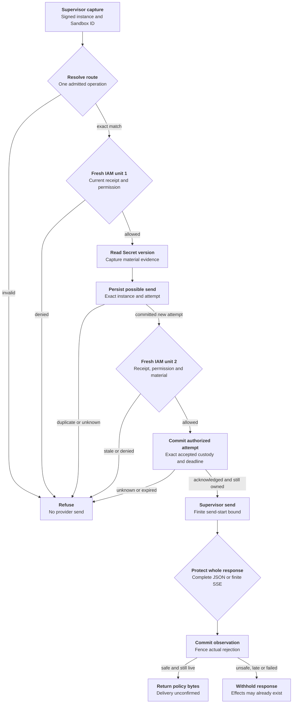

# Protected credential request flow

## Overview

OCC maps identity, checks current IAM policy, selects the
Secret version and sets response policy. Outside the Agent, the trusted OpenShell
supervisor resolves the static credential, obtains fresh permission to send, injects it
and submits the complete provider response for protection.

Only Kubernetes Compute can release a fresh protected execution, after signing its
startup challenge for the exact current installation. Production Credential Proxy
owns private response acceptance on the authenticated installation exchange. See
the [profile and release cutoff](../reference/credential-sources/protected-inference.md#execution-admission-cutoff)
and [supported configuration](../reference/credential-sources/protected-inference.md).
The bundled legacy supervisor is incompatible.

## Entry Points

- Trigger: an installed supervisor sends `HttpCredentialAccess.Resolve`, followed
  by `AuthorizeSend` and `HttpResponsePreReturn.Evaluate` over authenticated TLS.
- Source: `apps/controller/src/drivers/egress-proxy/openshell-authority.ts:createOpenShellEgressAuthority`
- Source: `packages/occ/src/index.ts:createCredentialProxy`
- Assumptions: source admission and Agent deployment produced an exact plan;
  a current verified loaded-enforcement receipt permits installation; the Agent is
  running; its service principal holds exact source `operate` permission.

## Flow

Wire fixtures exercise the required supervisor contract. Qualify the deployed
supervisor and no-bypass networking separately.

## Execution Trace

### 1. Admit source and install the revision plan

`packages/occ/src/index.ts:admitStaticEgressSource`,
`packages/occ/src/index.ts:admitProxyPlan`

New protected sources store a closed live/static descriptor after source/Secret
permission checks and candidate validation. Existing sources require explicit
source-update opt-in. For a new protected execution, OCC records version 3 admission
and the selected Driver ID, implementation and configuration digest in the plan.
Sandbox and Credential Proxy are separate interfaces of that one registered Driver.
The API checks the registration object itself. A worker loading the same installation
compares its durable reference. Neither check establishes that a Sandbox applied the plan.
The plan also freezes the execution, source generation, grant and routes. Empty routes mean deny all.

Version 2 remains readable with its original capability IDs. Only the bundled Driver
recognizes those historical protected plans, and only when releasing a stored revision
or settling its custody. New unprotected revisions retain version 2.

`packages/contracts/src/credential-proxy.ts:assertExecutionReleaseAllowed`,
`apps/controller/src/worker.ts:resolveRevisionSecretContext`

OCC calls Compute's validator before admitting the revision. The worker and Compute
check the admitted decision before launch. PostgreSQL refuses an unknown decision or a
mix of version 2 and version 3 fields. Older workers refuse the version 3 admission.
Upgrade all writers before admitting an execution that requires the new contract.
Qualification must exercise both release and installed deny-all behavior.

`apps/controller/src/drivers/compute/kubernetes/index.ts:prepareRevision`,
`apps/controller/src/drivers/egress-proxy/openshell.ts:attachmentStatus`

Compute passes Credential Proxy wiring to Sandbox provisioning.
`apps/controller/src/drivers/compute/kubernetes/index.ts:credentialSourceEnvironment`
requires protected admission, API-key login, an exact source-key match in the plan,
and no Gateway attachment. Protected sources receive no Gateway authentication
environment; Gateway-owned sources still require their exact attachment. The
Sandbox returns its complete prepared source policy from
`apps/controller/src/drivers/sandbox/openshell.ts:provisionHarness`.
The adapter compares the full source revision against that output and checks the
protected routes and middleware against the plan. It requires the authenticated
gateway's `LoadedPolicyObservationV1`, binding the unchanged source hash to the
effective policy and its nested enforcement evidence. Full policies must match
except for the exact name-only runtime rule allowed by the
[V1 contract](../reference/credential-sources/protected-inference.md#loaded-enforcement).
The evidence also binds Sandbox, current instance, policy version,
configuration/environment revisions and enforced capability. The immutable local
fingerprint includes both supplier hashes and both complete decoded policies.

`apps/controller/src/drivers/egress-proxy/openshell.ts:enforcementEvidence`

Installation and revalidation use the same V1 checks. Missing V1, widening or a
changed fence refuses; LOADED and legacy field 3 cannot substitute. The gateway
producer must compare full typed policies, including fields unknown to this
consumer, and fence reports and queries against current registration and effective
configuration. The local fingerprint does not compute a canonical supplier hash
or attest the supervisor. Request authorization still runs before Secret access
and before send.

`apps/controller/src/drivers/compute/egress-enrollment.ts:HARNESS_EGRESS_ENROLLMENT_HELPER`,
`apps/controller/src/drivers/sandbox/openshell.ts:enrollHarness`

Compute adds `OPENCLAW_EGRESS_ENROLLMENT_REVISION_ID` from the immutable admitted
revision only to protected provider Harness requirements. The generated helper
requires exact equality between this literal and the manifest's enrollment
execution revision before opening its authenticated listener on the existing
service port. Missing or mismatched values refuse. Compute's private status
revision, port, container name and Pod UID remain suppressed; the provider
receives the transport verifier, not the raw transport token.

The generated Harness waits on this listener before running the first model probe. Compute awaits the
installation commit, requeries current evidence and calls the selected Sandbox
Driver. The Driver checks the exact Sandbox and service, reads the execution/plan
challenge. Compute signs its fresh process nonce and current installation with a control-plane-only key.
The Harness closes that listener before starting Codex. Restart creates a new
challenge; a stale release cannot unlock the replacement. The 180-second wait
fails closed with a held startup failure. Reconciliation can repeat readiness
exchanges, but enrollment neither resolves material nor retries business requests.
The active-revision branch in `apps/controller/src/worker.ts:prepareRevision` can
repeat this sequence when work is queued. The default Kubernetes selection has no
periodic maintenance interval, so Harness-only restart recovery is not automatic;
see the [supported recovery boundary](../reference/credential-sources/protected-inference.md#installation-configuration).

### 2. Capture identity, operation and first authority decision

`apps/controller/src/drivers/egress-proxy/openshell-identity.ts:verify`,
`packages/occ/src/credential-proxy.ts:resolve`

The TLS adapter accepts one operation on `HttpInstallationExchange.Exchange`.
It authenticates the supervisor bearer before issuing a random 32-byte challenge
on that stream. Each authority allows at most 1,024 openings awaiting proof.
Accepting the signed opening, closing the stream, or reaching the 30-second
opening deadline releases that slot. `OpenShellEgressIdentity.acceptExchange`
rechecks the bearer, then verifies the gateway-signed `exchange_key` binding
and the supervisor's Ed25519 signature over the domain
`openshell-exchange-v1` plus a zero byte, challenge, and exact binary opening
request. Request JSON cannot introduce a key. Bearer-only legacy RPCs refuse.

The adapter binds a private capability to this stream and copies the decoded
request before asynchronous work. One owner verifies identity, captures origin
and holds the response. Before its first await, Credential Proxy checks body size
and capacity, reserves a slot and snapshots headers and body. Authorization and
response claims must match the captured peer, exchange and installation. Reusing
the bearer, key, request ID or handle on another stream cannot transfer custody.

Closing invalidates the capability and signals cancellation. Canceled or expired
handles drop their material reference immediately; pending policy or receipt work retains its
slot until settled. Closing an idle handle frees its slot. Pipelining is refused.

The Forwarder maps the captured peer to persisted installation state and
classifies one exact route through its registered provider. It reserves the
UUIDv7 request ID before asynchronous authorization. Its creation time fixes
the 30-second replay horizon; pending resolution and replay state are bounded.
Unsupported or ambiguous operations refuse before Secret access.

The required supplier enrollment starts at its authenticated current supervisor
hello, not at the first exchange. The supplier must keep the corresponding
private key outside the Agent and pin its actual downstream reply sink before
queueing. That complete supplier path is not yet qualified. The Driver requires
`openshell.supervisor-middleware.installation-exchange.v1`; old counterparts
cannot acquire this profile through an existing executable-restricted grant.

`packages/occ/src/index.ts:checkEgressUse`

Each check opens a fresh platform transaction. An enclosing controller transaction
is refused, so native IAM cannot reuse one policy snapshot for both checks. The
check verifies current Namespace/Agent state, admitted revision, installation,
source generation, withdrawal and exact Agent source permission. The existing
`credentialNamespace` mapping supplies Compute's runtime placement to the Driver;
IAM and audit retain logical Namespace identity. The Driver requeries current
policy-status evidence during each check and compares it with the stored fence.
Replacement, missing evidence or changed configuration refuses even when the saved
installation was once valid. Denials record phase and internal request attribution
without material.

### 3. Resolve versioned material and authorize its sole send

`apps/controller/src/drivers/secret/kubernetes/index.ts:readCredentialInput`,
`packages/occ/src/credential-proxy.ts:authorizeSend`

The selected Secret Driver verifies ownership and reads UID/resourceVersion from
the authoritative API. Static and prepared GitHub read ports receive one lifetime,
`{ signal, deadlineAt }`. The Kubernetes Secret reader carries that lifetime through
namespace verification, Secret GET and retries in one operation context. Within
that bounded read, child scopes inherit cancellation and the earliest absolute deadline.
Each HTTP dispatch rechecks that deadline even when the timer has not fired;
invalid deadlines fail closed. Per-attempt timeouts cannot extend the read lifetime.
GitHub acquisition validation, provider transport and metadata injection share
`apps/controller/src/drivers/repo/github/credentials/wire-credential.ts:isGitHubWireCredential`:
1–16,384 bytes of nonspace printable ASCII. This is a wire-format check, not authentication.

The registry retains material only for this bounded request. It returns credential
headers, an opaque handle and nonsecret material evidence to the authenticated supervisor.

`apps/controller/src/drivers/repo/github/credentials/prepared-lifecycle.ts:readWarm`
pins the committed attempt ID, material version and earlier of material expiry or
signed deadline. `apps/controller/src/drivers/repo/github/credentials/prepared-postgres.ts:store`
projects ciphertext only for that eligible row and issuer, checking `clock_timestamp()`
at projection. It rechecks expiry and cancellation immediately before decryption;
the outer reader still verifies identity and expiry. An expired or replaced selection
returns `not_ready` unless the signed deadline has elapsed. Bytes already projected
cannot be recalled. Background preparation has separate custody,
so rotation and cleanup can still handle material ineligible for requests.

Before send, `packages/occ/src/state/prepared-github-state.ts:postgresPreparedGitHubProof`
queries current material metadata on the active platform transaction, without another
checkout. The lifecycle supplies issuer/trust identity; shared metadata predicates and
exact evidence checks fence stale selections. The port exposes neither ciphertext
nor caller-supplied SQL. Statement and lock timeouts bound waits without relaxing
tighter caller limits. Successful SQL restores the original settings in the same
unit before cancellation and absolute expiry are rechecked; SQL errors leave rollback
to the transaction owner. OCC retains withdrawal, rejection and binding
checks in the same unit.

The authorization frame on that same stream must echo the original deadline, evidence and injection digest.
The registry reserves the handle, then uses
`packages/occ/src/egress-send-receipts.ts:EgressSendReceipts.begin` to commit
possible dispatch before permission. The key includes authenticated sender Ref,
instance, stable request/use ID and attempt ID; the binding includes exact
store-qualified material and original deadline. An existing attempt, failed write
or unknown commit refuses permission, including after an authority restart.

A separate fresh identity and policy check follows persistence and additionally
validates material identity and the durable rejection fence. The registry checks
cancellation, live handle ownership and deadline again after that check. The allowed permit
expires at the earliest request/material/identity bound and within one second.
`EgressSendReceipts.authorize` then atomically records the exact accepted execution,
installation fence, exchange, response and custody association, request and injection
digests, authorization time and bounded send-start time. This is a separate commit
from reservation. A receipt alone never grants permission. The trusted acceptance
owner must still own the same operation after commit; cancellation, lost handles,
expired bounds and unknown acknowledgments release no permit. The bound is never
recomputed after persistence. Restart cannot authorize the reserved attempt again.

Revocation can still race the subsequent send; the permit authorizes no retry.
An origin write followed by a lost reply remains a possible effect, never a reason
to repeat the business request.

### 4. Protect response and finish

`packages/occ/src/credential-proxy.ts:protectResponse`,
`apps/controller/src/drivers/egress-proxy/openai-provider.ts:protectedResponse`,
`apps/controller/src/drivers/egress-proxy/openai-responses-stream.ts:protectedResponsesStream`

The registry binds the complete response to the accepted peer, request and
exchange, then removes headers outside its allowlist. Nothing is streamed to the
caller before the decision. The original deadline bounds the first response byte;
`renewResponse` then keeps the permitted operation alive on supervisor progress
(five-minute idle horizon, fifteen-minute ceiling from creation, current policy
rechecked on renewal at most every 15 seconds, so withdrawal cuts the stream
within that window; an unavailable authority leaves the bound unchanged). The lease,
4 MiB and 16,384-event limits bound this check; an unsupported response is
refused, not approximated.

For Responses, inspect the text clients actually assemble: SDK output-part
snapshots; assistant text joined across parts, items or deltas; and Codex's
completed and streamed Plan views. Ambiguous indexes or parser order fail
closed. Check supported function arguments as bounded JSON, without recursively
decoding arbitrary strings. Safe responses keep their original bytes. This
[supported profile](../reference/credential-sources/protected-inference.md#static-source-and-response-policy)
protects named client views of one finite response, not secrecy from an origin
that already received the credential.

Only the accepted exchange can claim its response. The provider classifier
requires a structured 401 `invalid_api_key` / `invalid_request_error` error;
status alone does not fence material. `EgressSendReceipts.observe` commits the
safe response decision and exact rejection fence atomically before the adapter
replies. Blocked responses can still establish rejection. Receipts contain no
bodies, headers, material values or credential-bearing handles. Persistence
failure withholds bytes, and the deadline/cancellation check repeats after commit.

Returning bytes does not prove downstream delivery. Post-send outcomes remain
unsettled; recovery reads the exact attempt without retrying. Material is erased
after response handling or at deadline. A pre-permission refusal can settle as
undispatched; a possibly issued permission cannot.

### 5. Configure the regular Harness caller

`apps/controller/src/worker.ts:resolveRevisionSecretContext`,
`apps/controller/src/drivers/compute/plugin-runtime.ts:codexToml`

The worker obtains nonsecret endpoint configuration through the registered
provider's normalizer. The admitted inference grant disables provider tools in
protected Codex configuration while retaining local tools and ordinary Harness
components. HTTP Responses is selected with WebSockets and automatic request/stream
retries disabled. The runtime manifest preserves that profile; the generated
`--ignore-user-config` probe passes explicit zero request/stream retries and does
not repeat a protected probe after timeout. The provider-owned classifier
recognizes the bounded selected client payload; unknown operations fail before
credential access.

## Debugging and Verification

See the [static egress testing guide](../testing/static-egress.md) for commands
and prerequisites. Authority tests exercise API, IAM, controller and TLS paths;
PostgreSQL tests exercise persisted plans, currentness, installation and rejection.
Enrollment tests run the generated entrypoint and Sandbox Driver with a fixture
CLI, including the manifest and environment from `prepareRevision`.

These tests do not establish an installed model turn, response custody,
NetworkPolicy, chart or published-image compatibility. Verify those on the
selected installation, with independent observations at the origin and caller.

## Related docs

- [Credential source lifecycle](credential-source-lifecycle.md)
- [Protected static inference](../reference/credential-sources/protected-inference.md)
- [OpenShell Sandbox provisioning](openshell-sandbox-provisioning.md)
- [RFC 0023 proposal](../../specs/rfcs/0023-egress-proxy-credential-lifecycle/index.md)

## Manual Notes

None.

## Changelog

- 2026-10-16 22:49: Preserve Credential Proxy ownership when deriving Harness authentication environment. (authoring-run/bf50675b-2b74-4724-aeaf-8daecd2a5a29 - 6e302a4851b20191990bcb83d20b045a1462257a)

- 2026-10-16 02:06: Protect independent assistant items and bounded seeded runs, including citation and plan-mode projections. (authoring-run/68ecede6-d2bc-4d49-ae2c-c04150ccb307 - 3ed0e1cbd553b753e3f7d97b720cb7a43b6b5109)

- 2026-10-16 02:04: Bind prepared currentness proof to the active platform transaction in the accompanying implementation. (authoring-run/61a459b9-beed-4357-a96a-8483ab7cc2b9 - 3ed0e1cbd553b753e3f7d97b720cb7a43b6b5109)

- 2026-10-16 01:00: Protect incremental Responses SDK text snapshots and reject ambiguous appended indexes. (authoring-run/92d1c2e7-e68d-4684-b8d1-8bfa0ed99a09 - ed532ec5496e87da37c086cf71949f12a17250c9)

- 2026-10-16 00:27: Bound openings before proof and keep canceled operations charged until pending work settles. (authoring-run/3c418cc2-68fe-4c9a-a34e-9ecb83372b88 - 8df404d0635fa00e8d452cd0b846be3c68d3c4b0)

- 2026-10-15 20:14: Pin request ciphertext access to selected material and its expiry in the accompanying implementation. (authoring-run/a87e5b92-3e56-47e2-8112-82aa89ca28c4 - ab675985805a9d4a855f441a3ba91e836d42a532)

- 2026-10-15 19:23: Unify the read lifetime and exchange owner; detach one request snapshot before verification in the accompanying implementation. (authoring-run/b34da698-7e69-4c1d-a28c-238ed9c7d1d4 - adddcf2c0ce2429fb8fc7b9e503b01a74affdec8)

- 2026-10-15 04:08: Add acknowledged exact dispatch and the pending trusted acceptance integration gate. (authoring-run/77dbaecc-5f2b-4d7c-bd72-178b481d4feb - 0647e70303cd583ed64286f0ae11c1fa1896ac6a)
- 2026-10-15 04:09: Bind capture and response to a possession-authenticated exchange; refuse legacy peers and record the remaining supplier gate. (authoring-run/4ac4c430-12aa-4529-a02a-e1f26041eab4 - 0647e70303cd583ed64286f0ae11c1fa1896ac6a)
- 2026-10-15 04:06: Record the accompanying v2 admission cutoff and refusal before Compute release. (authoring-run/f0b2d2f6-37a8-4c41-b2e8-6c0c61ed8d5a - 0647e70303cd583ed64286f0ae11c1fa1896ac6a)

- 2026-10-14 21:54: Join durable sender receipts to the authority, separate response observations from supplier proof, and fence positive rejection atomically. (authoring-run/c11e8dcb-9e87-4682-b47e-e8640a65706d - fc20eb0174eaf8ae9d4ccb327ec65236c49ef4fb)

- 2026-10-14 21:15: Bind protected provider enrollment to a dedicated admitted-revision literal in the accompanying source fix. (authoring-run/a26c0140-0882-40ec-949d-c5fc6eecd0da - 765f1ef22aeba3e98c58a739700c9a0ffba14af4)

- 2026-10-14 14:11: Consume current instance-fenced evidence, finite replay identity and selected Responses HTTP/SSE profile. (01a13a97-c578-77a2-81a7-7366f1380110 - e42cb1674fadaf14ba3d61a4164d1ad3fde9935c)

- 2026-10-14 12:34: Document accompanying static egress implementation and its qualification limits. (authoring-run/fe204745-17c9-4662-82e0-e194d7c187cb - dc5648b67d2618cc43ef07562298e986a94674e7)
