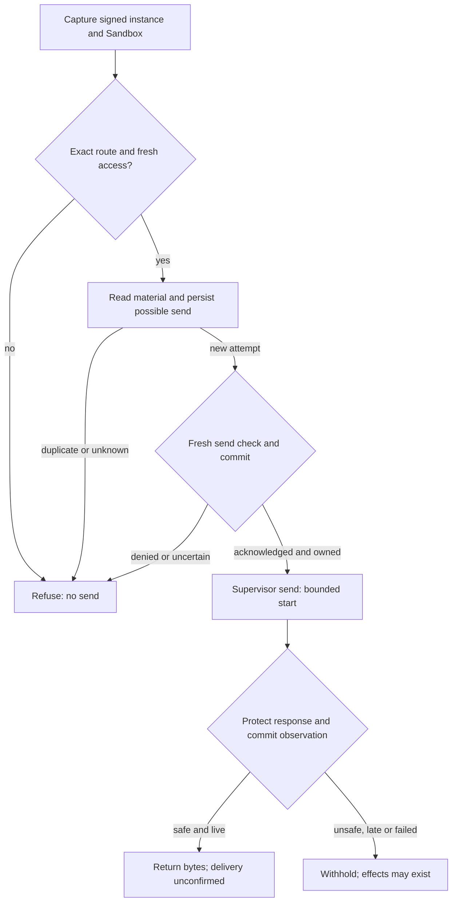

# Protected credential request flow

## Overview

OCC checks current identity and IAM policy, selects a Secret version and protects responses.
The selected Driver's authenticated OpenShell supervisor obtains send permission and
injects credentials outside the Agent; requests cannot change Drivers.

[Supported configuration](../reference/credential-sources/protected-inference.md)
excludes the bundled legacy supervisor.

[Protected repository Git](../reference/drivers/selection.md#select-a-protected-sender)
separately binds recipient observation, committed material and request authorization;
the Token Service issues, renews and retires material.

## Entry Points

- Trigger: an installed supervisor opens `HttpInstallationExchange.Exchange` over
  authenticated TLS to resolve, authorize and protect one request
  (`apps/controller/src/drivers/egress-proxy/openshell-authority.ts:createOpenShellEgressAuthority`).
- Assumptions: source admission and Agent deployment produced an exact plan; a current
  verified loaded-enforcement receipt permits installation; the running Agent's service
  principal holds exact source `operate` permission.

## Flow

Fixtures do not qualify deployed supervisors or no-bypass networking.

## Execution Trace

### Workspace PAT qualification boundary

`apps/controller/src/composition/driver-packages.ts:createExternalProtectedDriver`
wires verification for the reported PAT profile; stock senders do not advertise it.
`packages/occ/src/index.ts:admitStaticEgressSource` authorizes Secret UID/version access.
`apps/controller/src/drivers/egress-proxy/codex-workspace-identity.ts:bindVerifiedCodexWorkspaceSource`
checks the fixed HTTPS whoami audience with operator-owned trust; invalid TLS,
redirects, ambiguous JSON and FedRAMP identities refuse.

`egress.verifiedIdentity` stores scoped identity and material evidence without bearers.
Admission and release require current material and proof; requests cannot refresh identity.
Bound replacements need separate proof; unbound updates reverify.

`packages/occ/src/index.ts:checkEgressUseIn` checks the workspace grant before material
lookup and send. Bootstrap separates identity, accounts, policy and models from generation.
ChatGPT binds account headers. Identity and discovery bind workspace/backend;
catalogs retain admitted model.
Installed policy route: bodyless, queryless `GET /backend-api/wham/config/bundle`.
Require both lists. Reject responses over 64 KiB, ambiguous JSON/TOML or
credential reflection, including decoded TOML keys/strings (32 levels, 4,096 nodes).
Native enforces unchanged fragments. Empty lists, not errors, mean no policy.
Metadata permits `generic.developer_instructions`, empty MCP attribution and bounded reasoning efforts.

`packages/occ/src/index.ts:credentialSourceHarnessAuthSnapshot` records the exact owner:
`credentialProxyId` with nonsecret Namespace, source ID, provider generation, sender
and resolver, or `credentialGatewayId`. Save checks the provider grant against the
model and refuses missing workspace authority; no new input or Secret fallback exists.
`packages/occ/src/state/platform-state.ts:validHarnessAuthSnapshot` and SQL
`harness_auth_is_valid` enforce exclusive owner shapes. The worker re-resolves the
ready source. Compute checks `packages/contracts/src/harness-auth.ts:proxyHarnessAuthProvider`
against its paired Proxy before using the nonsecret PAT marker. Changed, absent or
ambiguous ownership refuses restoration or dispatch.

Integration tests do not qualify real accounts, installed enforcement or packaging.
Online Git cannot substitute for exact-dispatch admission.

### 1. Admit source and install the revision plan

Source/Secret authorization precedes admission; existing sources require opt-in.
Version 3 binds Sandbox and Proxy to one registered Driver by ID, implementation,
configuration digest, execution, source generation, grant and routes. Empty routes
deny all. The API checks registration, workers compare durable references, and
Sandbox enforcement needs separate evidence.

`packages/occ/src/index.ts:admitProxyPlan` rejects credential-free metadata grants
that differ from the source; property order does not change equivalent grant digests.
Mixed online Git/source routes require confirmed online authorization and authenticated
reduction v2 (v8); v5/v7 remain unchanged.
`apps/controller/src/drivers/compute/protected-execution-driver.ts` rechecks capabilities
before configuration and the installed recipient before release. Model exchange retains
its authenticated peer key; online Git uses pre-request authorization without an
exact-dispatch deadline. `packages/occ/src/credential-policy-reduction.ts` removes only
the selected route/binding and observes the original operation. Missing observation
keeps withdrawal pending; stale installation cannot expand policy.

Unprotected revisions remain v2. Only the bundled Driver recognizes historical
protected capability IDs for stored release/custody settlement. Compute and workers
recheck admission before launch. PostgreSQL rejects unknown decisions and mixed v2/v3
fields. Older workers refuse v3: upgrade writers first and qualify release/deny-all.

Missing Git delivery profiles fail in `admitProxyPlan` with 409
`REPOSITORY_GIT_PROFILE_UNSUPPORTED`. Bundled `git-write` fails with 409
`REPOSITORY_GIT_SENDER_UNQUALIFIED` in
`apps/controller/src/drivers/egress-proxy/openshell.ts:assertRepositoryGitProfileAvailable`;
preparation repeats both checks.

Compute wires Proxy to Sandbox provisioning. Protected sources require admission and exact source keys; protected workspace-token and API-key logins use nonsecret markers, not Gateway attachments.
Gateway sources require exact attachments. Egress compares complete prepared policies
and routes. Authenticated `LoadedPolicyObservationV1` binds source/effective policies,
Sandbox, instance, policy version, configuration/environment revisions and capabilities.
Installation/revalidation enforce the [V1 contract](../reference/credential-sources/protected-inference.md#loaded-enforcement)
and exact name-only exception. Missing evidence, widening, changed fences or legacy
observations refuse. Gateway comparison includes unknown fields. Local fingerprints
cover both hashes and full policies, without supplier-hash or attestation status.

Only protected Harness requirements get immutable `OPENCLAW_EGRESS_ENROLLMENT_REVISION_ID`
from Compute. Before opening its authenticated listener on the existing service port,
the helper requires it to equal the enrollment execution revision.
Compute withholds private status revision, port, container name and Pod UID;
providers receive a transport verifier, never the raw token.

Harness awaits enrollment before probing. After installation commit, Compute requeries
evidence and asks the selected Sandbox to check the exact Sandbox/service and
execution/plan challenge. Compute signs a fresh process nonce and installation
with a control-plane-only key. The listener closes before Codex starts; restart
invalidates stale releases. Startup stays held after 180 seconds. Enrollment neither
resolves material nor retries business requests. Reconciliation can repeat readiness
exchanges, including queued active-revision work. Kubernetes has no periodic
maintenance by default: Harness-only restart recovery is [not automatic](../reference/credential-sources/protected-inference.md#installation-configuration).

### 2. Capture identity, operation and first authority decision

Each authenticated TLS stream carries one `HttpInstallationExchange.Exchange`.
Up to 1,024 openings hold a 32-byte challenge until acceptance, closure or 30 seconds. The owner rechecks the bearer, gateway-signed `exchange_key`
and supervisor Ed25519 signature over `openshell-exchange-v1`, zero byte, challenge
and binary opening. Openings cannot supply keys; bearer-only RPCs refuse.

The adapter binds stream custody, snapshots the request before awaiting and joins the
signed path and raw query verbatim; misplaced delimiters, fragments and malformed escapes refuse. Workspace catalog discovery requires exactly
`GET https://chatgpt.com/backend-api/codex/models?client_version=0.163.0`.
Proxy bounds and snapshots bodies/headers and reserves auth slots; OCC copies peer
descriptors. Resolution, send and response lookup require an unexpired peer.
Send/response require the captured sender, Sandbox, instance, exchange, installation
and optional peer key. Changed keys refuse; bearers/handles cannot transfer custody.
Closure cancels; cancellation/expiry releases material, but pending policy/receipt
work retains its slot. No pipelining.

`packages/occ/src/credential-proxy.ts:resolve` assigns the verified Sandbox's slot share,
maps persisted installation state and classifies one exact provider route. Before
capture/policy I/O it reserves UUIDv7 identity with a 30-second creation-based replay horizon. [Slots/IDs are bounded](../reference/drivers/credential-proxy.md#request-time-capacity);
unsupported/ambiguous operations refuse before reservation.

Supplier enrollment requires the current authenticated supervisor hello, outside-Agent
private key and pinned downstream reply sink before queueing; this path remains unqualified. `openshell.supervisor-middleware.installation-exchange.v1` is required;
older executable-restricted grants cannot acquire it.

Each check uses a fresh transaction, refuses enclosing IAM snapshots, and verifies Namespace/Agent
state, revision, installation, source generation, withdrawal and exact Agent source permission. `credentialNamespace` supplies runtime placement; IAM/audit
retain logical Namespace identity. The Driver requeries policy-status evidence against
the fence; replacement, missing evidence or changed configuration refuses. Denials
record phase/request attribution without material.

### 3. Resolve versioned material and authorize its sole send

The Secret Driver verifies ownership and authoritative UID/resourceVersion. Static
and prepared GitHub reads propagate `{ signal, deadlineAt }` through namespace checks,
GET, retries and children. Dispatch checks the earliest deadline; invalid deadlines
refuse and timeouts cannot extend them. GitHub acquisition, transport and injection
require 1–16,384 nonspace printable ASCII bytes; this does not authenticate them.

`apps/controller/src/drivers/repo/github/credentials/prepared-lifecycle.ts:readWarm`
pins committed attempt, material version and earliest material/signed expiry. After `clock_timestamp()` checks, the store
projects only eligible row/issuer ciphertext.
Decryption rechecks cancellation/expiry; the outer reader rechecks identity/expiry.
Replaced/expired selections return `not_ready` unless the signed deadline elapsed.
Projected bytes cannot be recalled; background custody permits rotation/cleanup.
The supervisor receives request-scoped headers, an opaque handle and nonsecret evidence.

`packages/occ/src/state/prepared-github-state.ts:postgresPreparedGitHubProof` checks
current metadata, issuer/trust and exact evidence in the platform transaction,
without another checkout, ciphertext or caller SQL. Statement/lock timeouts honor
tighter caller limits. Success restores settings before cancellation/expiry checks;
errors require owner rollback. OCC checks withdrawal, rejection and binding there.

Same-stream authorization echoes deadline, evidence, injection digest. Handle
reservation precedes `packages/occ/src/egress-send-receipts.ts:EgressSendReceipts.begin`:
possible dispatch commits before permission, keyed by sender Ref, instance, request/use
and attempt, bound to store-qualified material and deadline. Duplicate, failed or
unknown commits refuse, including after restart.

Sender/OCC bind Sandbox, instance, configuration, peer key, policy hash, authority
and plan; Git has separate recipient evidence. After fresh identity/policy/material/
rejection checks, `EgressSendReceipts.authorize` commits execution, installation fence,
exchange, custody, request/injection digests, authorization time and send deadline:
at most one second, capped by request/material/identity expiry.

Return rechecks cancellation, ownership and persisted deadlines.
Lost acknowledgment/handle/deadline refuses; restart cannot reauthorize. Revocation
can race authorized sends.

### 4. Protect response and finish

`packages/occ/src/credential-proxy.ts:protectResponse` binds the complete response to its peer, request and exchange, removes
unlisted headers and releases no bytes before the decision. The request deadline bounds
the first byte. On progress, `renewResponse` rechecks policy at most every 15 seconds;
withdrawal cuts the stream within that window, and unavailable authority cannot extend
the lease. A shorter authenticated peer lifetime caps cached leases and held responses;
later progress cannot extend it.
Limits: five minutes idle, fifteen minutes total, 4 MiB and 16,384 events.

For Responses, check client-assembled SDK output-part snapshots, assistant text across
parts, items or deltas, and Codex's completed and streamed Plan views. Reject ambiguous
order or indexes. Inspect function arguments as bounded JSON without recursively
decoding strings. The
[supported profile](../reference/credential-sources/protected-inference.md#static-source-and-response-policy)
preserves safe response bytes. The origin has already received the credential.

Only this exchange can claim the response. `EgressSendReceipts.observe` atomically records
the decision and any exact rejection fence without bodies, headers, credentials or handles.
Failure withholds bytes; success rechecks cancellation and deadline.

Structured OpenAI `invalid_api_key`, unlike a bare 401, can establish rejection. At
its next scheduled check, the prepared owner excludes that version.
Concurrent owners coalesce replacement; uncertain issuance blocks it; late feedback
cannot invalidate its successor. GitHub metadata has no positive rejection classifier.

Erase material after response handling or at deadline. Only pre-permission refusal can settle as undispatched. After possible permission, effects may exist:
inspect the exact attempt without retrying; returned bytes do not prove delivery.

### 5. Configure the regular Harness caller

The provider normalizes the nonsecret endpoint and classifies requests before credential access. `apps/controller/src/drivers/compute/plugin-runtime.ts:codexToml` keeps local tools and ordinary Harness components,
disables provider tools, and uses HTTP Responses without WebSockets or automatic retries.
The manifest preserves this profile. The `--ignore-user-config` probe disables request/stream retries, including after timeout.

### 6. Reduce the live credential policy

OCC commits withdrawal before provider action. Under the Agent lock,
`packages/occ/src/credential-policy-reduction.ts:reduceCredentialPolicy` records an
exact source/repository compare-and-reduce request in `credential_delivery_reductions`.
Concurrent reductions wait; recovery observes the operation without another capability
probe or mutation. The reductions owner manages material-delivery receipts in the same
store with separately constrained evidence shapes.

Declared reduction v2 covers exact-dispatch Git and online v8. Online v5 and observed-hook
v6 retain their semantics. Ordinary v3 uses v1 only when the Driver declares it; v2 alone
does not authorize v1 or multiple static sources.

Independent observation supplies current policy from the exact operation, stable recipient
and retained plan without changing the original installation receipt.
`apps/controller/src/drivers/repo/github/credentials/prepared-repository-git.ts:recipients`
compares the registered sender's observation with the exact confirmed effective installation. Model-source reduction must preserve the original Git grant and all
stable execution/recipient fields. It returns the original Git delivery fence without
reinstalling material or changing admission. Arbitrary subsets, stale policies and
replacement recipients fail. Fresh Git requests require current Token Service
approval, session, deadline and material-version checks.

Missing identity, stale operations, incomplete configuration or wrong policy evidence
keeps withdrawal pending; an identified replacement recipient can require retirement.
Remaining grants stay unchanged; removing the last route leaves deny-all. Settlement
cannot reopen withdrawn authorization; the Driver blocks stale installation from
restoring routes. Reference-peer proof does not qualify released Sandboxes or continued
model execution.

### 7. Retain installation custody

`packages/occ/src/state/credential-deliveries.ts:CredentialDeliveries` fixes settlement
policy: independent confirmation for registered recipients; the original reserving
worker for snapshots, including bootstrap. Reservations advance the operation fence; confirmation grants no request authority. PostgreSQL keeps the full
recipient target and rejects a second binding for the same revision and target. Its hash
index rechecks JSONB equality, even when admission policy exceeds a B-tree entry.

`apps/controller/src/drivers/egress-proxy/openshell-git-runtime.ts:reconcile`
cancels only definitely unsent writes. Uncertain writes stay pending and blocked.
`release` drops closed routes whose Sandbox is gone; refusal stays.
See [restart behavior](../reference/repository-credentials/protected-openshell-git.md#route-state-restarts-and-recovery).

Creation requires the exact live owner; deletion retains custody but prevents use. `apps/controller/src/drivers/egress-proxy/openshell-git-route-store.ts:confirmDetached`
checks the retained fence, recipient, material, policy and request without another apply.

## Debugging and Verification

Use the [testing guide](../testing/static-egress.md) to qualify model execution,
response custody and NetworkPolicy with the selected chart/image. Observe origin and caller independently.

## Related docs

- [Credential source lifecycle](credential-source-lifecycle.md)
- [Protected static inference](../reference/credential-sources/protected-inference.md)
- [OpenShell Sandbox provisioning](openshell-sandbox-provisioning.md)
- [RFC 0023 proposal](../../specs/rfcs/0023-egress-proxy-credential-lifecycle/index.md)

## Manual Notes

None.

## Changelog

- 2026-10-24 12:54: Document exact target matching for large registered delivery policies. (authoring-run/ded21924-0d2a-4f83-9299-1926d35ceb01 - 692c5e6e8afeebf831a1c9feb1917f0f2aafc3b9)

- 2026-10-24 11:09: Preserve signed catalog queries. (authoring-run/adac7683-9281-441d-a539-a422c7b66bce - b9ff83995cc1b2dc03a6de4c8172cc20167c51c9)

- 2026-10-24 07:10: Bind workspace credentials to their admitted sender and retain Git access after confirmed model withdrawal. (authoring-run/f0f87daa-3c51-4559-b105-23c8c3d6084b - 5ad11ff5e27b16d83e0560d8ca35f1233d48d2af)

- 2026-10-23 20:14: Preserve exact Proxy ownership through Harness admission, persistence and dispatch. (authoring-run/e93bd191-284b-4701-929c-85a5d446c694 - ef61a85efa8f9a819986a072efb50ca91deca607)

- 2026-10-23 19:40: Record the workspace PAT policy and remaining qualification gates in the accompanying change. (authoring-run/46d0701b-da16-43b1-8c7e-2510a4dd1475 - c250d521a59cb7d1e8be85bf02a112062e5ab259)

- 2026-10-22 23:30: Refuse unqualified OpenShell Git senders early. (fix-2199 - b4a8157be)

- 2026-10-22 05:35: Pin peer identity and original authentication expiry throughout the exchange in the accompanying correction. (authoring-run/009b70d4-eb48-4ea6-97f0-25b0395d1e1a - d87db85f74052e9ff819920acd820880e7a6a8af)

- 2026-10-22 05:21: Preserve the metadata grant digest for equivalent Driver output. (authoring-run/aabacbf5-998a-479d-8903-9f891cd69066 - 1435acf226b887a2cd85b7515b302914605beaef)

- 2026-10-22 05:16: Bind exchange identity independently of Git delivery evidence. (authoring-run/601b0e1c-ade5-431c-aa48-1c6775df430a - d5c0a95fc970e8a63f40746ad2e55ac5216580e0)

- 2026-10-22: Streamline flow; preserve authority and recovery boundaries.

- 2026-10-22 04:16: Enforce delivery settlement policy, operation fences and retained detach confirmation in the accompanying changes. (authoring-run/bcd1284f-0d04-4fc7-92e1-b4d5ac1eeb7f - 1544403a30a747898deaf3cf0935094b7812390d)

- 2026-10-22 01:51: Describe final withdrawal and delivery custody in the accompanying schema consolidation. (authoring-run/c692ffd7-9ade-4cb3-80b7-cd02340e0537 - fe6b0002a5bf41e6e418df9848337b285ce53199)

- 2026-10-21 23:40: Describe versioned policy reduction, durable operation recovery and the reference-peer proof boundary in the accompanying change. (authoring-run/3e4e8e77-728c-435a-90e9-fe6c9758551c - d8a5a9c77963836fbe54f1dc28f2f8a0c01c5622)

- 2026-10-21 22:39: Explain conditional recovery of rejected prepared material and its classification limit in the accompanying change. (authoring-run/8ffbb140-b3c1-48de-ac47-8e2450bae002 - df297cd59e8de130e9eb0599e67f47fa6d85079e)

- 2026-10-16 22:49: Preserve Credential Proxy ownership when deriving Harness authentication environment. (authoring-run/bf50675b-2b74-4724-aeaf-8daecd2a5a29 - 6e302a4851b20191990bcb83d20b045a1462257a)

- 2026-10-16 02:06: Protect independent assistant items and bounded seeded runs, including citation and plan-mode projections. (authoring-run/68ecede6-d2bc-4d49-ae2c-c04150ccb307 - 3ed0e1cbd553b753e3f7d97b720cb7a43b6b5109)

- 2026-10-16 02:04: Bind prepared currentness proof to the active platform transaction in the accompanying implementation. (authoring-run/61a459b9-beed-4357-a96a-8483ab7cc2b9 - 3ed0e1cbd553b753e3f7d97b720cb7a43b6b5109)

- 2026-10-16 01:00: Protect incremental Responses SDK text snapshots and reject ambiguous appended indexes. (authoring-run/92d1c2e7-e68d-4684-b8d1-8bfa0ed99a09 - ed532ec5496e87da37c086cf71949f12a17250c9)

- 2026-10-16 00:27: Bound openings before proof and keep canceled operations charged until pending work settles. (authoring-run/3c418cc2-68fe-4c9a-a34e-9ecb83372b88 - 8df404d0635fa00e8d452cd0b846be3c68d3c4b0)

- 2026-10-15 20:14: Pin request ciphertext access to selected material and its expiry in the accompanying implementation. (authoring-run/a87e5b92-3e56-47e2-8112-82aa89ca28c4 - ab675985805a9d4a855f441a3ba91e836d42a532)

- 2026-10-15 19:23: Unify the read lifetime and exchange owner; detach one request snapshot before verification in the accompanying implementation. (authoring-run/b34da698-7e69-4c1d-a28c-238ed9c7d1d4 - adddcf2c0ce2429fb8fc7b9e503b01a74affdec8)

- 2026-10-15 04:08: Add acknowledged exact dispatch and the pending trusted acceptance integration gate. (authoring-run/77dbaecc-5f2b-4d7c-bd72-178b481d4feb - 0647e70303cd583ed64286f0ae11c1fa1896ac6a)
- 2026-10-15 04:09: Bind capture and response to a possession-authenticated exchange; refuse legacy peers and record the remaining supplier gate. (authoring-run/4ac4c430-12aa-4529-a02a-e1f26041eab4 - 0647e70303cd583ed64286f0ae11c1fa1896ac6a)
- 2026-10-15 04:06: Record the accompanying v2 admission cutoff and refusal before Compute release. (authoring-run/f0b2d2f6-37a8-4c41-b2e8-6c0c61ed8d5a - 0647e70303cd583ed64286f0ae11c1fa1896ac6a)

- 2026-10-14 21:54: Join durable sender receipts to the authority, separate response observations from supplier proof, and fence positive rejection atomically. (authoring-run/c11e8dcb-9e87-4682-b47e-e8640a65706d - fc20eb0174eaf8ae9d4ccb327ec65236c49ef4fb)

- 2026-10-14 21:15: Bind protected provider enrollment to a dedicated admitted-revision literal in the accompanying source fix. (authoring-run/a26c0140-0882-40ec-949d-c5fc6eecd0da - 765f1ef22aeba3e98c58a739700c9a0ffba14af4)

- 2026-10-14 14:11: Consume current instance-fenced evidence, finite replay identity and selected Responses HTTP/SSE profile. (01a13a97-c578-77a2-81a7-7366f1380110 - e42cb1674fadaf14ba3d61a4164d1ad3fde9935c)

- 2026-10-14 12:34: Document accompanying static egress implementation and its qualification limits. (authoring-run/fe204745-17c9-4662-82e0-e194d7c187cb - dc5648b67d2618cc43ef07562298e986a94674e7)
