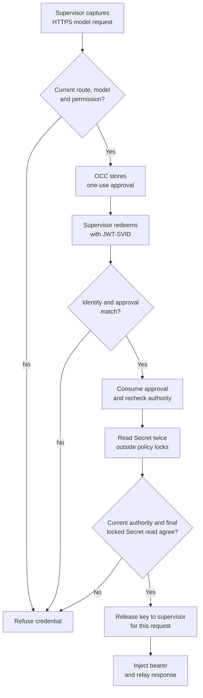

# Authorize model credentials per request

## Overview

A dedicated Codex Agent receives a placeholder instead of an OpenAI key.
For each admitted HTTPS Responses request, the OpenShell supervisor obtains
one approval from OpenClaw Control Plane (OCC), redeems it once, and injects the
current key outside the guest. This flow describes the implementation; it does
not establish qualification of an installed OpenShell and Codex pair.
The [Driver contract](../../reference/drivers/credential-proxy.md#online-model-requests)
defines the guarantee. Existing strict exchanges retain their
[separate flow](../credential-source-egress.md).

## Entry Points

- `packages/occ/src/index.ts:createCredentialSource` selects an explicitly
  requested `authorization: "online-request"` provider after source and Secret
  permission checks. With Proxy selected, eligible static sources default to strict admission.
- `packages/occ/src/index.ts:admitProxyPlan` records the selected profile, source,
  grant and execution. The operator and Agent need source `operate` permission.
- `apps/controller/src/drivers/egress-proxy/openshell-request-credential.ts:authorizeOpenShellRequest`
  handles the authenticated supervisor's pre-credential request.

## Flow

The diagram ends at the supervisor relay. This profile does not hold the full
response for OCC inspection or authorize an exact upstream dispatch.

## Execution Trace

### 1. Save and install the explicit profile

`packages/occ/src/index.ts:staticEgressProvider` selects by source type and
requested authorization profile. Updates retain the exact provider ID and
generation. The bundled adapter registers `openai-online-request`, generation 1,
separately from the strict provider. `admitProxyPlan` rejects mixed profiles and
records `authorization: "online-request"`. Admission version 8 covers the model
route; version 9 also requires independently authorized mandatory Git delivery.
`packages/contracts/src/drivers/credential-proxy/index.ts:assertExecutionAdmission`
refuses policy reduction for this profile. Binding removal may stop or redeploy
the execution through the existing lifecycle.

`apps/controller/src/drivers/sandbox/openshell-model-request-policy.ts:openShellModelRequestPolicy`
requires one dedicated Codex route at `/v1/responses`. It creates a provider with
no stored key, no credential environment mapping and an explicit zero-cache token
grant. The guest receives a placeholder. The existing Gateway source owner
remains metadata; it receives no model-key copy or attachment for this path.

`verifyModelRequestProfile` and `verifyModelRequestPolicy` in that file check the
provider, token endpoint, audience, mandatory middleware and actual admitted
policy. Overlapping model routes and a missing required hook refuse release.
Git has its own provider and disjoint route. Compute releases the Harness only
after current installation checks. Codex uses the existing custom Responses
provider with WebSockets disabled; an API-key selection alone does not establish
that transport.

`apps/controller/src/drivers/egress-proxy/openshell.ts:loadedPolicy` combines
independent worker-side Git verification with model installation evidence. The
persisted `enforcement.requestConfigurationId` records a hash of the observed
Sandbox admission, model provider/profile, full effective policy and process
identity. Only the top-level `provider_env_revision` is excluded from admission
and configuration hashing: it is an aggregate material/profile digest across
providers. This avoids invalidating the witness for normal Git material rotation. All remaining fields, including configuration and
process identities, stay in the hash. It is opaque to core and contains no Git
credential material.

### 2. Approve the captured request

`openshell-request-credential.ts:authorizeOpenShellRequest` authenticates the
Gateway-signed supervisor identity, reads the installed binding, and passes the
captured method, target, headers and body to OCC. Malformed binding configuration
is denied. `packages/occ/src/index.ts:checkRequestCredential` verifies the current
recipient, installation, revision, source, route, provider and IAM permission,
then classifies the actual request against the admitted model grant. It calls
`requestTimeCredentials.verifyRequestInstallation` with the persisted installation
and authenticated recipient. The bundled
`apps/controller/src/drivers/egress-proxy/openshell.ts:verifyRequestInstallation`
reobserves the request configuration and compares its hash with the stored
`requestConfigurationId`. Every observation first requires matching current
admission/configuration metadata, including `provider_env_revision`. Changes
confined to that aggregate epoch can preserve this witness; a mixed observation
cannot. Model provider/profile and full policy changes remain checked. Missing or changed retained evidence refuses. The API does not recompute
worker-owned Git custody state.

OCC stores a nonsecret approval in PostgreSQL, correlated with recipient,
request ID, binding, execution, Driver, policy digest and deadline. It stores no
request body or key. Redemption lasts at most 30 seconds; approval alone does
not permit release after withdrawal. The verified adapter supplies a separate
`replayUntilAt`, at least the redemption deadline and at most one hour from
admission. OpenShell uses the authenticated extension identity's expiry.
`packages/occ/src/state/request-credential-approvals.ts` retains consumed or
expired approvals until that horizon, so redemption expiry cannot permit
reapproval of the same recipient/request ID. Its global and per-recipient ID
quotas are durable and shared across API replicas. Admission requires PostgreSQL
READ COMMITTED isolation so quota counts observe preceding holders of the
transaction lock; other isolation levels deny admission. Strict exchange ID maps
remain per process.

### 3. Redeem once against current authority

`apps/controller/src/drivers/egress-proxy/openshell-token-grant.ts:bindOpenShellTokenGrant`
independently verifies a SPIFFE JWT-SVID against the configured trust bundle and
exact token-endpoint audience, accepting only keys marked `use: "jwt-svid"`.
Its subject identifies the Sandbox. Request ID and
binding are separately correlated protocol fields, not signed SVID claims.
The supervisor's Workload API socket and registration must be inaccessible to
the guest; a guest able to mint the same SVID could redeem an approval itself.

`openshell-authority.ts` and `openshell-token-grant.ts` acquire the same
per-process authentication budget before gRPC identity verification or HTTPS
body, bundle and JWT processing. They release that lease before resolver
admission, which charges its own operation and verified-recipient share.
These are process-local operation limits, separate from durable approval quotas.

`packages/occ/src/credential-proxy.ts:resolveRequestCredential` consumes the
approval once and rechecks authority. Two authoritative Secret reads outside
policy locks must agree on version, material identity and value. After material
validation and fresh recipient/policy checks,
`packages/occ/src/index.ts:checkRequestCredential` performs a final bounded
Secret read under the Namespace lock also held by OCC `updateSecret`. Release
is selected there only if the source snapshot and all three observations agree.
An OCC rotation committed before that decision therefore rejects the old
selection. Direct external Secret writes share no OCC lock: they are observed
only through the final read, not serialized with release.

Expiry, withdrawal, cancellation, stale installation and ambiguous outcomes
fail closed; a consumed approval is not retried. If the final read ignores
cancellation, abort releases policy locks while its operation slot remains
charged until the read settles.

The token endpoint returns a short release lease with `Cache-Control: no-store`.
Its `expires_in` does not describe the provider key's lifetime. OpenShell must
retain `cache_ttl: 0`, inject the bearer outside the guest, and request a new
approval for the next operation. Rotation or withdrawal after the final release
cannot recall material already released. Such a request may finish, including
its streamed response.

## Debugging and Verification

Inspect the selected source's provider ID/generation and the saved revision's
profile before diagnosing transport. A ready source is not proof of installed
enforcement. Middleware refusal reports `request_credential_denied`; token
redemption can return `invalid_client` or `invalid_grant`. Do not log assertions
or response material while collecting these errors.

Follow the [operator checks](../../guides/credential-proxy/model-requests.md#verify-the-installed-path).
Local source and controlled-origin proof do not replace an installed test of
separate API and worker processes, actual Codex HTTPS/SSE traffic, isolated
supervisor identity, required middleware,
zero-cache grants, source withdrawal and absence of a direct route. Revoke the
model source's IAM grant and verify that model requests cannot reach their origin
while authorized Git remains usable. Separately, remove Git
[standing approval](../../guides/repository-credentials.md#keep-git-access-on-the-same-running-agent)
with its current generation and verify that fresh Git requests do not reach
the origin. Version 9 may retire the entire runtime on Git removal; record that
outcome instead of claiming continued inference. These checks do not establish
continuity during binding removal.

## Related docs

- [Credential Proxy contract](../../reference/drivers/credential-proxy.md)
- [Threat model](../../reference/security/credential-proxy.md)
- [Model request setup](../../guides/credential-proxy/model-requests.md)
- [Source withdrawal](../../reference/credential-sources/withdrawal.md)

## Manual Notes

None.

## Changelog

- 2026-11-10 03:19: Trace the final rotation fence, authenticated replay retention and separate operation/approval budgets. (authoring-run/a802f6ce-4398-4469-a79b-cc18fe9219a9 - 072bdbf9c66b0b67008e1ec4859b3f0e02f1d3ee)

- 2026-11-10 03:14: Exclude only the shared material epoch from the persisted request witness while retaining current-observation agreement. (authoring-run/a802f6ce-4398-4469-a79b-cc18fe9219a9 - 072bdbf9c66b0b67008e1ec4859b3f0e02f1d3ee)

- 2026-11-10 03:09: Trace persisted request installation evidence separately from worker-owned Git custody. (authoring-run/a802f6ce-4398-4469-a79b-cc18fe9219a9 - 072bdbf9c66b0b67008e1ec4859b3f0e02f1d3ee)

- 2026-11-10 02:57: Distinguish model IAM denial, Repo authority and binding-removal lifecycle. (authoring-run/a802f6ce-4398-4469-a79b-cc18fe9219a9 - a6ebd816924d1669911a07e09ecdebc3d8b3176e)

- 2026-11-10 02:54: Trace explicit model approval and single-use credential release in the accompanying implementation. (authoring-run/a802f6ce-4398-4469-a79b-cc18fe9219a9 - a6ebd816924d1669911a07e09ecdebc3d8b3176e)
