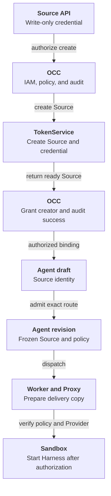

# Credential source lifecycle flow

## Overview

OpenClaw Control Plane (OCC) authorizes Source operations and governs IAM, Agent bindings, policy, and audit. The selected TokenService creates and owns [managed static Sources](token-service-static-custody.md), including their metadata and credentials. A caller supplies the credential through write-only Source registration. OCC admits the reviewed managed model route, and Worker prepares it through the selected Sandbox and Credential Proxy. The native Proxy observes delivery readiness; full runtime qualification remains pending.

## Entry Points

- Trigger: CredentialSource create, update, or delete; Agent draft binding or deployment.
- Source: `apps/controller/src/http/credential-sources.ts:createCredentialSource`
- Source: `packages/occ/src/managed-credential-sources.ts:createManagedCredentialSource`
- Source: `packages/occ/src/agent-credential-access.ts:authorizeAgentCredentialSources`
- Context: a ready Namespace, selected owner Driver, and grants for the exact source operation.

## Flow

A prepared revision does not prove a successful runtime request.

## Execution Trace

### 1. Register a source

`apps/controller/src/http/credential-sources.ts:createCredentialSource`, `packages/occ/src/managed-credential-sources.ts:createManagedCredentialSource`

The caller sends the credential in the write-only `secret` field of Source POST. OCC authorizes `credential_source:create` on the ready Namespace, validates approved destination policy, and records the request audit. It calls `TokenServiceDriver.createSource`; TokenService assigns the ID, creates the canonical Source and credential, and returns the ready Source. TokenService commits independently; OCC grants the creator access and records success in a separate transaction. Responses contain sanitized metadata and never return the credential.

A failure can leave orphaned credential material or a committed Source without its creator IAM grant. OCC reports failure and retains the request audit; the current private Secret store does not provide orphan inventory. See the [managed static reference](../reference/credential-sources/managed-static.md) for inputs and the [custody flow](token-service-static-custody.md) for execution.

The deprecated `CredentialGatewayDriver` and transitional protected Source forms are deferred to separate cutovers.

### 2. Update a source

`packages/occ/src/credential-source-operations.ts:credentialSourceUpdateIdentity`, `packages/occ/src/managed-credential-sources.ts:updateManagedCredentialSource`

OCC authorizes exact `credential_source:update` and dispatches PATCH by the locked Source owner. For a managed static Source, TokenService replaces material from the write-only `secret` field; omitted fields retain their values. A provider-preset change or removal requires an unbound Source and a separate request from credential replacement. Credential replacement is allowed while an active staged Agent revision uses the Source. OCC commits policy-only changes itself; credential updates go through TokenService in its own transaction before OCC records completion. See the [managed static reference](../reference/credential-sources/managed-static.md) for PATCH rules.

#### Deliver Source updates

`apps/controller/src/composition/token-service.ts:installTokenServiceDriver`, `apps/controller/src/drivers/credential-proxy/openshell.ts:bindSourceNamespaceResolver`, `apps/controller/src/drivers/credential-proxy/openshell.ts:notifyCredentialUpdated`, `apps/controller/src/drivers/credential-proxy/openshell-pushed-provider.ts:updateOccTokenServiceProviderCopy`

During API TokenService installation, composition binds the validated Credential Proxy to TokenService and supplies the native Proxy with a trusted Namespace resolver. Worker installs TokenService for Source resolution and does not bind the native Proxy’s Source placement resolver. The resolver verifies that this exact Proxy remains selected, reads the ready Namespace from state, asks the selected Compute for the Sandbox placement, checks cancellation, and verifies the placed Namespace ID and status. After committing replacement material, TokenService notifies the Proxy with the Source reference and version, plus a lazy resolver bound to that Source and TokenService instance. If no Provider exists, the Proxy returns without resolving material or creating one. Otherwise it resolves the authoritative credential and Source version and sends both through OpenShell `UpdateProvider`, conditional on the Provider resource version. Attached running Sandboxes are eligible; the Provider profile retains `stable_placeholder`.

The Gateway returns the affected targets in update receipts. The Proxy validates each receipt and confirms its target. For an activated target, it waits while receipt status is `PROVIDER_READINESS_STATE_PENDING` or `PROVIDER_READINESS_STATE_PERSISTED`, using the caller's operation signal. When status becomes `PROVIDER_READINESS_STATE_READY`, the Proxy fetches the target's current configuration admission and checks serving evidence before acknowledging delivery. An explicitly never-activated target needs no serving check. The wait does not send another `UpdateProvider` request or retry delivery.

If delivery fails, the new credential remains in TokenService custody. OCC records the committed Source update and the delivery failure as separate audit outcomes, and PATCH returns `503 DEPENDENCY_UNAVAILABLE`. Authorized explicit retry and live rotation proof remain separate work.

### 3. Bind and admit an Agent revision

`packages/occ/src/harness-auth.ts:authorizeHarnessAuthSource`

OCC requires exact `credential_source:operate` for a new binding to a ready Source in the same Namespace. A caller can remove an obsolete binding without looking up its Source. Under the Source lock, admission matches the selected TokenService instance, approved provider preset, model destination, and one unambiguous network grant. It freezes the Source reference, delivery Driver, and separate network and injection policies in a v8 revision. An unsupported route or active staged replacement returns `409` before creating work. PostgreSQL records references and prevents deletion while the Source is bound.

### 4. Resolve the source at dispatch

`apps/controller/src/composition/installation-config.ts:composeInstallationConfiguration`, `apps/controller/src/drivers/credential-proxy/openshell.ts:OpenShellCredentialProxyDriver`, `apps/controller/src/worker.ts:authorizeRevision`, `apps/controller/src/worker/revision-inputs.ts:createRevisionCredentialResolver`

Composition passes the Installation-selected TokenService implementation to the native Proxy. The Proxy accepts only OCC TokenService and rejects unsupported implementations during construction, before credential resolution or Gateway access.

Worker checks actor and Agent grants, selected Driver identity, Source ownership, and withdrawal state. It asks Compute for the placed Sandbox Namespace and gives the Proxy a resolver bound to the exact Source reference and TokenService instance. Compute makes the authenticated Gateway operator route available for node enrollment and provisions an idle Sandbox with the credential route withheld. The Proxy creates and attaches the Provider, then Sandbox applies the admitted credential rule through OpenShell UpdateConfig, using the revision UUID as the native replay ID. After policy and Provider status checks succeed, Sandbox completes initial workspace setup and prepares fresh launch inputs. The idle supervisor receives the launch arguments through the bounded command encoding. Worker commits the selected revision and authorizes the Agent and exact Source once before activation. The Sandbox starts the Harness. Compute reconciles workspace-node enrollment and waits for authenticated readiness before publishing user chat and delegated browser routes.

#### Pending native integration

Stop deletes the Sandbox before asking the Proxy to remove the frozen bindings, and retains the target record until removal succeeds. Full native model-request qualification remains pending.

The native Proxy compares the binding and injection policy with the frozen v8 admission and checks the target before resolving material. The binding uses the runtime provider key, which is distinct from the catalog ModelProvider ID. For pushed delivery, the Proxy resolves the current Source credential and version only when it creates the OpenShell Provider delivery copy. It reuses an existing owned Provider without resolving or updating the credential. The Proxy attaches the Provider, validates the receipt, and checks identity, version, and membership before returning a runtime placeholder projection.

Native status checks the loaded source policy and effective enforced route, configuration admission, attached Provider identity and resource version, and the supervisor's matching credential, policy, environment, and serving observation. The Gateway creates an internal `OBSERVE` receipt for this status query. The Provider's Source version identifies the last delivered material; status does not independently query TokenService or detect a later missed push. The [Proxy reference](../reference/drivers/credential-proxy.md) records the temporary executable and Bearer deviations.

For a surviving target, the Sandbox owner must first remove the credential-binding rule from its policy. OpenShell rejects detach while a policy still references the Provider. `removeDeployment` then detaches only this revision's Provider binding and confirms membership is absent. A missing target requires confirmed Workspace access and a second Sandbox read, since OpenShell also hides unauthorized Sandboxes as not found. An absent binding is already clean; the Provider delivery copy and TokenService Source remain intact. Stop and failure still need this coordinated order. Attach, detach, and Exec address a Sandbox by name rather than an atomic identity precondition, so concurrent name reuse can affect a replacement ([#5794](https://github.com/ai-openshell/openshell/issues/5794), [#5872](https://github.com/ai-openshell/openshell/issues/5872)).

### 5. Retire a source

`packages/occ/src/managed-credential-sources.ts:deleteCredentialSource`

DELETE requires exact `credential_source:delete` and rejects blocking Agent, revision, deployment, provisioning, or withdrawal references. Active staged Source withdrawal returns `409` before recording withdrawal state or work. OCC commits `deleting` and retirement intent, then calls TokenService without holding a transaction. TokenService independently removes custody, the Source, and its IAM bindings. OCC records completion separately. Uncertain removal can leave `deleting` for retry; if removal committed, a later audit failure cannot restore the Source.

## Debugging and Verification

Run the [managed PostgreSQL integration](../../tests/integration/postgres-staged-agent-credential-binding.test.ts) with the [PostgreSQL test environment](../testing/postgresql.md#postgresql-test-environment). It covers real Fastify routes, PostgreSQL, Native IAM, TokenService custody, sanitized reads, update and denial audit, retirement, Source POST, and staged Agent admission. The [Worker integration](../../tests/integration/postgres-worker-agent-revision-credential-sources.test.ts) covers activation and an authenticated PATCH while the Agent uses the Source. It exercises the selected native Proxy with controlled Compute, a simulated existing Provider attachment, and a recording Gateway client. It proves Provider update and receipt dispatch under controlled Gateway responses; it does not prove live OpenShell, supervisor delivery, or a model turn. The [custody flow](token-service-static-custody.md#debugging-and-verification) owns detailed Source verification.

## Related docs

- [Credential sources](../reference/credential-sources.md)
- [Managed static Sources](../reference/credential-sources/managed-static.md)
- [Secret storage and delivery](secret-storage-and-delivery.md)
- [Managed static TokenService custody](token-service-static-custody.md)

## Manual Notes

[keep this for the user to add notes. do not change between edits]

## Changelog

- 2026-11-22 12:21: Combine committed Source notification with native Provider receipt readiness. (authoring-run/52979f29-7db2-44bf-a8e4-3a7d8a6b9134 - 4df883ed81bb92632f909d76346d7874ec2761c5)
- 2026-11-22 11:54: Restore first-use-only Provider delivery and update the Worker resolver source pointer. (01a1ec21-b384-7472-887f-945ae0ab16fc - 2c2c13373)
- 2026-11-22 08:39: Bind native delivery to the selected OCC TokenService implementation before Gateway access. (01a1eae9-8497-74d2-a9c7-9bc93809e94a - f3a2121af)
- 2026-11-21 22:19: Integrate TokenService-owned Source enrollment and Worker startup with native Proxy delivery and cleanup. (01a1eae9-8497-74d2-a9c7-9bc93809e94a - 86772f7b5)
- 2026-11-21 22:05: Refresh retained pushed Providers during configuration and confirm Gateway authority before cleanup. (authoring-run/068f73af-8c65-4481-b861-0f2d1fc3fb46 - 82926b330)
- 2026-11-21 21:55: Reconcile TokenService-owned enrollment with staged Agent admission and startup. (01a1ec21-b384-7472-887f-945ae0ab16fc - 91de87598)
- 2026-11-21 21:39: Describe native readiness, cleanup, and temporary first-launch limits. (authoring-run/636084e8-b670-450a-b9e2-3347acaab3be - 1693a34aa)
- 2026-11-21 21:24: Prepare an idle target, start the fresh Harness at activation, and refuse unsupported TokenService source withdrawal. (01a1ec21-b384-7472-887f-945ae0ab16fc - 840e8ac00)
- 2026-11-21 21:14: Describe independently committed TokenService operations and partial outcomes. (authoring-run/e9a8f5b4-f521-4f22-ab7b-1639413a47a4 - f7a5c4b60d7902f6d13a41faaf13386931648795)
- 2026-11-21 20:59: Hold the first staged startup until activation and refuse competing or replacement deployments. (01a1ec21-b384-7472-887f-945ae0ab16fc - 6baee5df7)
- 2026-11-21 20:34: Move Source creation and lifecycle ownership to TokenService. (authoring-run/8bfb022d-2367-4ffc-b161-e5ea19cb7a80 - 55c444f3735a372e9f76a8f7e85a8ec4396ef7c7)
- 2026-11-21 20:21: Reauthorize the source before activation. (01a1ec21-b384-7472-887f-945ae0ab16fc - 9c11a8786)
- 2026-11-21 20:14: Validate native delivery against the admitted runtime binding and policy. (authoring-run/f9a96a90-7e99-4a4b-a6d8-d40f4bf1b797 - 28a98dda9)
- 2026-11-21 20:12: Limit the lifecycle to managed enrollment and the pending Agent delivery boundary. (authoring-run/06394127-de30-40bc-9196-521c3f9e710a - 0d3f97e68830607320a3bfe6a781d38539a26fbe)
- 2026-11-21 19:51: Reconcile OCC service owners. (01a1ec21-b384-7472-887f-945ae0ab16fc - e12513764)
- 2026-11-21 11:54: Lead the lifecycle with managed TokenService enrollment and mark old custody paths as transitional. (authoring-run/22722819-a3e4-4a6e-ae08-9e23bde479dd - 15794c3860bcf982b500774d8c700fbcd19aaf71)
- 2026-11-21 11:45: Reconcile enrollment status with the extracted source flow. (authoring-run/16cfa409-7c14-4f52-9167-3e897f919125 - 7533013d1061c433e27883818cf69f955239c43f)
- 2026-11-20 23:19: Record staged provision dispatch and observe the saved target on every retry. (01a1ec21-b384-7472-887f-945ae0ab16fc - 63d179f67)
- 2026-11-20 19:04: Refresh sources. (authoring-run/8a8bde8b-71de-4de5-80bf-e32f0e335c34 - 220f62d86ceb3dfc6f66dbee7c6f86cda50e5d05)
- 2026-11-20 18:49: Document enrolled retry target identity and v8 State admission. (01a1ec21-b384-7472-887f-945ae0ab16fc - c272bc823)
- 2026-11-20 16:33: Point Harness binding and snapshot checks to their source module. (authoring-run/5406c3c6-28fa-42a9-a7a7-4afa642738f1 - 56b116735a3a38a48eff35bf36152d3032b1d7d3)
- 2026-11-20 16:18: Link managed enrollment. (authoring-run/9bb61048-2680-4355-9169-bd7a6dd316af - 27b47ccbf7223c303b844af151c9712082380919)
- 2026-11-20 10:13: Name the serving protected source owner as the legacy egress Driver. (01a1f7ec-0d9e-7803-96c3-eb88548e3788 - b02e93892)
- 2026-11-20 09:05: Connect staged Agent callers to the selected native delivery Driver and distinguish readiness qualification. (01a1ec21-b384-7472-887f-945ae0ab16fc)
- 2026-11-20 08:10: Clarify serving and internal custody, registration checks, dispatch, and deletion retry behavior. (01a1eae9-8497-74d2-a9c7-9bc93809e94a - 6c7aeed58)
- 2026-11-20 07:59: Rewrite the serving lifecycle around source ownership, Agent delivery, and staged native limits. (01a1eae9-8497-74d2-a9c7-9bc93809e94a - e76d323cb)
