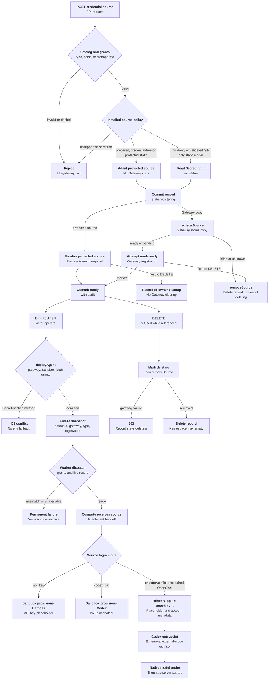

# Credential source lifecycle Flow

## Overview

OCC authorizes sources and stores metadata/references; OpenShell holds values.
Admission freezes identity; workers pass live sources to Compute.
See [refresh](credential-source-refresh.md) and
[Sandbox provisioning](openshell-sandbox-provisioning.md).

[Protected sources](credential-source-egress.md) admit versioned Secret references,
skip gateway copies and require explicit migration while unbound. Protected revisions
refuse legacy attachments. [OpenShell-owned Codex OAuth](credential-source-refresh.md#device-authorization-and-configuration)
retains its recorded Credential Gateway and Refresh owners, including when a Git
Proxy is later selected. Fresh OAuth enrollment is not part of the Git-only static
model exception. Without a selected Proxy, the existing Gateway/Refresh path remains.

## Entry Points

- Trigger: `POST`, `PATCH`, or `DELETE /namespaces/:namespaceId/credential-sources[/:credentialSourceId]`,
  Agent create or PATCH and `POST …/agents/:agentId/deploy`, and
  `POST …/agents/:agentId/credential-sources/:credentialSourceId/withdraw`.
- Source: `apps/controller/src/http/credential-sources.ts:createCredentialSource`
- Source: `packages/occ/src/index.ts:createCredentialSource`
- Source: `packages/occ/src/index.ts:deleteCredentialSource`
- Assumptions: a `ready` Namespace; an Installation selecting a Credential Gateway in an
  `openshell` Backend, a Sandbox and bundled Kubernetes Compute; and per-phase caller grants.

## Flow

## Execution Trace

Registration and deletion reject active or stale inherited controller transactions
with `ResourceConflictError` before effects. OCC commits intermediate State before
`registerSource` or `removeSource`.

### 1. Admit the registration request

`apps/controller/src/http/credential-sources.ts:createCredentialSource`,
`packages/occ/src/index.ts:createCredentialSource`

The route accepts `name`, `type`, optional `config` and lowercase-keyed `secrets`.
One transaction authorizes `credential_source:create`, locks the ready Namespace,
requires its selected source Driver, then reads the catalog.
An unoffered type returns `CredentialSourceTypeNotOfferedError` (`409`). Unknown
or missing catalog fields and Driver-invalid values return `400 INVALID_REQUEST`
before Secret reads, record creation, or gateway writes. OCC checks normalized
configuration against the catalog and stores it in the source record.

`apps/controller/src/drivers/credential-source-endpoint.ts:validateOpenAiSourceBaseUrl` validates
OpenShell destinations for requests and stored sources: field-specific `400` errors
for requests, `409` for stored endpoints. It normalizes explicit URLs and preserves
omission. Sources require an exact DNS host; Compute and Proxy retain broader URL rules.

OpenShell's lazy placement callback is unused by static OpenAI validation. OAuth2
validation resolves it to reject token endpoints in the Gateway's Namespace;
registration repeats this with tenant placement. The recorded Driver retains
source ownership and cleanup.

New sources use protected admission when a Credential Proxy is selected. Only
the validated bundled Git-only installation permits fresh static model sources
through its separately selected Credential Gateway. The catalog type must declare
Harness authentication without refresh, device authorization or OAuth token login. Plugin, refresh and
OAuth enrollment do not receive this exception. Prepared and credential-free types use
their Proxy owner first. Eligible static sources in other profiles use live Secret
reads without a Gateway write; retired or unavailable providers refuse admission.
For static admission and explicit live adoption, `packages/occ/src/index.ts:staticEgressProvider` selects
the first catalog entry for the requested type, then resolves its exact reference.
Duplicate registrations for that ID and generation return `409` before a Secret
payload read. Distinct providers of the same type retain catalog order. Updates
resolve the recorded reference. Admission retains the provider and its callbacks
and rechecks them, including identity uniqueness, around material resolution.

### 2. Read Secret values

`packages/occ/src/index.ts:readCredentialSourceSecrets`,
`packages/occ/src/index.ts:admitStaticEgressSource`

Cross-Namespace references raise `SecretBindingValidationError` (`400 INVALID_REQUEST`).
OCC authorizes `secret:operate`, then locks each Secret (`404` if absent).
Gateway copies use Secret Driver `withValue` (`503` if unsupported), keeping values
in memory for the authorized call. Live static admission requires
`readCredentialInput` with `retention: "none"`: validate without retaining; reject
missing version evidence or invalid `authoritativeObservedAt` (`503`). `withValue`
alone is insufficient. Kubernetes verifies ownership labels, UID and key before decoding.

### 3. Register with the gateway and commit

`packages/occ/src/index.ts:createCredentialSource`,
`packages/occ/src/index.ts:abandonCredentialRegistration`,
`apps/controller/src/drivers/credential-gateway/openshell.ts:registerSource`

OCC commits `registering` with Secret references. Gateway registration resolves
Compute's Sandbox namespace and calls `registerSource` (30-second deadline).
OpenShell checks provider ownership before changing the source-owned profile,
creates the labeled provider and rechecks collisions. Calls are non-atomic.
Only Refresh receives refresh material.

Codex PAT profiles include native app metadata and MCP transport; the
[Driver reference](../reference/drivers/openshell-credential-gateway.md#source-type-catalog)
owns the exact source-wide routes.

Definitive failure/absence triggers cleanup and deletion; failed cleanup retains
`deleting`. Thrown calls may take effect, so cleanup retains `deleting` for another
DELETE. Success atomically commits `ready` and audit. Failed commits leave
`registering`: binding/admission fail, deletion remains possible.

If DELETE wins after a Gateway write or Refresh configuration/mint, POST
compensates through the original Drivers. Prepared issuer withdrawal belongs to
DELETE; POST does not replay configuration.

### Device authorization and configuration

`packages/occ/src/index.ts:startAgentDeviceAuthorization`,
`pollAgentDeviceAuthorization`, `withPluginDiscoveryCredential`

Device authorization registers an empty source; paired Refresh fences the private
session. `withSourceToken` may refresh during authorized callbacks. The
[refresh flow](credential-source-refresh.md#device-authorization-and-configuration)
traces exchange and cancellation.

### 4. Bind the source to an Agent

`packages/occ/src/index.ts:authorizeHarnessAuthSource`

PATCH checks `credential_source:operate` on existing bindings without looking them
up, so callers can remove a binding after its Driver changes. For each requested
source, OCC checks `operate`, locks the ready source in the Agent's Namespace and
requires its recorded Gateway or Proxy. Harness authentication requires a Gateway.

Missing `operate` returns `403` before checking Harness source membership (`400`).
PostgreSQL mirrors `agents.credential_sources` into `agent_credential_sources`,
preventing deletion of referenced sources.

### 5. Admit the deployment

`packages/occ/src/index.ts:deployAgent`, `packages/occ/src/index.ts:admitHarnessAuth`

`assertCredentialGatewayDelivery` rejects `api_key` and both sources of
`codex_pat` with `409` while a gateway is selected. For `credential_source`,
`admitHarnessAuth` authorizes the Agent principal's `operate`, requires a ready
source whose catalog type declares `harnessAuth`, and freezes `{ method,
sourceId, credentialGatewayId, sourceType, loginMode }`.
`admittedCredentialSourceType` requires a Sandbox. Compute `validateHarnessAuth`
requires dedicated Codex or native OpenClaw, paired Drivers, and
`openai`/`api_key`. Dedicated Codex also accepts `codex-pat`/`codex_pat` or
`openai`/`chatgptAuthTokens` from an external-auth Driver. Compute renders no
model Secret and passes the resolved source to Sandbox provisioning.

`admitCredentialSources` requires a Sandbox (`409`) and rechecks caller and Agent
`operate` on every source. The recorded owner must still offer its type;
a matching Proxy type cannot replace a withdrawn Gateway type.
The revision records `sourceId`, `sourceType` and the owner's `credentialGatewayId`
or `credentialProxyId`. Older sources keep their Gateway owner, even when a Proxy
with the same Driver ID enforces the revision's egress plan.

Both State adapters call
`packages/occ/src/state/platform-state.ts:assertRevisionAuthAvailable` from
`createRevision`. Each listed or Harness snapshot must match a ready same-Namespace source by ID,
type, owner capability and Driver ID; otherwise, `ScopeViolationError`.
`packages/occ/src/state/postgres-state.ts:createRevision` locks all unique source
IDs in one ordered `SELECT FOR SHARE` and holds them through commit. Source-bearing
insertions first take a shared Namespace lock and an Agent key-share lock, following
OCC admission's Namespace, Agent, then source order. Both adapters copy input
before awaiting, then validate, persist and return that copy without reordering
snapshots. Memory checks its transaction snapshot. These checks reject stale or
forged owners on insertion; historical snapshots remain readable after legitimate
source deletion.

### 6. Resolve the source at dispatch

`apps/controller/src/worker.ts:authorizeRevision`,
`apps/controller/src/worker.ts:resolveRevisionSecretContext`

The worker rechecks the deploying actor's and Agent's
`credential_source:operate` (`AUTHORIZATION_DENIED`), the selected Gateway/Proxy
snapshot (`CREDENTIAL_GATEWAY_MISMATCH`) and live source ownership/type.
Unavailable sources return `HARNESS_AUTH_SOURCE_UNAVAILABLE` or
`CREDENTIAL_SOURCE_UNAVAILABLE`. Withdrawn sources stay detached; Compute repeats
snapshot checks before
[Sandbox provisioning](openshell-sandbox-provisioning.md#2-derive-the-provider-owned-harness-request).

Before attachment or release, Kubernetes preparation and activation recheck the
selected Gateway catalog. On a validated Git-only installation, unprotected revisions
without repositories require a static model source. Refresh, device authorization or `chatgptAuthTokens`
stops release. Gateway-only installations and protected plans keep their existing rules.

`apps/controller/src/composition/installation-config.ts` shares the internal
`OpenShellCredentialAttachments` handler only with bundled Sandbox/Gateway
instances on one Backend; Compute verifies those exact instances.
`staticOpenAiAttachmentsForRevision` selects it for unprotected dedicated
Codex/OpenClaw revisions without an egress plan or additional admitted sources:
one admitted `openai`/`api_key` Harness source on the selected Gateway. The
source must match Namespace and snapshot, without an egress binding.
Refusal never retries through Gateway methods.

`apps/controller/src/drivers/sandbox/openshell-credential-attachments.ts` implements
`attachForRevision`, `attachmentStatus` and `withdraw`, shared with public Gateway attachment consumers.

For `chatgptAuthTokens`, `credentialSourceEnvironment` forwards trusted metadata
and a placeholder into ephemeral `auth.json`. OpenShell's `sandboxCommand` wraps
it as a stable JWT alias; upstream injection preserves identity across rotation.
Neither refresh tokens nor legacy bundles reach Codex. See the
[external-auth contract](../reference/drivers/credential-gateway.md#external-chatgpt-authentication).

### 7. Delete the source

`packages/occ/src/index.ts:deleteCredentialSource`,
`apps/controller/src/drivers/credential-gateway/openshell.ts:removeSource`

OCC authorizes `delete`, locks the source and refuses Agent, revision or
pending-deployment references (`409`) and unfinished withdrawal
(`CREDENTIAL_WITHDRAWAL_IN_PROGRESS`). After matching the recorded owner, it
irreversibly marks the source `deleting`.

Prepared material calls issuer `withdraw`; a possibly valid token returns
`409 CREDENTIAL_TOKEN_UNSETTLED`. Credential-free sources have no material.
Otherwise Refresh removes refresh state, then Gateway `removeSource` verifies
ownership and removes the provider and profile.
Existing Gateway-owned live sources still use Compute placement and Gateway removal
on DELETE, including sources whose registration made no Gateway write.
Unknown ownership or a failed read cannot establish absence. Failure leaves
`deleting` (`404` for refused ownership, `503` for an unavailable dependency).

For 70 seconds after `createdAt`, OCC retains the source against late registration.
`packages/occ/src/errors.ts:RetryLaterError` retains the remaining seconds;
`apps/controller/src/http/errors.ts:canonicalFailure` sends `503 DEPENDENCY_UNAVAILABLE`,
`error.reason: "credential_registration_pending"` and `Retry-After`.
After that delay, retry DELETE to remove the record and commit its audit.
Until deletion, the Namespace remains nonempty.

### 8. Update a source

`packages/occ/src/index.ts:updateCredentialSource`,
`apps/controller/src/drivers/credential-gateway/openshell.ts:updateSource`

One transaction authorizes `credential_source:update`, reads the Namespace,
locks only the source, and requires a ready source offered by the catalog (`409`
otherwise). Device-authorized sources reject PATCH before Secret reads or refresh
changes. Static sources validate replacement references, authorize each
`secret:operate`, and read through `withValue`. Gateway `updateSource` runs with
Compute's placement while the source lock is held; OpenShell requires matching
ownership and nonempty values because `UpdateProvider` merges credentials.
Only subsequently started processes receive the update.

OCC commits replacement Secret references and mutation audit after the external
write. A failure rolls back the references; once the gateway may have changed,
the failure is audited. A failed commit can leave OpenShell newer until the same
request is repeated. An absent/failed source returns `503`. Secret-backed refresh
updates use the [Refresh Driver](credential-source-refresh.md#4-update-and-rotation).

### 9. Withdraw a source from an Agent

`packages/occ/src/index.ts:withdrawAgentCredentialSource`,
`apps/controller/src/worker.ts:processCredentialWithdrawal`,
`apps/controller/src/drivers/compute/kubernetes/index.ts:withdrawCredentialSource`,
`apps/controller/src/drivers/sandbox/openshell-credential-attachments.ts:withdraw`

The API requires `agent:operate` and the source in the selected version's
`credential_sources`. It records a `pending` `credential_withdrawals` row per
version/source, if absent, for the selected version, later versions admitted with that source,
and earlier unretired versions. It reassigns pending rows' `requested_by` to the
caller and queues or expedites version-scoped `credentials_withdrawn` work
(`packages/occ/src/state/controller-work.ts:credentialWithdrawalWorkKey`). It
never deploys a version.

The worker rechecks each requester's `agent:operate` and calls Compute's
`withdrawCredentialSource` for authorized requesters in admission order. Authorized but unconfirmed withdrawals
retry; denied requesters fail after other revocations, unless replay reassigns them.
Revocations audit each requester on confirmation; denials and failures audit once at claim
end. Compute uses the admitted attachment selection above for withdrawal and rechecks.
The shared OpenShell handler calls `DetachSandboxProvider` on the `harnessResource`
Sandbox and reads its receipt status.

`packages/occ/src/credential-policy-reduction.ts:reduceCredentialPolicy` sends protected
reductions only for the selected version. Other versions await replay or candidate
activation, which queues one attempt. Claim completion records `last_reason` and
`last_attempt_at`; `revoked` or `absent` also marks the row revoked and audits
`openclaw.agents.lifecycle.credentials_withdraw`. Other states retry with backoff.
`packages/occ/src/index.ts:readAgentCredentialWithdrawal` prefers exhausted rows,
then pending ones, with the selected version first. Without Compute maintenance,
`apps/controller/src/worker.ts:scheduleCredentialWithdrawalRecovery` caps recovery at
15 series. A false `withdrawalInProgress` requires replay or maintenance to queue more work.

Maintenance requires a Compute or repository credential interval.
`apps/controller/src/worker.ts:completeWithdrawnRevisionMaintenance` stops preparing
a version whose Harness source was withdrawn. The chain continues until all
withdrawals are revoked. Deploy and repair never reattach a withdrawn source;
a withdrawn Harness source fails with `CREDENTIAL_WITHDRAWN`. Either maintenance
pass requeues pending withdrawals without outstanding work, including other versions
(`apps/controller/src/worker.ts:recoverPendingCredentialWithdrawals`);
denied or refused withdrawals await replay. `authorizeRevision` skips withdrawn
sources' `operate` check so removing grants cannot end maintenance.

An absent Sandbox counts as revoked, but a previously accepted create can still land.
`recheckRevokedCredentialSources` rechecks every preparation and withdrawn-Harness pass;
OpenShell detaches again only if `SandboxSpec.providers` still lists the provider.

## Debugging and Verification

- [OCC conformance](../../tests/conformance/credential-source-occ.test.mjs) exercises grants,
  recovery and version admission with a gateway double.
- [API integration](../../tests/integration/credential-source-api.test.mjs) covers Fastify,
  IAM, OCC and the OpenShell Driver; storage and Compute are doubles.
- [Wire conformance](../../tests/conformance/openshell-gateway-wire.test.mjs) checks provider,
  profile, update, detach and recheck RPCs against the `v0.1.5` fixture.
- [Worker integration](../../tests/integration/postgres-worker-agent-revision.test.mjs)
  exercises withdrawals, retries, replays and late creates with PostgreSQL and a Compute double.
- [Real OpenShell cases](../testing/openshell.md#openshell-sandbox) register, inspect, update
  and withdraw PAT or API-key sources; the tool token disappears and the next model turn fails.
- A source stuck in `deleting` returns `503` on delete until the gateway is
  reachable; `GET` shows its live `status`.
- Worker reason codes `CREDENTIAL_GATEWAY_MISMATCH` and
  `HARNESS_AUTH_SOURCE_UNAVAILABLE` mean a changed selection or an unavailable
  source; `CREDENTIAL_WITHDRAWN` a withdrawn version source, and
  `CREDENTIAL_WITHDRAWAL_PENDING` an unconfirmed revocation. `CREDENTIALS_WITHDRAWN` and `WITHDRAWAL_REVISION_RETIRED` complete the work,
  and `CREDENTIAL_WITHDRAWAL_UNSUPPORTED`, `COMPUTE_DRIVER_MISMATCH`,
  `CREDENTIAL_WITHDRAWAL_MISCONFIGURED`, `CREDENTIAL_WITHDRAWAL_OWNERSHIP_CONFLICT`,
  `CREDENTIAL_WITHDRAWAL_REQUIRES_RUNTIME_RETIREMENT` and `AUTHORIZATION_DENIED` fail it at once.

## Related docs

- [Credential sources](../reference/credential-sources.md)
- [CredentialGatewayDriver contract](../reference/drivers/credential-gateway.md)
- [OpenShell Credential Gateway](../reference/drivers/openshell-credential-gateway.md)
- [Secret storage and delivery](secret-storage-and-delivery.md)
- [OpenShell Sandbox provisioning](openshell-sandbox-provisioning.md)

## Manual Notes

[keep this for the user to add notes. do not change between edits]

## Changelog

- 2026-11-13 15:44: Recheck the Git-only model lifecycle before Kubernetes attachment and release. (authoring-run/f3a542b0-ca6b-426f-8759-3ca2500f79ce - a14ccd99)

- 2026-11-11 19:04: Keep ordinary Gateway model delivery independent of Git Proxy selection. (authoring-run/1e8e6ab1-7c1b-4d49-a362-2dc060e32bbb - aea0cb511)

- 2026-11-11 16:45: Expose structured retry guidance for the existing registration deletion fence. (authoring-run/b642b758-0314-4f01-a300-5e37962b8fb4 - 5eed51d18d8ea86a6c9450c352e967b433fa47da)

- 2026-11-03 16:57: Correct catalog-field refusal status. (authoring-run/4d0e1a9c-b86a-4b59-be3e-d4306d5da9fc - 82a04653d)

- 2026-11-03 15:09: Document shared provider routing and separate destination authorization. (authoring-run/4d0e1a9c-b86a-4b59-be3e-d4306d5da9fc - 47e0e95df)

- 2026-10-30 02:05: Resolve fresh static provider identities consistently with source updates. (authoring-run/ddbd21a8-0432-4c61-b4ad-e48d12268c8c - 262a2188226cbcd2ee22630040617f6c39969352)

- 2026-10-29 21:40: Validate an owned revision snapshot under ordered storage locks. (authoring-run/833462ab-9c82-438a-95c4-53d1dbb2e7e9 - a9884d11bf325a39f3308f787a5ea266ebab5144)

- 2026-10-29 20:41: Validate static source endpoints without Gateway placement. (authoring-run/cf8bb25e-ffb8-4349-9770-a0b07d6bf50f - 2eed3c36a)

- 2026-10-29 19:11: Use the recorded owner’s catalog for fresh source admission. (authoring-run/d88f92d2-4a34-4001-aaa0-70d424201741 - 3a4244461)

- 2026-10-29 15:48: Preserve DELETE ownership when live registration loses readiness without an external write. (authoring-run/0f4f447d-cd98-4f49-9d16-217bf7500d1d - 6ead449d5)

- 2026-10-23 08:05: Refuse unselected protected withdrawals. (fix-2235 - 860eea712)

- 2026-10-16 22:08: Distinguish OpenShell-owned OAuth from protected source admission. (authoring-run/9fd90bae-7158-4df5-8f2e-62b0bd548272 - 4f98051f14)

- 2026-10-15 22:26: Reconcile current main behavior with OpenShell OAuth contracts in the accompanying merge. (authoring-run/41e4bb7a-c8eb-4332-b1f9-07fb8e234f63 - b747cf5b6402ad36ce9f1ae6dbed08928ddcf3dc)

- 2026-10-15 18:17: Pin OpenShell v0.1.4. (authoring-run/openshell-014-rebase-20261015 - 64a3424a9)

- 2026-10-14 14:04: Scope PAT authentication and OpenShell prerequisites. (authoring-run/dba0a6cb-33d9-40fd-b38b-e20cddf4b75f - 96a2b79fa)

- 2026-10-13 20:30: Document provider-managed Codex PAT authentication. (01a136ee-8824-7043-b9e2-49eccacac3bd - ed9018c09)

- 2026-10-14 01:11: Reconcile endpoint validation and provider ownership with external OAuth custody in the accompanying merge. (01a11d95-ebef-76e1-b9b9-9d3d2e88e99e - c5fb4880ebf2df2aedae12f99adb1992a930ba1b)

- 2026-10-13 20:07: Check provider ownership before profile updates. (authoring-run/01a136d4-3550-7042-834c-cf11f51f41f2 - 146c80ef66b5860cb9bea296d2574156468a103c)

- 2026-10-12 14:00: Every source, including `openai`, owns its OpenShell profile; no profile is shared by type. (claude-code/session_014fi7Uq1LyofgqwLrLoQ3yY - e0bb26d84)

- 2026-10-10 04:53: Reconcile credential refresh; report invalid offered-source values as field-specific 400 before effects. (agent:roboclaw:dashboard:9d0532e1-befb-4fc3-935e-7cd2a0c72110 - 90268463bbd255c3c13a0e0bdeb437728189eb1a)

- 2026-10-13 18:56: Use source-owned OpenShell profiles for Codex OAuth. (01a11d95-ebef-76e1-b9b9-9d3d2e88e99e - af184d6224af7c60b81027ca307097ecfc5007cc)

- 2026-10-13 09:37: Reconcile current admission and lifecycle behavior with external OAuth custody in the accompanying merge. (authoring-run/fd902939-ed58-4508-8d33-95a863d966af - e8d39978d801e7a5a8ac7242f32035f426da94e1)

[Credential source lifecycle documentation history](credential-source-lifecycle/history.md) preserves the older dated entries.
