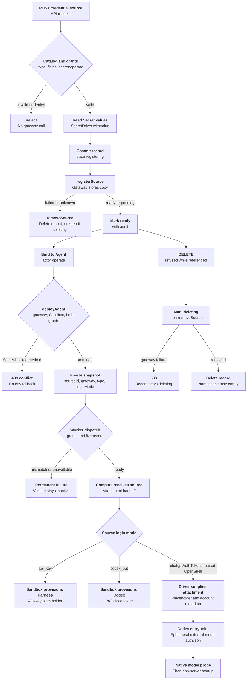

# Credential source lifecycle Flow

## Overview

OCC authorizes sources and stores metadata/references; OpenShell holds values.
Admission freezes identity; workers pass live sources to Compute.
See [refresh](credential-source-refresh.md) and
[Sandbox provisioning](openshell-sandbox-provisioning.md).

[Protected sources](credential-source-egress.md) admit versioned Secret references,
skip gateway copies and require explicit migration while unbound. Protected revisions
refuse legacy attachments. [OpenShell-owned Codex OAuth](credential-source-refresh.md#device-authorization-and-configuration)
uses the paired Credential Gateway and Refresh Drivers with `credential_proxy` unselected.

## Entry Points

- Trigger: `POST`, `PATCH`, or `DELETE /namespaces/:namespaceId/credential-sources[/:credentialSourceId]`,
  Agent create or PATCH and `POST …/agents/:agentId/deploy`, and
  `POST …/agents/:agentId/credential-sources/:credentialSourceId/withdraw`.
- Source: `apps/controller/src/http/credential-sources.ts:createCredentialSource`
- Source: `packages/occ/src/index.ts:createCredentialSource`
- Source: `packages/occ/src/index.ts:deleteCredentialSource`
- Assumptions: a `ready` Namespace; an Installation selecting a Credential Gateway in an
  `openshell` Backend, a Sandbox and bundled Kubernetes Compute; and per-phase caller grants.

## Flow

## Execution Trace

Registration and deletion reject an active or stale inherited transaction from the same controller
instance with `ResourceConflictError` before effects. OCC commits the
intermediate State record before calling `registerSource` or `removeSource`.

### 1. Admit the registration request

`apps/controller/src/http/credential-sources.ts:createCredentialSource`,
`packages/occ/src/index.ts:createCredentialSource`

The route accepts `name`, `type`, optional `config`, and lowercase-keyed `secrets`.
One transaction authorizes `credential_source:create`, locks the Namespace,
requires a selected gateway (`409 CREDENTIAL_GATEWAY_NOT_CONFIGURED`) and a
ready Namespace, then reads `listSourceTypes`. Before effects, an unoffered type
returns `CredentialSourceTypeNotOfferedError` (`409`); unknown or missing fields
return `ScopeViolationError` (`404`). Side-effect-free `validateSourceConfig`
rejects invalid values with `CredentialSourceConfigError` (`400 INVALID_REQUEST`)
before Secret reads, record creation, or gateway writes. OCC checks any returned
normalized configuration against the catalog and stores it in the source record.

`apps/controller/src/drivers/openai-endpoint.ts:normalizeOpenAiBaseUrl` and
OpenShell's `normalizedSourceBaseUrl` enforce the
[endpoint restrictions](../reference/drivers/openshell-credential-gateway.md#source-type-catalog).
OpenShell requires an exact DNS host; Compute also accepts IP hosts.
Registration and attachment validate endpoints; cleanup uses owned identity.

### 2. Read Secret values

`packages/occ/src/index.ts:createCredentialSource`

Cross-Namespace Secret references raise `SecretBindingValidationError`
(`400 INVALID_REQUEST`). OCC then authorizes `secret:operate`, locks each Secret
(`404` if absent), and calls its Driver's `withValue` (`503` if unsupported).
The Kubernetes Driver verifies ownership labels, UID, and key before decoding.
Values remain in memory only for the authorized external call.

### 3. Register with the gateway and commit

`packages/occ/src/index.ts:createCredentialSource`,
`packages/occ/src/index.ts:abandonCredentialRegistration`,
`apps/controller/src/drivers/credential-gateway/openshell.ts:registerSource`

OCC commits `registering` with Secret references, resolves Compute's Sandbox
namespace, and calls `registerSource` with a 30-second deadline. OpenShell checks
provider ownership before changing the source-owned profile, creates the labeled
provider, and rechecks creation collisions. These calls are not atomic. Only the
Refresh Driver receives refresh material.

A definitive failed/absent result triggers cleanup and record deletion; failed
cleanup retains `deleting`. Thrown calls may still take effect, so cleanup retains
`deleting` for another DELETE. Success commits `ready` and audit atomically. A
failed commit leaves `registering`: binding/admission fail, deletion remains
possible. If concurrent DELETE won, OCC repeats remote cleanup and returns `409`.

### Device authorization and configuration

`packages/occ/src/index.ts:startAgentDeviceAuthorization`,
`pollAgentDeviceAuthorization`, `withPluginDiscoveryCredential`

Device authorization registers an empty source; paired Refresh fences the private
session. `withSourceToken` may refresh during authorized callbacks. The
[refresh flow](credential-source-refresh.md#device-authorization-and-configuration)
traces exchange and cancellation.

### 4. Bind the source to an Agent

`packages/occ/src/index.ts:authorizeHarnessAuthSource`

PATCH checks `credential_source:operate` on existing bindings without looking them
up, so callers can remove a binding after its Driver changes. For each requested
source, OCC checks `operate`, locks the ready source in the Agent's Namespace and
requires its recorded Gateway or Proxy. Harness authentication requires a Gateway.

A missing `operate` grant returns `403` before OCC checks that the list includes
the Harness source (`400`). PostgreSQL mirrors `agents.credential_sources` into
`agent_credential_sources` and prevents deletion of a source still referenced.

### 5. Admit the deployment

`packages/occ/src/index.ts:deployAgent`, `packages/occ/src/index.ts:admitHarnessAuth`

`assertCredentialGatewayDelivery` rejects `api_key` and both sources of
`codex_pat` with `409` while a gateway is selected. For `credential_source`,
`admitHarnessAuth` authorizes the Agent principal's `operate`, requires a ready
source whose catalog type declares `harnessAuth`, and freezes `{ method,
sourceId, credentialGatewayId, sourceType, loginMode }`.
`admittedCredentialSourceType` requires a Sandbox. Compute `validateHarnessAuth`
requires dedicated Codex or native OpenClaw, paired Drivers, and
`openai`/`api_key`. Dedicated Codex also accepts `codex-pat`/`codex_pat` or
`openai`/`chatgptAuthTokens` from an external-auth Driver. Compute renders no
model Secret and passes the resolved source to Sandbox provisioning.

`admitCredentialSources` requires a Sandbox (`409`), rechecks caller grants and
requires the Agent principal's `operate` on each listed source of an offered type.
The revision records `sourceId`, `sourceType` and the owner's `credentialGatewayId`
or `credentialProxyId`. Older sources keep their Gateway owner, even when a Proxy
with the same Driver ID enforces the revision's egress plan.

### 6. Resolve the source at dispatch

`apps/controller/src/worker.ts:authorizeRevision`,
`apps/controller/src/worker.ts:resolveRevisionSecretContext`

The worker rechecks the deploying actor's and Agent principal's
`credential_source:operate` (`AUTHORIZATION_DENIED` on refusal). It matches
the selected Gateway or Proxy to the snapshot (`CREDENTIAL_GATEWAY_MISMATCH`),
then checks the live source, owner and type. Failure returns
`HARNESS_AUTH_SOURCE_UNAVAILABLE` for the Harness source or
`CREDENTIAL_SOURCE_UNAVAILABLE` for another source. Withdrawn sources stay
detached. Compute checks the snapshot again before
[Sandbox provisioning](openshell-sandbox-provisioning.md#2-derive-the-provider-owned-harness-request).

For `chatgptAuthTokens`, `credentialSourceEnvironment` forwards trusted metadata
and a placeholder into ephemeral `auth.json`. OpenShell's `sandboxCommand` wraps
it as a stable JWT alias; upstream injection preserves identity across rotation.
Neither refresh tokens nor legacy bundles reach Codex. See the
[external-auth contract](../reference/drivers/credential-gateway.md#external-chatgpt-authentication).

### 7. Delete the source

`packages/occ/src/index.ts:deleteCredentialSource`,
`apps/controller/src/drivers/credential-gateway/openshell.ts:removeSource`

OCC authorizes `delete`, locks the source and checks references. An Agent,
revision or pending deployment can block deletion (`409`), as can unfinished
withdrawal (`CREDENTIAL_WITHDRAWAL_IN_PROGRESS`). OCC requires the recorded
owner, then changes `registering` or `ready` to `deleting`. Neither transition is reversible.

For prepared material, OCC calls the issuer's `withdraw`; a token that may still be
valid returns `409 CREDENTIAL_TOKEN_UNSETTLED`. A credential-free source
has no material to remove. Otherwise the Refresh Driver removes refresh state,
then Gateway `removeSource` verifies ownership and removes the provider and profile.
Unknown ownership or a failed read cannot establish absence. Failure leaves
`deleting` (`404` for refused ownership, `503` for an unavailable dependency).

OCC returns `503` until 70 seconds after `createdAt`, allowing 30 seconds each for
late registration and Backend calls. It then deletes the record and commits its audit
in one transaction. Until then, Namespace deletion returns `NAMESPACE_NOT_EMPTY`.

### 8. Update a source

`packages/occ/src/index.ts:updateCredentialSource`,
`apps/controller/src/drivers/credential-gateway/openshell.ts:updateSource`

One transaction authorizes `credential_source:update`, reads the Namespace,
locks only the source, and requires a ready source offered by the catalog (`409`
otherwise). Device-authorized sources reject PATCH before Secret reads or refresh
changes. Static sources validate replacement references, authorize each
`secret:operate`, and read through `withValue`. Gateway `updateSource` runs with
Compute's placement while the source lock is held; OpenShell requires matching
ownership and nonempty values because `UpdateProvider` merges credentials.
Only subsequently started processes receive the update.

OCC commits replacement Secret references and mutation audit after the external
write. A failure rolls back the references; once the gateway may have changed,
the failure is audited. A failed commit can leave OpenShell newer until the same
request is repeated. An absent/failed source returns `503`. Secret-backed refresh
updates use the [Refresh Driver](credential-source-refresh.md#4-update-and-rotation).

### 9. Withdraw a source from an Agent

`packages/occ/src/index.ts:withdrawAgentCredentialSource`,
`apps/controller/src/worker.ts:processCredentialWithdrawal`,
`apps/controller/src/drivers/compute/kubernetes/index.ts:withdrawCredentialSource`,
`apps/controller/src/drivers/credential-gateway/openshell.ts:withdraw`

The API authorizes `agent:operate` and requires the selected version to list the
source in `credential_sources`. For that version, each later version
admitted with the source, and each earlier one not yet retired, it inserts a `pending` `credential_withdrawals` row keyed by version
and source unless one exists. It makes the caller `requested_by` of
each pending row and queues version-scoped work with target `credentials_withdrawn`
(`packages/occ/src/state/controller-work.ts:credentialWithdrawalWorkKey`) or
expedites outstanding work. That work never deploys the version.

The worker rechecks `agent:operate` for each pending withdrawal's
`requested_by` and calls Compute's
`withdrawCredentialSource` for each authorized one in admission order. The work retries while an authorized withdrawal is unconfirmed;
otherwise a denied requester fails it after the others are revoked, unless a
replay reassigned it. Revocations are audited per requester when confirmed;
denials and failures, once when the claim ends. The OpenShell Driver calls `DetachSandboxProvider`
on the `harnessResource` Sandbox and reads the receipt's status.
`packages/occ/src/credential-policy-reduction.ts:reduceCredentialPolicy` reduces protected
sources only on the selected version; elsewhere it sends nothing, and the refusal awaits a replay
or, for a candidate, its activation, which queues one attempt. Each
attempt records `last_reason` and `last_attempt_at` when its claim ends. `revoked` or `absent`
also marks the row `revoked` and appends
`openclaw.agents.lifecycle.credentials_withdraw`. Other states retry with
backoff. The read
(`packages/occ/src/index.ts:readAgentCredentialWithdrawal`) prefers these
versions' exhausted rows, then `pending` ones, the selected version's first. Without Compute maintenance, failed work queues
at most 15 recovery series (`apps/controller/src/worker.ts:scheduleCredentialWithdrawalRecovery`). `withdrawalInProgress` reflects outstanding
work; `false` means replay or maintenance must queue another attempt.

Maintenance runs only with a Compute or repository credential interval. It stops
preparing the selected version after its Harness source is withdrawn
(`apps/controller/src/worker.ts:completeWithdrawnRevisionMaintenance`). The chain
continues until every withdrawal is `revoked`. Deploy and repair work never re-attach a withdrawn source:
a Harness source fails them with `CREDENTIAL_WITHDRAWN`. Either maintenance pass re-queues
pending withdrawals with no work outstanding, the other versions' too
(`apps/controller/src/worker.ts:recoverPendingCredentialWithdrawals`); one denied
or refused waits for a replay. `authorizeRevision` skips the
`operate` recheck for withdrawn sources, so removing their grants cannot end
maintenance.

An absent Sandbox counts as revoked, but a previously accepted create can still land.
`recheckRevokedCredentialSources` rechecks every preparation and withdrawn-Harness pass;
OpenShell detaches again only if `SandboxSpec.providers` still lists the provider.

## Debugging and Verification

- [OCC conformance](../../tests/conformance/credential-source-occ.test.mjs) exercises grants,
  recovery and version admission with a gateway double.
- [API integration](../../tests/integration/credential-source-api.test.mjs) covers Fastify,
  IAM, OCC and the OpenShell Driver; storage and Compute are doubles.
- [Wire conformance](../../tests/conformance/openshell-gateway-wire.test.mjs) checks provider,
  profile, update, detach and recheck RPCs against the `v0.1.5` fixture.
- [Worker integration](../../tests/integration/postgres-worker-agent-revision.test.mjs)
  exercises withdrawals, retries, replays and late creates with PostgreSQL and a Compute double.
- [Real OpenShell cases](../testing/openshell.md#openshell-sandbox) register, inspect, update
  and withdraw PAT or API-key sources; the tool token disappears and the next model turn fails.
- A source stuck in `deleting` returns `503` on delete until the gateway is
  reachable; `GET` shows its live `status`.
- Worker reason codes `CREDENTIAL_GATEWAY_MISMATCH` and
  `HARNESS_AUTH_SOURCE_UNAVAILABLE` mean a changed selection or an unavailable
  source; `CREDENTIAL_WITHDRAWN` a withdrawn version source, and
  `CREDENTIAL_WITHDRAWAL_PENDING` an unconfirmed revocation. `CREDENTIALS_WITHDRAWN` and `WITHDRAWAL_REVISION_RETIRED` complete the work,
  and `CREDENTIAL_WITHDRAWAL_UNSUPPORTED`, `COMPUTE_DRIVER_MISMATCH`,
  `CREDENTIAL_WITHDRAWAL_MISCONFIGURED`, `CREDENTIAL_WITHDRAWAL_OWNERSHIP_CONFLICT`,
  `CREDENTIAL_WITHDRAWAL_REQUIRES_RUNTIME_RETIREMENT` and `AUTHORIZATION_DENIED` fail it at once.

## Related docs

- [Credential sources](../reference/credential-sources.md)
- [CredentialGatewayDriver contract](../reference/drivers/credential-gateway.md)
- [OpenShell Credential Gateway](../reference/drivers/openshell-credential-gateway.md)
- [Secret storage and delivery](secret-storage-and-delivery.md)
- [OpenShell Sandbox provisioning](openshell-sandbox-provisioning.md)

## Manual Notes

[keep this for the user to add notes. do not change between edits]

## Changelog

- 2026-10-23 08:05: Refuse unselected protected withdrawals. (fix-2235 - 860eea712)

- 2026-10-16 22:08: Distinguish OpenShell-owned OAuth from protected source admission. (authoring-run/9fd90bae-7158-4df5-8f2e-62b0bd548272 - 4f98051f14)

- 2026-10-15 22:26: Reconcile current main behavior with OpenShell OAuth contracts in the accompanying merge. (authoring-run/41e4bb7a-c8eb-4332-b1f9-07fb8e234f63 - b747cf5b6402ad36ce9f1ae6dbed08928ddcf3dc)

- 2026-10-15 18:17: Pin OpenShell v0.1.4. (authoring-run/openshell-014-rebase-20261015 - 64a3424a9)

- 2026-10-14 14:04: Scope PAT authentication and OpenShell prerequisites. (authoring-run/dba0a6cb-33d9-40fd-b38b-e20cddf4b75f - 96a2b79fa)

- 2026-10-13 20:30: Document provider-managed Codex PAT authentication. (01a136ee-8824-7043-b9e2-49eccacac3bd - ed9018c09)

- 2026-10-14 01:11: Reconcile endpoint validation and provider ownership with external OAuth custody in the accompanying merge. (01a11d95-ebef-76e1-b9b9-9d3d2e88e99e - c5fb4880ebf2df2aedae12f99adb1992a930ba1b)

- 2026-10-13 20:07: Check provider ownership before profile updates. (authoring-run/01a136d4-3550-7042-834c-cf11f51f41f2 - 146c80ef66b5860cb9bea296d2574156468a103c)

- 2026-10-12 14:00: Every source, including `openai`, owns its OpenShell profile; no profile is shared by type. (claude-code/session_014fi7Uq1LyofgqwLrLoQ3yY - e0bb26d84)

- 2026-10-10 04:53: Reconcile credential refresh; report invalid offered-source values as field-specific 400 before effects. (agent:roboclaw:dashboard:9d0532e1-befb-4fc3-935e-7cd2a0c72110 - 90268463bbd255c3c13a0e0bdeb437728189eb1a)

- 2026-10-09 20:27: Integrate main lifecycle, native workspace and readiness contracts without dropping endpoint safeguards. (agent:roboclaw:dashboard:9d0532e1-befb-4fc3-935e-7cd2a0c72110 - 90268463bbd255c3c13a0e0bdeb437728189eb1a)

- 2026-10-13 18:56: Use source-owned OpenShell profiles for Codex OAuth. (01a11d95-ebef-76e1-b9b9-9d3d2e88e99e - af184d6224af7c60b81027ca307097ecfc5007cc)

- 2026-10-13 09:37: Reconcile current admission and lifecycle behavior with external OAuth custody in the accompanying merge. (authoring-run/fd902939-ed58-4508-8d33-95a863d966af - e8d39978d801e7a5a8ac7242f32035f426da94e1)

- 2026-10-09 20:28: Retain external Harness authentication alongside explicit Agent source-list admission. (01a11d95-ebef-76e1-b9b9-9d3d2e88e99e - ece639c78)

- 2026-10-09 08:30: Replays take over withdrawal work. (fix-892-894)
- 2026-10-09 06:00: Exhausted withdrawals retry later without Compute maintenance. (fix-887)

- 2026-10-09 17:37: Trace Refresh-owned device authorization in the accompanying merge. (01a11d95-ebef-76e1-b9b9-9d3d2e88e99e - 1c2fbd2bc2953430e3ddaf68882176c6943ea7b2)

- 2026-10-09 17:01: Trace operator-TLS retrieval and Gateway-owned refresh in the accompanying change. (01a11d95-ebef-76e1-b9b9-9d3d2e88e99e - 4f902e2ab7738568fc8bb278296e54255355b8b7)

- 2026-10-08 12:47: Trace the experimental OpenShell device-login, warm-read, and JWT-placeholder integration in the accompanying local change. (01a0e5ec-d802-7800-9eb6-8022c1ac0d06 - ece639c78765727a67753639f6ab225a243e064d)

- 2026-10-08 20:30: Maintenance leaves denied withdrawals for a replay. (fix-853)
- 2026-10-08 17:30: Withdrawal covers unretired predecessors. (fix-816-819)
- 2026-10-08 16:00: Preparation rechecks revoked withdrawals against a late Sandbox create. (fix-790)
- 2026-10-08 14:00: An unoffered source type is a `409` naming the fix, not `404`; worker credential codes have their own status messages. (fix-821-824)
- 2026-10-08 12:00: A withdrawal also covers later versions admitted with the source. (fix-810)
- 2026-10-08 11:45: DELETE checks gateway ownership before `deleting`. (fix-811-812 - e461e1621)
- 2026-10-08 11:42: Reconciled binding and withdrawal behavior with endpoint validation; trimmed repeated lifecycle detail. (agent:roboclaw:dashboard:9d0532e1-befb-4fc3-935e-7cd2a0c72110 - 1eceea5dfb864ff469dce04a42fe3cce9c7f5f75)

- 2026-10-08 10:00: Replays take over stranded withdrawals; withdrawn sources skip the grant recheck. (fix-787-788)
- 2026-10-08 09:30: Agent PATCH needs only `operate` on already-bound sources. (fix-782)
- 2026-10-08 09:00: Deploying listed sources without a Sandbox Driver returns `409` with its message, not the generic "already exists". (fix-786)
- 2026-10-08 08:30: Agent binding reports a missing Credential Gateway as `409 CREDENTIAL_GATEWAY_NOT_CONFIGURED` and an unlisted Harness source as `400`, after the caller's `operate` checks. (fix-783-784)

- 2026-10-08 04:40: Reconciled OpenAI endpoint validation with the new tool-token source lifecycle. (authoring-run/02228d02-e16c-4a55-9a43-16b9efb35ebe - 31b1b6a9ab59f219d0fbe3d44b1550f8c8f2fe4a)

- 2026-10-07 18:00: Unified binding: one `credentialSources` list holds every source, and a credential-source `harnessAuth` names a listed entry. (claude-code/session_014fi7Uq1LyofgqwLrLoQ3yY - ee950468c)
- 2026-10-07 12:07: Unify imported and managed PAT authentication while preserving source ownership and existing OAuth behavior. (01a0e5ec-d802-7800-9eb6-8022c1ac0d06 - be5006e62)
- 2026-10-06 21:30: Keep tool-withdrawal recovery scheduled after model revocation without preparing the version again. (pr-851-rebase - bb6c7449b)
- 2026-10-06 16:12: Reject normalized hostname stars, zero ports, and OpenShell bracket hosts before credential-source persistence. (agent:roboclaw:dashboard:9d0532e1-befb-4fc3-935e-7cd2a0c72110 - 129b9b98812a861cfbdcec386daf5258902ebba8)
- 2026-10-05 11:36: Validate source configuration before persistence and recover invalid rows without guessing remote ownership. (agent:roboclaw:dashboard:9d0532e1-befb-4fc3-935e-7cd2a0c72110 - 9958ef0412565864efba7b13995536d7c2a51d22)

- 2026-10-07 17:36: Trace source-owned device authorization and warm configuration discovery; remove legacy OAuth fallback. (01a0e5ec-d802-7800-9eb6-8022c1ac0d06 - da984340ae4aafb03bb0c66bfd94ba40252625a5)

- 2026-10-07 00:22: Documented the external ChatGPT placeholder and account-metadata handoff into native Codex in the accompanying change. (01a0e5ec-d802-7800-9eb6-8022c1ac0d06 - ca0df6314ddddabc2f039de791f35c2e5de7ec43)
- 2026-10-03 18:00: Registration and update reject a Secret reference to another Namespace as an invalid request instead of not-found, as Secret bindings do. (binding-400b)
- 2026-10-03 16:00: Report `withdrawalInProgress` so an exhausted withdrawal no longer reads as in progress; maintenance re-queues only where it is scheduled. (fix-withdrawal-exhausted)
- 2026-10-02 10:00: Authorized each batched withdrawal by its own requester and recovered pending non-model withdrawals during maintenance. (claude-code/session_014fi7Uq1LyofgqwLrLoQ3yY - 92e33389d)

- 2026-10-01 21:30: Added non-model sources bound through `credentialSources`, their admission, dispatch and withdrawal. (claude-code/session_014fi7Uq1LyofgqwLrLoQ3yY - 9a202599b)
- 2026-10-01 20:30: Report a missing Credential Gateway as `409 CREDENTIAL_GATEWAY_NOT_CONFIGURED` at registration. (fix-d93-d100)
- 2026-10-01 11:37: Updated the OpenShell wire-fixture pin to v0.1.3-pre.2. (authoring-run/f1f395c4-2594-4b07-9e92-ae829a5b5dd4 - f22a584e6ce21d505b40a72fdb5ae1c6e74c1c84)
- 2026-09-30 21:14: Updated the independent OpenShell wire-contract verification pointer to v0.1.3-pre.1. (authoring-run/b158c89c-3010-42ae-95b4-350b05de7441 - 37bbee705ea3808ad000413dd54bdcc718980179)

- 2026-09-30 04:00: Recorded withdrawal attempt reasons, replay deduplication, and maintenance of a withdrawn version; corrected the update ordering. (pr-553-alignment - 3a5e48035)
- 2026-09-28 18:00: Added source update and per-Agent withdrawal through worker-executed revocation. (claude-code/session_014fi7Uq1LyofgqwLrLoQ3yY - 7cd4a210)
- 2026-09-28 05:13: Documented the controller transaction boundary for credential source writes. (authoring-run/5da74b2e-b249-44da-87e4-ca85f018c832 - 646b067220f6b7f8f3059eaa0710db2654b61499)
- 2026-09-27 22:51: Extended credential-source Harness delivery to dedicated native OpenClaw without projecting the model Secret. (authoring-run/88764ea7-c6bb-4ac8-919f-c21071946c37 - 859c0b11e5f1c350acda231c89ad3573504324eb)
- 2026-09-26 14:29: Documented credential source registration, Agent binding, admission, dispatch resolution, and retried deletion for the uncommitted Credential Gateway change. (claude-code/session_014fi7Uq1LyofgqwLrLoQ3yY - 849b2b24111fe237b12da5be1d4b411d3146cefb)
