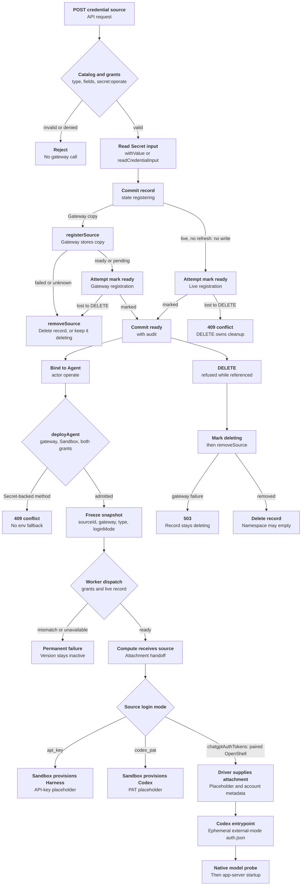

# Credential source lifecycle Flow

## Overview

OCC authorizes sources and stores metadata/references; OpenShell holds values.
Admission freezes identity; workers pass live sources to Compute.
See [refresh](credential-source-refresh.md) and
[Sandbox provisioning](openshell-sandbox-provisioning.md).

[Protected sources](credential-source-egress.md) admit versioned Secret references,
skip gateway copies and require explicit migration while unbound. Protected revisions
refuse legacy attachments. [OpenShell-owned Codex OAuth](credential-source-refresh.md#device-authorization-and-configuration)
uses the paired Credential Gateway and Refresh Drivers with `credential_proxy` unselected.

## Entry Points

- Trigger: `POST`, `PATCH`, or `DELETE /namespaces/:namespaceId/credential-sources[/:credentialSourceId]`,
  Agent create or PATCH and `POST …/agents/:agentId/deploy`, and
  `POST …/agents/:agentId/credential-sources/:credentialSourceId/withdraw`.
- Source: `apps/controller/src/http/credential-sources.ts:createCredentialSource`
- Source: `packages/occ/src/index.ts:createCredentialSource`
- Source: `packages/occ/src/index.ts:deleteCredentialSource`
- Assumptions: a `ready` Namespace; an Installation selecting a Credential Gateway in an
  `openshell` Backend, a Sandbox and bundled Kubernetes Compute; and per-phase caller grants.

## Flow

## Execution Trace

Registration and deletion reject an active or stale inherited transaction from the same controller
instance with `ResourceConflictError` before effects. OCC commits the
intermediate State record before calling `registerSource` or `removeSource`.

### 1. Admit the registration request

`apps/controller/src/http/credential-sources.ts:createCredentialSource`,
`packages/occ/src/index.ts:createCredentialSource`

The route accepts `name`, `type`, optional `config`, and lowercase-keyed `secrets`.
One transaction authorizes `credential_source:create`, locks the Namespace,
requires a selected gateway (`409 CREDENTIAL_GATEWAY_NOT_CONFIGURED`) and a
ready Namespace, then reads `listSourceTypes`. Before effects, an unoffered type
returns `CredentialSourceTypeNotOfferedError` (`409`); unknown or missing fields
return `ScopeViolationError` (`404`). Side-effect-free `validateSourceConfig`
rejects invalid values with `CredentialSourceConfigError` (`400 INVALID_REQUEST`)
before Secret reads, record creation, or gateway writes. OCC checks any returned
normalized configuration against the catalog and stores it in the source record.

`apps/controller/src/drivers/openai-endpoint.ts:normalizeOpenAiBaseUrl` and
OpenShell's `normalizedSourceBaseUrl` enforce the
[endpoint restrictions](../reference/drivers/openshell-credential-gateway.md#source-type-catalog).
OpenShell requires an exact DNS host; Compute also accepts IP hosts.
Registration and attachment validate endpoints; cleanup uses owned identity.

### 2. Read Secret values

`packages/occ/src/index.ts:readCredentialSourceSecrets`,
`packages/occ/src/index.ts:admitStaticEgressSource`

Cross-Namespace Secret references raise `SecretBindingValidationError`
(`400 INVALID_REQUEST`). OCC then authorizes `secret:operate` and locks each Secret
(`404` if absent). For a Gateway copy, OCC calls the Secret Driver's `withValue`
(`503` if unsupported); values remain in memory for the authorized external call.
The live static path requires `readCredentialInput` with `retention: "none"`.
It validates the value without retaining it and rejects missing version evidence
or an invalid `authoritativeObservedAt` (`503`). `withValue` alone is insufficient.
The Kubernetes Driver verifies ownership labels, UID, and key before decoding.

### 3. Register with the gateway and commit

`packages/occ/src/index.ts:createCredentialSource`,
`packages/occ/src/index.ts:abandonCredentialRegistration`,
`apps/controller/src/drivers/credential-gateway/openshell.ts:registerSource`

OCC commits `registering` with Secret references. For Gateway registration,
it resolves Compute's Sandbox namespace and calls `registerSource` with a
30-second deadline. OpenShell checks provider ownership before changing the
source-owned profile, creates the labeled provider, and rechecks creation
collisions. These calls are not atomic. Only the Refresh Driver receives refresh
material.

For a live versioned static OpenAI source without refresh, OCC skips placement
and Gateway registration. The Gateway still owns the catalog and the source record.

A definitive failed/absent result triggers cleanup and record deletion; failed
cleanup retains `deleting`. Thrown calls may still take effect, so cleanup retains
`deleting` for another DELETE. Success commits `ready` and audit atomically. A
failed commit leaves `registering`: binding/admission fail, deletion remains
possible.

If DELETE wins before a fresh live static source without refresh becomes ready,
POST returns `409` without resolving placement, calling Gateway removal, or deleting
the row. This POST wrote nothing to the Gateway or Refresh Driver. If the registration
fence delayed DELETE, the row stays `deleting` with its Secret link until DELETE
retries. If DELETE finished, the row is already gone.
After a Gateway write or Refresh configuration/mint, the losing POST still
compensates through the original Drivers. Prepared issuer withdrawal belongs to
DELETE; POST does not replay configuration.

### Device authorization and configuration

`packages/occ/src/index.ts:startAgentDeviceAuthorization`,
`pollAgentDeviceAuthorization`, `withPluginDiscoveryCredential`

Device authorization registers an empty source; paired Refresh fences the private
session. `withSourceToken` may refresh during authorized callbacks. The
[refresh flow](credential-source-refresh.md#device-authorization-and-configuration)
traces exchange and cancellation.

### 4. Bind the source to an Agent

`packages/occ/src/index.ts:authorizeHarnessAuthSource`

PATCH checks `credential_source:operate` on existing bindings without looking them
up, so callers can remove a binding after its Driver changes. For each requested
source, OCC checks `operate`, locks the ready source in the Agent's Namespace and
requires its recorded Gateway or Proxy. Harness authentication requires a Gateway.

A missing `operate` grant returns `403` before OCC checks that the list includes
the Harness source (`400`). PostgreSQL mirrors `agents.credential_sources` into
`agent_credential_sources` and prevents deletion of a source still referenced.

### 5. Admit the deployment

`packages/occ/src/index.ts:deployAgent`, `packages/occ/src/index.ts:admitHarnessAuth`

`assertCredentialGatewayDelivery` rejects `api_key` and both sources of
`codex_pat` with `409` while a gateway is selected. For `credential_source`,
`admitHarnessAuth` authorizes the Agent principal's `operate`, requires a ready
source whose catalog type declares `harnessAuth`, and freezes `{ method,
sourceId, credentialGatewayId, sourceType, loginMode }`.
`admittedCredentialSourceType` requires a Sandbox. Compute `validateHarnessAuth`
requires dedicated Codex or native OpenClaw, paired Drivers, and
`openai`/`api_key`. Dedicated Codex also accepts `codex-pat`/`codex_pat` or
`openai`/`chatgptAuthTokens` from an external-auth Driver. Compute renders no
model Secret and passes the resolved source to Sandbox provisioning.

`admitCredentialSources` requires a Sandbox (`409`), rechecks caller grants and
requires the Agent principal's `operate` on each listed source. The source's
recorded owner must still offer its type. A matching Proxy type cannot admit a
source whose Gateway no longer offers it.
The revision records `sourceId`, `sourceType` and the owner's `credentialGatewayId`
or `credentialProxyId`. Older sources keep their Gateway owner, even when a Proxy
with the same Driver ID enforces the revision's egress plan.

### 6. Resolve the source at dispatch

`apps/controller/src/worker.ts:authorizeRevision`,
`apps/controller/src/worker.ts:resolveRevisionSecretContext`

The worker rechecks the deploying actor's and Agent principal's
`credential_source:operate` (`AUTHORIZATION_DENIED` on refusal). It matches
the selected Gateway or Proxy to the snapshot (`CREDENTIAL_GATEWAY_MISMATCH`),
then checks the live source, owner and type. Failure returns
`HARNESS_AUTH_SOURCE_UNAVAILABLE` for the Harness source or
`CREDENTIAL_SOURCE_UNAVAILABLE` for another source. Withdrawn sources stay
detached. Compute checks the snapshot again before
[Sandbox provisioning](openshell-sandbox-provisioning.md#2-derive-the-provider-owned-harness-request).

For `chatgptAuthTokens`, `credentialSourceEnvironment` forwards trusted metadata
and a placeholder into ephemeral `auth.json`. OpenShell's `sandboxCommand` wraps
it as a stable JWT alias; upstream injection preserves identity across rotation.
Neither refresh tokens nor legacy bundles reach Codex. See the
[external-auth contract](../reference/drivers/credential-gateway.md#external-chatgpt-authentication).

### 7. Delete the source

`packages/occ/src/index.ts:deleteCredentialSource`,
`apps/controller/src/drivers/credential-gateway/openshell.ts:removeSource`

OCC authorizes `delete`, locks the source and checks references. An Agent,
revision or pending deployment can block deletion (`409`), as can unfinished
withdrawal (`CREDENTIAL_WITHDRAWAL_IN_PROGRESS`). OCC requires the recorded
owner, then changes `registering` or `ready` to `deleting`. Neither transition is reversible.

For prepared material, OCC calls the issuer's `withdraw`; a token that may still be
valid returns `409 CREDENTIAL_TOKEN_UNSETTLED`. A credential-free source
has no material to remove. Otherwise the Refresh Driver removes refresh state,
then Gateway `removeSource` verifies ownership and removes the provider and profile.
Existing Gateway-owned live sources still use Compute placement and Gateway removal
on DELETE, including sources whose registration made no Gateway write.
Unknown ownership or a failed read cannot establish absence. Failure leaves
`deleting` (`404` for refused ownership, `503` for an unavailable dependency).

OCC returns `503` until 70 seconds after `createdAt`, allowing 30 seconds each for
late registration and Backend calls. It then deletes the record and commits its audit
in one transaction. Until then, Namespace deletion returns `NAMESPACE_NOT_EMPTY`.

### 8. Update a source

`packages/occ/src/index.ts:updateCredentialSource`,
`apps/controller/src/drivers/credential-gateway/openshell.ts:updateSource`

One transaction authorizes `credential_source:update`, reads the Namespace,
locks only the source, and requires a ready source offered by the catalog (`409`
otherwise). Device-authorized sources reject PATCH before Secret reads or refresh
changes. Static sources validate replacement references, authorize each
`secret:operate`, and read through `withValue`. Gateway `updateSource` runs with
Compute's placement while the source lock is held; OpenShell requires matching
ownership and nonempty values because `UpdateProvider` merges credentials.
Only subsequently started processes receive the update.

OCC commits replacement Secret references and mutation audit after the external
write. A failure rolls back the references; once the gateway may have changed,
the failure is audited. A failed commit can leave OpenShell newer until the same
request is repeated. An absent/failed source returns `503`. Secret-backed refresh
updates use the [Refresh Driver](credential-source-refresh.md#4-update-and-rotation).

### 9. Withdraw a source from an Agent

`packages/occ/src/index.ts:withdrawAgentCredentialSource`,
`apps/controller/src/worker.ts:processCredentialWithdrawal`,
`apps/controller/src/drivers/compute/kubernetes/index.ts:withdrawCredentialSource`,
`apps/controller/src/drivers/credential-gateway/openshell.ts:withdraw`

The API authorizes `agent:operate` and requires the selected version to list the
source in `credential_sources`. For that version, each later version
admitted with the source, and each earlier one not yet retired, it inserts a `pending` `credential_withdrawals` row keyed by version
and source unless one exists. It makes the caller `requested_by` of
each pending row and queues version-scoped work with target `credentials_withdrawn`
(`packages/occ/src/state/controller-work.ts:credentialWithdrawalWorkKey`) or
expedites outstanding work. That work never deploys the version.

The worker rechecks `agent:operate` for each pending withdrawal's
`requested_by` and calls Compute's
`withdrawCredentialSource` for each authorized one in admission order. The work retries while an authorized withdrawal is unconfirmed;
otherwise a denied requester fails it after the others are revoked, unless a
replay reassigned it. Revocations are audited per requester when confirmed;
denials and failures, once when the claim ends. The OpenShell Driver calls `DetachSandboxProvider`
on the `harnessResource` Sandbox and reads the receipt's status.
`packages/occ/src/credential-policy-reduction.ts:reduceCredentialPolicy` reduces protected
sources only on the selected version; elsewhere it sends nothing, and the refusal awaits a replay
or, for a candidate, its activation, which queues one attempt. Each
attempt records `last_reason` and `last_attempt_at` when its claim ends. `revoked` or `absent`
also marks the row `revoked` and appends
`openclaw.agents.lifecycle.credentials_withdraw`. Other states retry with
backoff. The read
(`packages/occ/src/index.ts:readAgentCredentialWithdrawal`) prefers these
versions' exhausted rows, then `pending` ones, the selected version's first. Without Compute maintenance, failed work queues
at most 15 recovery series (`apps/controller/src/worker.ts:scheduleCredentialWithdrawalRecovery`). `withdrawalInProgress` reflects outstanding
work; `false` means replay or maintenance must queue another attempt.

Maintenance runs only with a Compute or repository credential interval. It stops
preparing the selected version after its Harness source is withdrawn
(`apps/controller/src/worker.ts:completeWithdrawnRevisionMaintenance`). The chain
continues until every withdrawal is `revoked`. Deploy and repair work never re-attach a withdrawn source:
a Harness source fails them with `CREDENTIAL_WITHDRAWN`. Either maintenance pass re-queues
pending withdrawals with no work outstanding, the other versions' too
(`apps/controller/src/worker.ts:recoverPendingCredentialWithdrawals`); one denied
or refused waits for a replay. `authorizeRevision` skips the
`operate` recheck for withdrawn sources, so removing their grants cannot end
maintenance.

An absent Sandbox counts as revoked, but a previously accepted create can still land.
`recheckRevokedCredentialSources` rechecks every preparation and withdrawn-Harness pass;
OpenShell detaches again only if `SandboxSpec.providers` still lists the provider.

## Debugging and Verification

- [OCC conformance](../../tests/conformance/credential-source-occ.test.mjs) exercises grants,
  recovery and version admission with a gateway double.
- [API integration](../../tests/integration/credential-source-api.test.mjs) covers Fastify,
  IAM, OCC and the OpenShell Driver; storage and Compute are doubles.
- [Wire conformance](../../tests/conformance/openshell-gateway-wire.test.mjs) checks provider,
  profile, update, detach and recheck RPCs against the `v0.1.5` fixture.
- [Worker integration](../../tests/integration/postgres-worker-agent-revision.test.mjs)
  exercises withdrawals, retries, replays and late creates with PostgreSQL and a Compute double.
- [Real OpenShell cases](../testing/openshell.md#openshell-sandbox) register, inspect, update
  and withdraw PAT or API-key sources; the tool token disappears and the next model turn fails.
- A source stuck in `deleting` returns `503` on delete until the gateway is
  reachable; `GET` shows its live `status`.
- Worker reason codes `CREDENTIAL_GATEWAY_MISMATCH` and
  `HARNESS_AUTH_SOURCE_UNAVAILABLE` mean a changed selection or an unavailable
  source; `CREDENTIAL_WITHDRAWN` a withdrawn version source, and
  `CREDENTIAL_WITHDRAWAL_PENDING` an unconfirmed revocation. `CREDENTIALS_WITHDRAWN` and `WITHDRAWAL_REVISION_RETIRED` complete the work,
  and `CREDENTIAL_WITHDRAWAL_UNSUPPORTED`, `COMPUTE_DRIVER_MISMATCH`,
  `CREDENTIAL_WITHDRAWAL_MISCONFIGURED`, `CREDENTIAL_WITHDRAWAL_OWNERSHIP_CONFLICT`,
  `CREDENTIAL_WITHDRAWAL_REQUIRES_RUNTIME_RETIREMENT` and `AUTHORIZATION_DENIED` fail it at once.

## Related docs

- [Credential sources](../reference/credential-sources.md)
- [CredentialGatewayDriver contract](../reference/drivers/credential-gateway.md)
- [OpenShell Credential Gateway](../reference/drivers/openshell-credential-gateway.md)
- [Secret storage and delivery](secret-storage-and-delivery.md)
- [OpenShell Sandbox provisioning](openshell-sandbox-provisioning.md)

## Manual Notes

[keep this for the user to add notes. do not change between edits]

## Changelog

- 2026-10-29 19:11: Use the recorded owner’s catalog for fresh source admission. (authoring-run/d88f92d2-4a34-4001-aaa0-70d424201741 - 3a4244461)

- 2026-10-29 15:48: Preserve DELETE ownership when live registration loses readiness without an external write. (authoring-run/0f4f447d-cd98-4f49-9d16-217bf7500d1d - 6ead449d5)

- 2026-10-23 08:05: Refuse unselected protected withdrawals. (fix-2235 - 860eea712)

- 2026-10-16 22:08: Distinguish OpenShell-owned OAuth from protected source admission. (authoring-run/9fd90bae-7158-4df5-8f2e-62b0bd548272 - 4f98051f14)

- 2026-10-15 22:26: Reconcile current main behavior with OpenShell OAuth contracts in the accompanying merge. (authoring-run/41e4bb7a-c8eb-4332-b1f9-07fb8e234f63 - b747cf5b6402ad36ce9f1ae6dbed08928ddcf3dc)

- 2026-10-15 18:17: Pin OpenShell v0.1.4. (authoring-run/openshell-014-rebase-20261015 - 64a3424a9)

- 2026-10-14 14:04: Scope PAT authentication and OpenShell prerequisites. (authoring-run/dba0a6cb-33d9-40fd-b38b-e20cddf4b75f - 96a2b79fa)

- 2026-10-13 20:30: Document provider-managed Codex PAT authentication. (01a136ee-8824-7043-b9e2-49eccacac3bd - ed9018c09)

- 2026-10-14 01:11: Reconcile endpoint validation and provider ownership with external OAuth custody in the accompanying merge. (01a11d95-ebef-76e1-b9b9-9d3d2e88e99e - c5fb4880ebf2df2aedae12f99adb1992a930ba1b)

- 2026-10-13 20:07: Check provider ownership before profile updates. (authoring-run/01a136d4-3550-7042-834c-cf11f51f41f2 - 146c80ef66b5860cb9bea296d2574156468a103c)

- 2026-10-12 14:00: Every source, including `openai`, owns its OpenShell profile; no profile is shared by type. (claude-code/session_014fi7Uq1LyofgqwLrLoQ3yY - e0bb26d84)

- 2026-10-10 04:53: Reconcile credential refresh; report invalid offered-source values as field-specific 400 before effects. (agent:roboclaw:dashboard:9d0532e1-befb-4fc3-935e-7cd2a0c72110 - 90268463bbd255c3c13a0e0bdeb437728189eb1a)

- 2026-10-13 18:56: Use source-owned OpenShell profiles for Codex OAuth. (01a11d95-ebef-76e1-b9b9-9d3d2e88e99e - af184d6224af7c60b81027ca307097ecfc5007cc)

- 2026-10-13 09:37: Reconcile current admission and lifecycle behavior with external OAuth custody in the accompanying merge. (authoring-run/fd902939-ed58-4508-8d33-95a863d966af - e8d39978d801e7a5a8ac7242f32035f426da94e1)

[Credential source lifecycle documentation history](credential-source-lifecycle/history.md) preserves the older dated entries.
