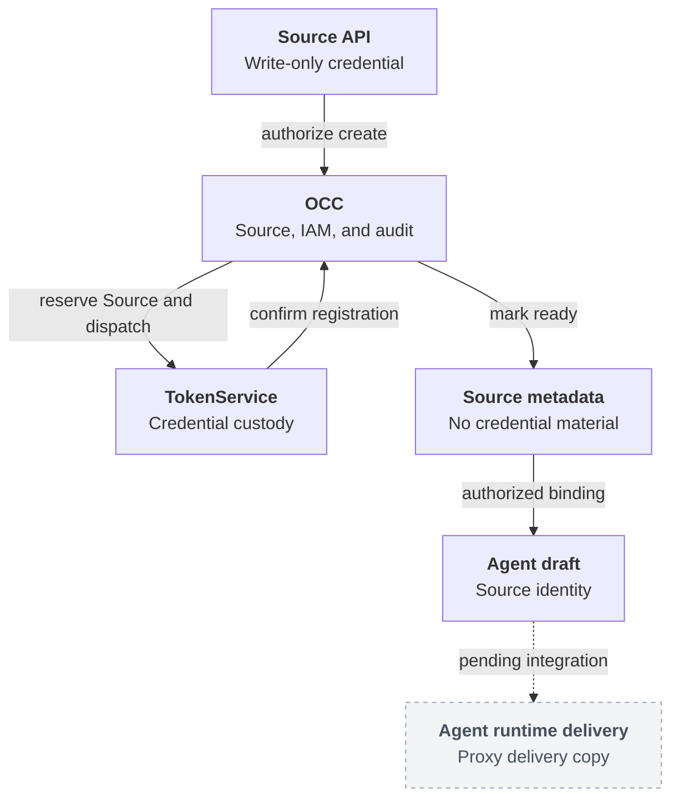

# Credential source lifecycle flow

## Overview

OpenClaw Control Plane (OCC) authorizes Source operations and stores Source metadata. For [managed static Sources](token-service-static-custody.md), the selected TokenService owns credential custody. A caller supplies the credential through write-only Source registration; the caller does not create a separate Namespace Secret. Enrollment, update, and retirement are available, but managed Agent deployment and native delivery are not yet integrated.

## Entry Points

- Trigger: CredentialSource create, update, or delete; Agent draft binding or deployment.
- Source: `apps/controller/src/http/credential-sources.ts:createCredentialSource`
- Source: `packages/occ/src/managed-credential-sources.ts:createManagedCredentialSource`
- Source: `packages/occ/src/agent-credential-access.ts:authorizeAgentCredentialSources`
- Context: a ready Namespace, selected owner Driver, and grants for the exact source operation.

## Flow

Solid arrows show implemented enrollment and draft binding. The dashed edge marks the missing managed Agent delivery integration.

## Execution Trace

### 1. Register a source

`apps/controller/src/http/credential-sources.ts:createCredentialSource`, `packages/occ/src/managed-credential-sources.ts:createManagedCredentialSource`

The caller sends the credential in the write-only `secret` field of Source POST. OCC authorizes `credential_source:create` on the ready Namespace, reserves the Source with the selected TokenService instance, grants the creator access, and commits the registration-start audit before dispatch. The Source owns no Namespace Secret reference; OCC records metadata and the private registration receipt, while TokenService owns the credential material.

OCC commits a dispatch claim before it calls `TokenServiceDriver.registerSource`. A confirmed registration lets OCC mark the Source `ready` and commit its success audit. A refusal before any write can remove the reservation; an uncertain write keeps the Source available for retirement through its recorded owner. Responses contain sanitized Source metadata and never return the supplied credential or private receipt. See the [managed static reference](../reference/credential-sources/managed-static.md) for inputs and the [custody flow](token-service-static-custody.md) for the dispatch and recovery sequence.

The deprecated `CredentialGatewayDriver` and transitional protected Source forms are deferred to separate cutovers.

### 2. Update a source

`packages/occ/src/credential-source-operations.ts:credentialSourceUpdateIdentity`, `packages/occ/src/managed-credential-sources.ts:updateManagedCredentialSource`

OCC authorizes exact `credential_source:update` and dispatches PATCH by the locked Source owner. For a managed static Source, TokenService replaces material from the write-only `secret` field; omitted fields retain their values. A provider-preset change or removal requires an unbound Source and a separate request from credential replacement. For material changes, OCC commits updated metadata and audit after the owner confirms the operation; a preset-only change updates metadata and audit directly. See the [managed static reference](../reference/credential-sources/managed-static.md) for PATCH rules.

### 3. Bind and admit an Agent revision

`packages/occ/src/harness-auth.ts:authorizeHarnessAuthSource`

OCC requires exact `credential_source:operate` for a new binding to a ready Source in the same Namespace. A caller can remove an obsolete binding without looking up its Source. A managed static Source can be saved for Harness authentication in the Agent draft, but deployment refuses it before creating a revision or queuing work. PostgreSQL records references and prevents deletion while the Source is bound.

### 4. Resolve the source at dispatch

`apps/controller/src/worker.ts:authorizeRevision`, `apps/controller/src/worker.ts:resolveRevisionSecretContext`

For source types supported by deployment, the worker rechecks actor and Agent grants, selected Driver identity, source ownership, and withdrawal state before Compute prepares the Sandbox. Kubernetes checks supported source types and deployment restrictions before release. The managed Source path does not reach this worker dispatch yet.

#### Pending native integration

The staged native Proxy can accept an admitted binding and deliver a credential copy to OpenShell, but the regular Agent workflow does not call it. Status fails closed until source-version authority and exact native executable enforcement are qualified. See the [native credential delivery flow](native-service-account-credential-delivery.md) for the staged boundary.

### 5. Retire a source

`packages/occ/src/managed-credential-sources.ts:deleteCredentialSource`

DELETE requires exact `credential_source:delete` and rejects blocking Agent, revision, deployment, provisioning, or withdrawal references. OCC marks the Source `deleting`, asks its recorded TokenService to remove material, then removes the Source and IAM bindings with completion audit. If a dispatched registration might have written material without returning a receipt, OCC retains the Source until its [dispatch-based retirement fence](token-service-static-custody.md#4-retire-the-source) passes and the owner confirms removal. Uncertain removal leaves the Source available for an authorized DELETE retry.

## Debugging and Verification

Run the [managed PostgreSQL integration](../../tests/integration/postgres-staged-agent-credential-binding.test.ts) with the [PostgreSQL test environment](../testing/postgresql.md#postgresql-test-environment). It covers real Fastify routes, PostgreSQL, Native IAM, TokenService custody, sanitized reads, update and denial audit, retirement, Agent draft binding, and pre-revision deployment refusal. Kubernetes API transport is simulated; this does not prove runtime delivery or a model turn. The [custody flow](token-service-static-custody.md#debugging-and-verification) owns detailed Source verification.

## Related docs

- [Credential sources](../reference/credential-sources.md)
- [Managed static Sources](../reference/credential-sources/managed-static.md)
- [Secret storage and delivery](secret-storage-and-delivery.md)
- [Managed static TokenService custody](token-service-static-custody.md)

## Manual Notes

[keep this for the user to add notes. do not change between edits]

## Changelog

- 2026-11-21 20:12: Limit the lifecycle to managed enrollment and the pending Agent delivery boundary. (authoring-run/06394127-de30-40bc-9196-521c3f9e710a - 0d3f97e68830607320a3bfe6a781d38539a26fbe)

- 2026-11-21 11:54: Lead the lifecycle with managed TokenService enrollment and mark old custody paths as transitional. (authoring-run/22722819-a3e4-4a6e-ae08-9e23bde479dd - 15794c3860bcf982b500774d8c700fbcd19aaf71)

- 2026-11-21 11:45: Reconcile enrollment status with the extracted source flow. (authoring-run/16cfa409-7c14-4f52-9167-3e897f919125 - 7533013d1061c433e27883818cf69f955239c43f)

- 2026-11-20 19:04: Refresh sources. (authoring-run/8a8bde8b-71de-4de5-80bf-e32f0e335c34 - 220f62d86ceb3dfc6f66dbee7c6f86cda50e5d05)
- 2026-11-20 16:33: Point Harness binding and snapshot checks to their source module. (authoring-run/5406c3c6-28fa-42a9-a7a7-4afa642738f1 - 56b116735a3a38a48eff35bf36152d3032b1d7d3)

- 2026-11-20 16:18: Link managed enrollment. (authoring-run/9bb61048-2680-4355-9169-bd7a6dd316af - 27b47ccbf7223c303b844af151c9712082380919)

- 2026-11-20 10:13: Name the serving protected source owner as the legacy egress Driver. (01a1f7ec-0d9e-7803-96c3-eb88548e3788 - b02e93892)
- 2026-11-20 08:10: Clarify serving and internal custody, registration checks, dispatch, and deletion retry behavior. (01a1eae9-8497-74d2-a9c7-9bc93809e94a - 6c7aeed58)
- 2026-11-20 07:59: Rewrite the serving lifecycle around source ownership, Agent delivery, and staged native limits. (01a1eae9-8497-74d2-a9c7-9bc93809e94a - e76d323cb)

[Earlier documentation history](credential-source-lifecycle/history.md) preserves the previous dated entries.
