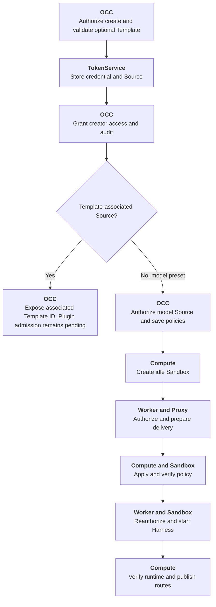

# Credential source lifecycle flow

## Overview

An operator registers a credential with TokenService and selects its Source for an Agent. OpenClaw Control Plane (OCC) authorizes the Source, checks the model destination against the saved network permission, and records the approved policy in an Agent revision. Compute, Worker, Sandbox, and Credential Proxy then prepare the credential route before starting the Harness. The [credential reference](../reference/credential-sources.md#intended-credential-flow) describes the broader proposed model and plugin design; its [status table](../reference/credential-sources.md#implementation-status) separates current support from remaining work.

## Entry Points

- Trigger: register, bind, deploy, update, or retire a managed credential Source.
- Source: `packages/occ/src/managed-credential-sources.ts:createManagedCredentialSource`
- Source: `packages/occ/src/agent-deployment-admission.ts:createAgentDeploymentAdmission`
- Source: `apps/controller/src/worker.ts:configureCredentialDeployment`
- Context: a ready Namespace, selected TokenService, Sandbox and Credential Proxy, and the caller's and Agent's required Source permissions.

## Flow

The arrows show implemented control flow. Readiness checks do not by themselves prove a successful model request or all enforcement guarantees.

## Execution Trace

### 1. Register a source

`packages/occ/src/managed-credential-sources.ts:createManagedCredentialSource`

OCC checks `credential_source:create` for the ready Namespace before looking up an optional Connection Template selection. It rejects an unavailable, foreign, or non-static Template, or a Template selection combined with a model provider preset, before calling TokenService. TokenService creates the canonical Source, saves its optional Template ID, and stores the write-only credential in its private custody. OCC then grants the creator access and records completion. The response never contains the credential. Independent commits can leave orphaned material or a Source without its creator grant if completion fails; the [custody flow](token-service-static-custody.md) owns those cases.

OAuth consent follows the [browser workflow](connection-templates.md#3-authorize-the-account-in-the-browser). OCC keeps temporary consent state without creating a Source, exchanges the returned authorization code, and calls the same selected TokenService registration boundary with the grant and original consent metadata. TokenService creates the ready OAuth Source and takes custody of its tokens; OCC grants access and audits completion. Both Source types return their Template ID. The OAuth subtype also retains the original consent version and selected client. Resolving the current Template version during Plugin credential admission remains pending.

### 2. Bind and admit an Agent revision

`packages/occ/src/harness-auth.ts:authorizeHarnessAuthSource`, `packages/occ/src/agent-deployment-admission.ts:createAgentDeploymentAdmission`

The caller binds a ready Source in the same Namespace and selects it for Harness authentication. OCC verifies the Source owner, the provider's authorized destination, the caller's and Agent's Source permissions, and one matching saved network grant within the Installation ceiling. OCC records the Source reference and separate network and per-binding injection policies in the Agent revision. An unsupported or ambiguous route is refused before deployment work is created.

### 3. Prepare credential delivery

`apps/controller/src/drivers/compute/kubernetes/index.ts:prepareRevisionWorkloads`, `apps/controller/src/worker.ts:configureCredentialDeployment`, `apps/controller/src/drivers/credential-proxy/openshell.ts:configureDeployment`

Compute creates and records an idle Sandbox, with the model credential route withheld, and makes the authenticated Gateway operator route available for node enrollment. It asks Worker to configure the recorded target. Worker rechecks the deploying actor and Agent's access to the exact Source, confirms its TokenService instance, and gives Credential Proxy a resolver limited to that Source.

The OpenShell Proxy resolves the credential and version from TokenService only when it creates an absent OpenShell Provider delivery copy. It reuses an existing owned Provider without resolving or updating its credential, then attaches the Provider to the Sandbox. If a new attachment fails, Proxy attempts to delete its owned Provider and profile; OpenShell refuses Provider deletion while another Sandbox is attached. The Harness receives a placeholder. Compute asks Sandbox to apply the admitted network policy and waits until that policy is applied and matches the revision and the Proxy reports ready. Sandbox then prepares the launch inputs while leaving the Harness stopped.

### 4. Activate and stop the Agent

`apps/controller/src/worker.ts:authorizedCredentialDeployment`, `apps/controller/src/drivers/compute/kubernetes/index.ts:activateRevision`

Worker selects the Agent revision and checks Source authorization again before each activation attempt. Sandbox starts the Harness. Compute waits for authenticated runtime readiness and workspace-node enrollment before publishing user chat and delegated browser routes. A pending readiness result leaves activation pending; a terminal error fails the operation.

On Stop, Compute deletes the Sandbox, then asks Proxy to remove or confirm absence of the revision's binding. It retains the saved target until cleanup succeeds. If a cleanup operation instead keeps the Sandbox, Sandbox must remove the policy's reference to the Provider before Proxy detaches it. Proxy attempts to delete its owned Provider and profile after cleanup; an attached-Provider refusal means it retains the shared copy until the last detach. The TokenService Source remains available for another deployment.

### 5. Update or retire a Source

`packages/occ/src/managed-credential-sources.ts:updateManagedCredentialSource`, `packages/occ/src/managed-credential-sources.ts:deleteCredentialSource`

OCC checks permission on the exact Source and dispatches credential changes to its TokenService owner. Credential replacement is allowed while an active Agent revision uses the Source. Changing or removing the provider preset still requires an unbound Source and a separate request.

#### Deliver Source updates

`apps/controller/src/composition/token-service.ts:installTokenServiceDriver`, `apps/controller/src/drivers/token-service/occ.ts:updateSource`, `apps/controller/src/drivers/credential-proxy/openshell.ts:notifyCredentialUpdated`

API composition connects the selected native Proxy to TokenService and binds a trusted Source Namespace placement resolver. After committing replacement material, TokenService sends the exact Source reference and version, with a lazy resolver bound to that Source and TokenService instance. The Proxy returns without resolution or creation if no Provider exists. Otherwise it updates the owned Provider through conditional `UpdateProvider`. It validates the returned target receipts, waits on the same receipt while status is pending or persisted, and checks fresh admission and serving evidence before acknowledging an activated target. A never-activated target needs no serving observation. The wait does not repeat the update.

If delivery fails, the replacement remains in TokenService custody. OCC audits the committed update and delivery failure separately, and PATCH returns `503 DEPENDENCY_UNAVAILABLE`. Manual retry and live rotation qualification remain pending.

#### Retire the Source

Static Source DELETE refuses blocking references and records retirement intent. OCC asks the selected Proxy to retire its delivery copy before TokenService removes the Source and credential from custody. Proxy retirement failure returns `503` and retains the Source and credential for retry. See the [custody flow](token-service-static-custody.md#4-retire-the-source) for ordering and failure handling. OAuth disconnect instead retires the private grant through TokenService; the current pushed delivery path supports static credentials only.

## Debugging and Verification

Use the [PostgreSQL test environment](../testing/postgresql.md#postgresql-test-environment) for the [managed Source and Agent integration](../../tests/integration/postgres-staged-agent-credential-binding.test.ts) and [Worker integration](../../tests/integration/postgres-worker-agent-revision-credential-sources.test.ts). The first exercises Source DELETE and Agent Stop through Worker, Compute, and the concrete Proxy; Stop starts from simulated delivery state with an absent Sandbox. The second sends an authenticated active-Source PATCH through the selected native Proxy and verifies its update receipt. Controlled Kubernetes and gRPC transports do not establish live delivery or a model turn. See the [custody verification notes](token-service-static-custody.md#debugging-and-verification) for details.

## Related docs

- [Credential sources](../reference/credential-sources.md)
- [Managed static Sources](../reference/credential-sources/managed-static.md)
- [Credential custody](token-service-static-custody.md)

## Manual Notes

[keep this for the user to add notes. do not change between edits]

## Changelog

- 2026-11-23 13:30: Trace canonical static and OAuth Source creation through the selected TokenService and remove the separate association and saved connection. (authoring-run/447bea0a-5c7e-477e-9924-ad4cdb7ab35a - d00c725c9c752dee95ffb33bd0395fa5d49e6929)

- 2026-11-23 01:53: Change Source associations and metadata to use a Template ID while preserving the OAuth consent version. (01a1f7eb-2091-7c21-9b03-27f01f958b69 - cd806684a)

- 2026-11-22 15:16: Trace static Source Template validation and immutable association, and OAuth consent projection. (01a1f7eb-2091-7c21-9b03-27f01f958b69 - e302d9e90)

- 2026-11-22 14:53: Combine the credential workflow with committed Source delivery updates and controlled caller proof. (authoring-run/bdd1048e-11c2-4f1f-9021-5069535f66bf - ad9964a9b2975199780000000c6ada2a2e8b376a)

- 2026-11-22 12:21: Combine committed Source notification with native Provider receipt readiness. (authoring-run/52979f29-7db2-44bf-a8e4-3a7d8a6b9134 - 4df883ed81bb92632f909d76346d7874ec2761c5)

- 2026-11-22 12:28: Describe native Provider cleanup after failed attachment and Agent teardown. (authoring-run/81ce6a62-aa40-44d2-8f4f-48c6b97428fc - 802c9adb9)

- 2026-11-22 12:08: Explain first-use Provider creation and the accepted stale-copy limitation. (authoring-run/193bbeb9-3f9b-4d51-a11f-6f763c5a299f - a6b923bad)

- 2026-11-22 11:54: Restore first-use-only Provider delivery and update the Worker resolver source pointer. (01a1ec21-b384-7472-887f-945ae0ab16fc - 2c2c13373)

- 2026-11-22 10:07: Explain Source authorization, policy, delivery, activation, and cleanup in runtime order. (authoring-run/3ab053df-6573-4709-94ef-7e3feb6a77f2 - 591f2311a)

- 2026-11-22 08:39: Bind native delivery to the selected OCC TokenService implementation before Gateway access. (01a1eae9-8497-74d2-a9c7-9bc93809e94a - f3a2121af)
- 2026-11-21 22:19: Integrate TokenService-owned Source enrollment and Worker startup with native Proxy delivery and cleanup. (01a1eae9-8497-74d2-a9c7-9bc93809e94a - 86772f7b5)
- 2026-11-21 22:05: Refresh retained pushed Providers during configuration and confirm Gateway authority before cleanup. (authoring-run/068f73af-8c65-4481-b861-0f2d1fc3fb46 - 82926b330)
- 2026-11-21 21:55: Reconcile TokenService-owned enrollment with staged Agent admission and startup. (01a1ec21-b384-7472-887f-945ae0ab16fc - 91de87598)
- 2026-11-21 21:39: Describe native readiness, cleanup, and temporary first-launch limits. (authoring-run/636084e8-b670-450a-b9e2-3347acaab3be - 1693a34aa)
- 2026-11-21 21:24: Prepare an idle target, start the fresh Harness at activation, and refuse unsupported TokenService source withdrawal. (01a1ec21-b384-7472-887f-945ae0ab16fc - 840e8ac00)
- 2026-11-21 21:14: Describe independently committed TokenService operations and partial outcomes. (authoring-run/e9a8f5b4-f521-4f22-ab7b-1639413a47a4 - f7a5c4b60d7902f6d13a41faaf13386931648795)
- 2026-11-21 20:59: Hold the first staged startup until activation and refuse competing or replacement deployments. (01a1ec21-b384-7472-887f-945ae0ab16fc - 6baee5df7)
- 2026-11-21 20:34: Move Source creation and lifecycle ownership to TokenService. (authoring-run/8bfb022d-2367-4ffc-b161-e5ea19cb7a80 - 55c444f3735a372e9f76a8f7e85a8ec4396ef7c7)
- 2026-11-21 20:21: Reauthorize the source before activation. (01a1ec21-b384-7472-887f-945ae0ab16fc - 9c11a8786)
- 2026-11-21 20:14: Validate native delivery against the admitted runtime binding and policy. (authoring-run/f9a96a90-7e99-4a4b-a6d8-d40f4bf1b797 - 28a98dda9)
- 2026-11-21 20:12: Limit the lifecycle to managed enrollment and the pending Agent delivery boundary. (authoring-run/06394127-de30-40bc-9196-521c3f9e710a - 0d3f97e68830607320a3bfe6a781d38539a26fbe)
- 2026-11-21 19:51: Reconcile OCC service owners. (01a1ec21-b384-7472-887f-945ae0ab16fc - e12513764)
- 2026-11-21 11:54: Lead the lifecycle with managed TokenService enrollment and mark old custody paths as transitional. (authoring-run/22722819-a3e4-4a6e-ae08-9e23bde479dd - 15794c3860bcf982b500774d8c700fbcd19aaf71)
- 2026-11-21 11:45: Reconcile enrollment status with the extracted source flow. (authoring-run/16cfa409-7c14-4f52-9167-3e897f919125 - 7533013d1061c433e27883818cf69f955239c43f)
- 2026-11-20 23:19: Record staged provision dispatch and observe the saved target on every retry. (01a1ec21-b384-7472-887f-945ae0ab16fc - 63d179f67)
- 2026-11-20 19:04: Refresh sources. (authoring-run/8a8bde8b-71de-4de5-80bf-e32f0e335c34 - 220f62d86ceb3dfc6f66dbee7c6f86cda50e5d05)
- 2026-11-20 18:49: Document enrolled retry target identity and v8 State admission. (01a1ec21-b384-7472-887f-945ae0ab16fc - c272bc823)
- 2026-11-20 16:33: Point Harness binding and snapshot checks to their source module. (authoring-run/5406c3c6-28fa-42a9-a7a7-4afa642738f1 - 56b116735a3a38a48eff35bf36152d3032b1d7d3)
- 2026-11-20 16:18: Link managed enrollment. (authoring-run/9bb61048-2680-4355-9169-bd7a6dd316af - 27b47ccbf7223c303b844af151c9712082380919)
- 2026-11-20 10:13: Name the serving protected source owner as the legacy egress Driver. (01a1f7ec-0d9e-7803-96c3-eb88548e3788 - b02e93892)
- 2026-11-20 09:05: Connect staged Agent callers to the selected native delivery Driver and distinguish readiness qualification. (01a1ec21-b384-7472-887f-945ae0ab16fc)
- 2026-11-20 08:10: Clarify serving and internal custody, registration checks, dispatch, and deletion retry behavior. (01a1eae9-8497-74d2-a9c7-9bc93809e94a - 6c7aeed58)
- 2026-11-20 07:59: Rewrite the serving lifecycle around source ownership, Agent delivery, and staged native limits. (01a1eae9-8497-74d2-a9c7-9bc93809e94a - e76d323cb)
