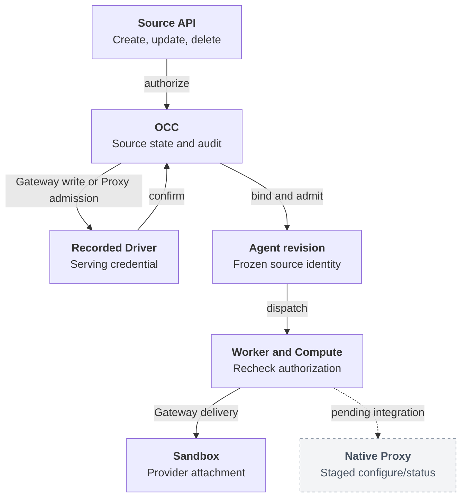

# Credential source lifecycle flow

## Overview

When a caller registers a CredentialSource, OpenClaw Control Plane (OCC) authorizes the action and records its owner and references. In the current serving path, the owner is a Credential Gateway or Proxy; OpenShell holds Gateway-managed values. Internal sources have separate [TokenService custody](token-service-static-custody.md). When an Agent deploys, OCC saves the source identity in its revision, and the worker rechecks authorization before delivery. Update, withdrawal, and deletion are separate operations.

## Entry Points

- Trigger: CredentialSource create, update, or delete; Agent binding and deployment; or Agent source withdrawal.
- Source: `apps/controller/src/http/credential-sources.ts:createCredentialSource`
- Source: `packages/occ/src/index.ts:createCredentialSource`
- Source: `packages/occ/src/index.ts:withdrawAgentCredentialSource`
- Context: a ready Namespace, selected owner Driver, and grants for the exact source operation.

## Flow

The dashed edge marks missing workflow integration, not a tested deployment.

## Execution Trace

### 1. Register a source

`packages/occ/src/index.ts:createCredentialSource`

OCC authorizes `credential_source:create`, locks the ready Namespace, and checks that the selected owner offers the requested source type before it reads a Secret or writes to a Driver. Invalid fields return `400`; an unoffered type returns `409`. Each Secret must belong to the Namespace, and the caller needs `secret:operate`. For a Gateway-managed source, OCC reads the Secret to copy its value to the Gateway. For a protected static source, OCC first checks that its selected provider is compatible and registered once, then verifies the credential format and its authoritative version without retaining the value. See the [source reference](../reference/credential-sources.md) for inputs and the [protected flow](credential-source-egress.md#1-admit-source-and-install-the-revision-plan) for admission details.

`packages/occ/src/index.ts:abandonCredentialRegistration`, `apps/controller/src/drivers/credential-gateway/openshell.ts:registerSource`

Registration and deletion reject inherited controller transactions before effects, so their intermediate states can commit independently. For Gateway-managed sources, OCC commits `registering` before calling the Gateway. OpenShell checks Provider ownership and creates the source-owned Provider and profile; Refresh alone receives refresh material. Success commits `ready` and audit together. A failed or uncertain external write triggers cleanup through the original owner. If cleanup cannot confirm removal, the record stays `deleting`; if DELETE wins the race, POST compensates without taking over DELETE's issuer withdrawal. Protected Proxy sources instead complete [protected admission](credential-source-egress.md) without a Gateway registration write; migration requires an unbound source.

### 2. Update a source

`packages/occ/src/index.ts:updateCredentialSource`

OCC authorizes `credential_source:update`, locks a ready source, and validates replacement Secret references. Device-authorized sources refuse PATCH before Secret reads. For Gateway-managed sources, the external write precedes the commit of references and audit; a failed commit can leave OpenShell newer until the request is repeated. OpenShell updates reach subsequently started processes. A protected static source must be unbound before it can be updated; OCC then repeats Proxy admission and commits replacement references without a Gateway update. Refresh rotation follows the [refresh flow](credential-source-refresh.md#4-update-and-rotation).

### 3. Bind and admit an Agent revision

`packages/occ/src/index.ts:authorizeHarnessAuthSource`

OCC checks `credential_source:operate` for existing bindings without requiring a lookup, so a caller can remove an obsolete binding. New bindings require a ready same-Namespace source and its recorded owner. Harness authentication requires a Gateway. PostgreSQL records Agent/source references and prevents deletion while referenced.

`packages/occ/src/index.ts:deployAgent`, `packages/occ/src/state/platform-state.ts:assertRevisionAuthAvailable`

OCC rechecks the caller's and Agent's source grants, requires a Sandbox and an offered owner type, then freezes source ID, type, owner Driver, and Harness login mode in the Agent revision. A selected Proxy cannot replace a withdrawn Gateway type or change an existing source's owner. State rejects stale or forged snapshots; PostgreSQL holds ordered Namespace, Agent, and source locks through commit. Compute accepts only supported Harness/Driver pairings and sends no model Secret to the workload.

### 4. Resolve the source at dispatch

`apps/controller/src/worker.ts:authorizeRevision`, `apps/controller/src/worker.ts:resolveRevisionSecretContext`

The worker rechecks actor and Agent grants, selected Driver identity, live source ownership, and withdrawal state before Compute prepares the Sandbox. Kubernetes checks the supported source type and deployment restrictions before delivery or Sandbox release. Credential Gateway delivery attaches the Provider through the bundled attachment handler; protected Proxy sources use their separate configuration path. [OAuth delivery](credential-source-refresh.md#device-authorization-and-configuration) gives the workload a placeholder and account metadata, never refresh tokens. The [Sandbox flow](openshell-sandbox-provisioning.md) owns provisioning and Harness-specific restrictions.

#### Pending native integration

`apps/controller/src/drivers/egress-proxy/openshell.ts:configureDeployment`, `apps/controller/src/drivers/sandbox/openshell-gateway-client.ts:attachSandboxProvider`

The staged native Proxy accepts a trusted admitted binding, exact target, and source-bound resolver. It rejects a mismatched target before resolving material. First use transfers material into a Provider and attaches it with a Sandbox resource-version precondition; compatible reuse does not resolve or repair material. The Gateway client validates the receipt and returned Sandbox, and the Proxy checks Provider identity/version and final membership before returning a runtime placeholder projection.

The regular Agent workflow does not call this path. Status fails closed because its signature lacks the admitted binding and exact native executable enforcement remains unqualified. A same-name replacement with the same resource version can still receive the Provider before the Proxy rejects its ID ([OpenShell issue](https://github.com/NVIDIA/OpenShell/issues/5794)). Malformed receipts yield no staged result; legacy serving ignores that result, and RPC errors are sanitized.

### 5. Withdraw or delete a source

`packages/occ/src/index.ts:withdrawAgentCredentialSource`, `apps/controller/src/worker.ts:processCredentialWithdrawal`, `packages/occ/src/index.ts:deleteCredentialSource`

Withdrawal requires `agent:operate` and queues version-scoped work without deploying a revision. The worker rechecks each requester's grant. For Credential Gateway delivery, Compute detaches the OpenShell Provider and confirms its receipt; protected Proxy sources instead reduce the approved policy. Denied requesters require replay. Unconfirmed revocation retries, and replay or maintenance recovers pending work. Deploy and repair never restore withdrawn access, including after a late Sandbox create.

DELETE requires `credential_source:delete` and refuses Agent, revision, or pending-deployment references and unfinished withdrawal. OCC marks `deleting` and removes material through the recorded owner. Prepared sources first withdraw issuer tokens; an unsettled token blocks deletion. Refresh removes refresh state before the Gateway removes its owned Provider and profile. Credential-free sources have no material to remove. OCC then deletes the record and commits audit. Uncertain cleanup retains `deleting`.

A registration write can finish after deletion starts. To prevent that late write from recreating material after the source record is gone, OCC keeps a Gateway or Proxy source in `deleting` for up to 70 seconds after creation and returns `503` with `Retry-After`. Internal TokenService sources use a separate [dispatch-based wait](token-service-static-custody.md#5-recover-failures) when registration might have reached their owner without a receipt.

## Debugging and Verification

Inspect source `status`, worker reason codes, and withdrawal state. `CREDENTIAL_GATEWAY_MISMATCH`, `HARNESS_AUTH_SOURCE_UNAVAILABLE`, and `CREDENTIAL_WITHDRAWN` identify a changed selection, unavailable source, or withdrawal. [API](../../tests/integration/credential-source-api.test.mjs), [worker](../../tests/integration/postgres-worker-agent-revision.test.mjs), and [controlled staged wire](../../tests/conformance/openshell-staged-credential-proxy.test.ts) coverage have different dependency boundaries. The staged fixture does not prove Worker integration, admission, Sandbox composition, or a live model request. Use the [OpenShell testing guide](../testing/openshell.md#openshell-sandbox) for runtime proof.

## Related docs

- [Credential sources](../reference/credential-sources.md)
- [Credential Gateway contract](../reference/drivers/credential-gateway.md)
- [Secret storage and delivery](secret-storage-and-delivery.md)
- [Internal static TokenService custody](token-service-static-custody.md) has no public enrollment or Agent delivery.

## Manual Notes

[keep this for the user to add notes. do not change between edits]

## Changelog

- 2026-11-20 08:10: Clarify serving and internal custody, registration checks, dispatch, and deletion retry behavior. (01a1eae9-8497-74d2-a9c7-9bc93809e94a - 6c7aeed58)
- 2026-11-20 07:59: Rewrite the serving lifecycle around source ownership, Agent delivery, and staged native limits. (01a1eae9-8497-74d2-a9c7-9bc93809e94a - e76d323cb)

[Earlier documentation history](credential-source-lifecycle/history.md) preserves the previous dated entries.
