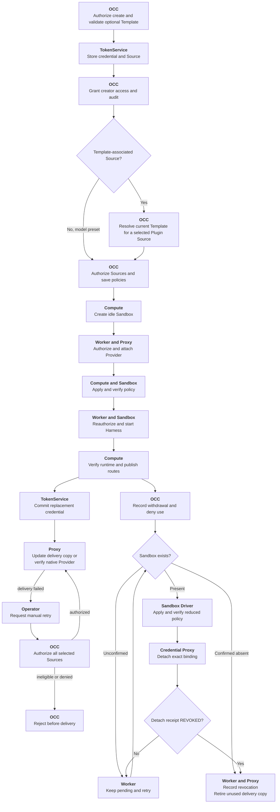

# Credential source lifecycle flow

## Overview

OpenClaw Control Plane (OCC) authorizes selected Sources and records approved policy in the Agent revision. Compute, Worker, Sandbox, and Credential Proxy prepare credential delivery before Harness startup. See the [credential reference](../reference/credential-sources.md#intended-credential-flow) and [current limits](../reference/credential-sources.md#implementation-status).

## Entry Points

- Trigger: register, bind, deploy, withdraw, update, retry delivery for, or retire a managed credential Source.
- Source: `packages/occ/src/managed-credential-sources.ts:createManagedCredentialSource`
- Source: `packages/occ/src/agent-deployment-admission.ts:createAgentDeploymentAdmission`
- Source: `packages/occ/src/agent-credential-retry.ts:pushAgentCredentials`
- Context: a ready Namespace, selected TokenService, Sandbox and Credential Proxy, and the caller's and Agent's required Source permissions.

## Flow

## Execution Trace

### 1. Register a source

`packages/occ/src/managed-credential-sources.ts:createManagedCredentialSource`

OCC checks `credential_source:create` and validates any static Template. TokenService creates the Source and stores the credential privately. OCC grants the creator access, audits completion, and returns nonsecret metadata. See the [custody flow](token-service-static-custody.md) for failures between commits.

The OpenShell TokenService checks a static credential against the [native size limit](../reference/credential-sources/managed-static.md#preview-openshell-custody) before importing a Provider profile or changing a Provider.

The deprecated legacy Proxy still exposes a separate [protected metadata Source](../reference/credential-sources/protected-repository-metadata.md). Credential 1.0 retires it; ordinary metadata reads have only a Sandbox network rule.

After [Template consent](connection-templates.md#3-authorize-the-account-in-the-browser), TokenService creates the Source and stores the OAuth grant. The Source records the original Template version and client. Each new Plugin deployment resolves the Template’s current approved version. See [Source metadata](../reference/credential-sources.md#read-and-list-sources).

#### Device authorization and configuration

`packages/occ/src/device-authorization-flow.ts:createDeviceAuthorizationFlow`

OCC binds the private login session to the actor, Namespace, optional Agent,
and selected TokenService instance. Before polling the provider, OCC claims the
session in PostgreSQL. Before grant exchange, OCC rechecks Agent and Source
creation permissions, session version, expiry, and TokenService ownership.
TokenService exchanges the grant and saves the Source. Cancelling a pending
login creates no Source. Closing a completed session leaves the authorized
Source available.

GitHub App Sources follow the [issuance and renewal flow](#issue-and-renew-a-github-installation-token).

### 2. Bind and admit an Agent revision

`packages/occ/src/harness-auth.ts:authorizeHarnessAuthSource`, `packages/occ/src/agent-deployment-admission.ts:createAgentDeploymentAdmission`

The caller binds a ready Source in the same Namespace and selects it for Harness authentication. OCC verifies the Source owner, the provider's authorized destination, and the caller's and Agent's Source permissions. Admission uses a valid saved network grant or derives the exact [preset model requests](../reference/credential-sources/managed-static.md#native-model-requests) within the Installation ceiling. OCC records the Source reference and separate network and per-binding injection policies in the Agent revision. For a Plugin connection, OCC also checks the requests reported by the Plugin Driver against the current Source Template. The [native qualifier](../../apps/controller/src/composition/openshell-credential-admission.ts) compiles the complete proposed policy against the selected Sandbox defaults. OCC refuses an unsupported or ambiguous policy before it saves a revision or queues deployment.

### 3. Prepare credential delivery

`apps/controller/src/drivers/compute/kubernetes/index.ts:prepareRevisionWorkloads`, `apps/controller/src/worker.ts:configureCredentialDeployment`, `apps/controller/src/drivers/credential-proxy/openshell.ts:configureDeployment`

Compute records an idle Sandbox with model credential routes withheld, opens the authenticated operator enrollment route, and requests Worker configuration. Worker rechecks the deploying actor and Agent's Source access, matches each Source's identity, type, and TokenService instance to the revision snapshot, and refuses withdrawn or unavailable Sources. Proxy receives a resolver limited to admitted Sources.

For OCC custody, OpenShell Proxy creates or reuses a Provider per projection, resolving each Source at most once for new copies. Existing Providers attach without renewal. Each binding receives a fresh placeholder; failed attachment triggers cleanup. OpenShell refuses to delete an attached Provider.

For [OpenShell custody](../reference/credential-sources/managed-static.md#preview-openshell-custody), `apps/controller/src/drivers/token-service/openshell.ts:resolveNativeProvider` verifies Source, Workspace, and Provider identity. Proxy attaches that Provider. `apps/controller/src/drivers/sandbox/openshell.ts:prepareStagedHarness` maps its Source-specific supervisor placeholder to the binding's environment and removes the internal variable before starting the Harness.

Admission freezes the [three OAuth requests](../reference/credential-sources.md#codex-account-model-requests) or [seven PAT requests](../reference/credential-sources/managed-static.md#codex-pat) for one stock executable within the Installation ceiling. Both receive placeholders. Worker also projects trusted account metadata for OAuth.

Sandbox compiles HTTP and managed MCP bindings. MCP checks exact RPCs and selected tools at the approved endpoint. Sandbox refuses overlapping credential-free routes and unsupported broad Plugin grants. For Git, Proxy compares the complete effective policy, allowing name-only rules for approved attached Providers. Compute waits for Sandbox policy and Proxy readiness. See the [Proxy Driver reference](../reference/drivers/credential-proxy.md) for MCP exceptions.

### 4. Activate and stop the Agent

`apps/controller/src/worker.ts:authorizedCredentialDeployment`, `apps/controller/src/drivers/compute/kubernetes/index.ts:activateRevision`

Before each activation attempt, Worker rechecks Source authorization for the selected Agent revision. OAuth requires eligible custody and a readiness receipt for the Provider version. Sandbox starts the Harness. Compute publishes user chat and delegated browser routes after authenticated runtime readiness and workspace-node enrollment. A pending readiness result delays activation. A terminal error fails the operation.

On Stop, Compute deletes the Sandbox and retains the saved target until Proxy confirms binding removal or absence. If cleanup keeps the Sandbox, Sandbox Driver removes the policy's Provider reference before Proxy detaches it. Proxy retires its delivery copy and profile after the last detach. OpenShell custody retains the authoritative Provider until Source DELETE.

### 5. Withdraw an Agent binding

`packages/occ/src/agent-credential-withdrawal.ts:withdrawAgentCredentialSource`, `apps/controller/src/worker.ts:processCredentialWithdrawal`, `apps/controller/src/drivers/compute/kubernetes/index.ts:withdrawCredentialSource`, `apps/controller/src/drivers/credential-proxy/openshell.ts:removeDeployment`

OCC checks exact `agent:operate`, records pending withdrawals, and queues reconciliation. Worker rechecks the requester. Sandbox verifies the reduced injection policy and preserves independent, non-overlapping network grants. An overlapping retained grant prevents confirmed native reduction. Proxy detaches the binding from its recorded target and confirms a `REVOKED` receipt or Sandbox absence. Unconfirmed removal remains pending with `DEPENDENCY_UNAVAILABLE`.

Worker derives active bindings from the revision and confirmed withdrawals, omitting revoked optional Plugin bindings. Pending withdrawal, a missing required model, or failed readiness blocks activation. Proxy remains pending until the loaded policy and Provider fingerprint agree.

With OCC custody, Proxy attempts to retire copies and profiles after detachment. OpenShell refuses deletion while a Sandbox still uses the copy. With OpenShell custody, the authoritative Provider and profile remain in the Workspace. TokenService retains the Source credential. Already-sent requests can complete. See the [same-name detach limit](../reference/credential-sources.md#implementation-status).

### 6. Update or retire a Source

`packages/occ/src/managed-credential-sources.ts:updateManagedCredentialSource`, `packages/occ/src/managed-credential-sources.ts:deleteCredentialSource`

OCC checks permission on the exact Source and dispatches static credential replacement to its TokenService owner. An active Agent revision can keep using the Source during replacement. Changing or removing the provider preset requires an unbound Source and a separate request.

#### Deliver Source updates

`apps/controller/src/composition/token-service.ts:installTokenServiceDriver`, `apps/controller/src/drivers/token-service/occ.ts:updateSource`, `apps/controller/src/drivers/credential-proxy/openshell.ts:notifyCredentialUpdated`

API composition binds Proxy to trusted Namespace placement for OCC custody. After committing a replacement or renewal, TokenService sends the Source, version, and instance-bound resolver. If delivery Providers exist, Proxy resolves the credential once. When a Provider holds a different Source version, Proxy conditionally updates it and checks the update receipts for activated Sandboxes. If the committed version is already present, Proxy checks current serving readiness without rewriting the Provider or restarting policy activation.

With OpenShell custody, TokenService updates the authoritative Workspace Provider. Proxy checks its resource version after the update. OpenShell propagates the change to attached Sandboxes.

Delivery failure leaves committed material in custody. PATCH audits the update and failure separately and returns `503 DEPENDENCY_UNAVAILABLE`. OAuth leaves the old schedule due and retries the committed version without exchanging the rotated grant again.

#### Issue and renew a GitHub installation token

`apps/controller/src/drivers/token-service/occ.ts:createGitHubAppSource`, `apps/controller/src/drivers/token-service/github-app-issuer.ts:mintInstallationToken`, `apps/controller/src/composition/token-service.ts:scheduleTokenServiceMaintenance`

OCC TokenService reads the registered GitHub App Client and checks Namespace readiness and registry grants. It releases the database connection before GitHub enrollment. If registry IDs are missing, the issuer checks the installation account with a signed App request and mints by repository name. Otherwise it mints by ID. Both requests use verified HTTPS. It verifies exact repository scope, IDs, permissions, and expiry, then locks and rechecks the Namespace and Client before saving the Source and private token. The Client keeps its signing key. A known failed save triggers best-effort token revocation; an unknown commit outcome does not.

The API scans ready GitHub App Sources every five seconds. When a token is within 45 seconds of expiry, TokenService mints using verified IDs under the Source lock, commits a replacement, and notifies Proxy. Before renewal is due, a pending delivery record retries the same committed version across API restarts. The [OAuth scan](connection-templates.md#5-renew-the-grant) runs independently. Shutdown drains both scans before closing PostgreSQL.

#### Retry delivery

`apps/controller/src/http/credential-sources.ts:pushAgentCredentials`, `packages/occ/src/agent-credential-retry.ts:pushAgentCredentials`, `apps/controller/src/drivers/credential-proxy/openshell.ts:notifyCredentialUpdated`

For an Agent credential push, OCC selects unwithdrawn bindings from the active revision. It checks caller `agent:operate` and exact `credential_source:update`, plus Agent service-principal `credential_source:operate`, for the entire request before notifying Proxy.

A principal denial requests restored access and names only explicitly selected or readable Sources.

OCC sends Proxy each authorized Source reference and TokenService-bound resolver. For OCC custody, Proxy retries the conditional update and verifies serving receipts, including stale targets at the same version. The update can affect other Agents using that Provider. For OpenShell custody, success verifies Provider metadata; verify delivery on the running Sandbox. OCC reports `succeeded`, `resolution_failed`, or `delivery_failed` per Source. See [verification scope](../reference/credential-sources.md#implementation-status).

#### Retire the Source

OCC returns `409` while Agent, revision, deployment, provisioning or Plugin slot references block removal. When they clear, OCC records any OAuth revocation intent. For OCC custody, Proxy retires delivery copies before TokenService removes custody. Proxy failure returns `503` and retains custody for retry. Worker retries pending OAuth retirement. For OpenShell custody, TokenService deletes the authoritative Provider and profile. See the [static custody flow](token-service-static-custody.md#4-retire-the-source).

### 7. Enroll a Codex PAT Source

`packages/occ/src/managed-credential-sources.ts:createManagedCredentialSource`, `packages/occ/src/plugin-discovery.ts:withPluginDiscoveryCredential`, `apps/controller/src/drivers/plugin/hosted-catalog.ts`

A caller enrolls the PAT as a static Source with the `codex-pat` preset. OCC uses the ordinary Source creation grant, and TokenService stores the material. Hosted Apps resolves the authorized Source and the Plugin Driver verifies the account with the issuer. Agent admission records the Source for selected Proxy delivery. See [Enroll a Codex PAT Source](../guides/deploy/credential-lifecycle.md#enroll-a-codex-pat-source).

## Debugging and Verification

The [staged Source and Agent integration](../../tests/integration/postgres-staged-agent-credential-binding.test.ts) covers DELETE, Stop, and withdrawal through Fastify and PostgreSQL with controlled Kubernetes and OpenShell transports. The [Worker integration](../../tests/integration/postgres-worker-agent-revision-credential-sources.test.ts) covers active PATCH, retry authorization, and Proxy receipts with modeled attachments. See the [custody verification notes](token-service-static-custody.md#debugging-and-verification) for test setup and runtime proof limits.

For a failed retry result, check `credential.resolution_failed` or `credential.delivery_failed` logs and the mutation audit. Logs identify the Namespace, Source, request, and fixed error code without exposing credential material or backend errors.

## Related docs

- [Credential sources](../reference/credential-sources.md)
- [Managed static Sources](../reference/credential-sources/managed-static.md)
- [Credential custody](token-service-static-custody.md)

[Refresh flow history](https://github.com/openclaw/openclaw-enterprise/blob/2ed738ba4cb4c54802879a4c41ca98221f9716e8/docs/flows/credential-source-refresh.md) records the retired implementation.

## Manual Notes

[keep this for the user to add notes. do not change between edits]

## Changelog

- 2026-11-26 09:03: Check serving readiness for an already-persisted Source version without rewriting the Provider. (authoring-run/b6362a0b-1ad4-4db1-9018-9dba014291fc - fdd646b4ab8a8c9ad44a10ecfe09f88acae35735)

- 2026-11-25 13:09: Trace Client continuity during GitHub Source persistence. (authoring-run/2f7e175f-ccea-4569-8017-cb40f1852076 - 1fdc956c0c6f8e9c2d94f22adf220cc4dec92d19)
- 2026-11-25 11:27: Trace Credential Client persistence and direct GitHub issuance before the Source save transaction. (authoring-run/4cdd2925-8687-45e2-8e5f-6bc296f9f54c - b29bb40f04d07fb306f87aa8c1c260bb2a6e1e19)
- 2026-11-25 06:13: Trace generic native static custody and binding-specific placeholder delivery. (authoring-run/8d6879f5-e9be-4828-a054-6fb620189dfb - 2ed738ba4cb4c54802879a4c41ca98221f9716e8)

- 2026-11-24 15:22: Verify GitHub installation and mint by name. (authoring-run/2fff43ca-53a8-4cd9-a462-25f833fec902 - 83575ae57607ec1302aa119523df6e3b39a53c50)

- 2026-11-24 13:46: Trace static Source custody, direct Provider attachment, and retirement in the OpenShell development preview. (authoring-run/ee107727-89f5-45e8-b411-3dfb7b7aa9b5 - b3d10d91c1e7ae20dadcf22eb4b7e350df96b234)

- 2026-11-24 12:24: Trace PAT adoption and its failure boundary. (authoring-run/cb980faf-dd8e-4334-bc01-d795ff83eaeb - eefcbef7958ee233386b3172384d1777ebbb693d)
- 2026-11-24 10:41: Trace grant-only Codex login, native account delivery, renewal notification, and referenced Source refusal before revocation. (authoring-run/327102e0-6dec-42cc-b735-3c5cfe2874d3 - 219356409a900924f407bb247b6bc064710a218a)
- 2026-11-24 03:37: Clarify how TokenService creates a Source and how OAuth consent keeps its original Template version. (authoring-run/fce46218-b73c-4df8-94cb-dba64a455e23 - abdf66b8f3645433f29422b9783c24428f6f093c)

- 2026-11-24 10:09: Require selected Proxy retirement before OAuth custody removal in both the API and worker. (authoring-run/2f82fe10-6549-44c7-9e66-a75aca4b0406 - c3fe0bb531242c6e6b8fa22c28a1ffcdcdaef3cb)

- 2026-11-24 09:33: Document the existing Gateway and Proxy request and the recorded-owner lifecycle on the Source API. (authoring-run/fc29889e-e795-4b35-91dd-40a401edafe0 - 5fe2168a8d17bc7dee2d63a251093367da3ac446)

- 2026-11-24 09:12: Describe static Source retirement and OAuth disconnect alongside per-binding HTTP delivery. (authoring-run/460fd0ef-1bc5-4950-85de-bf351916de43 - 03091f9a99ec9cbc18e88f97c297e0e7c217054d)

- 2026-11-24 09:12: Describe managed MCP compilation from frozen bindings and its enforcement limits. (authoring-run/2270a9df-5f0f-4c15-b5e2-1f37520233e3 - 7bba27408a4ae30c1f7066b7d250b24ec0b36dd0)

- 2026-11-24 00:18: Describe per-binding delivery and Source-wide rotation and retirement. (authoring-run/71b868ab-4583-4018-8755-568a186c1c69 - 9ee73bafa34d54d0081e3fe1437c0f302ec1821f)

- 2026-11-23 16:40: Resolve admitted Sources through their selected TokenService after checking the frozen Source snapshot. (authoring-run/de26f92b-d7fd-42e6-a746-6a046aa3e0bf - f6c697e0d752b15132d5b4e9c1e8c06ccfec26cc)

- 2026-11-23 16:03: Narrow the broad network grant exception to the unique model grant. (authoring-run/9c98e573-cb4a-4060-a169-eccbce1e83cc - 5ce2820dff8456af43fe2444afae1ae63996ec31)

- 2026-11-23 15:59: Preserve the canonical single-model endpoint during serving recovery. (authoring-run/9c98e573-cb4a-4060-a169-eccbce1e83cc - af8cd7ac6bc79de5ebb104461f212ac3df6e250b)

- 2026-11-23 15:50: Describe staged Agent withdrawal, policy reduction, revocation receipts, and shared Provider retirement. (authoring-run/b7ff67de-4bf2-49de-9896-f5a97e79e49b - 82ab46ced89791f2283c64847c68c68bc54b1c02)

- 2026-11-23 15:48: Record native binding isolation, model authentication, and broad network grant refusals. (authoring-run/9c98e573-cb4a-4060-a169-eccbce1e83cc - 9d2d4df6ffdb04c76d4a1443f1f5aeaad00933d7)

- 2026-11-23 13:39: Describe native aggregate HTTP Plugin delivery and its admission proof boundary. (authoring-run/e1b79e98-189c-4036-9eec-f550acf642b9 - 44e86dc26055e434c3690e8601c66d52e6ef0968)

- 2026-11-23 13:30: Trace canonical static and OAuth Source creation through the selected TokenService and remove the separate association and saved connection. (authoring-run/447bea0a-5c7e-477e-9924-ad4cdb7ab35a - d00c725c9c752dee95ffb33bd0395fa5d49e6929)

- 2026-11-23 08:44: Trace Plugin selection of a Template-associated Source. (authoring-run/82130fc5-2b62-4e13-b10f-9521fbd7b536 - 5dcfdf664)

- 2026-11-23 08:04: Distinguish Template consent from the fixed built-in Codex OAuth preset. (authoring-run/cc0bf76f-7449-4eac-b151-d064ddc9580e - e4a24549373e8e111a15ec6da6b753eca4449646)

- 2026-11-23 05:38: Trace manual Agent credential delivery retry, authorization preflight, and per-Source outcomes. (authoring-run/7ccae64a-f7c3-40b7-8cc2-d7825d7b0eb4 - 44e86dc26)

- 2026-11-23 01:53: Change Source associations and metadata to use a Template ID while preserving the OAuth consent version. (01a1f7eb-2091-7c21-9b03-27f01f958b69 - cd806684a)

- 2026-11-22 15:16: Trace static Source Template validation and immutable association, and OAuth consent projection. (01a1f7eb-2091-7c21-9b03-27f01f958b69 - e302d9e90)

- 2026-11-22 14:53: Combine the credential workflow with committed Source delivery updates and controlled caller proof. (authoring-run/bdd1048e-11c2-4f1f-9021-5069535f66bf - ad9964a9b2975199780000000c6ada2a2e8b376a)

- 2026-11-22 12:21: Combine committed Source notification with native Provider receipt readiness. (authoring-run/52979f29-7db2-44bf-a8e4-3a7d8a6b9134 - 4df883ed81bb92632f909d76346d7874ec2761c5)

- 2026-11-22 12:28: Describe native Provider cleanup after failed attachment and Agent teardown. (authoring-run/81ce6a62-aa40-44d2-8f4f-48c6b97428fc - 802c9adb9)

- 2026-11-22 12:08: Explain first-use Provider creation and the accepted stale-copy limitation. (authoring-run/193bbeb9-3f9b-4d51-a11f-6f763c5a299f - a6b923bad)

- 2026-11-22 11:54: Restore first-use-only Provider delivery and update the Worker resolver source pointer. (01a1ec21-b384-7472-887f-945ae0ab16fc - 2c2c13373)

- 2026-11-22 10:07: Explain Source authorization, policy, delivery, activation, and cleanup in runtime order. (authoring-run/3ab053df-6573-4709-94ef-7e3feb6a77f2 - 591f2311a)

- 2026-11-22 08:39: Bind native delivery to the selected OCC TokenService implementation before Gateway access. (01a1eae9-8497-74d2-a9c7-9bc93809e94a - f3a2121af)
- 2026-11-21 22:19: Integrate TokenService-owned Source enrollment and Worker startup with native Proxy delivery and cleanup. (01a1eae9-8497-74d2-a9c7-9bc93809e94a - 86772f7b5)
- 2026-11-21 22:05: Refresh retained pushed Providers during configuration and confirm Gateway authority before cleanup. (authoring-run/068f73af-8c65-4481-b861-0f2d1fc3fb46 - 82926b330)
- 2026-11-21 21:55: Reconcile TokenService-owned enrollment with staged Agent admission and startup. (01a1ec21-b384-7472-887f-945ae0ab16fc - 91de87598)
- 2026-11-21 21:39: Describe native readiness, cleanup, and temporary first-launch limits. (authoring-run/636084e8-b670-450a-b9e2-3347acaab3be - 1693a34aa)
- 2026-11-21 21:24: Prepare an idle target, start the fresh Harness at activation, and refuse unsupported TokenService source withdrawal. (01a1ec21-b384-7472-887f-945ae0ab16fc - 840e8ac00)
- 2026-11-21 21:14: Describe independently committed TokenService operations and partial outcomes. (authoring-run/e9a8f5b4-f521-4f22-ab7b-1639413a47a4 - f7a5c4b60d7902f6d13a41faaf13386931648795)
- 2026-11-21 20:59: Hold the first staged startup until activation and refuse competing or replacement deployments. (01a1ec21-b384-7472-887f-945ae0ab16fc - 6baee5df7)
- 2026-11-21 20:34: Move Source creation and lifecycle ownership to TokenService. (authoring-run/8bfb022d-2367-4ffc-b161-e5ea19cb7a80 - 55c444f3735a372e9f76a8f7e85a8ec4396ef7c7)
- 2026-11-21 20:21: Reauthorize the source before activation. (01a1ec21-b384-7472-887f-945ae0ab16fc - 9c11a8786)
- 2026-11-21 20:14: Validate native delivery against the admitted runtime binding and policy. (authoring-run/f9a96a90-7e99-4a4b-a6d8-d40f4bf1b797 - 28a98dda9)
- 2026-11-21 20:12: Limit the lifecycle to managed enrollment and the pending Agent delivery boundary. (authoring-run/06394127-de30-40bc-9196-521c3f9e710a - 0d3f97e68830607320a3bfe6a781d38539a26fbe)
- 2026-11-21 19:51: Reconcile OCC service owners. (01a1ec21-b384-7472-887f-945ae0ab16fc - e12513764)
- 2026-11-21 11:54: Lead the lifecycle with managed TokenService enrollment and mark old custody paths as transitional. (authoring-run/22722819-a3e4-4a6e-ae08-9e23bde479dd - 15794c3860bcf982b500774d8c700fbcd19aaf71)
- 2026-11-21 11:45: Reconcile enrollment status with the extracted source flow. (authoring-run/16cfa409-7c14-4f52-9167-3e897f919125 - 7533013d1061c433e27883818cf69f955239c43f)
- 2026-11-20 23:19: Record staged provision dispatch and observe the saved target on every retry. (01a1ec21-b384-7472-887f-945ae0ab16fc - 63d179f67)
- 2026-11-20 19:04: Refresh sources. (authoring-run/8a8bde8b-71de-4de5-80bf-e32f0e335c34 - 220f62d86ceb3dfc6f66dbee7c6f86cda50e5d05)
- 2026-11-20 18:49: Document enrolled retry target identity and v8 State admission. (01a1ec21-b384-7472-887f-945ae0ab16fc - c272bc823)
- 2026-11-20 16:33: Point Harness binding and snapshot checks to their source module. (authoring-run/5406c3c6-28fa-42a9-a7a7-4afa642738f1 - 56b116735a3a38a48eff35bf36152d3032b1d7d3)
- 2026-11-20 16:18: Link managed enrollment. (authoring-run/9bb61048-2680-4355-9169-bd7a6dd316af - 27b47ccbf7223c303b844af151c9712082380919)
