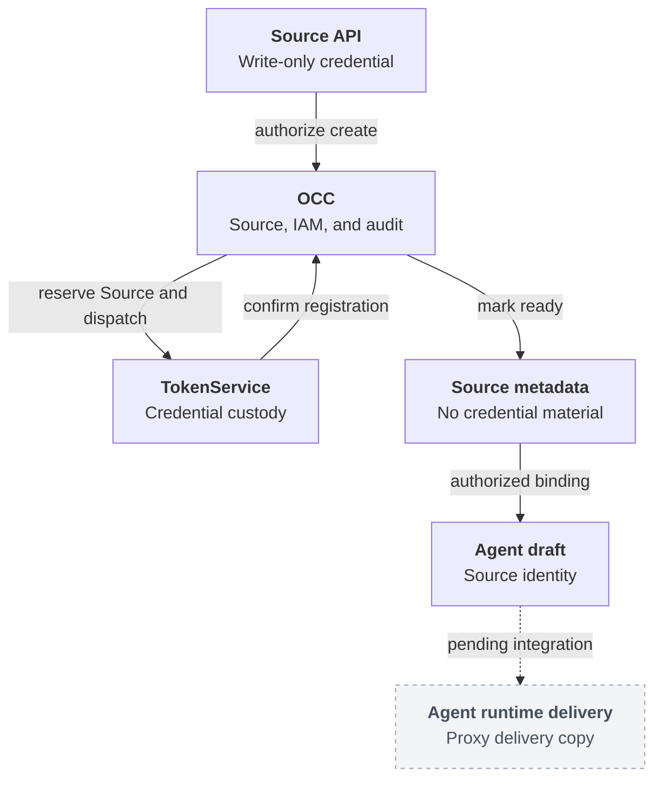

# Credential source lifecycle flow

## Overview

OpenClaw Control Plane (OCC) authorizes Source operations and stores Source metadata. For [managed static Sources](token-service-static-custody.md), the selected TokenService owns credential custody. A caller supplies the credential through write-only Source registration; the caller does not create a separate Namespace Secret. Enrollment, update, and retirement are available, but managed Agent deployment and native delivery are not yet integrated.

## Entry Points

- Trigger: CredentialSource create, update, or delete; Agent binding and deployment; or Agent source withdrawal.
- Source: `apps/controller/src/http/credential-sources.ts:createCredentialSource`
- Source: `packages/occ/src/managed-credential-sources.ts:createManagedCredentialSource`
- Source: `packages/occ/src/agent-credential-withdrawal.ts:withdrawAgentCredentialSource`
- Context: a ready Namespace, selected owner Driver, and grants for the exact source operation.

## Flow

Solid arrows show implemented enrollment and draft binding. The dashed edge marks the missing managed Agent delivery integration.

## Execution Trace

### 1. Register a source

`apps/controller/src/http/credential-sources.ts:createCredentialSource`, `packages/occ/src/managed-credential-sources.ts:createManagedCredentialSource`

The caller sends the credential in the write-only `secret` field of Source POST. OCC authorizes `credential_source:create` on the ready Namespace, reserves the Source with the selected TokenService instance, grants the creator access, and commits the registration-start audit before dispatch. The Source owns no Namespace Secret reference; OCC records metadata and the private registration receipt, while TokenService owns the credential material.

OCC commits a dispatch claim before it calls `TokenServiceDriver.registerSource`. A confirmed registration lets OCC mark the Source `ready` and commit its success audit. A refusal before any write can remove the reservation; an uncertain write keeps the Source available for retirement through its recorded owner. Responses contain sanitized Source metadata and never return the supplied credential or private receipt. See the [managed static reference](../reference/credential-sources/managed-static.md) for inputs and the [custody flow](token-service-static-custody.md) for the dispatch and recovery sequence.

The deprecated `CredentialGatewayDriver` (distinct from the OpenClaw Gateway runtime) and protected Proxy registration forms remain enabled during the serving cutover; see the [legacy Driver contract](../reference/drivers/credential-gateway.md#lifecycle) and [protected admission flow](credential-source-egress.md#1-admit-source-and-install-the-revision-plan).

### 2. Update a source

`packages/occ/src/credential-source-operations.ts:credentialSourceUpdateIdentity`, `packages/occ/src/managed-credential-sources.ts:updateManagedCredentialSource`

OCC authorizes exact `credential_source:update` and dispatches PATCH by the locked Source owner. For a managed static Source, TokenService replaces material from the write-only `secret` field; omitted fields retain their values. A provider-preset change or removal requires an unbound Source and a separate request from credential replacement. For material changes, OCC commits updated metadata and audit after the owner confirms the operation; a preset-only change updates metadata and audit directly. See the [managed static reference](../reference/credential-sources/managed-static.md) for PATCH rules.

Transitional Gateway and protected Proxy updates keep their existing owner-specific behavior. Device-authorized sources refuse PATCH before Secret reads, and refresh rotation follows the [refresh flow](credential-source-refresh.md#4-update-and-rotation).

### 3. Bind and admit an Agent revision

`packages/occ/src/harness-auth.ts:authorizeHarnessAuthSource`

OCC checks `credential_source:operate` for existing bindings without requiring a lookup, so a caller can remove an obsolete binding. New bindings require a ready same-Namespace source and its recorded owner. A managed static Source can be saved for Harness authentication in the draft, but deployment refuses it before creating an Agent revision. Supported Harness delivery requires the legacy Credential Gateway. PostgreSQL records Agent/source references and prevents deletion while referenced.

`packages/occ/src/agent-deployment-admission.ts:admitAgentDeployment`, `packages/occ/src/state/platform-state.ts:assertRevisionAuthAvailable`

OCC rechecks the caller's and Agent's source grants, requires a Sandbox and an offered owner type, then freezes source ID, type, owner Driver, and Harness login mode in the Agent revision. A selected Proxy cannot replace a withdrawn Gateway type or change an existing source's owner. State rejects stale or forged snapshots; PostgreSQL holds ordered Namespace, Agent, and source locks through commit. Compute accepts only supported Harness/Driver pairings and sends no model Secret to the workload.

### 4. Resolve the source at dispatch

`apps/controller/src/worker.ts:authorizeRevision`, `apps/controller/src/worker.ts:resolveRevisionSecretContext`

The worker rechecks actor and Agent grants, selected Driver identity, live source ownership, and withdrawal state before Compute prepares the Sandbox. Kubernetes checks the supported source type and deployment restrictions before delivery or Sandbox release. Legacy Gateway delivery attaches the Provider through the bundled attachment handler; protected Proxy sources use their separate configuration path. [OAuth delivery](credential-source-refresh.md#device-authorization-and-configuration) gives the workload a placeholder and account metadata, never refresh tokens. The [Sandbox flow](openshell-sandbox-provisioning.md) owns provisioning and Harness-specific restrictions.

#### Pending native integration

`apps/controller/src/drivers/credential-proxy/openshell.ts:configureDeployment`, `apps/controller/src/drivers/sandbox/openshell-gateway-client.ts:attachSandboxProviderWithReceipt`

The staged native Proxy accepts a trusted admitted binding, exact target, and source-bound resolver. It rejects a mismatched target before resolving material. First use transfers material into an OpenShell Provider delivery copy and attaches it with a Sandbox resource-version precondition; compatible reuse does not resolve or repair material. The OpenShell Gateway API client validates the receipt and returned Sandbox, and the Proxy checks Provider identity/version and final membership before returning a runtime placeholder projection.

When OCC TokenService is selected, composition pairs `credential_proxy_delivery` with the Sandbox; the regular Agent workflow does not call it. Status fails closed because current source-version authority and exact native executable enforcement remain unqualified. A same-name replacement with the same resource version can still receive the Provider before the Proxy rejects its ID ([OpenShell issue](https://github.com/NVIDIA/OpenShell/issues/5794)). The native RPC rejects malformed receipts and sanitizes errors; legacy serving keeps its separate Attach operation.

### 5. Withdraw or delete a source

`packages/occ/src/agent-credential-withdrawal.ts:withdrawAgentCredentialSource`, `apps/controller/src/worker.ts:processCredentialWithdrawal`, `packages/occ/src/managed-credential-sources.ts:deleteCredentialSource`

Withdrawal requires `agent:operate` and queues version-scoped work without deploying a revision. The worker rechecks each requester's grant. For legacy Gateway delivery, Compute detaches the OpenShell Provider and confirms its receipt; protected Proxy sources instead reduce the approved policy. Denied requesters require replay. Unconfirmed revocation retries, and replay or maintenance recovers pending work. Deploy and repair never restore withdrawn access, including after a late Sandbox create.

DELETE requires `credential_source:delete` and refuses Agent, revision, or pending-deployment references and unfinished withdrawal. OCC marks `deleting` and removes material through the recorded owner. Prepared sources first withdraw issuer tokens; an unsettled token blocks deletion. For legacy Gateway sources, Refresh removes refresh state before the Gateway removes its owned Provider and profile. Credential-free sources have no material to remove. OCC then deletes the record and commits audit. Uncertain cleanup retains `deleting`.

A registration write can finish after deletion starts. To prevent that late write from recreating material after the source record is gone, OCC keeps a legacy Gateway or protected Proxy source in `deleting` for up to 70 seconds after creation and returns `503` with `Retry-After`. Managed TokenService Sources use a separate [dispatch-based wait](token-service-static-custody.md#4-retire-the-source) when registration might have reached their owner without a receipt.

## Debugging and Verification

Inspect Source state and lifecycle audit for managed enrollment; record state does not attest credential usability. For existing Agent delivery, inspect source `status`, worker reason codes, and withdrawal state. `CREDENTIAL_GATEWAY_MISMATCH`, `HARNESS_AUTH_SOURCE_UNAVAILABLE`, and `CREDENTIAL_WITHDRAWN` identify a changed selection, unavailable source, or withdrawal. [API](../../tests/integration/credential-source-api.test.mjs), [worker](../../tests/integration/postgres-worker-agent-revision.test.mjs), and [controlled staged wire](../../tests/conformance/openshell-staged-credential-proxy.test.ts) coverage have different dependency boundaries. The staged fixture does not prove Worker integration, admission, Sandbox composition, or a live model request. Use the [OpenShell testing guide](../testing/openshell.md#openshell-sandbox) for runtime proof.

## Related docs

- [Credential sources](../reference/credential-sources.md)
- [Managed static Sources](../reference/credential-sources/managed-static.md)
- [Secret storage and delivery](secret-storage-and-delivery.md)
- [Managed static TokenService custody](token-service-static-custody.md)

## Manual Notes

[keep this for the user to add notes. do not change between edits]

## Changelog

- 2026-11-21 11:54: Lead the lifecycle with managed TokenService enrollment and mark old custody paths as transitional. (authoring-run/22722819-a3e4-4a6e-ae08-9e23bde479dd - 15794c3860bcf982b500774d8c700fbcd19aaf71)

- 2026-11-21 11:45: Reconcile enrollment status with the extracted source flow. (authoring-run/16cfa409-7c14-4f52-9167-3e897f919125 - 7533013d1061c433e27883818cf69f955239c43f)

- 2026-11-20 19:04: Refresh sources. (authoring-run/8a8bde8b-71de-4de5-80bf-e32f0e335c34 - 220f62d86ceb3dfc6f66dbee7c6f86cda50e5d05)
- 2026-11-20 16:33: Point Harness binding and snapshot checks to their source module. (authoring-run/5406c3c6-28fa-42a9-a7a7-4afa642738f1 - 56b116735a3a38a48eff35bf36152d3032b1d7d3)

- 2026-11-20 16:18: Link managed enrollment. (authoring-run/9bb61048-2680-4355-9169-bd7a6dd316af - 27b47ccbf7223c303b844af151c9712082380919)

- 2026-11-20 10:13: Name the serving protected source owner as the legacy egress Driver. (01a1f7ec-0d9e-7803-96c3-eb88548e3788 - b02e93892)
- 2026-11-20 08:10: Clarify serving and internal custody, registration checks, dispatch, and deletion retry behavior. (01a1eae9-8497-74d2-a9c7-9bc93809e94a - 6c7aeed58)
- 2026-11-20 07:59: Rewrite the serving lifecycle around source ownership, Agent delivery, and staged native limits. (01a1eae9-8497-74d2-a9c7-9bc93809e94a - e76d323cb)

[Earlier documentation history](credential-source-lifecycle/history.md) preserves the previous dated entries.
