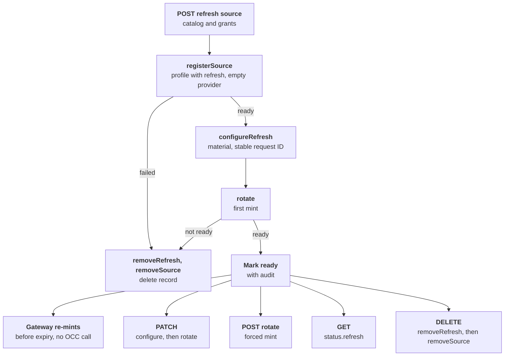

# Credential source refresh Flow

## Overview

A `refresh`-type credential source, such as `oauth2-client-credentials`, holds
issuer material instead of a static value. The API registers it with the
selected Credential Gateway, then asks the paired Credential Refresh Driver to
store the material and mint the first token. Afterwards the gateway re-mints
tokens before expiry without OCC, and the Agent keeps one stable placeholder.
OCC calls the refresh role again only to update material, force a rotation,
read status, or delete the source. This flow covers those calls; the
[credential source lifecycle flow](credential-source-lifecycle.md) owns
binding, admission, dispatch, and withdrawal, which are the same for every type.

In the [Codex device flow](#device-authorization-and-configuration), OpenShell keeps the
refresh grant and its successors. The Harness receives a stable placeholder and account
metadata; a separate operator connection can retrieve an access token for authorized
discovery. These [OAuth checks](../testing/openshell-oauth.md) do not qualify protected egress.

[OCE-prepared GitHub credentials](#6-oce-prepared-github-core) have a different owner.
An OCE worker prepares a repository-scoped installation token in the background.
[Git and draft pull requests](../reference/repository-credentials/prepared-native-git.md)
can use an eligible, committed token but cannot trigger issuance.

## Entry Points

- Trigger: `POST /namespaces/:namespaceId/credential-sources` with a `refresh`
  type, `PATCH`, `GET`, or `DELETE …/credential-sources/:credentialSourceId`,
  and `POST …/credential-sources/:credentialSourceId/rotate`.
- Source: `packages/occ/src/index.ts:createCredentialSource`
- Source: `packages/occ/src/index.ts:rotateCredentialSource`
- Source: `apps/controller/src/drivers/credential-refresh/openshell.ts:OpenShellCredentialRefreshDriver`
- Assumptions: the OpenShell Backend declares both `credential_gateway` and
  `credential_refresh`, and both Drivers are selected; the gateway's
  `toolBinaries` are configured, so the catalog lists the OAuth2 types; the
  OpenShell gateway trusts and reaches the issuer's `token_url`.

## Flow

## Execution Trace

### 1. Registration

`packages/occ/src/index.ts:createCredentialSource`

The API validates the request against the gateway catalog. Device-authorized
types defer the first mint to the completion path below. A type whose
`rotation` is `refresh` resolves the selected Credential Refresh Driver inside
the first transaction, so a missing selection fails before any gateway call.
The API reads the Secret values, commits the record as `registering`, and calls
the gateway's `registerSource` with config only: a refresh type's Secret values
are issuer material, so only the refresh Driver receives them.

The gateway posts the issuer material to `token_url` from its own network
position, so `validateOAuth2Config` refuses a `token_url` host that is an IP
address in any spelling, a `localhost` or `localdomain` name, or a single-label
name (the shapes of the gateway Pod's `/etc/hosts` aliases), before any Secret
read. Building the profile refuses a stored one, or a stored port `0`, too, so
attaching such a source fails. A `hostAliases` entry on the gateway Pod (the
OpenShell chart's `server.hostGatewayIP`) stays reachable by its name; that is
the deployer's choice.

The check also refuses names that reach the gateway Pod itself, which egress
NetworkPolicy does not police (finding 1356):

- A Pod DNS name (`10-42-0-5.idp.pod.cluster.local`) in any namespace: CoreDNS's
  default `pods insecure` answers it with the written address. CoreDNS ignores
  one or two leading labels before it, so any `pod` label after the second is
  refused, whatever the cluster domain (finding 1359).
- When the OpenShell Backend names the gateway's namespace
  (`apps/controller/src/backends/openshell.ts:placement`), any name in that
  namespace's `svc` or `pod` zone, whatever the cluster domain, and the shorter
  names the gateway Pod's DNS search list completes into it: `<x>.<namespace>`, `<x>.<y>.<namespace>`, and
  any name of up to three labels ending in the gateway Service or `<service>-*`. CoreDNS reads the leading
  labels as an endpoint (`<pod>.<service>-peer`, the StatefulSet Pod's own name) or a port and protocol
  (`grpc.tcp.<service>`), so the label count decides, not the port name (finding 1366). An `endpoint` host
  `<service>.<namespace>.svc[.<domain>]` or a dotted `serviceName` names one
  namespace at save. A bare `serviceName` runs in each tenant namespace, so only
  registration and attach know it. Registration refuses the name before any
  gateway write with `400` naming `/config/token_url`. Attach runs only in the
  worker: it refuses a stored one with a message that names the replacement, and
  the worker retries the revision. An IP address, node address, two-label
  `<service>.<namespace>` or other `endpoint` host names no namespace, and only
  Pod names are refused.

Issuers in other namespaces keep their Service names. OCC stores `token_url` as
the controller's URL parser serializes it (`new URL(token_url).href`), so the
gateway parses the spelling that was checked.

`apps/controller/src/drivers/credential-gateway/openshell.ts:registerSource`
imports a per-source OpenShell profile whose `access_token` credential declares
the OAuth2 strategy, `token_url`, and refresh-material names. It creates the
provider without a credential value, because OpenShell resolves a
gateway-mintable credential at runtime.

### 2. First mint

`packages/occ/src/index.ts:mintFirstRefreshToken`

OCC calls `configureRefresh` with the source config and resolved Secret values,
then `rotate`. Both request IDs are name-based UUIDs derived from the source ID
and step, so a replay is not applied twice. The OpenShell Driver sends
`ConfigureProviderRefresh` with `client_id`, `scope`, and the secrets as
material, and `RotateProviderCredential`; OpenShell calls the issuer and stores
the access token on the provider. A thrown call leaves the outcome unknown, and
OCC keeps the record `deleting` after cleanup. A definite non-`ready` mint is
terminal: OCC removes the refresh material and provider, deletes the record, and
returns `503` with the Driver's failure code. Otherwise the second transaction
marks the source `ready` with its audit event.

### Device authorization and configuration

`packages/occ/src/index.ts:startAgentDeviceAuthorization`,
`pollAgentDeviceAuthorization`, `withPluginDiscoveryCredential`

For a type declaring `deviceAuthorization.harnessId`, OCC registers the empty
source before asking the paired Refresh Driver to start device login. It then
stores the opaque handle, actor, source, and Driver IDs in the session Secret.
The HTTP handler in `apps/controller/src/index.ts` records the successful start
before sending the session reference. The audit event identifies the Agent or
Namespace, not the session Secret.

`apps/controller/src/console/agents/device-login.mts:createDeviceLogin` keeps
`start_unconfirmed` in the form draft if the start has no response status or its
successful response is unusable. The form blocks another start. Without a
confirmed session reference, it also cannot poll or cancel. See
[interrupted sign-in recovery](../guides/deploy/credential-lifecycle.md#recover-an-interrupted-codex-sign-in).
For a known session, compare-and-swap permits one poll at a time. OCC rechecks scope and
both Driver selections before accepting completion. An uncertain exchange closes
the handle without removing the source or repeating the exchange.

`apps/controller/src/drivers/credential-refresh/codex-device-authorization.ts:startCodexDeviceAuthorization`
starts the issuer request from the API Pods. The start, poll, and token-exchange
requests use fixed `auth.openai.com` endpoints and refuse redirects, so login
material is never forwarded to a redirect target. It preserves the existing
`DeviceAuthorizationStartError` distinction: connection failure or timeout is
`unreachable`; HTTP rejection, malformed replies, and `AbortError` are
`unavailable`. The HTTP handler returns `503 DEPENDENCY_UNAVAILABLE`, naming
`auth.openai.com` and API Pod egress only for `unreachable`. The
`device_authorization.start_failed` warning keeps the Refresh boundary and allowed
failure class, never provider messages, response bodies, or nested causes.

`apps/controller/src/drivers/credential-refresh/openshell.ts:pollDeviceAuthorization`
performs the Codex exchange, configures OpenShell with refresh material, and
stores trusted account metadata. Before acquiring a code, its issuer polling
returns pending on HTTP `429`, `5xx`, or a fetch connection failure; OCC retains
the handle and its polling interval. An aborted initial poll, including OCC's
internal timeout, closes the session and requires a fresh login; it is not
retried as pending. Failures from code acquisition onward likewise close the
session without replay. OpenShell owns
future refresh and successor persistence. Polling uses existing state after handoff; unfinished refresh stays
pending, while a persistent uncertain marker needs operator inspection.
Ready confirms a usable token. Later versions attach the existing provider
without reseeding credentials; account metadata changes require a new login and
version.

For plugin configuration, the Gateway reads ownership/account metadata using its
ordinary Backend identity, then calls `GetProviderCredentials` through the
separate operator-TLS channel. OpenShell may refresh to satisfy its five-minute
remaining-lifetime requirement. Only access credentials enter the callback; it
rechecks the caller's authority and saved-Agent binding/grant before provider I/O.
Closing or expiring the login session does not disable source-based discovery.
Cancellation or a failed recheck cannot undo gateway refresh already started.

### 3. Background refresh

`apps/controller/src/drivers/credential-refresh/openshell.ts:refreshStatus`

OpenShell re-mints the token before it expires and writes it to the provider.
The Sandbox proxy substitutes the current token for the stable placeholder on
each request, so a running Harness needs no restart. OCC makes no call.
`GET` on the source adds `refreshStatus` to the gateway status; OpenShell's
`refreshed` state reports `ready`, its error states report `failed` with a
recovery action, and missing established refresh state reports `failed`. OCC finds the
type through `refreshDriverForSource`, which tolerates a type the catalog no
longer offers: that source keeps its gateway status without `refresh`.

### 4. Update and rotation

`packages/occ/src/index.ts:updateCredentialSource`

`PATCH` locks the source, not the Namespace, so other Namespace writes do not
wait on the issuer. A field the catalog marks `issuerRotated` (`refresh_token`)
must name a different Secret than the recorded one, or the update returns `409`
before any Secret read: OpenShell may hold a newer token. `PATCH` then reads
its Secrets and checks the gateway status. For a `refresh` type it calls
`configureRefresh` with a new request ID, then `rotate`, instead of the
gateway's `updateSource`. A non-`ready` mint returns `503` before OCC replaces
the Secret references, but OpenShell keeps the new material, the next `GET`
reports the failed mint, and OCC records a `failure` audit event. OpenShell
starts a new authorization epoch on each reconfiguration, even one whose mint
fails, which revokes the stable placeholders of running Sandboxes, so Agents
need a redeploy.

`packages/occ/src/index.ts:rotateCredentialSource`

`POST …/rotate` requires `credential_source:update`, a `ready` source, and a
`refresh` type; a static type returns `409`. It calls `rotate` under the source
lock and returns the new status. The HTTP handler commits the audit event in
the same transaction; a failed mint commits a `failure` event instead. A commit
whose outcome is unknown records neither event.

### 5. Deletion

`packages/occ/src/index.ts:deleteCredentialSource`

After the usual reference check and `deleting` mark, OCC calls `removeRefresh`,
then the gateway's `removeSource`. Before `DeleteProviderRefresh`,
`apps/controller/src/drivers/credential-refresh/openshell.ts:ownedProvider`
checks the exact source Namespace and paired Gateway ID, then the current
provider's manager/source labels and profile identity. A missing provider is
already clean; a foreign provider or failed lookup refuses cleanup. The deletion
RPC retains `allow_missing`. Explicit rotation uses the same guard but refuses absence. The check protects against
out-of-band provider drift; lookup and mutation are not atomic. A failure leaves
the record `deleting` for retry.

### 6. OCE-prepared GitHub core

`apps/controller/src/drivers/repo/github/credentials/prepared-owner.ts:createGitHubPreparationOwner`

A background worker can prepare one admitted GitHub App grant without traffic
from an Agent. The owner commits an `issuing` attempt before retrieving the exact
signing key version, then checks the family, owner epoch and that attempt again
before calling GitHub. It reuses the existing signer and installation-token
exchange. This is the [OCE-owned GitHub preparation option](../../specs/rfcs/0023-egress-proxy-credential-lifecycle/protocol.md#prepare-and-renew-credentials).

GitHub issuance cannot be atomic with local storage. The owner verifies the exact
returned repository, rights and provider expiry. The publication transaction
rechecks the fence and remaining validity, then commits the token with its own
opaque material version. A late, invalid or ambiguous result stays quarantined
across owner changes. If storage loses a token before commit, the recorded attempt
still blocks replay. Recovery and cleanup need an explicit owner.

The shared response parser identifies custody separately from scope evidence
(see [response capture](repository-credentials.md#4-reserve-acquire-and-dispatch)).
Ambiguous fields quarantine a uniquely identified token for cleanup. Repeated
root token keys leave no candidate to revoke automatically; the retained intent
blocks replay and requires explicit recovery.

The trusted Resolver gets only a read port. It can receive still-eligible
committed material during renewal. Cold, expired or differently admitted material
returns `not_ready`, including when validity runs out during the read. The
Resolver must authorize both access and the actual send.

The optional PostgreSQL lifecycle joins the family transaction, encrypted custody,
and retained attempts. The worker retains the dedicated 32-byte custody
key across restarts; the API does not receive it. Only the worker prepares material.
The Installation owns the HTTPS issuer and its trust roots; a source cannot redirect the issuer. A cold or
expired read cannot start an exchange, and uncertain issuance blocks another attempt.

The grant names one Agent. Once that Agent's deletion begins, the shared live predicate
stops claims, renewal and use. The worker's next pass disables the family and retires its
current token for revocation. Agent deletion never waits on GitHub. Deleting the source
waits up to 25 seconds for a revocation in flight; other unsettled custody still returns `409`.

`apps/controller/src/drivers/repo/github/credentials/prepared-postgres.ts:store`
clears the previous committed buffer and token buffers still on the publication
draft in `finally`, even if the callback, sealing or SQL publication fails. Callers
own their detached warm reads. Clearing a local buffer does not revoke a provider token.

## Debugging and Verification

- `node --test tests/integration/repository-credentials-github-prepared.test.mjs`
  exercises producer → transaction commit → warm consumer over loopback HTTPS,
  with a generated App key and actual JWT signature verification. It covers
  renewal overlap, duplicate attempts, latest-admission fences, rejected provider
  scope/expiry, cancellation, and transaction failures before/after commit.
  Its serializable in-memory fixture reconnects owners to shared committed state;
  it is not production durability, process-crash, live-provider, installed-runtime,
  cluster or regular Agent workflow proof.
  `postgres-prepared-github-lifecycle.test.mjs` exercises the durable lifecycle,
  signed protected exchange, issuer rotation, withdrawal, Agent deletion and quarantine over loopback.

- Read the source: `status.refresh.state`, `lastRefreshAt`, `failureCode`, and
  `recoveryAction` explain the last mint without exposing a token.
- `oauth_token_endpoint_unavailable` means the OpenShell gateway Pod could not
  reach `token_url`; check its NetworkPolicy and trust of the issuer's CA.
- `reauthorize` requires new authorization: replace Secret-backed material with
  `PATCH`; for device-authorized sources, sign in again and rebind the Agent.
- `tests/integration/sandbox-driver-openshell-k3d-real.test.mjs` proves minting,
  background re-minting, forced rotation, reauthorization, a failed update, and deletion against
  a real Keycloak. `tests/conformance/credential-source-occ.test.mjs` covers OCC
  ordering and cleanup.

## Related docs

- [CredentialRefreshDriver contract](../reference/drivers/credential-refresh.md)
- [OpenShell Credential Gateway](../reference/drivers/openshell-credential-gateway.md#oauth2-refresh-sources)
- [Credential sources](../reference/credential-sources.md#rotate-a-refresh-source)
- [Credential source lifecycle flow](credential-source-lifecycle.md)

## Manual Notes

[keep this for the user to add notes. do not change between edits]

## Changelog

- 2026-10-22 09:48: Distinguish a start the Console cannot confirm from an uncertain exchange on a known session. (01a162e5-0e51-7b41-915c-00017912b787 - 9a6b9c3e69a9fce4a859d70307257c0319fbdfda)

- 2026-10-16 22:08: Distinguish OpenShell-owned OAuth from background GitHub App preparation. (authoring-run/9fd90bae-7158-4df5-8f2e-62b0bd548272 - 4f98051f14)

- 2026-10-14 23:26: Restore issuer redirect refusal in all three moved device-login requests. (01a11d95-ebef-76e1-b9b9-9d3d2e88e99e - 6f0b9180125f80d9e490d77656d4919c574d5004)

- 2026-10-14 21:40: Refuse the three-label `<port>.<protocol>.<service>` short form of the gateway's Services. (fix-1366 - bc85338f2)

- 2026-10-14 01:13: Check current provider ownership before refresh mutation and retain fresh-login recovery after a poll timeout. (01a11d95-ebef-76e1-b9b9-9d3d2e88e99e - c5fb4880ebf2df2aedae12f99adb1992a930ba1b)

- 2026-10-13 19:42: Restore issuer-connectivity diagnostics at the Refresh-owned device-login boundary. (authoring-run/0754f915-95b1-457f-b261-5b1474f1dfe1 - 70431971c6b1e9157634d36a9d911480ad6d833f)

- 2026-10-13 09:37: Reconcile current admission and lifecycle behavior with external OAuth custody in the accompanying merge. (authoring-run/fd902939-ed58-4508-8d33-95a863d966af - e8d39978d801e7a5a8ac7242f32035f426da94e1)

- 2026-10-09 23:30: Update refuses a recorded refresh token; update and rotation hold only the source lock and audit failures. (fix-848-978-979)

- 2026-10-09 13:29: Keep retryable issuer polling pending before code acquisition while preserving the no-replay exchange boundary. (authoring-run/b15140a3-8d21-494c-b7c5-0c2dd362b30f - 69a0a6aaa5b3ba3aecd05d8780024e8d173f3a24)

- 2026-10-09 17:37: Trace Refresh-owned device authorization in the accompanying merge. (01a11d95-ebef-76e1-b9b9-9d3d2e88e99e - 1c2fbd2bc2953430e3ddaf68882176c6943ea7b2)

- 2026-10-08 16:19: Registration sends the gateway no refresh secrets; a failed update keeps the new material. (claude-code/session_014fi7Uq1LyofgqwLrLoQ3yY - f79f896b3)
- 2026-10-08 11:46: Reading a source no longer needs its type in the current catalog. (claude-code/session_014fi7Uq1LyofgqwLrLoQ3yY - 3ce93bfda)
- 2026-10-08 00:00: Created for OAuth2 refresh sources and the Credential Refresh Driver. (claude-code/session_014fi7Uq1LyofgqwLrLoQ3yY - 4151882d2)
