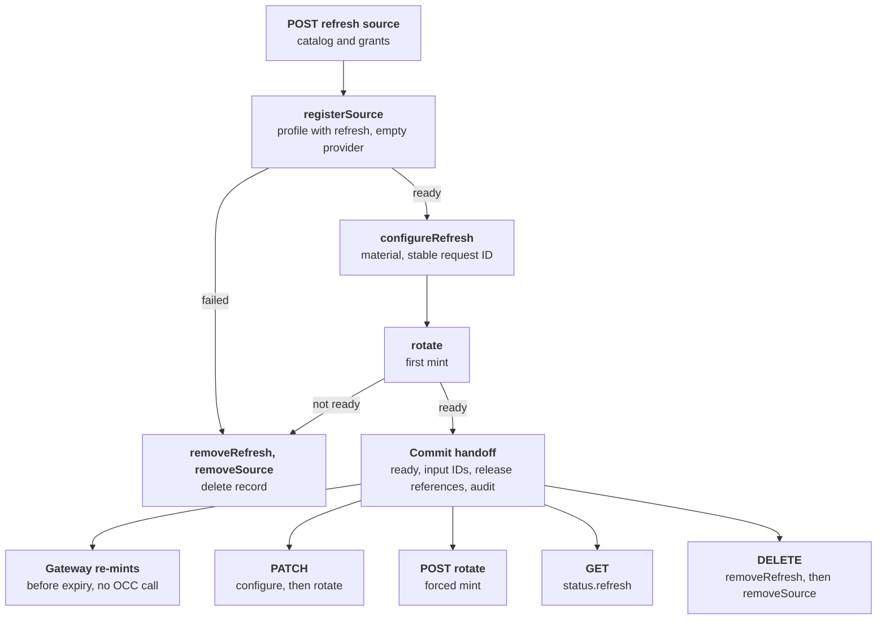

# Credential source refresh Flow

## Overview

A `refresh`-type credential source, such as `oauth2-client-credentials`, holds
issuer material instead of a static value. The API registers it with the
selected Credential Gateway, then asks the paired Credential Refresh Driver to
store the material and mint the first token. Afterwards the gateway re-mints
tokens before expiry without OCC, and the Agent keeps one stable placeholder.
OCC calls the refresh role again only to update material, force a rotation,
read status, or delete the source. This flow covers those calls; the
[credential source lifecycle flow](credential-source-lifecycle.md) owns
binding, admission, dispatch, and withdrawal, which are the same for every type.

## Entry Points

- Trigger: `POST /namespaces/:namespaceId/credential-sources` with a `refresh`
  type, `PATCH`, `GET`, or `DELETE …/credential-sources/:credentialSourceId`,
  and `POST …/credential-sources/:credentialSourceId/rotate`.
- Source: `packages/occ/src/index.ts:createCredentialSource`
- Source: `packages/occ/src/index.ts:rotateCredentialSource`
- Source: `apps/controller/src/drivers/credential-refresh/openshell.ts:OpenShellCredentialRefreshDriver`
- Assumptions: the OpenShell Backend declares both `credential_gateway` and
  `credential_refresh`, and both Drivers are selected; the gateway's
  `toolBinaries` are configured, so the catalog lists the OAuth2 types; the
  OpenShell gateway trusts and reaches the issuer's `token_url`.

## Flow

## Execution Trace

### 1. Registration

`packages/occ/src/index.ts:createCredentialSource`

The API validates the request against the gateway catalog. A type whose
`rotation` is `refresh` resolves the selected Credential Refresh Driver inside
the first transaction, so a missing selection fails before any gateway call.
The API reads the Secret values, commits the record as `registering`, and calls
the gateway's `registerSource` with config only: a refresh type's Secret values
are issuer material, so only the refresh Driver receives them.

`apps/controller/src/drivers/credential-gateway/openshell.ts:registerSource`
imports a per-source OpenShell profile whose `access_token` credential declares
the OAuth2 strategy, `token_url`, and refresh-material names. It creates the
provider without a credential value, because OpenShell resolves a
gateway-mintable credential at runtime.

### 2. First mint

`packages/occ/src/index.ts:mintFirstRefreshToken`

OCC calls `configureRefresh` with the source config and resolved Secret values,
then `rotate`. Both request IDs are name-based UUIDs derived from the source ID
and step, so a replay is not applied twice. The OpenShell Driver sends
`ConfigureProviderRefresh` with `client_id`, `scope`, and the secrets as
material, and `RotateProviderCredential`; OpenShell calls the issuer and stores
the access token on the provider. A thrown call leaves the outcome unknown, and
OCC keeps the record `deleting` after cleanup. A definite non-`ready` mint is
terminal: OCC removes the refresh material and provider, deletes the record, and
returns `503` with the Driver's failure code. Otherwise the second transaction
marks the source `ready`, records the last committed Secret IDs in internal
source-owned provenance, clears live Secret references, and appends the success
audit in one transaction (`handoffCredentialSourceSecrets`). The response's
`secrets` is `{}`. The operator may delete bootstrap Secrets once no other
consumer holds them. A definite rollback retains the prior state. If the database
commit outcome is unknown, reconcile the handoff and success audit before acting.
An unknown external outcome does not authorize another configure or mint.

### 3. Background refresh

`apps/controller/src/drivers/credential-refresh/openshell.ts:refreshStatus`

OpenShell re-mints the token before it expires and writes it to the provider.
The Sandbox proxy substitutes the current token for the stable placeholder on
each request, so a running Harness needs no restart. OCC makes no call.
`GET` on the source adds `refreshStatus` to the gateway status; OpenShell's
`refreshed` state reports `ready`, its error states report `failed` with a
recovery action, and missing refresh state reports `failed`. OCC finds the
type through `refreshDriverForSource`, which tolerates a type the catalog no
longer offers: that source keeps its gateway status without `refresh`.

### 4. Update and rotation

`packages/occ/src/index.ts:updateCredentialSource`

`PATCH` locks the source, not the Namespace, so other Namespace writes do not
wait on the issuer. A field the catalog marks `issuerRotated` (`refresh_token`)
must name a different Secret ID than its last committed handoff, or the update
returns `409` before any Secret read: OpenShell may hold a newer token. Changing
that Secret's value or deleting it does not remove the rejection. Every refresh
update requires explicit Secret inputs; `{}` returns `409`. This ID comparison
proves neither token freshness nor rejection of every older submission.

The source lock protects the provenance read. Legacy live bindings supply the
actual IDs until their first successful handoff. An issuer-rotated source with
neither live bindings nor retained history returns `503`; OCC does not invent
history or silently allow the resend. `PATCH` then reads its authorized
same-Namespace Secrets and checks the gateway status (including `pending`). For a `refresh` type it calls
`configureRefresh` with a new request ID, then `rotate`, instead of the
gateway's `updateSource`. A non-`ready` mint returns `503` before OCC replaces
the committed handoff IDs or releasing references, but OpenShell keeps the new material, the next `GET`
reports the failed mint, and OCC attempts the configured failure audit after rollback. OpenShell
starts a new authorization epoch on each reconfiguration, even one whose mint
fails, which revokes the stable placeholders of running Sandboxes, so Agents
need a redeploy. On success, the new last-committed IDs, live-reference release
and success audit commit together. A failed or unknown configure/mint response
before handoff does not replace the prior committed evidence. An unknown database
commit leaves the handoff and success-audit outcome unknown. The evidence is not
a record of every externally submitted attempt.

`packages/occ/src/index.ts:rotateCredentialSource`

`POST …/rotate` requires `credential_source:update`, a `ready` source, and a
`refresh` type; a static type returns `409`. It calls `rotate` under the source
lock and returns the new status. The HTTP handler commits the audit event in
the same transaction; after a failed mint and definite rollback, OCC attempts the
configured failure audit separately. An unknown
commit does not run the rollback-triggered failure audit; whether the success
event committed remains unknown and requires reconciliation.

### 5. Deletion

`packages/occ/src/index.ts:deleteCredentialSource`

After the usual reference check and `deleting` mark, OCC calls `removeRefresh`,
which sends `DeleteProviderRefresh` with `allow_missing`, and then the gateway's
`removeSource`. A failure leaves the record `deleting` for retry.

## Debugging and Verification

- Read the source: `status.refresh.state`, `lastRefreshAt`, `failureCode`, and
  `recoveryAction` explain the last mint without exposing a token.
- `oauth_token_endpoint_unavailable` means the OpenShell gateway Pod could not
  reach `token_url`; check its NetworkPolicy and trust of the issuer's CA.
- `reauthorize` follows a revoked refresh token; supply new material with `PATCH`.
- When run, `tests/integration/sandbox-driver-openshell-k3d-real.test.mjs` exercises minting,
  background re-minting, forced rotation, reauthorization, a failed update, and deletion against
  a real Keycloak. `tests/conformance/credential-source-occ.test.mjs` covers OCC
  ordering and cleanup.

## Related docs

- [CredentialRefreshDriver contract](../reference/drivers/credential-refresh.md)
- [OpenShell Credential Gateway](../reference/drivers/openshell-credential-gateway.md#oauth2-refresh-sources)
- [Credential sources](../reference/credential-sources.md#rotate-a-refresh-source)
- [Credential source lifecycle flow](credential-source-lifecycle.md)

## Manual Notes

[keep this for the user to add notes. do not change between edits]

## Changelog

- 2026-10-14 03:10: Release refresh bootstrap references while preserving last-committed Secret-ID rejection. (authoring-run/92488d54-b44d-449b-b76a-5ac69c9965d2 - b749f9e2b992f16169b69a3695a257239196b991)

- 2026-10-09 23:30: Update refuses a recorded refresh token; update and rotation hold only the source lock and audit failures. (fix-848-978-979)

- 2026-10-09 10:38: Document Secret-reference handoff and explicit refresh reauthorization for the accompanying change. (authoring-run/f7c45a46-6f14-42ea-acd8-7f8990a41d89 - 1c6ac12fb)

- 2026-10-08 16:19: Registration sends the gateway no refresh secrets; a failed update keeps the new material. (claude-code/session_014fi7Uq1LyofgqwLrLoQ3yY - f79f896b3)
- 2026-10-08 11:46: Reading a source no longer needs its type in the current catalog. (claude-code/session_014fi7Uq1LyofgqwLrLoQ3yY - 3ce93bfda)
- 2026-10-08 00:00: Created for OAuth2 refresh sources and the Credential Refresh Driver. (claude-code/session_014fi7Uq1LyofgqwLrLoQ3yY - 4151882d2)
