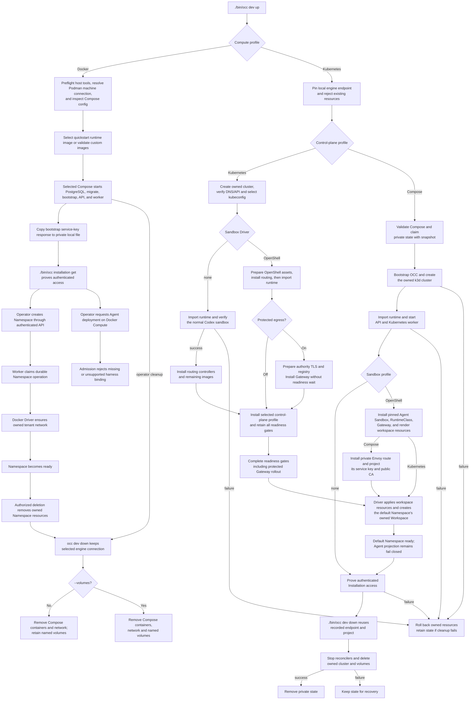

# Compose development flow

## Overview

`./bin/occ dev up` starts local OpenClaw Enterprise development from a checkout.
The `scripts/dev-up` entry point selects the same profile. By default OCC and
PostgreSQL run in Compose with Docker Compute. Operators can explicitly select
Kubernetes Compute with either the Compose control plane or the
[local k3d-only profile](../guides/deploy/local-kubernetes-development.md). The
Kubernetes profile can select the OpenShell Sandbox Driver for its fail-closed
path; it prepares pinned OpenShell infrastructure and reconciles rendered
workspace-chart resources before reporting readiness.
Compose-backed profiles perform host preflight, select Docker Engine or Podman,
prepare runtime images, start Compose, and wait for PostgreSQL migration,
Installation bootstrap, API health, and worker readiness. The Kubernetes-only
profile performs the equivalent readiness checks inside its owned cluster.
Startup proves authenticated Installation access with a protected local
bootstrap service key; it does not create an Agent or prove model execution.

For Docker Compute, the worker can reconcile Namespace infrastructure, but
Agent deployment stops at harness authentication admission because Docker
Compute rejects bindings. Kubernetes Agent execution continues through the
selected Kubernetes Compute Driver and the
[authenticated Agent deployment procedure](../guides/deploy/production-agents.md).

## Entry Points

- Trigger: `./bin/occ dev up [--key-output PATH] [-- COMPOSE_GLOBAL_OPTIONS...]`
  from the repository root, followed by authenticated Namespace operations.
- Source: `scripts/dev-up:require_command`, `internal/occdev/up.go:Up`, and
  `internal/occdev/openshell.go:prepareOpenShell`.
- Assumptions: Docker Engine with Compose, or Podman with `docker-compose` or `podman-compose` (Docker Compute requires `podman-compose`);
  Bash, curl, Python 3, and `yq` v4 for the Docker profile; writable PostgreSQL
  and Configuration volumes; loopback API publication; executable `bin/occ`
  built with `pnpm cli:build`. Startup needs no model credential.

The Kubernetes profile additionally uses `compose.kubernetes.yaml`,
`internal/occdev`, k3d, and kubectl. `./bin/occ dev down` owns profile cleanup;
`scripts/dev-down` dispatches to it. The local Kubernetes development guide
owns the operator procedure and destructive cleanup boundary.

## Flow

## Execution Trace

### 1. Start and initialize the local stack

`internal/occcli/dev.go:developmentCommand`,
`internal/occdev/egress_k3d.go:CheckDevelopmentProfile`, `scripts/dev-up`

Before Compute dispatch, the CLI checks protected-egress, database, and host-gateway
selectors through the existing development validators. Direct Docker script startup
calls the same check through `occ dev check-profile` before temporary-state creation
or engine probes; Kubernetes script startup dispatches to the guarded CLI.
Invalid or incompatible selections stop startup. Unset or `0` protected egress
preserves ordinary startup when its related selectors are absent.

Both shell wrappers locate the checkout with command-local `CDPATH="" cd`,
so shell search paths cannot change the selected repository or contaminate the
captured path; the delegated CLI retains the caller's original `CDPATH`.

[Docker or Podman Compose startup](docker-compose-development/startup.md) owns
engine selection, database initialization, local API admission and worker startup.

### 2. Prepare Namespace infrastructure and enforce Agent admission

`apps/controller/src/drivers/compute/docker/index.ts:DockerComputeDriver`

[Namespace execution and Agent admission](docker-compose-development/agent-execution.md)
traces API authorization, queued controller operations, tenant network ownership, unsupported
Agent authentication and exact resource removal.
The Driver rejects Docker API responses above 4 MiB from either a declared
content length or the bytes received before buffering the complete body.

### 3. Clean up Docker or Podman Compose

`internal/occdev/down.go:Down`, `internal/occdev/down.go:podmanComposeArgs`

`occ dev down` uses the selected engine and forwarded Compose project and file
options, including after partial startup. Podman retains the caller's selected
connection. Its reported API socket supplies `OCC_CONTAINER_ENGINE_SOCKET` only
to resolve the worker mount; a socket inside a macOS VM is not substituted for
the host connection. An unavailable engine or invalid socket fails cleanup.

Compose removes its project containers and network. Named database,
Configuration, and bootstrap volumes remain unless `--volumes` is explicit.
Agent-owned containers and Namespace networks remain the responsibility of
their platform deletion workflows; follow [safe development shutdown](../guides/deploy/local-operations.md#stop-development-safely).

### 4. Start and clean up Kubernetes development

`internal/occdev/up.go:Up`, `internal/occdev/down.go:Down`.

[The Kubernetes startup and cleanup trace](docker-compose-development/startup.md#12-select-kubernetes-development-and-preserve-cleanup-ownership)
follows profile selection, the private Compose snapshot, k3d creation, runtime
import, authenticated readiness, and cleanup through the recorded engine.

For the Kubernetes-only profile, `internal/occdev/openshell_k3d.go:upK3d`
creates the owned cluster, checks node DNS, and writes and selects its kubeconfig.
With Sandbox Driver `none`, it then imports the runtime image and runs
`prepareDevelopmentCodexSandbox` before installing private routing controllers.
Meanwhile, `internal/occdev/concurrent.go:concurrently` imports the controller
image, then checks network isolation while importing PostgreSQL and, when
configured, repository images. The first independent failure cancels the others
and is reported. A sandbox refusal or failed check rolls back the owned cluster
before Installation setup or credential delivery. OpenShell retains its
routing-controller installation, then runtime-import order. Both paths install
the platform only after the check, then gate on authenticated readiness.

`internal/occdev/kubernetes.go:importDevelopmentImage` exports each selected
image to its own temporary archive, with an explicit Linux platform on Docker.
`internal/occdev/k3d_import.go:importArchiveDirect` streams it into
k3d, retrying only its known closed-stream race, three times at most. The launcher
resolves the imported digest from containerd, rejects missing or ambiguous
results, and removes the archive. Tagged builds share this path.
`internal/occdev/registry_k3d.go:pullDevelopmentImage` pulls digest-pinned
`OCC_DEVELOPMENT_IMAGE_REGISTRY_CONTAINER` images instead; `state.json` records
the registry attachment for `occ dev down` to detach.

### 5. Prepare the optional OpenShell development profile

`internal/occdev/openshell_k3d.go:upK3d`,
`internal/occdev/openshell.go:prepareOpenShell`,
`apps/controller/src/drivers/sandbox/openshell.ts:ensureNamespace`

With `OCC_DEVELOPMENT_CONTROL_PLANE=kubernetes`, OpenShell uses the
Kubernetes-only lifecycle before Compose rendering. It pins K3s and OpenShell
inputs, installs PostgreSQL, OCE, and one central Gateway in `oce-system`, and
publishes only an admitted API proxy on host loopback. The source archive and all three
OpenShell images select 0.1.6 together, including the paired sandbox/supervisor
control protocol and compromised-key rejection. The observed-hook repository
credential preview admits 0.1.6 through its existing opt-in, held-launcher and
recipient checks. Repository-scoped access uses the separate
[protected Git enrollment](../guides/repository-credentials/openshell-enrollment.md).

By default, the Kubernetes lifecycle starts PostgreSQL, migration, bootstrap,
the API, and the worker in Compose. It installs the central Gateway in
`openshell-system` and exposes its fixed NodePort only to the owned container
network. Before starting the API and worker, the launcher installs pinned
cert-manager and Envoy Gateway controllers, renders only the Helm-owned private
routing resources, and copies the generated public CA and a dedicated service
key into the private state directory. The Installation uses the k3d node name
and Envoy HTTPS NodePort. After Compose starts, the launcher reapplies Envoy
ingress with the controller, Kubernetes worker, and k3d node `/32` addresses.
In both modes, the worker
creates the bootstrap Namespace through the regular Compute workflow. The
Sandbox Driver applies rendered workspace resources and the operator label
before creating the corresponding Gateway Workspace. Startup waits until the
OCC Namespace becomes ready. See the
[OpenShell flow](openshell-sandbox-provisioning.md#0-create-the-development-control-plane).

### 6. Start protected OpenShell transport

`internal/occdev/egress_k3d.go:protectedEgressSelection`,
`internal/occdev/openshell_k3d.go:installDevelopmentPlatform`,
`apps/controller/src/drivers/sandbox/openshell-gateway-client.ts:createClient`

The explicit protected profile requires Kubernetes Compute, Kubernetes control
plane, OpenShell Sandbox, and reviewed
candidate images/charts. It prepares authority server TLS and its public CA,
then installs OpenShell with native PKI and a TLS middleware registration.
OpenShell owns the complete Gateway server/client certificate and extension-JWT
key set. The launcher reads only its public key ID and writes the paired Backend,
egress Driver and authority listener settings into the Installation.

Gateway startup contacts the registry, so `installDevelopmentPlatform` defers
its readiness wait until after the OCE release's normal readiness gates. API
composition starts the authority; Backend validation is declarative, and worker
startup/preflight and health do not require a Gateway call. The final Gateway
rollout gate still precedes Namespace readiness. Any failure returns to the
existing owned-cluster rollback path; no empty registry response substitutes for
negotiation.

The chart projects the administrative client certificate into API and worker
only. The Backend supplies it to verified gRPC TLS for DNS or exact-IP server
identities. Service traffic keeps its separate scoped bearer identity. The API
alone receives authority TLS and the issuer public key; selected Gateway and
supervisor Pods can reach that listener through narrow NetworkPolicies. See the
[Backend authentication boundary](../reference/backends.md#openshell-gateway).

`selectedDevelopmentDatabase` validates an optional disposable database name
before effects. `installKubernetesControlPlane` uses that name in creation, readiness,
migrator and application URLs. Bootstrap, API and worker share the limited
application-role URL. PostgreSQL starts while the bootstrap volume is prepared;
Helm waits for both. Unselected profiles retain the existing database and
transport defaults. The [launch guide](../guides/deploy/local-openshell-images.md#select-the-protected-profile)
owns inputs; [packaging verification](../testing/static-egress.md#protected-launch-packaging)
distinguishes local proof from pending connected runtime qualification.

## Debugging and Verification

- `./scripts/dev-up` should show PostgreSQL readiness, migration completion,
  API listening on `127.0.0.1:${OPENCLAW_DEV_PORT:-3000}`,
  fresh-database initialization, `worker.started` with `computeDriverId` set to
  `compute-docker-development`, a private copied service-key path, and a
  successful authenticated `/installation` proof.
- With `OCC_DEVELOPMENT_COMPUTE_DRIVER=kubernetes`, startup should instead
  report Kubernetes Compute, a private kubeconfig, and the disposable k3d
  context; it does not mount the engine socket into the Kubernetes worker.
- With `OCC_DEVELOPMENT_SANDBOX_DRIVER=openshell` and
  `OCC_DEVELOPMENT_CONTROL_PLANE=kubernetes`, startup should also report
  Kubernetes-only deployment, one ready `oce-system/openshell-gateway` Service, the
  `openshell-sandbox` RuntimeClass, the Agent Sandbox CRD, and workspace
  resources in the bootstrap Namespace. The selected real dev-up case also
  reads the owned Workspace through the Gateway API. This proves infrastructure
  readiness, not a model turn. The expected Agent result is the explicit
  unsupported `secretKeyRef` projection failure with no Sandbox or Agent Pod.
- With the default Compose control plane, OpenShell startup should report
  `Control plane: Compose`, retain a private Compose snapshot, install the
  Gateway in `openshell-system`, program
  `oce-system/openclaw-enterprise-agent-gateways`, and create the bootstrap
  Namespace's operator-mode Workspace. `installation.yaml` must contain the
  Envoy NodePort endpoint, while only the controller and `worker-kubernetes`
  receive `gateway-api-key` and `gateway-ca.crt` mounts.
- Docker Compute on Podman startup verification should show Podman as the
  selected engine, mount only its reported API socket into the worker, and
  complete the same authenticated Installation proof without a `docker` alias.
  The [startup flow](docker-compose-development/startup.md) documents the macOS
  prerequisite.
- `<engine> network ls --filter label=org.openclaw.enterprise.compute-driver=docker`
  should show the owned network for a ready development Namespace.
- Docker Compute Agent deployment must reject a missing or unsupported harness binding before
  workload creation. A worker `OPENAI_API_KEY` cannot make it supported.
- Retained Docker/Podman model suites currently cannot pass through this admission
  boundary. See [Docker test status](../testing/docker.md); old model-turn evidence
  does not establish current support.
- Namespace deletion removes its owned resources while preserving unrelated ones.
- The [real Compose cleanup case](../testing/docker.md#verify-compose-cleanup)
  verifies the compiled CLI against a partially started project, including volume
  retention and explicit deletion on the selected engine connection.

## Related docs

- [Development and production deployment](../guides/deploy.md)
- [Local Kubernetes development](../guides/deploy/local-kubernetes-development.md)
- [Quickstart](../guides/quickstart.md)
- [Docker Compute Driver](../reference/drivers/docker-compute.md)
- [Kubernetes Agent deployment and TUI](../guides/deploy/production-agents.md)
- [Controller worker flow](controller-worker.md)

## Manual Notes

[keep this for the user to add notes. do not change between edits]

## Changelog

- 2026-10-30 16:09: Reconcile patched OpenShell documentation with capability-based repository admission. (authoring-run/9aae796b-aac3-4058-99fd-5d9f4d403d4f - 87d52638bda95e06820328e244ba2ad9960df1c4)

- 2026-10-30 10:12: Select paired OpenShell 0.1.6 and preserve guarded preview admission. (authoring-run/9d2efbc4-c4d4-4678-a191-7b23d350a008 - 319e24a88facddd38a883bdfd5b226652d2a6e26)

- 2026-10-28 21:21: Select paired OpenShell 0.1.6 inputs without widening credential preview admission. (authoring-run/cc92d8d2-ac00-488a-a581-bba758672967 - aa2cfe543b3bba361679e7e1a3028c3327d2c388)

- 2026-10-15 23:41: Isolate development-wrapper path resolution from CDPATH while preserving the CLI environment. (authoring-run/92de1204-326a-4c11-a868-5b3f1b9de0c1 - 04514330688378316bd0641b8d5560da56aeff85)

- 2026-10-14 18:14: Bound declared and streamed Docker API response bodies before complete buffering. (issue-2406 - 1fc3258afdd73b2888c524092b988a2110449bbb)

- 2026-10-14 17:03: Validate protected development selectors before CLI dispatch and direct Docker script effects. (authoring-run/5607c5fd-a268-466b-a5c9-93e0cc984807 - 3fba9be5bae09aa9c33483a768221f44079edc3b)

- 2026-10-14 16:11: Add the default-off protected OpenShell launch, native mTLS credential ownership, authority-first readiness and disposable database selection. (authoring-run/b0bd473e-3b1d-44cc-a1b1-4a1d411a1829 - 126b6a1b13b48281aee5d3ca4d476ec75da8a24a)

[Compose development documentation history](docker-compose-development/history.md) preserves the older dated entries.
