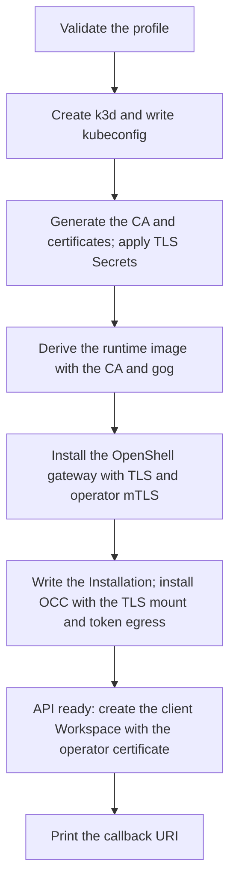

# Local Agent OAuth connections startup

## Overview

Trace `occ dev up` with `OCC_DEVELOPMENT_CONNECTIONS=openshell` through the
OpenShell gateway PKI, the derived runtime image, the Installation and chart
settings, and the client Workspace that holds OAuth client secrets. The flow stops
when startup prints the callback URI. This is a disposable development
Installation; see the [operator procedure](../../guides/deploy/local-agent-connections.md).

## Entry Points

- Trigger: `occ dev up` with the Kubernetes control plane, Kubernetes Compute,
  OpenShell, and `OCC_DEVELOPMENT_CONNECTIONS=openshell`.
- Source: `internal/occdev/connections_k3d.go:developmentConnections`,
  `internal/occdev/openshell_k3d.go:upK3d`.
- Assumptions: the base Kubernetes-only OpenShell startup in
  [Development startup](startup.md#kubernetes-only-startup).

## Flow

## Execution Trace

### 1. Validate before claiming resources

`internal/occdev/connections_k3d.go:developmentConnections`,
`internal/occcli/dev.go`

`Up` and `upK3d` accept the value only with the Kubernetes control plane,
Kubernetes Compute, and OpenShell. The Docker Compute branch of the CLI refuses it
through `CheckDevelopmentConnections`. The value is recorded as `connections` in
`state.json`.

`internal/occdev/browser_k3d.go:developmentBrowserDomain` validates the optional
`OCC_DEVELOPMENT_BROWSER_DOMAIN`, and `checkDevelopmentBrowserDomain` requires the
console and Agent host names to resolve only to loopback before startup creates
the cluster. With a domain, the OpenShell profile publishes the HTTPS console,
enables Agent native administration, and prints the HTTPS callback URI; without
one, the callback stays on the loopback HTTP API.

### 2. Generate the PKI and apply the TLS Secrets

`internal/occdev/connections_k3d.go:prepareDevelopmentConnectionPKI`

Right after the kubeconfig is written, startup creates a name-constrained P-256 CA
and three leaf certificates: the gateway server (Service names, `localhost`, and
`*.openshell.localhost` for sandbox routes), the sandbox client, and the OCC
operator with `OU=operator`. It writes them to the state directory with mode
`0600` and applies `openshell-server-tls`, `openshell-client-tls`,
`openshell-server-client-ca`, and `openclaw-openshell-tls` in the platform
namespace.

### 3. Derive the runtime image

`internal/occdev/kubernetes.go:importRuntime`,
`internal/occdev/connections_k3d.go:buildDevelopmentConnectionRuntime`

After the runtime image is built or selected, startup downloads the `gog` release
archive for the image's architecture and verifies its SHA-256. It builds
`openclaw-enterprise-runtime:connections`, which adds the CA to the system store,
sets `NODE_USE_SYSTEM_CA=1`, installs `/usr/local/bin/gog`, and restores the base
image's user. The derived image is imported in place of the base image.

### 4. Install the gateway and OCC

`internal/occdev/openshell.go:installOpenShellGateway`,
`internal/occdev/kubernetes.go:writeInstallation`,
`internal/occdev/openshell_k3d.go:installKubernetesControlPlane`

The gateway installs with `server.disableTls=false`, client certificate
verification, and `openshell.gateway.mtls_auth.operator_enabled`. The Backend uses
`https` with `rootCertificatePath` and `operatorTls` under
`/etc/openclaw/openshell-tls`. The Installation adds the Credential Refresh Driver
with `clientWorkspace: oce-oauth-clients` and sets the Credential Gateway's
`toolBinaries` to `gog`. The OCC chart values mount `openclaw-openshell-tls` into
the API and worker and enable `agentConnections.tokenEgress`.

### 5. Create the client Workspace

`internal/occdev/connections_k3d.go:provisionDevelopmentClientWorkspace`

After the API answers, startup creates and labels the `oce-oauth-clients`
namespace and applies the Workspace chart resources there. The gateway image has
no CLI, so startup runs OCC's gRPC client inside the API Pod. That Pod already has
the operator certificate and gateway egress. The client gets the Workspace or
creates it, and requires it to be active. Any failure stops startup, which rolls
back the owned cluster.

## Debugging and Verification

- `OCC_TEST_DEV_UP_OPENSHELL_CONNECTIONS_REAL=1 node --test tests/integration/dev-up-openshell-k3d-real.test.mjs`
  starts the profile and checks:
  - the chart mount and token egress policy;
  - the derived image;
  - HTTPS from the generated CA and the active client Workspace;
  - template client-secret registration;
  - refusal of credential reads without the operator certificate.
- The gateway log shows `mTLS operator authentication enabled` after the gateway
  installs.
- Startup does not prove a Google consent or token refresh; follow the
  [operator procedure](../../guides/deploy/local-agent-connections.md).

## Related docs

- [Development startup](startup.md).
- [Connection templates](../../reference/connection-templates.md).
- [Agent OAuth connections flow](../agent-oauth-connections.md).

## Manual Notes

[keep this for the user to add notes. do not change between edits]

## Changelog

- 2026-10-22 01:45: Added the optional browser domain for the HTTPS console and native admin. (claude-code/0aaa76e4-8457-4cdb-b732-780b69e59679 - aaac611c8)
- 2026-10-21 23:55: Traced the optional Agent OAuth connections profile. (claude-code/0aaa76e4-8457-4cdb-b732-780b69e59679 - 2c868396c)
