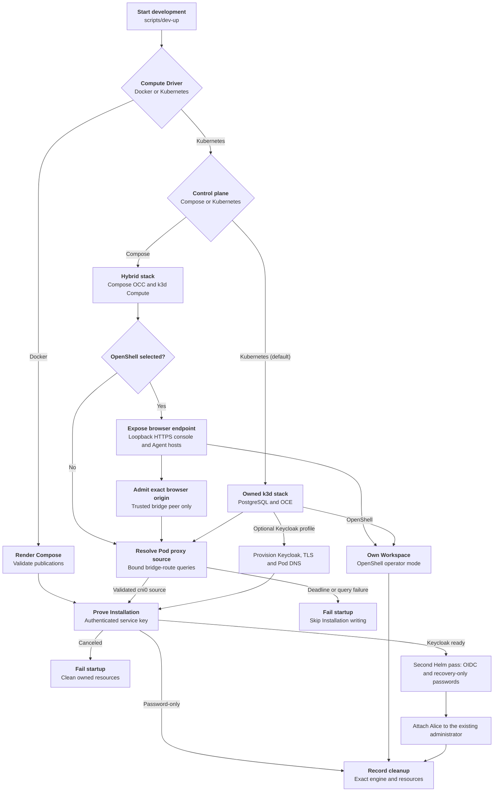

# Compose development startup

## Overview

`scripts/dev-up` runs PostgreSQL, migration, bootstrap, API, and worker in Compose
or owned k3d; Kubernetes-only is the default (`internal/occdev/profile.go:ResolveProfile`).
Readiness requires authenticated Installation, bootstrap Namespace, and, for OpenShell, Workspace readiness.

## Entry Points

- Trigger: `./scripts/dev-up [--key-output PATH] [-- COMPOSE_GLOBAL_OPTIONS...]`.
- Source: `scripts/dev-up:require_command`
- Source: `internal/occdev/up.go:Up`
- Source: `internal/occdev/openshell_k3d.go:upK3d`
- Assumptions: the checkout-local OCC CLI is built; the selected container
  engine is running; Kubernetes profiles also have k3d, kubectl, and, on Podman, root or a
  [rootful machine](../../guides/deploy/local-kubernetes-development.md#start-the-profile); Kubernetes-only and OpenShell
  profiles require Helm, and OpenShell requires its pinned or selected assets.

## Flow

## Execution trace

### 1. scripts/dev-up: host preflight and runtime image selection

`scripts/dev-up:require_command`, `internal/occdev/up.go:Up`,
`internal/occdev/compose.go:AnalyzeCompose`,
`deploy/runtime/Dockerfile`

Build `bin/occ` with `pnpm cli:build`; arguments after `--` go to Compose.
[Step 12](#12-select-kubernetes-development-and-preserve-cleanup-ownership) covers Kubernetes Compute.
Compose Kubernetes requires Node without a Sandbox Driver.

Engine and Compose probes select Docker or Podman despite `docker` aliases.
Podman requires `yq` v4 and a Compose provider. Docker Compute pins standalone
`podman-compose` for startup and cleanup. Kubernetes startup prefers
`docker-compose`, then `podman-compose`, with absolute paths and no
`--project-directory`; shutdown uses Podman directly. Linux rootful Podman
requires its API socket (`systemctl enable --now podman.socket`), pinned as
`DOCKER_HOST`. Explicit `-f FILE`, `-fFILE`, `-f=FILE`, `--file FILE`, or
`--file=FILE` overrides `COMPOSE_FILE` and defaults. Attached short options become
`--file=FILE` to avoid Podman's help parser. Empty or missing values fail before rendering.

Docker Compose renders JSON; Podman YAML is converted to JSON in private temporary
storage. `./bin/occ dev analyze-compose` enforces loopback controller and database
publications and resolves Docker runtime image selection. The final `compose.podman.yaml` override
mounts Podman's reported API socket at `/var/run/docker.sock` in the worker.
Docker Compute disables worker SELinux process labeling to avoid socket relabeling;
other services retain confinement. Migration, bootstrap, API, and worker share one image. `dev-up` builds through migration,
uses `--no-build`; Docker uses `up --build`. Configuration and credentials
are never printed.
`command.go` and `k3d_import.go` report monotonic durations through `timing.go`. See
[local command diagnostics](../../reference/cli/local-development.md);
concurrent durations can overlap.

`dev-up` builds missing default `openclaw-enterprise-runtime:quickstart` images from
`deploy/runtime/Dockerfile`. Custom images must exist; partial selection fails.
[Rebuild and verify](../../../deploy/runtime/README.md#rebuild-an-existing-image)
after recipe edits: tags survive changes. The recipe owns plugin and gateway/Codex compatibility. Startup proves no model turns.

### 2. compose.yaml:services.postgres and services.migrate

`compose.yaml:services.postgres`, `compose.yaml:services.migrate`

PostgreSQL initializes `occ_postgres_data` with local-only administrator credentials;
SQL creates `occ_migrator` and `occ_app`. Migration then uses
`OCC_MIGRATION_DATABASE_URL` and Drizzle. API and worker never use migrator or
administrator URLs.

### 3. Initialize before starting the API or worker

`compose.yaml:services.bootstrap`, `scripts/bootstrap-installation.mjs`

Docker Compute refuses retained PostgreSQL volumes;
[recover the original key](../../guides/operate/local-setup-troubleshooting.md#docker-compute-reports-existing-postgresql-storage).
After migration, bootstrap creates administrators, Installation, IAM, audit,
service key, and a `provisioning` Namespace. Launchers authenticate before CLI export.

`scripts/dev-up` and `internal/occdev/bootstrap.go:prepareBootstrapCredentials`
resolve Compose password precedence before preparation. `prepareBootstrapMounts` inspects the
Compose bootstrap UID and assigns private mount copies before startup. Originals remain host-owned `0600` recovery inputs.
Compose projects bootstrap-only copies; Kubernetes-only setup precreates its
Secret with a random default password before Helm. Migration, API and
worker receive neither credential. API and worker load committed state after
initializer success. The
[bootstrap flow](../local-password-authentication.md) owns credentials, concurrent
attempts, and failure recovery.

### 4. The API admits only local development traffic

`apps/controller/src/api-startup.ts:startApi`,
`apps/controller/src/composition/development-postgres.ts:composePostgresDevelopment`,
`apps/controller/src/drivers/configuration/filesystem/index.ts:FilesystemConfigurationDriver`

The API starts in `NODE_ENV=development`, binds inside the Compose network, and
publishes its host port only on `127.0.0.1`. `OCC_AUTH_SECRET` signs user
sessions and `OCC_AUTH_BASE_URL` fixes the cookie origin. The API and initializer
accept HTTP(S) origins on `localhost`, `127.0.0.1`, or `[::1]` in development.

Development accepts the explicitly configured Compose bridge CIDR as local
control-plane traffic, while non-loopback clients, forwarded headers,
caller-supplied identity headers, bearer credentials, and trusted-proxy claims
remain rejected.

`scripts/dev-up` wraps the retained raw key as JSON containing `data.key`, without
container extraction. `--key-output` requires an absent file in a private
directory; omission creates a temporary directory. Setup never overwrites files,
prints credentials, or bootstraps replacement keys.

After readiness, `./bin/occ installation get` discovers the server-owned
Installation ID. Local key JSON has no Installation metadata. `apps/controller/src/auth/index.ts:ControllerAdmissionVerifier.verify`
resolves the Installation-scoped service administrator; IAM authorizes each
operation. The [service-key flow](../service-api-keys.md#3-verify-the-credential-and-enforce-its-fixed-identity-scope)
owns admission and `401` rejection without cookie fallback.

When `OCC_CONFIG_PATH` is absent, PostgreSQL-backed development selects the
filesystem Configuration Driver from `OCC_DEVELOPMENT_CONFIGURATION_ROOT`.
Compose sets that root to `/app/.development/configurations` and backs it with
the `occ_configuration_data` named volume, mounted only into the controller.
PostgreSQL remains the OCC metadata system of record.

### 5. The worker selects Docker Compute and claims queued operations

`apps/controller/src/worker.mjs:configuration`,
`apps/controller/src/drivers/compute/docker/index.ts:DockerComputeDriver.preflight`,
`apps/controller/src/drivers/compute/docker/index.ts:DockerComputeDriver.request`

After the controller is healthy, the worker starts with the same
application-role `OCC_DATABASE_URL`. Without `OCC_CONFIG_PATH`, development
selects `compute-docker-development` with implementation `docker-local`;
otherwise it uses the trusted Driver set in that file.

Preflight checks engine ping, version, and images before database pooling.
Interrupted responses fail under the 10-second deadline and claim cancellation
without retry; complete responses retain status and JSON checks.

The worker loads the singleton Installation, validates IAM policy, and polls
PostgreSQL work. Readiness proves durable claims, not Agent or TUI existence.
Each operation reauthorizes its original actor before Compute. Only the worker
receives Docker-compatible engine access.

### Kubernetes-only startup

`internal/occdev/openshell_k3d.go:upK3d`,
`internal/occdev/gateway_k3d.go:installDevelopmentRoutingControllers`,
`internal/occdev/repository_k3d.go:enableDevelopmentRepository`.

Before tools or state creation, `upK3d` requires a Namespace DNS label of at most
63 characters. Cleanup accepts longer historical names but checks ownership and
deletes only the recorded cluster through its endpoint.

Both k3d profiles use legacy iptables and honor an explicit IPv4 node resolver
without changing host DNS. Linux Docker selects the first glibc nameserver.
`internal/occdev/node_dns_k3d.go:checkDevelopmentNodeDNS` fails startup on
refused node DNS. Kubernetes-only startup imports matching OCE images.

Without OpenShell, startup verifies pinned cert-manager and Envoy manifests,
waits for the k3s Gateway API CRDs, then installs Envoy before rollback on
failure.
`internal/occdev/gateway_k3d.go:waitDevelopmentCRDEstablished` polls each CRD
until `Established`, a `kubectl` error, or timeout. Before gateway proxy trust,
`internal/occdev/network_k3d.go:verifyDevelopmentNetworkPolicy` checks allowed
and denied Pod traffic with credential-free Pods and a temporary policy, then
rechecks Driver policies after bootstrap creates the initial gateway Namespace.
Probe Pods use short grace periods and UID-preconditioned deletes. Cleanup waits
for selector-matching Pods before removing their egress policy; probe or cleanup
failure fails startup. Checks are point-in-time and single-node.

With `OCC_DEVELOPMENT_CODEX_VERIFICATION_MODE=danger-full-access`,
`internal/occdev/kubernetes.go:prepareDevelopmentCodexSandbox` returns no custom
profile and reports workspace-write proof not applicable/not performed. Startup
does not verify containment; real Agent QA must. Requires Sandbox `none`;
presets are unchanged. See [development verification](../../guides/deploy/codex-sandbox.md#explicit-container-only-development-verification).

In default workspace-write mode, before Installation,
`scripts/prepare-development-codex-seccomp.ts` probes
`RuntimeDefault` in a credential-free Pod. Confirmed denial triggers
[verified, content-addressed Localhost profile derivation](../../guides/deploy/local-kubernetes-development.md#start-the-profile).
Failure triggers cluster rollback. On readiness failure, writable stderr receives
`OCE_CODEX_SECCOMP_READINESS_FAILURE` before cleanup with operation
`runtime-default-pod-readiness` and a recognized waiting reason or `null`.

Startup awaits Gateway, certificate and proxy Pods. Envoy sources must match the
node's Pod CIDR; tenant ingress admits only the Gateway's exact proxy peer.

Loopback HTTPS uses a per-installation CA whose leaf covers only its console
and Agent hosts. API and browser NodePorts publish only on host loopback; the CA
key stays private. `internal/occdev/openshell_k3d.go:upK3d` prints
[required browser trust instructions](../../guides/operate/troubleshooting.md#the-local-console-reports-a-certificate-error)
beside the URL and public CA path. Stack readiness does not establish browser trust.

### 12. Select Kubernetes development and preserve cleanup ownership

`internal/occdev/command.go:selectEngine`,
`internal/occdev/command.go:pinEndpoint`,
`internal/occdev/command.go:podmanEndpoint`,
`internal/occdev/up.go:Up`.

Startup resolves Docker context or Podman socket. It verifies Podman's API and sets
k3d's `DOCKER_HOST` and engine-host `DOCKER_SOCK`. State pins the endpoint,
project, and cluster for cleanup.

Startup refuses existing resources. `internal/occdev/compose_config.go:resolveCompose`
resolves inheritance, environment files, interpolation, and absolute paths.
`Up` reads the resolved setup password, then removes its extension before saving
the Compose snapshot. Credential preparation follows exclusive state creation.
`internal/occdev/compose.go:AnalyzeCompose`
validates publications; `internal/occdev/up.go:validateResourceOwnership` rejects
external or unscoped networks and volumes. Exclusive `0700` state creation
precedes resources. `setKubernetesBridgeGateway` preserves an explicit gateway
or selects the subnet's first usable address. A private Compose snapshot pins
startup and cleanup against later `.env` edits. The provider validates the snapshot before creating resources. Podman's `x-podman.in_pod: false`
keeps containers out of an unlabelled Pod.

`internal/occdev/compose.go:prepareComposeBootstrapSQL` snapshots default SQL as
`0644` for PostgreSQL. Only the default read-only bind, including checkout aliases,
is redirected; custom and writable mounts and original permissions stay unchanged.
State remains `0700`. Cleanup removes the copy. Pre-start failures remove incomplete
state despite `OCC_DEVELOPMENT_KEEP_ON_FAILURE`; retention requires a recoverable
snapshot and resource startup.

Kubernetes-only mode enters `internal/occdev/openshell_k3d.go:upK3d` before Compose rendering.

`internal/occdev/repository_k3d.go` validates inputs. After authenticated bootstrap
and Namespace readiness, it binds the server-assigned Namespace ID, generates CA
and exact-host certificates, and upgrades Helm with Kubernetes inputs, Repo Driver
and worker sidecar. Discovery checks approved references and profiles. See
[required inputs](../../guides/deploy/local-repository-credentials.md#prepare-the-approved-inputs).

### 13. Bootstrap OCC, create k3d, and prepare runtime configuration

`internal/occdev/up.go:Up`, `internal/occdev/kubernetes.go:writeKubeconfigs`,
`internal/occdev/openshell.go:prepareOpenShell`.

Compose builds the database services separately, then starts them with `--no-build`.
The Compose startup deadline excludes builds, which still honor cancellation.
On Linux and macOS, `internal/occdev/compose_process_unix.go:ownComposeProcessGroup`
stops and drains the provider's process group on cancellation or completion.
Unconfirmed termination keeps recovery state and prevents rollback.
`internal/occdev/command.go:composeServiceID` looks up exact project and service labels.

With Docker and a selected runtime, bootstrap and cluster setup overlap after
PostgreSQL creation. After kubeconfig, OpenShell overlaps
`internal/occdev/gateway_k3d.go:installDevelopmentRoutingControllers` with runtime
import and OpenShell installation. Both finish before routing resolves PostgreSQL
and starts OCC. Failure drains siblings before rollback. Cold builds and Podman
install routing afterward.

Cert-manager and Envoy install concurrently, with checksum, CRD and rollout checks
before GatewayClass acceptance or routing. Envoy waits for k3s-owned Gateway API CRDs.
Without OpenShell, `OCC_DEVELOPMENT_K3S_IMAGE` selects the node
image; its default `+v1.35` resolves the latest 1.35 patch. An explicit
image skips lookup. OpenShell uses its pinned image in both control-plane modes.
Cluster creation binds the API to loopback and preserves the default kubeconfig
and current context. Both Kubernetes profiles use
`internal/occdev/kubernetes.go:developmentImageGCArgs` to retain local images
(high threshold 100, low threshold 99). Disk-pressure eviction stays enabled.

Non-root API/worker containers receive read-only configuration and kubeconfig
for the TLS-verified load balancer, without engine access. Host kubeconfig stays private.

`importRuntime` builds source runtimes with the optional
[build CA](../../reference/settings/development.md) secret. Existing runtime selections skip building.

`internal/occdev/kubernetes.go:engineImageReference` resolves engine names,
including Podman `localhost/` and Docker Hub, defaults tags to `:latest`,
and rejects missing or ambiguous matches. For multi-arch digests that Docker 29
cannot export completely, `internal/occdev/k3d_import.go:stageDevelopmentPlatformChild`
selects the registry's platform child for a complete archive. Unlisted sources or
failed pulls retain the pinned reference and filter. `importDevelopmentImage`
resolves cluster digests. Both paths call
`internal/occdev/status_proxy_k3d.go:developmentStatusProxySource` before
`writeInstallation`, retaining caller context for node inventory.

`internal/occdev/up.go:poll` bounds route commands to two minutes.
`developmentStatusProxyCidr` requires one non-network IPv4 `cni0` source in the Pod
CIDR and returns `/32`. Errors or cancellation prevent Installation writing and trigger cleanup.

`internal/occdev/kubernetes.go:writeInstallation` selects Kubernetes Compute,
Configuration, Secret Drivers, and native IAM. Without OpenShell, it adds both
Presets and the Codex Plugin Driver after the sandbox check. Runtime settings
include the transport Secret prefix, gateway storage class, and memory limits:
4 GiB per gateway and 6 GiB per Harness.

Compose installs OpenShell in k3d operator workspace mode; see the
[OpenShell provisioning flow](../openshell-sandbox-provisioning.md#0-create-the-development-control-plane).

`internal/occdev/compose_routing.go:prepareComposePrivateFiles` builds selected services
before `--no-build` startup. Both Compose Kubernetes profiles assign browser TLS
files to the proxy UID/GID; OpenShell routing files use the API/worker UID/GID.
Ownership follows each reader's image and Compose user setting, preserving mode `0600`.

The hybrid snapshot adds `compose.native-admin.yaml`. Its CA signs only the
installation's console and wildcard Agent hosts. `browser-proxy` terminates loopback
HTTPS; Agent `ClusterIP` Services remain behind Envoy.

`apps/controller/src/composition/development-postgres.ts:composePostgresDevelopment`
passes `OCC_AUTH_BASE_URL` to admission. `apps/controller/src/index.ts:createFastifyApp`
requires its exact Host and optional exact Origin from loopback or trusted development
CIDRs. Sibling hosts, other Origins, forwarded headers, and untrusted peers fail
before identity resolution.

### 14. Prove readiness and clean up the owned Kubernetes profile

`internal/occdev/up.go:waitReady`,
`internal/occdev/bootstrap.go:verifyBootstrapKey`,
`internal/occdev/down.go:Down`,
`internal/occdev/state.go:readState`.

After API/worker readiness, `verifyBootstrapKey` authenticates with local
`bootstrap-client-key.json` before exclusive CLI export. The response supplies
the Installation ID; cancellation cleans up. OpenShell awaits
Namespace and Workspace readiness. Readiness and repository discovery use
`occclient.Client.WithContext` deadlines.
Both Compose Kubernetes profiles verify HTTPS sessions with the generated CA and console name.

Both profiles use `OCC_DEVELOPMENT_STARTUP_TIMEOUT_SECONDS` for `k3d cluster create --timeout`; expiry fails startup.

`internal/occdev/state.go:exclusiveWrite` removes new outputs, including partial
external keys, after chmod, write or close failure. It preserves existing targets
and reports removal errors.

Shutdown validates recorded ownership, stops reconcilers, then removes owned
k3d and Compose resources through the recorded engine. Podman uses exact project labels and direct removal, retrying while
container dependencies disappear. It verifies container/volume/network absence;
no dependency cascades or image pruning. Both engines must also confirm the
recorded k3d image volume is absent before discarding state. Shutdown, including
that final check, has five minutes; rollback has two. Cleanup retains failed state.
Success removes state and owned keys. External `--key-output` files remain
operator-owned unless OpenShell readiness fails.

### 15. Start and remove the optional Keycloak profile

`internal/occdev/keycloak_k3d.go:installDevelopmentKeycloak`.

`OCC_DEVELOPMENT_SIGN_IN=keycloak` provisions Keycloak in Kubernetes-only sandbox
`none` before readiness, then enables OIDC and attaches Alice to the administrator.
The [Keycloak lifecycle](keycloak.md) covers validation, DNS/TLS, Helm passes,
recovery and destructive teardown.

## Debugging and Verification

`internal/occdev/openshell_k3d.go:upK3d` reports selected
`controller-image-import` failures after cleanup.
`internal/occdev/startup_failure.go` preserves routing details;
`concurrently` retains sibling cleanup failures.
Helpers and CI retain one allowlisted final failure record, including older formats.
Ambiguity, success and cleanup yield none; stdout is unauthenticated.
[Field meanings](../../reference/cli/local-development.md).

- `node --test tests/integration/dev-up-compose-startup.test.ts tests/integration/dev-up-compose.test.mjs tests/integration/dev-up.test.mjs`
  exercises profile selection, generated configuration, authenticated readiness,
  rollback, and cleanup with inert engine and cluster commands.
- `OCC_TEST_DEV_UP_OPENSHELL_REAL=1 node --test tests/integration/dev-up-openshell-k3d-real.test.mjs`
  selects the Kubernetes-only real-cluster proof.
- `OCC_TEST_DEV_UP_OPENSHELL_COMPOSE_REAL=1 node --test tests/integration/dev-up-openshell-k3d-real.test.mjs`
  selects the Compose-backed real-cluster proof.
- `OCC_TEST_DEV_UP_K3D_REAL=1 node --test --test-concurrency=1 tests/integration/dev-up-k3d-real.test.mjs tests/integration/dev-up-k3d-refusals-real.test.ts tests/integration/dev-up-k3d-keycloak-real.test.ts`
  selects the [real launcher cases](../../testing/kubernetes.md#keycloak-local-launcher-coverage),
  including Keycloak login, persistence and failure cleanup.

- `OCC_TEST_LOCAL_FIRST_AGENT_CONTROL_UI=1 node --test tests/integration/local-first-agent-real.test.mjs`
  checks its exact HTTPS console and Control UI origins and the deployed
  Configuration's allowed origin and trusted-proxy policy.
- Startup does not prove Agent creation or model execution; use the runtime integration.

## Related docs

- [Return to the parent flow](../docker-compose-development.md).
- [OpenShell Sandbox provisioning](../openshell-sandbox-provisioning.md).
- [Local Kubernetes development](../../guides/deploy/local-kubernetes-development.md).

## Manual Notes

[keep this for the user to add notes. do not change between edits]

## Changelog

- 2026-11-18 21:57: Reconcile native Compose configuration and cancellation with precreated bootstrap credentials in the accompanying uncommitted integration. (authoring-run/4305c3cc-b3b5-4f82-9eaa-9237672fbf4d - 5783a737f848b6ab7780225e33bf6a5e54d87b5d)

- 2026-11-17 01:37: Remove duplicate full-access probe; retain real Agent qualification. (authoring-run/28767d0f-55e0-4d91-abb6-1f25ff793a2a - 8d3f95dd5)

- 2026-11-16 22:56: Add explicit container-boundary development verification without changing workspace-write defaults. (authoring-run/e151ca6f-93f3-4976-bad1-585c8dde1264 - ac72edfbf884219d7392f32fd245173dffccf922)

- 2026-11-14 03:39: Remove repeated startup explanations after the Podman refresh. (authoring-run/1ced20ff-7099-45bc-9dd0-f2f3a617b2dc - f5bb87eba48ce7d8d41e520a8e9c0ccc497284ba)

- 2026-11-13 17:08: Trace the resolved Compose snapshot, image retention, and provider cancellation. (authoring-run/807a71f5-237d-4e19-97e2-adeb12df0c2c - ecca730b4bf065962763f7b5aae79c89c2cb7958)

- 2026-11-16 15:50: Resolve Compose password precedence, prepare private mounts, refuse retained PostgreSQL storage, and verify before export. (authoring-run/a92d5e93-e5c6-44c1-acf1-b4d08ee54a70 - 8d64b41e408e3d3f093d3547beb3a71fec3f4f88)

- 2026-11-16 09:42: Replace output-volume extraction with private credential preparation and authenticated Installation discovery in the accompanying uncommitted implementation. (authoring-run/e8039d10-1e3b-41aa-82f2-0d2c709b421f - 81ab0a9fbe38cd2eea88f599a5e0ac9aad9c4f92)

- 2026-11-12 00:24: Correct readiness ownership. (authoring-run/289927cc-a9eb-477c-8cfa-1f6c9aa9f291 - 6b44940d40419e4cd9889cf4b0316d95a798be56)

- 2026-11-12 00:18: Handle checkout aliases and clean incomplete pre-start state. (authoring-run/40b08b7d-d158-4f4d-8a93-1e53f45a5999 - 2d5cf2bf7138c2d7bd40b3fa630a4c9d8b9dafe4)

- 2026-11-12 00:05: Copy default bootstrap SQL into private owned state with container-readable permissions. (authoring-run/bd5e5418-5167-4b5f-b5bc-b9047ed8b68b - 8cd9b5d944e1c25191c6622cf5b6cf1fe7b33054)

- 2026-11-11 23:56: Report probe readiness. (authoring-run/1189518e-cadf-4a8f-aabe-bcdbff4d434e - c6aad5bf134ae15bb9abea127b978756f843769f)

[Compose development startup documentation history](startup/history.md) preserves the older dated entries.
