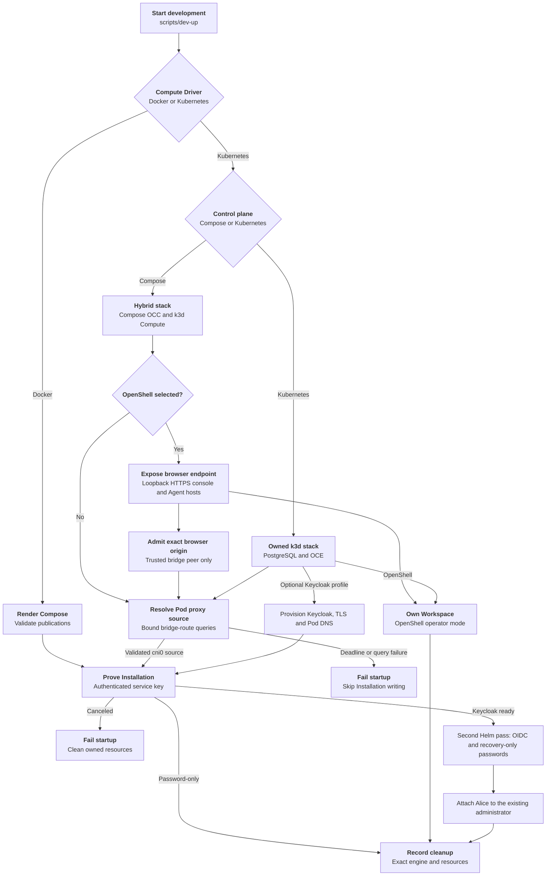

# Compose development startup

[Compose development flow](../docker-compose-development.md).

## Overview

`scripts/dev-up` starts Docker or Kubernetes Compute. Compose-backed profiles run
PostgreSQL, migration, bootstrap, API, and worker in Compose; the Kubernetes-only
profile runs them in the owned k3d cluster. Startup requires authenticated
Installation and bootstrap Namespace readiness, plus Workspace readiness for OpenShell.

## Entry Points

- Trigger: `./scripts/dev-up [--key-output PATH] [-- COMPOSE_GLOBAL_OPTIONS...]`.
- Source: `scripts/dev-up:require_command`
- Source: `internal/occdev/up.go:Up`
- Source: `internal/occdev/openshell_k3d.go:upK3d`
- Assumptions: the checkout-local OCC CLI is built; the selected container
  engine is running; Kubernetes profiles also have k3d, kubectl, and, on Podman, root or a
  [rootful machine](../../guides/deploy/local-kubernetes-development.md#start-the-profile); Kubernetes-only and OpenShell
  profiles require Helm, and OpenShell requires its pinned or selected assets.

## Flow

## Execution trace

### 1. scripts/dev-up: host preflight and runtime image selection

`scripts/dev-up:require_command`, `internal/occdev/up.go:Up`,
`internal/occdev/compose.go:AnalyzeCompose`,
`deploy/runtime/Dockerfile`

`bin/occ` (`pnpm cli:build`) is required; arguments after `--` go to Compose. For Kubernetes Compute, required by OpenShell, see
[step 12](#12-select-kubernetes-development-and-preserve-cleanup-ownership).
Without a Sandbox Driver, Compose Kubernetes startup requires Node before creating resources.

Engine and Compose JSON probes select Docker or Podman independently of a
`docker` alias. Podman requires `yq` v4 and a Compose provider. Docker Compute
requires standalone `podman-compose`, which `scripts/dev-up` pins and `occ dev
down` matches so the stack is stopped with the provider that started it. The
Kubernetes-profile Compose command that `occ dev up` and `occ dev down` drive
prefers `docker-compose` — it passes `--project-directory`, which standalone
`podman-compose` does not support — and falls back to `podman-compose` when
`docker-compose` is absent. Rootful
Podman on Linux must expose its API socket (for example,
`systemctl enable --now podman.socket`); startup resolves that socket and pins
it as `DOCKER_HOST` for the provider. Explicit `-f FILE`, `-fFILE`, `-f=FILE`, `--file FILE`, or
`--file=FILE` overrides `COMPOSE_FILE` and the default file. Startup and cleanup
forward attached short options as `--file=FILE` so Podman does not mistake an
`h` in the path for help. Empty or missing file values fail before configuration rendering.

Docker Compose renders JSON; Podman YAML is converted to JSON in private temporary
storage. `./bin/occ dev analyze-compose` enforces loopback controller and database
publications and resolves Docker runtime image selection. The final `compose.podman.yaml` override
mounts Podman's reported API socket at `/var/run/docker.sock` in the worker.
The base Docker Compute
worker disables SELinux process labeling because relabeling a host engine socket
is unsafe; other services retain SELinux confinement. One development image
covers migration, bootstrap, API, and worker, so `dev-up` builds it once through
migration and starts with `--no-build`; Docker uses `up --build`. Expanded
configuration and credentials are never printed.

For unselected runtime images, `dev-up` builds missing
`openclaw-enterprise-runtime:quickstart` from `deploy/runtime/Dockerfile` at
repository root. Custom images must exist; partial selection fails.
Tags survive recipe edits; [rebuild and verify](../../../deploy/runtime/README.md#rebuild-an-existing-image)
after package changes. The recipe owns plugin and gateway/Codex compatibility;
`dev-up` neither installs plugins nor proves model turns.

### 2. compose.yaml:services.postgres and services.migrate

`compose.yaml:services.postgres`, `compose.yaml:services.migrate`

Compose starts PostgreSQL with the local `occ_postgres_data` volume. Local-only
administrator credentials initialize the database; checked-in SQL creates the
less-privileged `occ_migrator` and `occ_app` roles.

Through Compose, `dev-up` runs migration after PostgreSQL, using
`OCC_MIGRATION_DATABASE_URL` and Drizzle. API and worker never use the migrator
or PostgreSQL administrator URL.

### 3. Initialize before starting the API or worker

`compose.yaml:services.bootstrap`, `scripts/bootstrap-installation.mjs`

After migration exits `0`, bootstrap creates administrators, Installation, native
IAM, audit evidence, service key, and a `provisioning` default Namespace. The
worker provisions its Docker boundary. Existing Installation state is preserved;
missing, expired, or revoked keys never trigger reissue.

Only the initializer mounts `occ_bootstrap_data`; the API and worker load
committed state after initializer success. The
[bootstrap flow](../local-password-authentication.md) owns credentials, concurrent
attempts, and failure recovery.

### 4. The API admits only local development traffic

`apps/controller/src/api-startup.mjs:startApi`,
`apps/controller/src/composition/development-postgres.ts:composePostgresDevelopment`,
`apps/controller/src/drivers/configuration/filesystem/index.ts:FilesystemConfigurationDriver`

The API starts in `NODE_ENV=development`, binds inside the Compose network, and
publishes its host port only on `127.0.0.1`. `OCC_AUTH_SECRET` signs user
sessions and `OCC_AUTH_BASE_URL` fixes the cookie origin. The API and initializer
accept HTTP(S) origins on `localhost`, `127.0.0.1`, or `[::1]` in development.

Development accepts the explicitly configured Compose bridge CIDR as local
control-plane traffic, while non-loopback clients, forwarded headers,
caller-supplied identity headers, bearer credentials, and trusted-proxy claims
remain rejected.

After controller and worker readiness, `dev-up` copies initializer-owned
service-key JSON from the stopped bootstrap container. Docker uses `compose cp`;
`podman-compose` lacks `cp`, so Podman selects one bootstrap container by Compose
labels and runs `podman cp` by ID. `--key-output` requires an absent file in a
private operator-owned directory; otherwise startup creates a private temporary
directory. It never overwrites files, prints `data.key`, or bootstraps replacement keys.

`./bin/occ installation get` uses the copied key. The returned Installation ID
must match the key's `meta.installationId`. `apps/controller/src/auth/index.ts:ControllerAdmissionVerifier.verify`
resolves the Installation-scoped service administrator; IAM authorizes each
operation. The [service-key flow](../service-api-keys.md#3-verify-the-credential-and-enforce-its-fixed-identity-scope)
owns admission and `401` rejection without cookie fallback.

When `OCC_CONFIG_PATH` is absent, PostgreSQL-backed development selects the
filesystem Configuration Driver from `OCC_DEVELOPMENT_CONFIGURATION_ROOT`.
Compose sets that root to `/app/.development/configurations` and backs it with
the `occ_configuration_data` named volume, mounted only into the controller.
PostgreSQL remains the OCC metadata system of record.

### 5. The worker selects Docker Compute and claims queued operations

`apps/controller/src/worker.mjs:configuration`,
`apps/controller/src/drivers/compute/docker/index.ts:DockerComputeDriver.preflight`,
`apps/controller/src/drivers/compute/docker/index.ts:DockerComputeDriver.request`

After the controller is healthy, the worker starts with the same
application-role `OCC_DATABASE_URL`. Without `OCC_CONFIG_PATH`, development
selects `compute-docker-development` with implementation `docker-local`;
otherwise it uses the trusted Driver set in that file.

Before its database pool, preflight runs engine ping, version, and image checks. Response-stream errors reject interrupted requests under the existing 10-second deadline and claim-owned cancellation, with no automatic retry; complete responses keep status and JSON validation.

The worker loads the singleton Installation, validates IAM policy, and polls
PostgreSQL work. Readiness proves durable claims, not Agent or TUI existence.
Each operation reauthorizes its original actor before Compute. Only the worker
receives Docker-compatible engine access.

### Kubernetes-only startup

`internal/occdev/openshell_k3d.go:upK3d`,
`internal/occdev/gateway_k3d.go:installDevelopmentRoutingControllers`,
`internal/occdev/repository_k3d.go:enableDevelopmentRepository`.

Before tools or state creation, `upK3d` requires a Namespace DNS label of at most
63 characters. Cleanup accepts longer historical names, preserves ownership checks,
and deletes only the recorded cluster through its recorded endpoint.

Both k3d profiles use legacy iptables and honor an explicit IPv4 node resolver
without changing host DNS. Linux Docker selects the first glibc nameserver.
`internal/occdev/node_dns_k3d.go:checkDevelopmentNodeDNS` fails startup on
refused node DNS. Kubernetes-only startup imports matching OCE images.

Without OpenShell, startup verifies pinned cert-manager and Envoy manifests,
waits for the k3s Gateway API CRDs, then installs Envoy before rollback on
failure.
`internal/occdev/gateway_k3d.go:waitDevelopmentCRDEstablished` polls each CRD
until `Established`, a `kubectl` error, or timeout. Before gateway proxy trust,
`internal/occdev/network_k3d.go:verifyDevelopmentNetworkPolicy` checks allowed
and denied Pod traffic with credential-free Pods and a temporary policy, then
rechecks Driver policies after bootstrap creates the initial gateway Namespace.
Probe Pods use short grace periods and UID-preconditioned deletes. Cleanup waits
for selector-matching Pods before removing their egress policy; probe or cleanup
failure fails startup. Checks are point-in-time and single-node.

Before writing the Installation, `scripts/prepare-development-codex-seccomp.mjs`
probes the runtime in a credential-free Pod. If `RuntimeDefault` blocks it, the
reviewed generator derives and verifies a content-addressed Localhost profile
for dedicated Codex; failure rolls back the cluster. The
[local Kubernetes guide](../../guides/deploy/local-kubernetes-development.md#start-the-profile)
owns the verified boundaries and provenance.

Startup waits for the Gateway, certificate, and proxy Pods before reporting
success. Envoy source addresses must fall inside the selected node's Pod CIDR;
the tenant ingress policy must still admit only the Gateway's exact proxy peer.

Loopback HTTPS uses a per-installation CA whose leaf covers only its console
and Agent hosts. API and browser NodePorts publish only on host loopback; the CA
key stays private. `internal/occdev/openshell_k3d.go:upK3d` prints
[required browser trust instructions](../../guides/operate/troubleshooting.md#the-local-console-reports-a-certificate-error)
beside the URL and public CA path. Stack readiness does not establish browser trust.

### 12. Select Kubernetes development and preserve cleanup ownership

`internal/occdev/command.go:selectEngine`,
`internal/occdev/command.go:pinEndpoint`,
`internal/occdev/command.go:podmanEndpoint`,
`internal/occdev/up.go:Up`.

Without a Sandbox Driver, Kubernetes startup selects Docker or Podman and
resolves its host socket from Docker's active context or `podman machine inspect`.
Private state records the socket, Compose project, and `occ-dev-*` cluster for
validated cleanup despite later context changes.

Startup refuses existing cluster or project resources.
`internal/occdev/compose.go:AnalyzeCompose` validates publications;
`internal/occdev/up.go:validateResourceOwnership` rejects external or unscoped
networks and volumes. Exclusive `0700` state creation precedes resources.
`setKubernetesBridgeGateway` preserves an explicit gateway or selects the subnet's
first usable address for k3d. Startup and cleanup use the privately saved Compose
snapshot, unaffected by later `.env` edits.

With `OCC_DEVELOPMENT_CONTROL_PLANE=kubernetes`, Compute enters
`internal/occdev/openshell_k3d.go:upK3d` before Compose rendering and uses the
engine only for k3d and images. Without OpenShell, the Installation selects the
bundled Presets and Codex Plugin Driver and copies bootstrap credentials into
private state.

`internal/occdev/repository_k3d.go` validates selected inputs and waits for
authenticated bootstrap and Namespace readiness. It binds the server-assigned
Namespace ID, generates a CA and exact-host broker certificate, creates Kubernetes
inputs, and upgrades Helm with the Repo Driver and worker sidecar. Discovery must
match approved references and profiles; it proves no model turn, native sandbox,
or Git operation. See [required inputs](../../guides/deploy/local-repository-credentials.md#prepare-the-approved-inputs).

`OCC_DEVELOPMENT_CONTROL_PLANE` defaults to `compose`; unsupported values fail
before resource creation. The
[OpenShell provisioning flow](../openshell-sandbox-provisioning.md#0-create-the-development-control-plane)
owns both OpenShell control-plane sequences.

### 13. Bootstrap OCC, create k3d, and prepare runtime configuration

`internal/occdev/up.go:Up`, `internal/occdev/up.go:waitCompleted`,
`internal/occdev/kubernetes.go:writeKubeconfigs`,
`internal/occdev/kubernetes.go:importRuntime`,
`internal/occdev/kubernetes.go:writeInstallation`,
`internal/occdev/openshell.go:prepareOpenShell`.

Compose starts PostgreSQL, migration, and bootstrap. After both one-shot
services succeed, startup creates k3d on the Compose network.
With the default Sandbox profile, `OCC_DEVELOPMENT_K3S_IMAGE` selects the node
image; its default `+v1.35` resolves the latest K3s 1.35 patch. An explicit
image skips lookup. OpenShell uses its pinned image in both control-plane modes.
The cluster API binds host loopback; creation leaves the default kubeconfig and
current context unchanged.

The host kubeconfig stays private. Non-root API/worker containers receive
read-only configuration and kubeconfig for the TLS-verified internal load balancer,
without the engine socket.

`internal/occdev/kubernetes.go:engineImageReference` resolves engine-recorded names,
including Podman `localhost/` and Docker Hub, defaults omitted tags to `:latest`,
and rejects missing or ambiguous matches. `importDevelopmentImage` resolves
cluster digests. Both startup paths call
`internal/occdev/status_proxy_k3d.go:developmentStatusProxySource` before
`writeInstallation`; node inventory retains caller context outside polling.

`internal/occdev/up.go:poll` bounds route queries to two minutes through
`exec.CommandContext`; deadline or cancellation stops blocked queries.
`developmentStatusProxyCidr` requires one non-network IPv4 `cni0` source in the
Pod CIDR and returns `/32`. Errors stop Installation writing and trigger cleanup.

`internal/occdev/kubernetes.go:writeInstallation` then selects Kubernetes Compute,
Configuration, and Secret Drivers with native IAM; without OpenShell,
it adds both bundled Presets and the Codex Plugin Driver after the shared Codex
sandbox check. Its runtime section sets the transport Secret prefix, gateway
storage class, and memory limits
of 4 GiB per gateway and 6 GiB per Harness.

With Compose and OpenShell, startup installs the pinned Agent Sandbox controller
and OpenShell Gateway in k3d and selects operator workspace mode. The
[OpenShell provisioning flow](../openshell-sandbox-provisioning.md#0-create-the-development-control-plane)
owns their placement and resources.

`internal/occdev/compose_routing.go:prepareComposeRoutingFiles` builds selected services
before `--no-build` startup. Routing files belong to the API/worker identity; browser
TLS files belong to the proxy identity. Both retain mode `0600`.

The hybrid snapshot adds `compose.native-admin.yaml` with cluster-scoped browser
and routing settings. A name-constrained CA signs only the console and wildcard Agent
hosts. `browser-proxy` terminates HTTPS on loopback; Agent `ClusterIP` Services
remain behind Envoy.

`apps/controller/src/composition/development-postgres.ts:composePostgresDevelopment`
passes `OCC_AUTH_BASE_URL` into development admission.
`apps/controller/src/index.ts:createFastifyApp` accepts that exact Host and
optional exact Origin only from loopback or trusted development CIDRs. Sibling
hosts, another Origin, forwarded headers, and untrusted peers fail before
identity resolution.

### 14. Prove readiness and clean up the owned Kubernetes profile

`internal/occdev/up.go:waitReady`, `internal/occdev/up.go:copyAndVerifyKey`,
`internal/occdev/openshell_k3d.go:copyAndVerifyKubernetesKey`,
`internal/occdev/down.go:Down`, `internal/occdev/down.go:cleanup`,
`internal/occdev/state.go:readState`.

After API/worker readiness, both bootstrap readers use private temporary keys
and cancellation-bound `occclient` requests. Installation IDs must match bootstrap
before exclusive key export; cancellation triggers owned cleanup. OpenShell also
waits for its bootstrap Namespace and operator-mode Workspace. Namespace readiness
and repository discovery use `occclient.Client.WithContext` for polling deadlines,
preserving the original client.
Hybrid OpenShell startup also requires the generated CA and exact console name
to reach the controller session route through the HTTPS browser proxy.

Both Kubernetes profiles pass `OCC_DEVELOPMENT_STARTUP_TIMEOUT_SECONDS` to `k3d cluster create --timeout`; node readiness timeout fails startup.

`internal/occdev/state.go:exclusiveWrite` removes a newly created output when
permission setting, writing, or closing fails, including a partial external key
before startup records a successful copy. Existing targets stay untouched; a
removal failure is returned with the original file-operation error.

Failure triggers cleanup. Shutdown validates the marker, state and Compose
snapshot, then stops API/worker and deletes owned k3d and Compose resources through
the recorded engine. Cleanup continues after errors, retaining state on failure;
success removes state and the helper-owned key. External `--key-output` files
remain operator-owned, except startup removes a newly written key if later
OpenShell readiness fails.

### 15. Start and remove the optional Keycloak profile

`internal/occdev/keycloak_k3d.go:installDevelopmentKeycloak`,
`internal/occdev/keycloak_k3d.go:signInDevelopmentKeycloak`,
`internal/occdev/down.go:cleanup`.

With `OCC_DEVELOPMENT_SIGN_IN=keycloak`, Kubernetes-only sandbox `none` provisions
Keycloak before authenticated readiness, then enables OIDC and attaches Alice to
the administrator. See the [Keycloak lifecycle](keycloak.md) for validation,
DNS/TLS, both Helm passes, recovery and destructive teardown.

## Debugging and Verification

- `node --test tests/integration/dev-up-compose.test.mjs tests/integration/dev-up.test.mjs`
  exercises profile selection, generated configuration, authenticated readiness,
  rollback, and cleanup with inert engine and cluster commands.
- `OCC_TEST_DEV_UP_OPENSHELL_REAL=1 node --test tests/integration/dev-up-openshell-k3d-real.test.mjs`
  selects the Kubernetes-only real-cluster proof.
- `OCC_TEST_DEV_UP_OPENSHELL_COMPOSE_REAL=1 node --test tests/integration/dev-up-openshell-k3d-real.test.mjs`
  selects the Compose-backed real-cluster proof.
- `OCC_TEST_DEV_UP_K3D_REAL=1 node --test tests/integration/dev-up-k3d-real.test.mjs`
  selects the [real launcher cases](../../testing/kubernetes.md#keycloak-local-launcher-coverage),
  including Keycloak login, persistence and failure cleanup.

- `OCC_TEST_LOCAL_FIRST_AGENT_CONTROL_UI=1 node --test tests/integration/local-first-agent-real.test.mjs`
  checks its exact HTTPS console and Control UI origins and the deployed
  Configuration's allowed origin and trusted-proxy policy.
- Startup does not prove Agent creation or model execution; use the runtime integration.

## Related docs

- [Return to the parent flow](../docker-compose-development.md).
- [OpenShell Sandbox provisioning](../openshell-sandbox-provisioning.md).
- [Local Kubernetes development](../../guides/deploy/local-kubernetes-development.md).

## Manual Notes

[keep this for the user to add notes. do not change between edits]

## Changelog

- 2026-10-28 09:41: Normalize attached Podman file options for startup and cleanup, retaining file validation. (authoring-run/fc103f5f-f130-4239-a879-78ed1d7e6602 - 8eea685f0303ad004e222fc4399a019a9486dcb3)

- 2026-10-24 17:53: Preserve attached Compose file selection before environment defaults. (authoring-run/bf58bf91-3fb2-4b62-9afe-c5cf1ce830dd - fd5723d94aebbd96d93e85649eec908adbc6d58a)

- 2026-10-15 01:49: Build enabled browser proxy before startup. (authoring-run/c11897e0-33a6-4276-b620-aaec6d57ab00 - c7468f5965686a75474d81ba0fd11b9a16ccff75)

- 2026-10-13 13:57: Reconciled Control UI startup with upstream cancellation, cleanup, and Keycloak paths. (authoring-run/503e74ea-e82a-4d1a-8081-fcf4fc4e6868 - 96272fa0a5e4f359ed354abb1918e44986c19e76)

[Compose development startup documentation history](startup/history.md) preserves the older dated entries.
