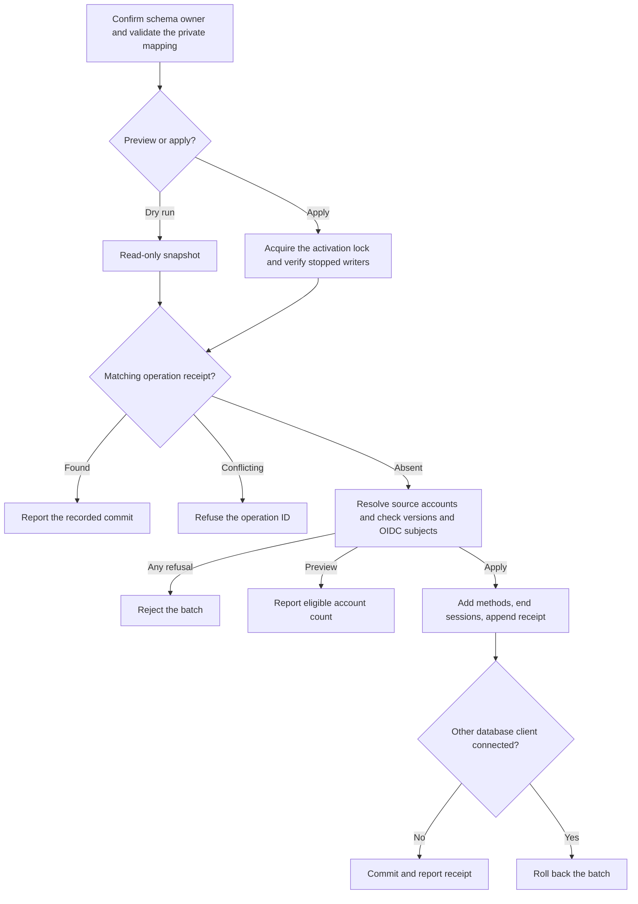

# External sign-in maintenance flow

## Overview

The authentication maintenance command uses the migration role for database
inspection and stopped sign-in operations. Linking existing external accounts
to OIDC ends affected sessions and saves a receipt for the completed batch.

## Entry Points

- Trigger is `pnpm auth:maintain link-oidc`.
- Source is `scripts/auth-maintain.ts:authMaintain`.
- The database has an activated human authentication profile. The operator has
  verified the private identity mapping and uses the migration role. Apply
  requires the API, worker, and all other database clients to stop.

## Flow

## Execution Trace

### 1. Validate the requested operation and its mapping

`scripts/lib/auth-maintain-arguments.ts:parseAuthMaintainArguments` requires a
mapping path and either preview or apply. After the CLI checks the schema owner,
`scripts/auth-maintain.ts:loadOidcLinkMapping` checks the file limits and entry
fields. It derives the same OIDC provider ID that sign-in uses for the issuer
and client.

### 2. Resolve the source accounts or read the operation receipt

`packages/occ/src/state/human-authentication-maintenance.ts:PostgresHumanAuthenticationMaintenance.linkOidc`
checks the operation's audit ID and mapping digest. A matching receipt reports
a prior commit. A conflicting receipt refuses the operation. For a new
operation, State resolves each exact source provider ID and subject to an
identity-only method on a distinct enabled account with an enrolled Principal
in the Installation. State checks the expected account versions and destination
subject collisions.
Dry run performs these reads in one read-only snapshot.

### 3. Commit the methods and audit together

`packages/occ/src/state/human-authentication-maintenance.ts:PostgresHumanAuthenticationMaintenance.maintain`
takes the activation lock and verifies that no other client is connected before
apply. State locks the matched accounts and identities.
`packages/occ/src/state/human-authentication.ts:attachExternalAuthenticationMethod`
adds each OIDC method, advances the account version, and ends its sessions.
Maintenance appends one receipt with the mapping digest and count as the
migration role. It checks the role and connected clients again before commit.
A refusal rolls back the batch. Normal OIDC sign-in resumes after operator
startup and applies its configured Group admission and enrollment policy.

## Debugging and Verification

- The [operator procedure](../guides/deploy/auth-maintenance.md#link-existing-external-accounts-to-oidc)
  defines the mapping, exit codes, and how to check an uncertain result.
- `tests/integration/postgres-oidc-identity-import.test.ts` runs the command with
  real PostgreSQL roles and checks that OIDC sign-in reaches the existing account.

## Related docs

- [Bootstrap and human authentication flow](local-password-authentication.md)
- [External sign-in reference](../reference/authentication/external-sign-in.md)

## Manual Notes

[keep this for the user to add notes. do not change between edits]

## Changelog

- 2026-11-18 10:09: Trace linking external sign-in methods to OIDC during maintenance. (authoring-run/2e28e8ce-8311-4f83-bafa-86757df9b322 - 43194d2b141b43d5da490c21661c85a91662ec83)
