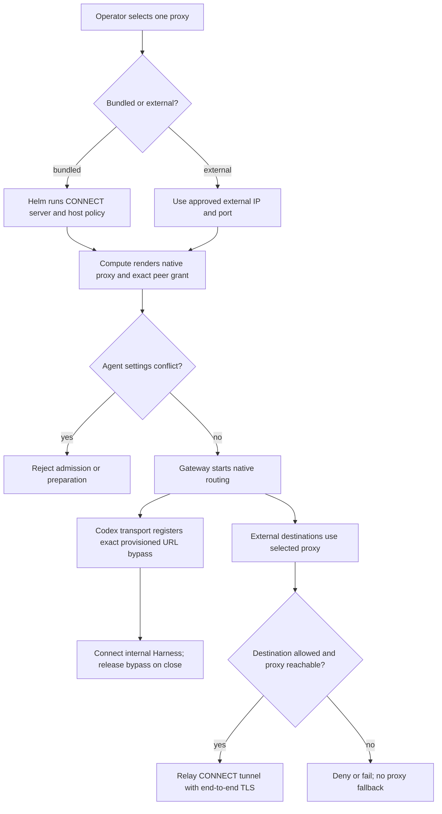

# Gateway outbound proxy flow

## Overview

Operator proxy selection is applied during Agent revision preparation. Kubernetes
Compute owns native Gateway routing and its proxy peer grant; Helm owns the
bundled server and directory-client route. This flow stops when Gateway clients
are routed and the internal Codex transport is connected or fails closed.

## Entry Points

- Trigger: profile rendering and authorized Agent deployment through the durable worker.
- Sources: `scripts/render-installation-profile.mjs:buildRendered`,
  `apps/controller/src/drivers/compute/kubernetes/index.ts:KubernetesComputeDriver`,
  and `apps/controller/src/gateway-proxy.mjs:createGatewayProxyServer`.
- Preconditions: supported topology, ready Namespace, selected Compute Driver,
  and a protected Installation configuration. Proxy credentials are not accepted.

## Flow

## Execution Trace

### 1. Select and validate the endpoint

`scripts/render-installation-profile.mjs:buildRendered` accepts `proxy.bundled`
with an optional host list, or `proxy.url`, never both. It renders Helm
`gatewayProxy` and Compute `runtime.proxy` from that selection. Helm configures
`OCC_CHANNEL_DIRECTORY_PROXY_URL` for the API only and grants its exact route.
No Console or per-Agent proxy selector is added. Without selection, native
configuration and networking behavior stay unchanged.

### 2. Prepare the Gateway

`apps/controller/src/drivers/compute/kubernetes/index.ts:kubernetesGatewayConfigurationDocument`
rejects contradictory Agent settings and generates native proxy configuration.
`gatewayProxyNetworkPolicy` permits the selected peer and TCP port even without
channels. `reconcileGatewayProxyNetworkPolicy` keeps the existing
`allow-gateway-channels-<Agent hash>` object name. Switching endpoints replaces
the old grant on that object; removing the proxy writes an empty egress list
when the owned policy exists. `deleteRetiredAgentPolicies` deletes that same
owned object at retirement. This stable identity prevents additive stale grants.
`deployment` gives the Gateway its endpoint; separate Harnesses do
not inherit it. Embedded model/tool egress remains separately owned. Existing
channel and native-worker qualification gates are unchanged.
Embedded two-cluster Gateways reject a managed control-cluster proxy Service;
that placement needs a reachable external endpoint.

### 3. Connect and release internal transport

`apps/controller/src/drivers/compute/kubernetes/index.ts:deployment`

`deploy/runtime/openclaw-internal-transport-proxy.patch` bridges the pinned OC
lifecycle and its existing Codex WebSocket transport. Compute provisions
`OPENCLAW_INTERNAL_TRANSPORT_URL` from its own `APP_SERVER_URL`. The transport
registers a Proxyline exact-URL exception before opening; another path does not
match. Closure or failed construction releases the exception. Process proxy
shutdown clears the underlying registrations. Native workspace nodes and native
workers use their separate unproxied configuration and initiate the Gateway connection.

### 4. Relay or reject external traffic

`apps/controller/src/gateway-proxy.mjs:createGatewayProxyServer` validates the
operator host list and accepts only CONNECT/TCP 443 for matching destinations.
An explicit `"*"` entry matches all hosts without changing CONNECT syntax or port
checks. The chart still excludes private/reserved IPv4 upstreams through its
NetworkPolicy; hostname matching does not enforce that address boundary.
Policy denial returns 403;
connection failure returns 502. The server does not decrypt TLS. External proxies
own their own destination policy. Dedicated Gateway default-deny networking
prevents direct Internet fallback; this is not whole-Harness containment.

## Debugging and Verification

- Run `node --test tests/conformance/gateway-proxy-*.test.mjs` for host-policy and tunnel behavior.
- Profile/Helm integration checks prove configuration and rendered peer grants,
  not live networking or model execution.
- The packaged runtime's Gateway peer suite checks genuine Codex transport,
  TLS routing, denial, outage, and bypass revocation without model credentials;
  see [image testing](../testing/docker.md#runtime-image-startup-test-environment).
- Real model qualification uses the selected Kubernetes API/worker topology cases
  in [Kubernetes testing](../testing/kubernetes.md), with a disposable enforcing
  cluster, approved images, and existing authorized credentials.
- A CONNECT 403 means destination policy denied it; 502 means the upstream failed.
  Check the current Agent revision after changing the selected endpoint.

## Related docs

- [Operator setup](../guides/integrations/gateway-proxy.md)
- [Networking reference](../reference/drivers/kubernetes-compute/gateway-proxy.md)
- [Agent deployment](harness-execution-topology.md)
- [Directory lookup](agent-channel-directory.md)

## Manual Notes

[keep this for the user to add notes. do not change between edits]

## Changelog

- 2026-11-05 20:33: Preserve proxy-policy identity across endpoint changes, removal and retirement (authoring-run/7e915b47-503f-4c59-85b5-679cc43bd09f - 393028040769a3d0064b0bf74af7378b4ba07381)
- 2026-11-05 20:13: Trace explicit all-hosts policy with unchanged port and address restrictions (authoring-run/e9bf9370-1230-46cf-a388-d218708b8969 - dc5024a57ef9a046e31b191295a379296309d5ff)
- 2026-11-05 19:30: Trace one selected proxy and the exact internal transport bridge (authoring-run/88571699-9ee3-42d5-89c5-d871f0a18b62 - 324fbad6f248bce4606e175fbb67ac506cd824ff)
