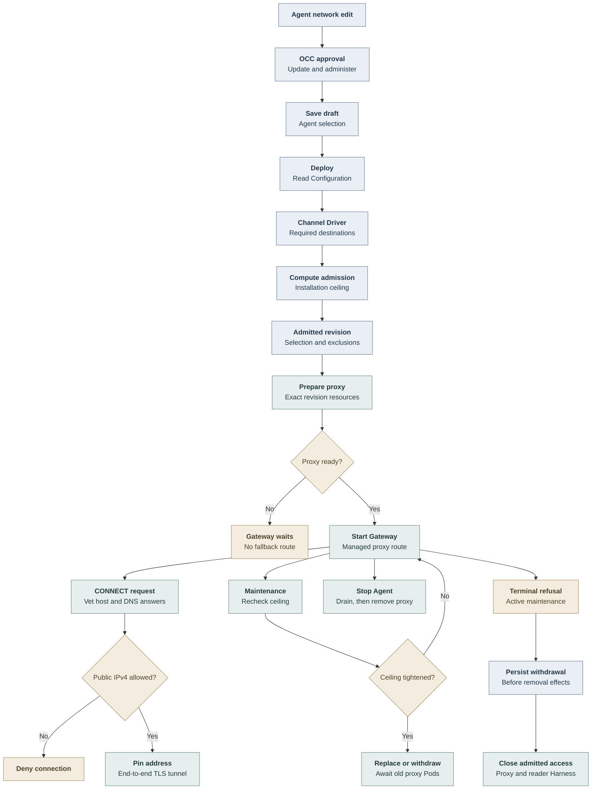

# Gateway Outbound Flow

## Overview

An administrator saves an Agent's additional Gateway access. Deployment freezes
that approval with trusted channel requirements and Installation exclusions.
Kubernetes Compute reconciles an isolated proxy before starting that dedicated
Gateway. This flow ends when the route is ready, withdrawn, or removed after drain.

## Entry Points

- Trigger: exact-Agent PATCH, deployment POST, revision preparation and maintenance.
- Sources: `packages/occ/src/index.ts:OpenClawController.updateAgent`,
  `OpenClawController.deployAgent`, and
  `apps/controller/src/drivers/compute/kubernetes/index.ts:KubernetesComputeDriver`.
- Assumptions: ready Namespace, supported dedicated topology, selected IAM and
  Compute Drivers, approved proxy image, and explicit infrastructure exclusions.
  Changing the Agent field requires exact Agent update and administer.

## Flow

## Execution Trace

### 1. Save additional authority on the Agent

`apps/controller/src/console/navigation.mts:createNavigation` retains the exact
Network tab through login. `apps/controller/src/console/agents/detail.mts:reloadDraftInPlace`
rereads the Agent after a Network save or explicit reload, then rebuilds the editor
in place with confirmation and focus. Sidebar navigation and Back wait for pending
Network writes. Unsaved changes still block deployment;
the backend's saved selection remains the baseline after cancel or reload.

`packages/occ/src/index.ts:OpenClawController.updateAgent` validates the tagged
selection, checks exact update plus administer, and locks the Agent. The selected
Compute Driver validates newly submitted additional access or a topology change.
Ordinary updates retain saved authority even after an Installation tightening;
deployment rechecks it. State persists the selection beside other Agent settings.

`packages/occ/src/state/postgres-state.ts:updateConfiguration` writes
`gateway_outbound`; `migrations/0060_gateway_outbound.sql` constrains its shape,
DNS names, and dedicated-only extra authority. The memory adapter mirrors those
invariants. The normal mutation audit names the actor and exact Agent.

The Agent row also retains upstream's `sandbox_policy_editing` flag. Revision
serialization stores `gateway_outbound` beside `sandbox_policy`; the combined
database constraint permits both without dropping either snapshot. Sandbox policy
admission and application remain with their [existing owner](agent-sandbox-policy.md).

### 2. Freeze requirements at deployment

`packages/occ/src/index.ts:OpenClawController.deployAgent` reads the admitted
Configuration and applies the composed pure channel network declaration. The
Slack Driver supplies requirements only for enabled supported accounts;
caller-authored native settings cannot supply this trusted declaration.

`apps/controller/src/composition/channel.ts:createBundledChannelCapabilities`
supplies the same declaration to API and worker composition. The API also
registers the provider Driver. `apps/controller/src/worker.ts:ControllerWorker.start`
gives provisioning admission only the pure declaration; provider validation and
directory methods stay outside the worker transaction. API credential validation
runs before enqueueing provisioning.

`KubernetesComputeDriver.admitGatewayOutbound` enforces the Installation ceiling
and produces the snapshot. OCC validates it and `freezeAgentRevision` copies
selection, requirements and exclusions into the immutable revision. Missing
support refuses extra authority. A default selection with no channel requirements
needs no proxy. A snapshot requires Compute's `revisionAccessStatus` and removal-only
`withdrawRevisionAccess` hooks. OCC freezes the Gateway snapshot before the selected
Compute's `admitRevision`; its opaque admission facts remain alongside that snapshot.
Persisted admission keeps both decisions unchanged across retries.

### 3. Prepare an isolated route before starting the Gateway

`apps/controller/src/drivers/compute/kubernetes/index.ts:KubernetesComputeDriver.revisionAccessStatus`
purely compares admitted access with current Gateway and reader configuration.
Before normal Compute dispatch, the worker turns `withdrawn` into
`REVISION_ACCESS_WITHDRAWN` and persists the removal-only phase described below.
Preparation therefore cannot start withdrawal before that decision is durable.
`reconcileGatewayOutbound` creates the exact revision's immutable policy ConfigMap,
ServiceAccount, Deployment, Service, proxy egress policy and Gateway peer policy.
All resource names and ownership selectors include Agent and revision identity.

`apps/controller/src/gateway/proxy-configuration.mjs:readProxyConfiguration` checks
and reads the same opened regular file with a 1 MiB bound. Both proxy entrypoints
use it; Kubernetes ConfigMap projection symlinks remain supported.

The proxy Pod uses its separate network profile, has no Secret or API token, and
receives public IPv4 TCP/443 plus DNS under exclusions. Its ingress admits only
its owning Gateway revision. The Gateway receives no new direct public grant.
Compute checks proxy readiness before preparing the Gateway with HTTP(S) proxy,
Node proxy opt-in and exact internal bypass hosts. Harness environment and
networking retain their existing contract. Older Node versions fail managed
Gateway startup before plugin execution.

### 4. Admit each tunnel without moving credentials

`apps/controller/src/gateway/outbound-proxy.mjs:createOutboundProxyServer`
handles CONNECT/443. It validates authority syntax and destination policy,
resolves through the OS resolver once, rejects any prohibited answer, then
connects to a vetted literal IPv4 address. Subsequent TLS remains between the
native client and destination. The proxy holds neither provider nor model
credentials. Health and bounded denial diagnostics contain no request secrets.

`apps/controller/src/gateway/control-plane-outbound-proxy.mjs` loads a separate
restricted policy from trusted Driver composition. The Helm instance admits
only OCC API clients; Agent selections never broaden it. See the
[channel directory flow](agent-channel-directory.md) for management requests.

### 5. Persist withdrawal before terminal maintenance

`apps/controller/src/worker.ts:ControllerWorker.beginRevisionAccessWithdrawal`
persists a terminal active-version result as `REVISION_ACCESS_WITHDRAWAL_PENDING`
before removal. Work-bound evidence keeps the refusal, bounded failure details and
required runtime retirement together. The next pass calls
`ControllerWorker.finishRevisionAccessWithdrawal` instead of preparing the revision.

`ControllerWorker.processRevision` preserves permanent
`resolveRevisionSecretContext` refusals through `finalizeRevision` when access was
admitted. Restoring the selected Secret Driver cannot resume that revision after
withdrawal begins. For active revisions with admitted access, permanent Sandbox
authorization refusals also reach `finalizeRevision` instead of generic active
maintenance recovery. Transient authentication failures retain their retry
classification. Without admitted access, active Secret-context and Sandbox
failures retain the existing continuing-maintenance recovery path.

`KubernetesComputeDriver.revisionAccessStatus` returns `none` without admitted
access, `current` when its immutable Gateway/reader admission is still permitted,
and `withdrawn` when current configuration refuses it. A pending withdrawal remains
selected for either non-`none` status, so restoring approval cannot cancel it.
`KubernetesComputeDriver.withdrawRevisionAccess` attempts both selected closures
independently: remove the exact Gateway proxy, and remove the reader policy plus
terminate its admitted Compute-owned Harness. A failure or blocked Pod in one
closure cannot prevent the other from starting. An unchanged reader peer or
restored authority does not cancel withdrawal. Ordinary Harnesses without reader
admission retain their existing behavior.

Each retry keeps the persisted removal-only decision. Stale-lease recovery copies
its fields, preserving nested null values in failure evidence. The worker publishes
the terminal result and queues any required runtime retirement only after all
selected proxy/workload closures finish. A new authorized revision restores access.

### 6. Reconcile tightening and tear down after drain

`apps/controller/src/drivers/compute/kubernetes/index.ts:KubernetesComputeDriver.reconcileGatewayOutbound` combines current exclusions
with admitted exclusions. A changed immutable policy stops old proxy Pods before
recreation. Disabled outbound or withdrawn public approval follows the persisted
withdrawal phase above. Maintenance scheduling is owned by the existing worker;
its 30-second interval also observes reader configuration on the next pass and does
not bound queue and shutdown time.

`removeGatewayOutbound` deletes only resources matching exact revision ownership
and waits on Namespace, Agent, revision and workload-role Pod labels. Stop retains the proxy while the Gateway drains;
retirement and deletion remove it afterward. Old cleanup cannot match a successor.
Existing tunnels end with the proxy process rather than surviving a policy change.

`retireGatewayChannelGrant` removes the retired Agent-wide channel grant before
Gateway deployment reconciliation and during access withdrawal. For those callers,
the grant stays as the retry obligation until fenced Deployment deletion, Gateway
Pod termination and Deployment absence are confirmed. Historical stop and
retirement preserve a newer Gateway and leave its grant for its owner to remove;
withdrawal remains pending. This cleanup accepts no retired channel-proxy
configuration.

## Debugging and Verification

Read the selected revision's network snapshot and deployment result before
inspecting its exact owned proxy resources. A draft save does not mean its route
is active. Preparation must show a ready proxy and Gateway.

The [testing page](../testing/gateway-outbound.md) separates API, database,
real proxy, Kubernetes and simulated UI proof. No single result establishes
compatibility with every native plugin transport or provider.

## Related docs

- [Gateway outbound reference](../reference/gateway-outbound.md)
- [Harness topology](harness-execution-topology.md)
- [Configuration persistence and revisions](configuration-driver/persistence-and-revisions.md)
- [Controller worker](controller-worker.md)

## Manual Notes

## Changelog

- 2026-10-19 22:31: Preserve both Sandbox and Gateway snapshots after upstream integration and update the migration link. (authoring-run/a17d3f2a-fc44-4f46-af2d-e8749bfb8305 - 5f494a0fdf8f36f5b4cdf0a2886987ca49a5248c)

- 2026-10-19 13:31: Preserve Network login return, editor position and focus through upstream refresh. (authoring-run/40820368-0ee7-4901-9224-041654014ae4 - 6be6b0a00)

- 2026-10-17 19:31: Preserve admitted-access withdrawal on permanent active Sandbox refusal during the worker refresh. (authoring-run/3eb9cf81-4deb-49ce-82e7-d52bf1940560 - 0757fb95d8f3f14e4e3b3d6c1839a19ee64e898a)

- 2026-10-17 19:07: Preserve current native runtime, credential-source capabilities and canonical authentication during upstream refresh; renumber the outbound migration. (authoring-run/e42db43f-12e0-4e90-8f4c-c21707b46f91 - f106ce5b31c608bd99a0859cd6972ebdfa402461)

- 2026-10-16 17:53: Update the migration source link after refreshing upstream main. (authoring-run/b0880b90-1d57-45a0-971b-fc6755eab657 - 7e3a2a21a3a0e0d4c8c8308c8c8dafd14b841fd0)

- 2026-10-16 17:45: Leave historical channel-grant cleanup to the newer Gateway owner. (authoring-run/fea49e8b-1a66-42da-af1c-9a184f0f09a7 - 8f34dbb61e953bd6882f450b1c3b0b1ac995cdbc)

- 2026-10-16 13:35: Preserve permanent Secret-context refusal and retire obsolete channel grants before access completion. (authoring-run/05789d5b-74d1-470e-874f-94028b6d6115 - e2dc3023d8c2369dab0a0f200051ff5e84096077)

- 2026-10-16 13:09: Compose admitted Gateway and reader withdrawal against refreshed upstream. (authoring-run/523fa03e-fd48-4e90-a757-e4c83a1e2b53 - 792afad4f9e8bd4323fc197a102ebde7961484c9)

- 2026-10-15 15:46: Unify channel capability composition and carry withdrawal state through retries. (authoring-run/6de03ad9-293f-4b20-b21c-a5e0a23cb208 - b0c299f7e8a9cdb992500fa39d32dddea9271ed0)

- 2026-10-15 10:01: Preserve Channel Driver requirements during worker provisioning admission. (authoring-run/903d04fd-a3a7-4825-aca7-f94d828ab2d8 - 313a70262e432192306a2db431bf0b6f0459a957)

- 2026-10-14 17:45: Add durable terminal-maintenance withdrawal (authoring-run/068ea9ef-c548-4e2e-86e6-a75b33ec5ae3 - 27562ebf56a8315a663583731a303ca362cbfc5d)
- 2026-10-14 16:16: Document accompanying Gateway outbound implementation (authoring-run/068ea9ef-c548-4e2e-86e6-a75b33ec5ae3 - bd8fe1f7b0b798dca84d6f90b7377ddda79d88a6)
