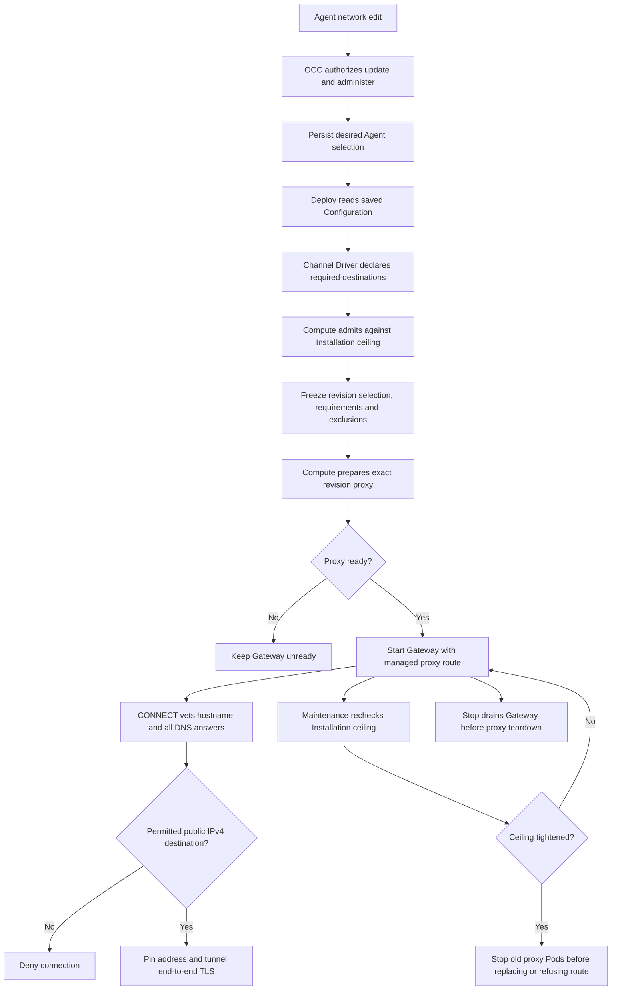

# Gateway Outbound Flow

## Overview

An administrator saves an Agent's additional Gateway access. Deployment freezes
that approval with trusted channel requirements and Installation exclusions.
Kubernetes Compute reconciles an isolated proxy before starting that dedicated
Gateway. This flow ends when the route is ready, withdrawn, or removed after drain.

## Entry Points

- Trigger: exact-Agent PATCH, deployment POST, revision preparation and maintenance.
- Sources: `packages/occ/src/index.ts:OpenClawController.updateAgent`,
  `OpenClawController.deployAgent`, and
  `apps/controller/src/drivers/compute/kubernetes/index.ts:KubernetesComputeDriver`.
- Assumptions: ready Namespace, supported dedicated topology, selected IAM and
  Compute Drivers, approved proxy image, and explicit infrastructure exclusions.
  Changing the Agent field requires exact Agent update and administer.

## Flow

## Execution Trace

### 1. Save additional authority on the Agent

`packages/occ/src/index.ts:OpenClawController.updateAgent` validates the tagged
selection, checks exact update plus administer, and locks the Agent. The selected
Compute Driver validates newly submitted additional access or a topology change.
Ordinary updates retain saved authority even after an Installation tightening;
deployment rechecks it. State persists the selection beside other Agent settings.

`packages/occ/src/state/postgres-state.ts:updateConfiguration` writes
`gateway_outbound`; `migrations/0054_gateway_outbound.sql` constrains its shape,
DNS names, and dedicated-only extra authority. The memory adapter mirrors those
invariants. The normal mutation audit names the actor and exact Agent.

### 2. Freeze requirements at deployment

`packages/occ/src/index.ts:OpenClawController.deployAgent` reads the admitted Configuration and asks the
selected Channel Driver for `gatewayNetworkRequirements`. The Slack Driver
supplies requirements only for enabled supported accounts. Caller-authored
native settings cannot supply this trusted declaration.

`KubernetesComputeDriver.admitGatewayOutbound` enforces the Installation ceiling
and produces the snapshot. OCC validates it and `freezeAgentRevision` copies
selection, requirements and exclusions into the immutable revision. Missing
support refuses extra authority. A default selection with no channel requirements
needs no proxy. Persisted admission keeps the same snapshot across retries.

### 3. Prepare an isolated route before starting the Gateway

`apps/controller/src/drivers/compute/kubernetes/index.ts:KubernetesComputeDriver.enforceGatewayOutboundCeiling` withdraws an old route
when current configuration refuses its admitted authority.
`reconcileGatewayOutbound` creates the exact revision's immutable policy ConfigMap,
ServiceAccount, Deployment, Service, proxy egress policy and Gateway peer policy.
All resource names and ownership selectors include Agent and revision identity.

The proxy Pod uses its separate network profile, has no Secret or API token, and
receives public IPv4 TCP/443 plus DNS under exclusions. Its ingress admits only
its owning Gateway revision. The Gateway receives no new direct public grant.
Compute checks proxy readiness before preparing the Gateway with HTTP(S) proxy,
Node proxy opt-in and exact internal bypass hosts. Harness environment and
networking retain their existing contract. Older Node versions fail managed
Gateway startup before plugin execution.

### 4. Admit each tunnel without moving credentials

`apps/controller/src/gateway/outbound-proxy.mjs:createOutboundProxyServer`
handles CONNECT/443. It validates authority syntax and destination policy,
resolves through the OS resolver once, rejects any prohibited answer, then
connects to a vetted literal IPv4 address. Subsequent TLS remains between the
native client and destination. The proxy holds neither provider nor model
credentials. Health and bounded denial diagnostics contain no request secrets.

`apps/controller/src/gateway/control-plane-outbound-proxy.mjs` loads a separate
restricted policy from trusted Driver composition. The Helm instance admits
only OCC API clients; Agent selections never broaden it. See the
[channel directory flow](agent-channel-directory.md) for management requests.

### 5. Reconcile tightening and tear down after drain

`apps/controller/src/drivers/compute/kubernetes/index.ts:KubernetesComputeDriver.reconcileGatewayOutbound` combines current exclusions
with admitted exclusions. A changed immutable policy stops old proxy Pods before
recreation. Disabled outbound or withdrawn public approval removes the route and
returns a typed refusal. Maintenance scheduling is owned by the existing worker;
its interval does not bound queue and shutdown time.

`removeGatewayOutbound` deletes only resources matching exact revision ownership
and waits for owned Pods to stop. Stop retains the proxy while the Gateway drains;
retirement and deletion remove it afterward. Old cleanup cannot match a successor.
Existing tunnels end with the proxy process rather than surviving a policy change.

## Debugging and Verification

Read the selected revision's network snapshot and deployment result before
inspecting its exact owned proxy resources. A draft save does not mean its route
is active. Preparation must show a ready proxy and Gateway.

The [testing page](../testing/gateway-outbound.md) separates API, database,
real proxy, Kubernetes and simulated UI proof. No single result establishes
compatibility with every native plugin transport or provider.

## Related docs

- [Gateway outbound reference](../reference/gateway-outbound.md)
- [Harness topology](harness-execution-topology.md)
- [Configuration persistence and revisions](configuration-driver/persistence-and-revisions.md)
- [Controller worker](controller-worker.md)

## Manual Notes

## Changelog

- 2026-10-14 16:16: Document accompanying Gateway outbound implementation (authoring-run/068ea9ef-c548-4e2e-86e6-a75b33ec5ae3 - bd8fe1f7b0b798dca84d6f90b7377ddda79d88a6)
