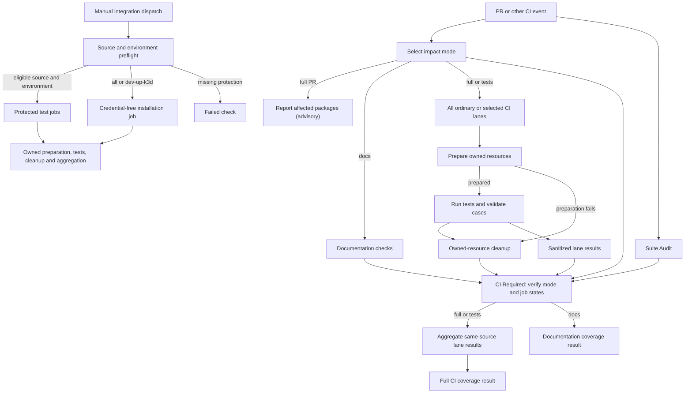

# GitHub Actions testing flow

## Overview

The [ordinary CI lanes](../testing/ci.md#ci) reject missing or skipped coverage. Docs-only runs check documentation and Suite Audit. Neither proves credentialed integrations.

## Entry Points

- `.github/workflows/ci.yml:jobs`: PR, main push, merge-group and manual checks on ephemeral runners.
- `.github/workflows/qa-advisory.yml:jobs`: 6-hourly QA on `main`, and post-merge QA when `QA_ADVISORY_ON_PUSH` is `true`; trusted pull requests opt in with `full-qa`.
- `.github/workflows/full-integration.yml:jobs`: manual integrations from main or approved Kubernetes model/OpenShell branches, pinned to the dispatched commit.

## Flow

## Execution Trace

### 1. Select one source commit and coverage group

`scripts/ci/run-tests.mjs:main` audits, runs and aggregates both locally and in CI.

`.github/workflows/ci.yml:jobs`, `.github/workflows/full-integration.yml:jobs`,
`scripts/ci/full-integration-preflight.mjs:validateFullIntegrationPreflight`, and
`scripts/ci/test-suites.mjs:loadTestSuites`

`loadTestSuites` assembles `scripts/ci/test-suites.json` and its ordered
`scripts/ci/test-suites/<lane>.json` references for runners and preparation.
Each lane owns its tests, environment, required inputs and preparation settings.

CI uses the event checkout without external service credentials. Impact and Suite Audit start independently. In every mode, `static-checks` verifies checkout identity and runs workspace, lint, format, OpenAPI and docs checks (no product tests), alone in docs mode. The [coverage map](../testing/ci.md#tests-in-each-workflow) lists matrix jobs and the separate `runtime-image-fixture`; tests mode runs only selected lanes. Image startup parts 1 and 2, PostgreSQL Application and the `checks-baseline` and `checks-browser` parts use `blacksmith-32vcpu-ubuntu-2404` for its 8 CPUs, k3d fixture and observability for its NetworkPolicy-enforcing kernel; `runtime-image-fixture` uses `ubuntu-22.04`. Other lanes, Static Checks and audit use `blacksmith-16vcpu-ubuntu-2404`.

The selector verifies that the tested merge has the event head as its second parent. It
compares that tree with its first parent, the current base, using policy from the base.
Git path decoding preserves a leading UTF-8 BOM. Only a nonempty set of allowlisted
regular Markdown changes selects docs mode; generated API references, including Markdown
under `docs/reference/api/`, require full CI for `openapi:check`.

Registered test changes may include docs and their own lane-manifest entries. CI runs
the owning lanes from either tree, adds `checks-baseline-2` for TypeScript, and uses
`checks-baseline-1` if only the fixture job would run. Other changes and non-PR events
select full CI. Missing policy or unverifiable source selects full or fails closed.

`CI Required` rechecks the mode and selected lanes. Impact, audit and selected jobs must
succeed; other jobs must be skipped. Full and tests modes aggregate results from the same
source. Docs mode produces no test artifacts. The impact summary shows mode, fixed reason
and accepted lanes; it omits paths and raw output. Selector errors fail the job, and missing
evidence is reported as unavailable.

For full-mode PRs, `affected-packages` verifies merge identity and checkout cleanliness, then reports workspace dependents. This advisory neither selects tests nor gates `CI Required`.

A PR can change the workflow loaded from its merge checkout despite base-loaded
policy. Separately trusted enforcement is a deployment decision, not an
established source property.

Full Integration checks out immutable `github.sha`. `all` selects every dispatch
lane and CI suite; preflight includes `integration-qa`. QA waits for Slack to finish, regardless of success.
Aggregation requires QA and `dev-up-k3d` results. Cancellation stops QA.
`all` requires `main`. Only `k3d-model`/`openshell` admit exact environment-granted
branches; administrators remove temporary grants after verification.
Credential-free `dev-up-k3d` also accepts branches and prepares Go, CLI, Chromium
and k3d on Ubuntu 22.04, with 150/180-minute file/job deadlines.
Dispatches serialize without cancellation: standalone `dev-up-k3d` per branch,
others in `full-integration`. Preflight rejects required reviewers and retains
branch restrictions. Dispatchers inspect commits; no approval is needed.

PostgreSQL migration and application suites own separate servers; each Kubernetes fixture lane owns a separate cluster and PostgreSQL server. Before creating k3d nodes that share the runner kernel, the shared action enables bridge netfilter; missing filtering fails setup rather than leaving Pod network policies unenforced. The repository credential platform lane uses Blacksmith for full-image HTTP, PostgreSQL, Unix-control and credential-material proof; NetworkPolicy enforcement remains the fixture lanes' responsibility. State and cleanup stay on each runner; within a lane, `scripts/ci/run-tests.mjs:runLane` runs files sequentially except audited `parallelFiles`.

The application lane gives the native IAM barrier test its own migrated PostgreSQL database; only that test receives its application and migrator connection details, which the CLI keeps out of `GITHUB_ENV`. Its unregistered supplier stays in that disposable database. This fixture does not establish production writer participation in the barrier.

Full CI and Full Integration call the [run-ci-lane action](../../.github/actions/run-ci-lane/action.yml) for setup, selected baseline checks, preparation, execution, unconditional cleanup, and sanitized result upload. Callers own the commit, protected environment, explicit credentials and timeout; tests stop five minutes earlier.

PR dependency caches stay within GitHub's PR merge-ref scope; main caches stay main-scoped. Results and credential-bearing state are not caches; protected jobs do not promote PR artifacts.

The provider job uses the shared `blacksmith-8vcpu-ubuntu-2404` runner for image-build and k3d-import disk headroom; standard Ubuntu reached `DiskPressure` and evicted the seccomp probe before startup. Preparation copies the archive to each owned k3d node for node-local `ctr image import`; k3d `tools-node` can report success despite logged per-node failures. Imported manifest and CRI checks remain required before tests.

### 2. Prepare resources under the job owner

`scripts/ci/prepare.mjs:main` and `scripts/ci/prepare.mjs:ensureK3dCluster`

[CI resource preparation](github-actions-testing/preparation.md) traces tool setup, image and cluster preparation, protected credentials, and resource ownership. Continue below when preparation has produced the lane state.

For `logging-collector`, `scripts/ci/prepare.mjs:prepareLane` pre-pulls the pinned Collector, Node, Prometheus and Grafana images before publishing lane inputs. The metrics test and preparation share the digests in `scripts/ci/metrics-monitoring-images.mjs:metricsMonitoringImages`. `scripts/ci/prepare.mjs:ensureDockerSourceImage` reuses a verified local repository digest or pulls through `scripts/ci/image-pull.mjs:pullImage`, then verifies that digest before tests start containers. Registry 5xx and rate limits retry within the shared pull budget; missing manifests and authorization refusals fail preparation immediately. Explicit unpinned Node overrides keep the existing test-owned pull behavior.

`checks-browser`, `checks-browser-2`, `postgres-auth`, `postgres-platform`, `images-runtime-startup`, `images-runtime-startup-2` and `images-runtime-startup-3` use separate runners and required artifacts. `scripts/ci/prepare.mjs:imageBuildArgs` enables scoped BuildKit caches for hosted image jobs: packaging exports; runtime startup restores. Images load into the job's Docker engine; cache credentials stay in preparation.

Kubernetes preparation records host snapshots. Failed reads, bounded
by time and size, save `<state-file>.diagnostics.json` outside the cluster directory.
These lanes use `--no-rollback`; workflows own teardown after capture, while
local callers use the failed state file. Observation failures preserve the original error. `nodeLogExcerpt` orders Docker streams
and retry summaries by full UTC timestamp precision using locale-independent ASCII comparison ([CI guide](../testing/ci.md)).

Tests delete Agent namespaces and their events before file exit. While each file
runs, `scripts/ci/run-tests.mjs:runFile` watches Compute-managed Pods and events
in ready k3d clusters; `scripts/ci/k3d-diagnostics.mjs:projectAgentNamespaceActivity`
appends Pod transitions and those namespaces' events to the report under
`agentNamespaces` on pass or failure. Each file retains at most 200 Pod and 200
event records, and the report retains 40 files. Messages are redacted and
truncated, and Pod specs dropped. Each file streams raw watches to its own files
in the cluster directory and removes them when done. Watches are cluster-wide, so
under `fileConcurrency` a record can include a sibling's namespaces. A failed
start logs `Agent namespace activity unavailable`. Each lane that writes the
artifact uploads it.

Dedicated Codex preparation and the operator's offline profile generator share
`scripts/lib/codex-seccomp-profile.mjs:deriveCodexBwrapProfile`. Preparation
requires an actual workspace write and denied write to a container-writable
outside path before publishing the selected Localhost profile to the live suite.
Native runtime-image tests trust a dynamic Codex Docker seccomp profile only when
`OPENCLAW_ENTERPRISE_CI_STATE` records the exact prepared
`cluster.codexDockerSeccompProfile` path and SHA. A self-hashed profile without
that state is not CI proof; the standalone fallback remains the pinned reviewed
manual profile. Production node provisioning remains outside CI ownership; see
[Codex sandbox setup](../guides/deploy/codex-sandbox.md).

### 3. Execute and account for actual cases

`scripts/ci/run-tests.mjs:main`, `scripts/ci/reporter.mjs:jsonLinesReporter` and `scripts/ci/failure-redaction.mjs:redactFailure`

The runner discovers active test files and verifies one lane assignment per file. Different prerequisites require separate files. It invokes whole files with invocation-scoped environment inputs. A custom Node reporter publishes case names, locations and outcomes, excluding arbitrary output. The runner also keeps each failure's error message (at most 600 characters) and top stack frame (240), with the repository path stripped, every nonpublic environment value of eight or more characters (from the job and from the test process) replaced by `[env:NAME]`, and common token, key, URL-password and `password=`-style values replaced by `[redacted]`; the runner prints the same line per failed case to the job log. Values a test generates at run time are redacted only when they match those shapes. Failed provider-test HTTP assertions also retain numeric actual and expected status codes, an allowlisted OCC error code, and the upstream ChatGPT operation and status when available. Denied-traffic failures retain only an allowlisted traffic category, without target addresses or response data. Plugin-status fixture failures retain an allowlisted readiness or rollout stage. Rollout diagnostics include allowed Pod phases, readiness and scheduling flags, container restart counts and exit codes, and allowlisted reasons. These structured diagnostics exclude response bodies, credentials, and identities.

Required cases must pass; every skip or TODO fails the lane. There are no counterpart-skip lists or CI name filters. Synthetic file-wrapper success, missing output, zero cases, or interruption without final reporter output cannot establish coverage. Lane results retain failure, timeout and cleanup outcomes.

### 4. Clean up and report results

`scripts/ci/cleanup.mjs:main` and `scripts/ci/run-tests.mjs:main`

`.github/actions/run-ci-lane/action.yml` uploads one sanitized result artifact
per lane and run. A retry replaces that lane's artifact, preventing aggregation
of a stale result; other lanes retain theirs. Each attempt also uploads the same
file as `attempt-<run attempt>-<artifact-prefix>-<lane>`, which no aggregate
pattern matches, so a failed attempt's cases survive a `--failed` rerun.

The `k3d-fixture-configuration` lane runs `scripts/ci/memory-sampler.sh`
beside tests to diagnose runner loss. Every 15 seconds it samples available and container memory, memory pressure,
root disk and top process RSS by name, excluding arguments and environment. Minute
summaries reach the job log; failed or cancelled lanes print the last samples.
Each attempt uploads at most about 1 MiB as
`memory-<artifact-prefix>-<lane>-attempt-<run attempt>`. Sampler and upload errors
do not fail the lane; only logged summaries survive runner loss.

For `images-packaging`, `scripts/ci/export-image-reconciliation.mjs` attempts to
retain attempt-specific cleanup records for prepared controller and runtime tags.
Planned records do not prove image creation; tag names confer no authentication
or deletion authority. Missing state is unavailable, and empty inventories do not
prove cleanup. The separate runtime-images test tag, other resource kinds and
private environment values are excluded. Export, upload or runner failure can
prevent retention.

Fixture bootstrap diagnostics upload separately as `diagnostics-<artifact-prefix>-<lane>-attempt-<N>`.
They survive cluster/private-state cleanup but cannot satisfy required test results.

Per-file cleanup releases its database; job cleanup removes state-owned resources.
Deleting an owned `k3d-cluster` removes its Collector Namespace and RBAC. Logging
cleanup removes its Docker backend and JSONL/config directory even without
Kubernetes. Cleanup failure fails the check except for
[hosted QA image warnings](github-actions-testing/preparation.md). Private
state stays on its runner host and path; user databases, contexts, unrelated
containers and other image references remain outside that ownership.

`scripts/ci/cleanup.mjs:execFile` waits for exit and drained output.
On POSIX, `scripts/ci/cleanup-command.mjs` leads each group. Caller exit,
including SIGKILL or `process.exit()`, closes its private IPC channel;
the supervisor kills its group. Completion drains output, kills grouped
descendants, and returns command status.
At its [deadline](../testing/ci.md#cleanup-command-deadlines), TERM then KILL
bound the group despite direct-child exit. Escaped groups receive no signals;
retained streams close after another grace. Windows provides direct-child
termination and stream bounds, without this supervisor.

`scripts/ci/run-tests.mjs:killDescendants` stops active cleanup groups before
sweeping descendants and exiting after abandoned work.
`tests/helpers/postgres-worker-revision-fixture.mjs:disposeStep` records named
timeouts and continues disposal. Root hooks allow two seconds for reports before
exit; cleanup failure arms that grace immediately. A 60-second backstop covers
skipped hooks. The parent runner accounts for failures. Failed resources stay in state; cleanup continues.

`CI Required` checks jobs even after failures. Full-mode aggregation verifies
matching commit SHAs, success, required evidence and cleanup; the runner
validates cases. Docs mode checks documentation, audit and skipped test jobs
without aggregation, proving only those checks. Full Integration accounts for
its selected `full` group or lane. `ssh-host` stays outside automatic groups until
an operator prepares its [disposable host](../testing/ssh.md#ssh-raw-hosts).
Abrupt runner loss can prevent teardown and loses private `RUNNER_TEMP` state.
External reconciliation awaits an approved resource ledger.

## Debugging and Verification

- `node scripts/ci/run-tests.mjs audit` checks the actual checkout inventory against the suite map.
- `node --test tests/integration/ci-runner.test.mjs` exercises the runner with real child Node processes and controlled pass/fail/skip cases.
- Reproduce the sanitized result's failing file, name and location with approved prerequisites. The named aggregate bounds coverage.
- On local Docker Desktop or equivalent VM-backed Docker hosts, run one Kubernetes lane at a time when disk or network pressure has caused measured instability. GitHub Actions still runs the configured matrix; this local guidance is for reproducible operator runs.
- Missing protected environments, tools, images or credentials are setup failures. Configure the approved resource; do not mark its required test skipped or replace it with a fixture.
- Retain sanitized results for seven days; exclude private state and credentials from uploads. Recover local teardown using run-owned state on its original host and path.

## Related docs

- [Testing guide](../testing/README.md)
- [CI suite map](../../scripts/ci/test-suites.json)
- [Integration implementation specification](../../specs/plans/19-github-actions-test-coverage/index.md)
- [Upstream infrastructure report](../../specs/plans/19-github-actions-test-coverage/source-audit.md)

## Manual Notes

[keep this for the user to add notes. do not change between edits]

## Changelog

- 2026-10-23 07:40: Preserve upstream CI selection alongside locale-independent timestamp ordering after conflict resolution. (authoring-run/01a10a81-070c-7aa3-97d0-fbce8f285d4d - a6a49a5192fa1c9cc5035801eed7d64b03336491)

- 2026-10-23 03:43: Order Docker timestamps and retain twelve latest retry kinds independently of locale. (authoring-run/01a10a81-070c-7aa3-97d0-fbce8f285d4d - 9bca605f5175bb225a522c3d5537a7ee6e1a7751)

- 2026-10-21 04:42: Preserve submillisecond Docker event order. (authoring-run/458f4777-70d1-4992-a922-ab387c6a4aba - e8185dac805b737363c7178d3068b310a53a7c24)

- 2026-10-14 22:31: Complete all selection. (authoring-run/d5130a41-8ae6-4a80-aef3-32d61a53348c - 9b50982b75a578d6967ee12befb1fa3904e20a38)

- 2026-10-14 14:09: Remove environment approvals. (authoring-run/ff0eb53f-ceb9-43fc-a81a-c1bc88b5c9fb - 909b0b9d4)

- 2026-10-14 14:04: Scope PAT authentication and OpenShell prerequisites. (authoring-run/dba0a6cb-33d9-40fd-b38b-e20cddf4b75f - 96a2b79fa)

- 2026-10-14 16:37: Document hosted QA image cleanup. (authoring-run/0733d076-37af-4fd5-ade5-869487072f47 - 1c406aef)

- 2026-10-14 10:19: Retain cleanup ownership. (authoring-run/ee448fbe-3e0a-40d4-b7d1-3f122d3e5f1b - 10f34280f56dc2375f48df9d2161024520a35882)

- 2026-10-14 09:44: Document command-group termination, pipes with shutdown deadlines, and abandoned runner and fixture handoffs in the accompanying fix. (authoring-run/6dec0b67-a5cd-4a9e-82dc-7609f956b115 - 47d5b8cc901e225e51227a905ee688c69c8ea729)

- 2026-10-08 11:04: Isolate launcher queue. (authoring-run/09563984-5be9-4e9d-bf17-142ceb70d96d - 9e7a30a5da374826b1a2ba79b3bca9cdcb74d1f2)

- 2026-10-08 09:57: Documented Keycloak egress repair and manual qualification. (authoring-run/e5c12029-7b1c-4214-a4b9-bde04d03ab41 - 12719f1d366291b774eb9d4948be451c9dd7d805)

- 2026-10-06 02:00: Per-file Agent namespace watch files. (audit-followup-ci-runner)

- 2026-10-04 03:44: Add a non-required affected-package advisory to the accompanying CI change. (authoring-run/5808365b-c590-4c11-92d6-4ee32efc3626 - 070147565f45e720918de9e649b93cad71820b07)

- 2026-10-04 03:00: Split the baseline lane into two parallel parts. (ci-split-checks - 77323afe4d57960c37e07b62e684942a418d585a)

- 2026-10-04 01:41: Document metrics image preparation, shared pins and pull failure handling in the accompanying changes. (authoring-run/091c2e1e-27cb-4514-a1ea-8308051d6ab9 - 61ce8407ac7f46c137f17e7d3bdaf8e9377fa4ff)

- 2026-10-01 02:34: Document the advisory impact summary in the accompanying changes. (authoring-run/0f81a0c3-327f-4389-ae2e-89431878a2d7 - c61836797191a0924671eaaec074863fe2d80cfe)

- 2026-10-01 01:06: Preserve Git path byte identity in the selector and document its coverage decision in the accompanying changes. (authoring-run/2403db12-cdf4-4070-aece-2f4b45ff0234 - 5e0906ccd42473596c2006474adf199d42ab74df)

- 2026-09-29 22:55: Split browser, PostgreSQL authentication, and image model-probe lanes; cache hosted controller/runtime builds while retaining required result accounting. (01a0f0d0-002a-7dc3-af73-e7d25dfe92e2 - b8d7e48f5837d11e54e04dce40650f7ccc5100f0)

- 2026-09-30 02:42: Document generated API reference selection in the accompanying changes. (authoring-run/cd1c4c87-0519-4df7-8bf2-abbff0d53424 - a56c027ff8ec22655cca49aa6a912081cb98b593)

- 2026-09-30 02:03: Describe the documentation-only checks and required gate in the accompanying changes. (authoring-run/ac4af003-ce47-4e8d-83af-040e227a7673 - 20c06dffda90748e5ea16348eaa04feb79d551ab)

[GitHub Actions testing documentation history](github-actions-testing/history.md) preserves the older dated entries.
