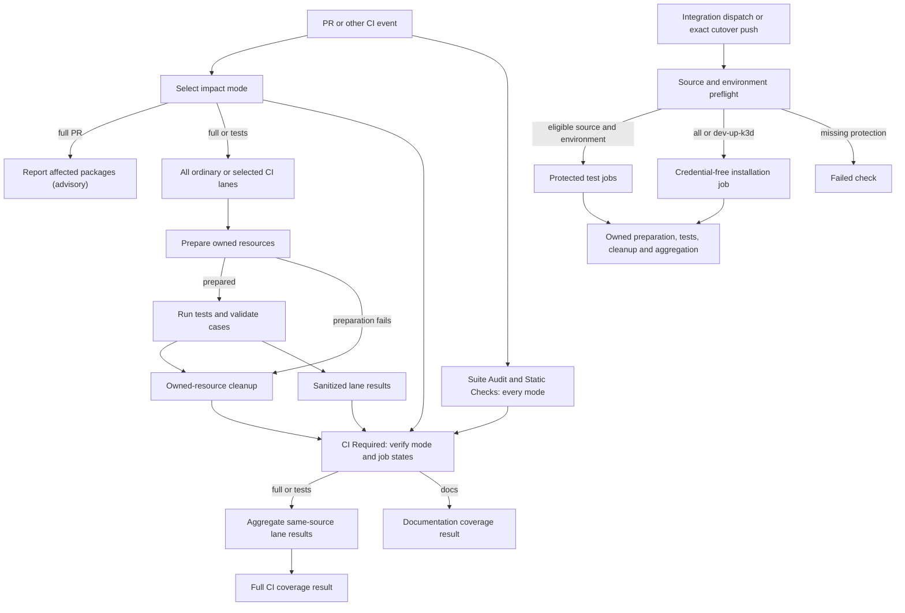

# GitHub Actions testing flow

## Overview

The [ordinary CI lanes](../testing/ci/required-checks.md) reject missing or skipped coverage. Docs-only runs execute Suite Audit and Static Checks. Neither proves credentialed integrations.

## Entry Points

- `.github/workflows/ci.yml:jobs`: PR, main push, merge-group and manual checks on ephemeral runners.
- `.github/workflows/qa-advisory.yml:jobs`: 6-hourly QA on `main`, and post-merge QA when `QA_ADVISORY_ON_PUSH` is `true`; trusted pull requests select [full or focused advisory QA](../testing/ci/qa-advisory.md).
- `.github/workflows/full-integration.yml:jobs`: automatic main pushes and approved manual main integrations, pinned to `github.sha`.

## Flow

## Execution Trace

### 1. Select one source commit and coverage group

`.github/workflows/ci.yml:jobs`, `.github/workflows/full-integration.yml:jobs`,
`scripts/ci/full-integration-preflight.mjs:validateFullIntegrationPreflight`, and
`scripts/ci/test-suites.mjs:loadTestSuites`

`loadTestSuites` assembles `scripts/ci/test-suites.json` and its ordered
`scripts/ci/test-suites/<lane>.json` references for runners and preparation.
Each lane owns its tests, environment, required inputs and preparation settings.

For focused proof, `run-tests.mjs:selectLane` requires a lane-owned path; the action
validates it before setup. Focused results retain expected cases, environment and
cleanup, but `validateLaneEvidence` rejects them for full-lane aggregation,
including one-file lanes.

CI uses the event checkout without external service credentials. `CI Impact` selects coverage independently of `Suite Audit and Static Checks`, which verifies checkout identity and runs in every mode. The [coverage map](../testing/ci/required-checks.md#scenarios) lists ordinary lanes and the separate `runtime-image-fixture`. The workflow owns runner classes; Kubernetes lanes require a NetworkPolicy-enforcing kernel.

Pull requests compare the verified merge with its first parent using that parent’s
policy; the second parent must match the event head. Canonical main pushes compare
the complete `before` to verified `after` range using `before` policy. Missing history,
forced pushes, and older policies retain full CI.
Git path decoding preserves a leading UTF-8 BOM. Only a nonempty set of allowlisted
regular Markdown changes selects docs mode; generated API references, including Markdown
under `docs/reference/api/`, require full CI for `openapi:check`.

Registered test changes may include docs and their own lane-manifest entries. CI runs
the owning lanes from either tree, adds `checks-baseline-2` for TypeScript, and uses
`checks-baseline-1` if only the fixture job would run. Test-only main pushes, other changes, and remaining event types select full CI. Missing policy or unverifiable source selects full or fails closed.

`CI Required` rechecks the mode and selected lanes. Impact, the combined static-checks job, and selected lanes must
succeed; other jobs must be skipped. Full and tests modes aggregate results from the same
source. Docs mode produces no test artifacts. The impact summary shows mode, fixed reason
and accepted lanes; it omits paths and raw output. Selector errors fail the job, and missing
evidence is reported as unavailable.

For full-mode PRs, `affected-packages` verifies the checkout and reports dependents; it does not select tests or gate CI. Base-loaded policy cannot prevent PR changes to the workflow itself.

Full Integration checks out `github.sha`. Verified docs-only main pushes omit runtime lanes; other pushes select `all`. Manual dispatches
require `integration-main-approval` and verified dispatcher, team and environment policy.
A push may reuse same-SHA CI results after the [bounded admission and publication checks](../testing/ci/full-integration.md#results-and-limits);
otherwise it runs fresh. Credentialed lanes do not wait for reuse.

Main pushes share a queue; dispatches await approval separately. Slack Live serializes channel/app access. Installation and installed Skipper Git serialize per branch. These queues retain waiting jobs. Jobs verify repository, branch and event. Push retries retain their source; manual retries require a new [approved dispatch](../testing/ci/configuration.md#environments).

`all` selects every suite. QA waits for Slack even after failure. Cancellation
stops QA. Aggregation requires the selected results.

PostgreSQL migration and application suites own separate servers; each Kubernetes fixture lane owns a separate cluster and PostgreSQL server. Before creating k3d nodes that share the runner kernel, the shared action enables bridge netfilter; missing filtering fails setup rather than leaving Pod network policies unenforced. The repository credential platform lane uses Blacksmith for full-image HTTP, PostgreSQL, Unix-control and credential-material proof; NetworkPolicy enforcement remains the fixture lanes' responsibility. State and cleanup stay on each runner; within a lane, `scripts/ci/run-tests.mjs:runLane` runs files sequentially except audited `parallelFiles`.

The application lane gives the native IAM barrier test its own migrated PostgreSQL database; only that test receives its application and migrator connection details, which the CLI keeps out of `GITHUB_ENV`. Its unregistered supplier stays in that disposable database. This fixture does not establish production writer participation in the barrier.

`runtime-artifact` supplies `image-lanes` (CI), `image-lanes-same-sha` (Full Integration), and First Agent Smoke. Aggregates require producer and consumer success; unrelated lanes run independently.

The [run-ci-lane action](../../.github/actions/run-ci-lane/action.yml) prepares, runs, and cleans up lanes and uploads sanitized results. Callers set the commit, environment, credentials, and timeout. Tests stop five minutes early.

PR dependency caches stay within GitHub's PR merge-ref scope; main caches stay main-scoped. Results and credential-bearing state are not caches; protected jobs do not promote PR artifacts.

### 2. Prepare resources under the job owner

`scripts/ci/prepare.mjs:main` and `scripts/ci/prepare.mjs:ensureK3dCluster`

[CI resource preparation](github-actions-testing/preparation.md) traces tool setup, image and cluster preparation, protected credentials, and resource ownership. Continue below when preparation has produced the lane state.

For `logging-collector`, `scripts/ci/prepare.mjs:prepareLane` pre-pulls the pinned Collector, Node, Prometheus and Grafana images before publishing lane inputs. The metrics test and preparation share the digests in `scripts/ci/metrics-monitoring-images.mjs:metricsMonitoringImages`. `scripts/ci/prepare.mjs:ensureDockerSourceImage` reuses a verified local repository digest or pulls through `scripts/ci/image-pull.ts:pullImage`, then verifies that digest before tests start containers. Registry 5xx and rate limits retry within the shared pull budget; missing manifests and authorization refusals fail preparation immediately. Explicit unpinned Node overrides keep the existing test-owned pull behavior.

`scripts/ci/prepare.mjs:imageBuildArgs` restores scoped BuildKit caches for hosted image jobs. Only the [CI Image Cache workflow](../../.github/workflows/ci-image-cache.yml) calls `warmImageCache` to export the shared controller/runtime cache. Images load into the job's Docker engine; cache credentials stay in preparation.

Kubernetes preparation records host snapshots. Failed reads, bounded
by time and size, save `<state-file>.diagnostics.json` outside the cluster directory.
These lanes use `--no-rollback`; workflows own teardown after capture, while
local callers use the failed state file. Observation failures preserve the original error. `nodeLogExcerpt` orders Docker streams
and retry summaries by full UTC timestamp precision using locale-independent ASCII comparison ([CI guide](../testing/ci.md)).

`scripts/ci/run-tests.mjs:runFile` watches Compute-managed Pods and namespace
events in ready k3d clusters before tests delete them. On pass or failure,
`scripts/ci/k3d-diagnostics.mjs:projectAgentNamespaceActivity` records
`agentNamespaces`: up to 200 Pod and 200 event records per file and cluster, retaining 40
entries. Messages are redacted and truncated; Pod specs are omitted. Raw watches
use separate files in the cluster directory and are removed on completion.
Cluster-wide watches can include sibling namespaces under `fileConcurrency`.
Failed starts log `Agent namespace activity unavailable`. Each producing lane
uploads the artifact.

API or worker Deployment readiness can fail before any Agent Pod exists.
`tests/helpers/kubernetes-real.mjs:waitForDeploymentAvailable` captures logs
and Pod/event snapshots; the artifact retains the last eight `containerLogs`
records. Without configured runner capture, it emits a projected test diagnostic.
Snapshots marked `unavailable` are failed observations; missing records do not
prove healthy startup.

Dedicated Codex preparation and the operator's offline profile generator share
`scripts/lib/codex-seccomp-profile.mjs:deriveCodexBwrapProfile`. Preparation
requires an actual workspace write and denied write to a container-writable
outside path before publishing the selected Localhost profile to the live suite.
Native runtime-image tests trust a dynamic Codex Docker seccomp profile only when
`OPENCLAW_ENTERPRISE_CI_STATE` records the exact prepared
`cluster.codexDockerSeccompProfile` path and SHA. A self-hashed profile without
that state is not CI proof; the standalone fallback remains the pinned reviewed
manual profile. Production node provisioning remains outside CI ownership; see
[Codex sandbox setup](../guides/deploy/codex-sandbox.md).

`scripts/ci/staging-qualification.ts:pull` verifies release metadata and
[isolates pull credentials](../release/staging-qualification.md).
`smoke` runs trusted workflow code against the release images. Results identify
both commits.

### 3. Execute and account for actual cases

`scripts/ci/run-tests.mjs:main`, `scripts/ci/reporter.mjs:jsonLinesReporter` and `scripts/ci/failure-redaction.mjs:redactFailure`

The runner discovers active test files and verifies one lane assignment per file. Different prerequisites require separate files. It invokes whole files with invocation-scoped environment inputs. A custom Node reporter publishes case names, locations and outcomes, excluding arbitrary output. The runner also keeps each failure's error message (at most 600 characters) and top stack frame (240), with the repository path stripped, every nonpublic environment value of eight or more characters (from the job and from the test process) replaced by `[env:NAME]`, and common token, key, URL-password and `password=`-style values replaced by `[redacted]`; the runner prints the same line per failed case to the job log. Values a test generates at run time are redacted only when they match those shapes. Controller HTTP assertion diagnostics can also retain numeric actual and expected status codes, an allowlisted OCC error code, and the upstream ChatGPT operation and status when available. Denied-traffic failures retain only an allowlisted traffic category, without target addresses or response data. Plugin-status fixture failures retain an allowlisted readiness or rollout stage. Rollout diagnostics include allowed Pod phases, readiness and scheduling flags, container restart counts and exit codes, and allowlisted reasons. These structured diagnostics exclude response bodies, credentials, and identities.

Required cases must pass; every skip or TODO fails the lane. There are no counterpart-skip lists or CI name filters. Synthetic file-wrapper success, missing output, zero cases, or interruption without final reporter output cannot establish coverage. Lane results retain failure, timeout and cleanup outcomes.

### 4. Clean up and report results

`scripts/ci/cleanup.mjs:main` and `scripts/ci/run-tests.mjs:main`

`.github/actions/run-ci-lane/action.yml` uploads one sanitized result artifact
per lane and run. A retry replaces that lane's artifact, preventing aggregation
of a stale result; other lanes retain theirs. Each attempt also uploads the same
file as `attempt-<run attempt>-<artifact-prefix>-<lane>`, which no aggregate
pattern matches, so a failed attempt's cases survive a `--failed` rerun.

`scripts/ci/memory-sampler.sh` samples memory pressure, RSS, process IDs,
containers and disk every 15 seconds, excluding arguments and environment.
`k3d-fixture-configuration` samples during tests and logs live summaries for
runner-loss diagnosis. Runtime startup and browser lanes sample from before
preparation through cleanup, then print summaries.

Each attempt uploads `memory-<artifact-prefix>-<lane>-attempt-<run attempt>`
(about 1 MiB maximum). Sampler and upload errors do not fail the lane.
Only live summaries survive runner loss.

For `images-packaging`, `scripts/ci/export-image-reconciliation.mjs` attempts to
retain attempt-specific cleanup records for prepared controller and runtime tags.
Planned records do not prove image creation; tag names confer no authentication
or deletion authority. Missing state is unavailable, and empty inventories do not
prove cleanup. The separate runtime-images test tag, other resource kinds and
private environment values are excluded. Export, upload or runner failure can
prevent retention.

Fixture bootstrap diagnostics upload separately as `diagnostics-<artifact-prefix>-<lane>-attempt-<N>`.
They survive cluster/private-state cleanup but cannot satisfy required test results.

`tests/helpers/local-first-agent-native.mjs:nativeWorkerPlacementObservation`
classifies public placement errors and projects environment/tunnel states, node
connection and capability counts, and exact workspace-node matches. The expected
node comes from the selected revision's Gateway Pod. Failure reads use
`sessions.describe`, `environments.status` and `node.list` share a five-second
budget; failed refreshes retain a labeled fallback observation.
`reporter.mjs:nativeFirstAgentProofDiagnostic` validates the fixed categories,
booleans and counters again. Raw errors and identifiers do not enter the record.
Public RPCs do not expose workspace-binding readiness or restoration; a workspace
reference does not prove either state.

Per-file cleanup releases its database; job cleanup removes owned resources. Deleting the
owned k3d cluster removes Collector RBAC and Namespace. Logging cleanup removes its Docker
backend and JSONL/config directory without Kubernetes. Cleanup errors fail the check except
for [hosted QA image warnings](github-actions-testing/preparation.md). Private state stays
on its original runner and path. User databases, contexts, unrelated containers and other
image references remain untouched.

`scripts/ci/cleanup.mjs:execFile` awaits exit and drained output. On POSIX,
`scripts/ci/cleanup-command.mjs` kills its group on caller IPC closure, including caller SIGKILL.
Completion drains output, kills grouped descendants and returns command status.
At [timeout](../testing/ci/configuration.md#runner-overrides), TERM then KILL still apply after
direct-child exit. Escaped groups are unsignaled; retained streams close after grace.
Windows bounds streams and terminates only the direct child.

`scripts/ci/run-tests.mjs:killDescendants` stops cleanup groups before sweeping descendants.
`tests/helpers/postgres-worker-revision-fixture.mjs:disposeStep` records timeouts and continues.
Root hooks allow two seconds for reports, immediately on cleanup failure; skipped hooks have a
60-second backstop. The runner reports failures; failed resources stay recorded.

`scripts/ci/impact-gate.mjs:main` and Full Integration report matrix failures by job.
`scripts/ci/run-tests.mjs:aggregateGroup` attributes lane outcomes only to matching lane/SHA
receipts, even when the parent fails. Reused lanes have independent successful job entries; fresh lanes retain their matrix parent. Passing requires successful jobs, one owner per lane, test evidence and cleanup. Docs mode skips aggregation. Full Integration checks its lane or `full` group; `ssh-host` requires a [disposable host](../testing/ssh.md#ssh-raw-hosts).
Runner loss can prevent teardown and erase private `RUNNER_TEMP` state; external reconciliation
awaits an approved resource ledger.

## Debugging and Verification

- `node scripts/ci/run-tests.mjs audit` checks the actual checkout inventory against the suite map.
- `node --test tests/integration/ci-runner.test.mjs` exercises the runner with real child Node processes and controlled pass/fail/skip cases.
- Reproduce the sanitized result's failing file, name and location with approved prerequisites. The named aggregate bounds coverage.
- On local Docker Desktop or equivalent VM-backed Docker hosts, run one Kubernetes lane at a time when disk or network pressure has caused measured instability. GitHub Actions still runs the configured matrix; this local guidance is for reproducible operator runs.
- Missing protected environments, tools, images or credentials are setup failures. Configure the approved resource; do not mark its required test skipped or replace it with a fixture.
- Retain sanitized results for seven days; exclude private state and credentials from uploads. Recover local teardown using run-owned state on its original host and path.

## Related docs

- [Testing guide](../testing/README.md)
- [CI suite map](../../scripts/ci/test-suites.json)
- [Integration implementation specification](../../specs/plans/19-github-actions-test-coverage/index.md)
- [Upstream infrastructure report](../../specs/plans/19-github-actions-test-coverage/source-audit.md)

## Manual Notes

[keep this for the user to add notes. do not change between edits]

## Changelog

- 2026-11-08 08:28: Preserve matrix failure attribution alongside admitted CI reuse. (authoring-run/7219e3b9-3091-4a5b-8712-c543ff5f0c68 - 006cf6288913ff8eb56d0fbc2283885bd551ecc9)

- 2026-11-08 16:09: Reuse admitted same-source ordinary CI results before fresh Full Integration execution. (authoring-run/d394120a-859d-45f1-ba62-9bf9dd9b66c1 - 832dbfca29eca2dd3cb98bd9dd5d803d9100911e)

- 2026-11-08 16:02: Select documentation-only main pushes from verified before-tree policy. (authoring-run/bafcfe3a-329e-4d07-8f36-f178b64e37d0 - ca3ad3c4f3ec8ec5660ec2909bd4673adf78ff90)

- 2026-11-04 12:10: Isolate the Codex Git proof queue without Slack. (authoring-run/14bcb9d6-2d4c-449d-8bbc-b64e3ef7e632 - aa60a72115e342ec020d1083fb5e30c139202c84)

- 2026-11-06 09:03: Validate lane identity before attributing outcomes from matrix results. (authoring-run/acefb857-8e57-4f00-b7f5-ed9224944d88 - 048b2cd25cc59087bcb2551fce03a39eef023340)

- 2026-11-04 10:07: Consolidate Full Integration policy and bound the cutover proof routes. (authoring-run/79147f32-199a-48ad-9b7e-fbdf94bf9d60 - 2628dba73edd44e4980711129e48fb7842828019)

- 2026-11-03 01:07: Bind staging tests to release source. (authoring-run/c1bf6b1d-bea1-4de7-b3af-4a2ea197ba06 - d2fc28e1d6d70292e462956cedef0dae9281c48c)

- 2026-11-02 23:56: Trace staging authentication. (authoring-run/5817dfd2-487d-44bc-a2f7-2d57659ea0fc - db2cc11c4fd767c47394d680ef46bf26e1202fbc)

- 2026-10-29 02:11: Add focused Compose OpenShell selection and sanitized native worker observations. (authoring-run/01a17fae-f253-7d71-af12-d3f259c4faf0 - aa2cfe543b3bba361679e7e1a3028c3327d2c388)

- 2026-10-23 07:40: Preserve upstream CI selection alongside locale-independent timestamp ordering after conflict resolution. (authoring-run/01a10a81-070c-7aa3-97d0-fbce8f285d4d - a6a49a5192fa1c9cc5035801eed7d64b03336491)

- 2026-10-23 03:43: Order Docker timestamps and retain twelve latest retry kinds independently of locale. (authoring-run/01a10a81-070c-7aa3-97d0-fbce8f285d4d - 9bca605f5175bb225a522c3d5537a7ee6e1a7751)

- 2026-10-21 04:42: Preserve submillisecond Docker event order. (authoring-run/458f4777-70d1-4992-a922-ab387c6a4aba - e8185dac805b737363c7178d3068b310a53a7c24)

- 2026-10-14 22:31: Complete all selection. (authoring-run/d5130a41-8ae6-4a80-aef3-32d61a53348c - 9b50982b75a578d6967ee12befb1fa3904e20a38)

- 2026-10-14 14:09: Remove environment approvals. (authoring-run/ff0eb53f-ceb9-43fc-a81a-c1bc88b5c9fb - 909b0b9d4)

- 2026-10-14 14:04: Scope PAT authentication and OpenShell prerequisites. (authoring-run/dba0a6cb-33d9-40fd-b38b-e20cddf4b75f - 96a2b79fa)

- 2026-10-14 16:37: Document hosted QA image cleanup. (authoring-run/0733d076-37af-4fd5-ade5-869487072f47 - 1c406aef)

- 2026-10-14 10:19: Retain cleanup ownership. (authoring-run/ee448fbe-3e0a-40d4-b7d1-3f122d3e5f1b - 10f34280f56dc2375f48df9d2161024520a35882)

- 2026-10-14 09:44: Document command-group termination, pipes with shutdown deadlines, and abandoned runner and fixture handoffs in the accompanying fix. (authoring-run/6dec0b67-a5cd-4a9e-82dc-7609f956b115 - 47d5b8cc901e225e51227a905ee688c69c8ea729)

[GitHub Actions testing documentation history](github-actions-testing/history.md) preserves the older dated entries.
