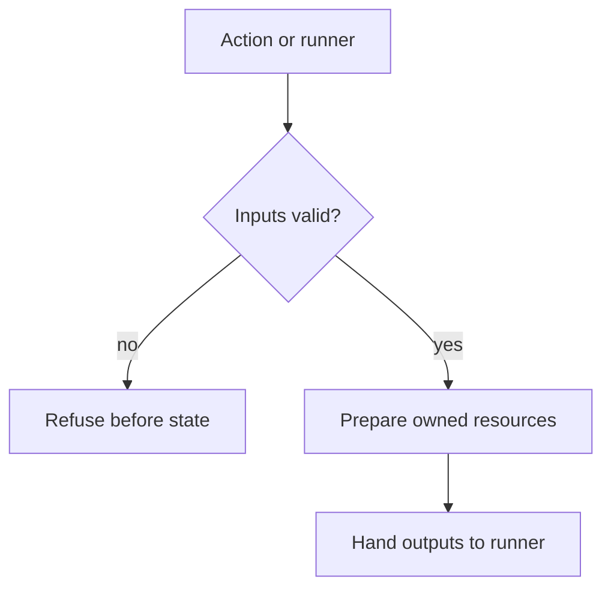

# CI resource preparation

## Overview

CI prepares lane and file resources before the runner starts selected tests.

## Entry Points

- `scripts/ci/prepare-cli.ts:runPreparationCli`
- `scripts/ci/prepare.ts:prepareFile`

## Flow

## Execution Trace

### 2. Prepare resources under the job owner

Static Checks restores the documentation pnpm store and saves misses after
Pagefind succeeds; Baseline and browser part 1 only restore it. Keys include OS,
architecture, Node.js, pnpm and lockfile hash; prefix matches can cross lockfiles.
Frozen installation fetches missing packages.

First Agent Smoke and `run-ci-lane` restore yq, k3d and kubectl outside `PATH`.
`scripts/ci/setup-tools.sh` selects platform checksums;
`scripts/ci/download-pinned.sh` verifies bytes in private staging before atomic
0755 publication. Missing or corrupt entries trigger pinned downloads; cache
outages do not fail setup. PostgreSQL, image and Kubernetes profiles share
platform- and installer-keyed caches. Direct callers can reuse verified bytes.

For packaging and shared-runtime artifact consumers using `run-ci-lane`,
`scripts/ci/setup-registry-transport.sh:verify_skopeo` reuses working `PATH` tools;
packaging requires version 1.13.3. Missing, broken or mismatched tools trigger
APT update and installation from configured repositories with signature checks.
Version probes allow 10 seconds plus 5 seconds before forced termination;
each APT command allows 120 plus 10 seconds, three acquisition retries and
20-second HTTP/HTTPS timeouts. Sudo is non-interactive. Failed updates prevent
installation. APT output and failure status are preserved.
The final probe must pass.

`scripts/ci/image-pull.ts:pullImage` logs each failed attempt's time, timeout
status and up to eight layer states. After a
`docker.io/<path>[:tag]@sha256:<digest>` pull times out, it pulls that digest
once from `mirror.gcr.io`, then retries the original. A failed seed changes
neither the error nor the retries; a stalled one costs up to one attempt
timeout. `ensureK3dCluster` pulls the K3s node image this way before
`k3d cluster create`.

The PR advisory OpenShell job uses Ubuntu 24.04 for Landlock and selects packaged Google Chrome through `OCC_TEST_BROWSER_EXECUTABLE`. The OpenShell manifest lists this optional input so test children receive it. Before image builds, `scripts/ci/setup-tools.sh:install_browser_dependencies` checks a headless sandboxed renderer and logs its version; errors fail setup. The browser inherits only `PATH`, with private `HOME` and `TMPDIR`. Ubuntu’s existing AppArmor profile permits its user namespaces. Without an override, Playwright uses its default headless shell.

`scripts/ci/prepare-inputs.ts` rejects malformed manifest preparation objects
and policy flags at load time. `runPreparationCli` dispatches lane and file
requests from `prepare.ts`. Lane and file preparation validate selected
OpenShell credentials and optional Gateway/Agent image pairs before locking or
creating state. The CLI validates environment names and rejects CR/LF values
before appending any assignment. It excludes `NODE_OPTIONS`.

`scripts/ci/image-build-cache.ts:imageBuildArgs` restores read-only caches, including
`k3d-otel`. `prepareLane` primes selected `sourceBuildFiles`;
each OpenShell lane builds its stack. Tests inherit builder and epoch,
not cache credentials; installers still build source.
`openshell-build-inputs` resolves the `integration-main` controller base.
`scripts/ci/warm-image-cache.ts` validates the base before Buildx setup, then
builds the controller and runtime concurrently. Required export errors propagate
after both builds settle. Standalone exports are best effort.
The workflow requires a retained runtime tag and successful cleanup before
OpenShell admission for the same source SHA. Queued writers can run out of
commit order. `imageCacheObservation` counts distinct steps and cache imports;
import lines alone cannot establish cache hits. Loads may reuse probes.

Images, First Agent Smoke, Docker Model Runtime, Gateway Routing and
Production TUI fetch artifacts by repository/run/artifact ID with `actions: read`.

Docker Model Runtime requires an artifact ID on producer success. Failure or
skip selects standalone builds. Local import cancels three minutes before the
lane deadline. Gateway Routing and default
Production TUI share that deadline. Full and focused runs wait for the producer
before controller preparation and runtime import. `integration-main` snapshots
the Gateway/Agent pair; consumers reject incomplete mode, pair or artifact ID
before setup. Focused explicit pairs skip the producer. Artifacts cannot accompany
Gateway inputs or TUI upgrade candidates; conflicts fail before allocation.

`loadRuntimeArtifact` verifies archive, source/run/attempt, platform, OCI
index/manifest/config digests and loaded image. Docker image IDs can equal config digests. `buildRuntimeImages` records ownership before import, rejects
alternate sources and import fallback, and sets aliases. Startup skips Buildx;
packaging/source builds retain it. Envoy and seccomp stay separate.

First Agent Smoke's `prepareRuntimeArtifactLayout` verifies compressed and
uncompressed layer digests; Buildx builds its trust layer from the verified
platform manifest digest.

`scripts/ci/prepare-command.ts:execFile` drains both output streams. Cluster
creation uses the cleanup supervisor to hold the process group for signal forwarding.

The CLI journals image ownership in private `RUNNER_TEMP` state before tagging
or import. Database tests use the limited application role and freshly migrated
databases. Agent revision tests copy migrated templates (`prepareFile({ template })`).
Failure and Kubernetes database names satisfy admission guards.

Ordinary k3d lanes require loopback and digest-pinned K3s 1.35. OpenShell has a
separate pin. `scripts/ci/k3d-image-admission.ts:registerImageInK3d` checks external
digests and platform. Imported images get run-owned, manifest-digest references
pinned against garbage collection. Every node must report the containerd digest
and matching CRI digest-list entry with boolean `pinned: true`. Manual imports are excluded.

TUI upgrades require both candidate and baseline controller/runtime digests
before allocation. Preparation imports all four, rejects candidates resolving to
their baselines, and records source and imported identities. File preparation
checks that selection and passes imported references to tests. Otherwise,
preparation builds the controller and imports the selected runtime artifact or
builds source. Failures enter cleanup, which checks k3d inventory before and after
deletion, then matching Docker containers, networks and volumes. Invalid inventory
or possible survivors retain state.

The retired CLI-only installed repository lane is absent from the manifest:
`assertLane` rejects it before allocation; its preparation below is unreachable.

`scripts/ci/prepare.ts:retainRuntimeProvenance` compares platform-selected host
and CRI config digests. `scripts/ci/runtime-provenance.ts:readImageCodexProvenance`
reads bounded metadata; results and diagnostics retain only their preparation's evidence.
Missing metadata records `unavailable`; image policy is unchanged.
Extraction journals IDs before removal. Cleanup removes containers and anonymous volumes. Journal and cleanup errors fail preparation; unresolved resources retain receipts.

`scripts/ci/prepare-postgres.ts:ensurePostgresServer` journals exclusive bootstrap-directory
and SQL-copy ownership. It refuses existing paths and retires failed directory
records. Its container-readable `migrations/init-local.sql` copy is selected by
`OPENCLAW_CI_POSTGRES_INIT_SQL`.

Docker assigns the loopback port. Preparation rejects missing, non-loopback and
`55432` mappings before connecting. Failed discovery retains pending `0` and
prevents database preparation. Mixed fixture lanes start PostgreSQL before k3d.
Model lanes start k3d first and attach PostgreSQL before port discovery: Docker
can reassign automatic ports on attachment. Tests retain that attachment;
reverse-order cleanup removes PostgreSQL first.

`scripts/ci/cleanup.ts:cleanupComposePostgres` validates the directory against state.
Unconfirmed ownership preserves contents/state. Directory confirmation alone permits
empty-directory removal; confirmed SQL is removed after Compose teardown. Unexpected
contents or teardown failure retain state. Subnet exhaustion preserves the original
error and planned resource and prints [owned cleanup](../../testing/postgresql.md#subnet-pool-exhaustion).

`scripts/ci/prepare.ts:readState` rejects malformed lane, selected-file, env, and defaults fields; owners validate resources.
`prepareLane` atomically publishes without replacement; `prepareFile` registers fresh children. Cleanup verifies files, identity, lane, and path. Worker death remains recoverable; mismatches, symlinks, and failures preserve journals and parent references.

For hosted QA, `scripts/ci/qa-matrix-credentials.mjs` reads the reviewed registry
file only for a selected repository scenario. It stages the metadata, selected
private App key and approved endpoint CIDRs under private `RUNNER_TEMP`, which
both fixtures pass to the consumer and independent App-backed observer. The
observer keeps credentials outside Agents, mints short-lived repository tokens,
and checks run ownership before closing a pull request or deleting a branch with
an exact-SHA lease. Invalid input or target mismatch fails before credential paths
reach the runner.

For hosted `qa-matrix` jobs, `scripts/ci/lane-images.ts:imageInventory` records
tagged or digest-pinned references and IDs in private `lane-images` state before tests. A failed
inventory warns and leaves no baseline; workstation runs record none. During
cleanup, `restoreLaneImages` restores changed or missing baseline tags and removes
new tags matching the QA launcher patterns. Other references are untouched. A
failed first cleanup inventory skips both actions. A successful final inventory
reports added, changed and missing references; a failed one reports `added`, `changed`, and `missing` as `null`. Tag and inventory failures
warn rather than fail the job. Returned resources leave state; invalid state or
ownership fails cleanup. These observations do not prove a shared-store commit.

Each Kubernetes fixture lane uses a server and worker with a shared local-path
mount. Preparation validates the server's route source to the worker Pod CIDR and
exports its `/32` as `OCC_TEST_KUBERNETES_PLUGIN_STATUS_PROXY_CIDRS`. It verifies
the imported digest alias on both nodes. A DaemonSet keeps the image active on both
nodes until cluster cleanup and exposes no Service. The status suite schedules the
runtime on the worker to test proxy ingress across nodes.

`scripts/ci/k3d-fixture-storage.ts:buildFixtureImage` reports engine-version and
fixture-build stages. The engine probe defaults to 30 seconds; the fixture build
allows 30 minutes. Before each command, both limits respect the remaining lane
deadline minus the test reserve. Without a valid deadline, the finite limits
still apply. Invalid timer values are rejected; exhausted budgets identify the
stage that could not start. On POSIX, `scripts/ci/cleanup-command.ts` holds the
owned process group through signal forwarding, including SIGINT cancellation,
and sends no signals after the group supervisor exits. Windows terminates the
direct child. Failed builds summarize up to eight numbered FROM, RUN or COPY
steps and completion states from the last 32,768 characters of each stream,
omitting arguments, container output and arbitrary errors. The summary identifies
Dockerfile steps, not the current phase or stall cause. Timeouts retain their
stage error and cause. The image tag is recorded before building and becomes
ready only on success, so cleanup can recover failed preparation.

Preparation checks the storage controller before fixture setup, then restarts it
after image registration and requires the replacement to become ready before
publishing test inputs. Per-file cleanup repeats the health check while preserving
database cleanup. Failures report the last 30 lines of storage-controller logs, Pod scheduling
conditions, and node pressure/taints outside the sanitized test reporter; they do
not include tenant workloads or complete Pod specifications.

The runtime image recipe pins compatible OpenClaw, Codex-plugin and Slack-plugin releases together with the Codex app-server version required by the plugin. Image startup smoke verifies fresh-home plugin loading, actual app-server initialization, and nested Codex home ownership for generated images and credential files before credentialed tests. Routing additionally requires the Gateway identity-scope contract; embedded continuity requires outgoing media to remain visible through history and artifact APIs across Pod replacement. Image builds alone prove none of these outcomes.

`scripts/ci/image-build-cache.ts:reuseEngineImage` uses BuildKit's scalar
SHA-256 config digest to inspect the engine. A failed reuse probe falls back to
the build. In CI, both share the remaining `CI_RUNNER_DEADLINE_MS` budget,
reserving three minutes for preparation and tests. Exhaustion reports `Image
build out of lane time`, starts no further build, and leaves owned-tag removal to
job cleanup. Local runs and main's cache warmer have no lane deadline. The warmer
gives each image one shared 20-minute build budget, including any first stage.
Each cache export has a separate 20-minute limit within the 45-minute job.
These are cancellation limits, not expected durations.

Dedicated Codex preparation (and installed repository-credential preparation when
available) obtains each node's actual `RuntimeDefault` syscall profile from a
restricted probe Pod. It verifies that the profile denies the pinned Codex
Bubblewrap sandbox, preserves that baseline, adds the version-pinned calls, installs the Localhost
profile, checks its hash and effective OCI policy, and requires sandbox execution
through it. A missing profile prevents container creation. The live fixture gets
`runtime.codexSeccompProfile` for the dedicated Codex container and checks the
effective model before paid turns. Node profiles belong to the disposable cluster;
probe resources are cleaned before model tests. OpenShell owns containment for its
provider-created Harness.

`scripts/ci/repository-credentials.ts:prepareRepositoryCredentials` journals each
tag before building it. A valid immutable Docker image ID moves the tag to ready.
The Repository Credentials lane writes the service, client, and qualification IDs
and source commit to a mode-0600 receipt. Production Observability builds the
service for k3d import and verification on each node.

`scripts/ci/prepare.ts:prepareFileWithState` extracts the delivered `gh`
only for manifest consumers, using a networkless, read-only container. It checks
the pinned version before returning the path and cleanup callback. Nonconsumers
return no callback. The standalone CLI refuses consumers before extraction;
the runner owns their callback. Lane cleanup removes journaled image tags.
Invalid images, source commits, or binary versions produce fixed errors.

The suite map owns fixed selection flags, required input names, and the resources each lane needs. Preparation consumes those descriptors instead of maintaining parallel lane lists. External model, ChatGPT and Slack credentials come only from the selected protected environment. Missing selected inputs fail rather than turning the lane into a skipped success.

Routing preparation installs pinned Gateway API, cert-manager v1.18.4, and Envoy
Gateway v1.6.7 controllers and creates a private test CA. It imports immutable
controller and runtime references so OCC can reach Envoy through its ClusterIP
Service.

OpenShell preparation digest-pins K3s v1.36.4, installs matching kubectl and Agent
Sandbox resources, obtains the CLI and chart, and imports gateway, sandbox and
supervisor images. `prepareOpenShellClusterBootstrap` returns the node image and
kubectl selection; `createK3dPreparation` uses no OCE admission file or API
server admission override. `prepareOpenShell` requires PSA to reject privileged
and forbidden-capability Pods in a restricted probe namespace, then runs a
default-runtime smoke Pod. The privileged probe omits
`allowPrivilegeEscalation: false` to reach PSA rather than core validation.
OCE creates no RuntimeClass or PSA exemption. The full lane checks filesystem,
privilege and binary-scoped Layer 7 network policy enforcement by the supervisor. Neither the
Harness nor supervisor receives `SYS_PTRACE` or `DAC_READ_SEARCH`.

`scripts/ci/prepare.ts:prepareLane` stops queued and drains active pulls; failure
exports nothing. `prepareLaneLogging` starts other lanes’ JSONL Collector.
`scripts/ci/logging.ts:prepareLogging` records the Docker endpoint, daemon,
attempt, directory identity and full container ID. Its backend base directory
comes from the explicit directory, `RUNNER_TEMP`, or the OS temporary directory.
It rejects a base inside or equal to the k3d resource directory before setup,
so independent k3d retirement cannot erase the backend directory, private cidfile
or sibling custody receipt. `cleanupLogging` rejects legacy/unbound state and
removes only the verified ID. Retain unresolved evidence and reconcile uncertain
creation or removal without replay; keep receipts until lane retirement.
Incompatible `--host` endpoints prevent creation.

[Docker setup](../../../.github/actions/setup-test-docker/action.yml) connects the
CLI, Compose and Driver to Docker 29.9.2 at `/var/run/docker.sock` for
`fluentd-write-timeout` in Collector and Docker Model Runtime jobs.
Others keep runner defaults. See [hosted coverage](../../../specs/plans/19-github-actions-test-coverage/delivery-status.md#delivery-status).

The OpenShell test owns management port-forwards. Teardown stops the worker,
drains forwards, and attempts app, database, namespace and directory cleanup
even after failure. Forward shutdown waits two seconds after `SIGTERM`, then
sends `SIGKILL` if needed and waits two more. Cleanup errors fail the test.

## Debugging and Verification

CLI lists exports; errors go to stderr.
See [lane verification](../../testing/ci/run-lanes.md).

## Related docs

- [Parent flow](../github-actions-testing.md).

## Manual Notes

## Changelog

- 2026-11-27 04:00: Document independent logging recovery storage and shorten the flow. (authoring-run/7e42a047-c5fb-480c-b168-0c01480fd373 - 5bedeb756f91663e60fd8171ac8cacc44704f3a7)

- 2026-11-27 03:38: Document logging cleanup identity and recovery limits. (authoring-run/b7299b03-1a22-4622-a04e-9cddad878fa2 - 5bedeb756f91663e60fd8171ac8cacc44704f3a7)

- 2026-11-19 23:19: Stop queued logging pulls after failure. (authoring-run/b428bcb4-c4a3-4e68-b09d-cb10d3b8fc60 - d271eef41c4169a072750dca326fd4a00d19da00)

- 2026-11-19 18:56: Restore stock-Node image build budgets after removing Node compilation. (01a1f528-3827-7cb0-9d72-19b91cbb6f69 - 32662b9d2)

- 2026-11-18 03:52: Validate journals. (authoring-run/96d31457-49fb-4427-a877-88398bb619ab - a56c941614457b172727092dcc1c25e43496fd16)

- 2026-11-18 03:26: Point preparation callers to the TypeScript command. (authoring-run/ac86eb9c-8f66-4c1a-b92a-ec70193e5fd5 - f5ac2329754d41a36a6cc47950cd3a95eae1ebfc)

- 2026-11-18 02:08: Reject malformed preparation policy and preserve cleanup ownership. (authoring-run/3d960c94-5e42-4c7d-9cff-d0eb63beceb4 - 886eacfe0fce0e18c03a0f01d5f8dc9476efdfc2)
- 2026-11-18 01:27: Trace input admission and dispatch. (authoring-run/e8f2d1a8-8c76-495f-a77d-cfae21e183ef - 86c25391636e35f3d4bbdc88e2acd52e03aaa7a7)
