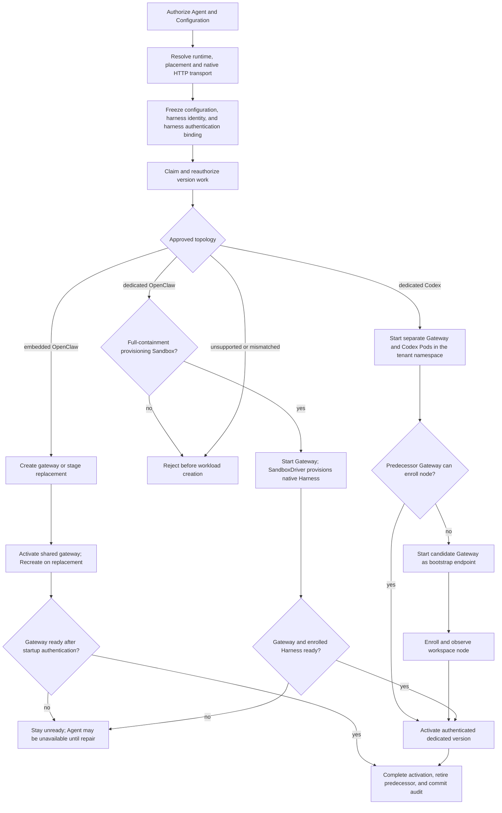

# Harness Execution Topology Flow

## Overview

Deployment freezes Harness policy, placement and authentication. Compute prepares
workloads, publishes guarded routes and retires predecessors before activation audit.

## Entry Points

- Trigger: exact-Agent `POST /namespaces/:namespaceId/agents/:agentId/deploy` and durable version
  reconciliation.
- Source: `packages/occ/src/index.ts:OpenClawController.deployAgent` and
  `apps/controller/src/worker.ts:ControllerWorker`.
- Assumptions: authorized actor; ready Namespace; same-Namespace native agent Configuration;
  explicit execution mode; and a supported `harnessAuth` binding with an authorized
  OCC Secret or account-owned credential.

## Flow

## Execution Trace

### 1. Resolve and freeze the native harness

`packages/occ/src/index.ts:OpenClawController.deployAgent`

OCC authorizes and locks the Agent and Configuration, then resolves `agentRuntime.id`,
models, fallback routes and Harness mode. Fallbacks retain the primary provider
and Harness. Only unambiguous built-in configuration defaults to embedded OpenClaw;
unsupported or incompatible selections fail closed.
Compute's `apps/controller/src/drivers/compute/native-gateway-transport.ts:validatePlaintextNativeGateway`
rejects `gateway.tls.enabled: true` before version creation and preparation:
Docker, SSH and Kubernetes require native HTTP.
The version freezes native configuration, Harness identity, mode, Compute selection
and Agent ServicePrincipal. Production supports `openclaw/embedded` and
`codex/dedicated`. `openclaw/dedicated` additionally requires a provisioning Sandbox
with networking, filesystem and process containment, plus native-worker support.
`access_token` requires dedicated Codex; versions store opaque credential references.
See [deployment modes](../reference/agents/deployment.md#execution-mode).

### 2. Claim work and realize the approved topology

`apps/controller/src/worker.ts:ControllerWorker`

The worker claims version work, rechecks actor/ownership and the frozen Harness,
then calls `ComputeDriver.prepareRevision`.

`apps/controller/src/drivers/compute/docker/index.ts:DockerComputeDriver.prepareRevision`

Docker rejects managed Harness authentication, so its underlying container path
is not deployable through an Agent. See
[Docker authentication](../reference/drivers/docker-compute.md#gateway-authentication).
Kubernetes supports managed bindings. SSH permits runtime-owned credentials only
for embedded OpenClaw; its readiness check does not validate models. See the
[SSH flow](pr-24-ssh-compute.md).

`apps/controller/src/drivers/compute/kubernetes/index.ts:KubernetesComputeDriver.prepareRevision`

Kubernetes calls `prepareHarnessAuth` once per source and projects its selected
credentials into version-owned Secrets. Model keys reach only embedded OpenClaw
or dedicated Harnesses. Dedicated Gateways receive transport credentials only.
See the [harness authentication flow](native-service-account-credential-delivery.md)
for admission, immutable source snapshots, and worker reauthorization.

API and worker startup run `preflight` before reconciliation. Configuration
validation reserves private status TCP/18791. Preflight scans every storage namespace
and rejects split targets without the tenant label; adopted `oce-gateways-<hash>`
namespaces require the storage label too. See
[upgrade requirements](../reference/drivers/kubernetes-compute.md#existing-split-layout-installations).

`ensureNamespace` labels the single-cluster tenant namespace for storage discovery.
Two-cluster Gateways retain their control-cluster target. Gateway and Harness Pods,
identities and PVCs stay separate. Secret delivery validates canonical sources.
Legacy password adoption requires exact ownership and identical values; foreign
or conflicting sources fail. New templates use separate transport and password Secrets.
[Namespaces and isolation](../reference/drivers/kubernetes-compute/networking-and-isolation.md#namespaces-and-isolation)
owns qualified DNS and exact NetworkPolicy/Service selectors. Harness selectors
include version and network profile; Gateway selectors omit version for stability.
`runtime.gatewayNodeSelector`
independently places the Gateway Pod and private-state initializer on trusted nodes.
After Harness readiness, preparation starts a candidate Gateway if its predecessor is stopped or unready. Activation waits for workspace node enrollment. Dedicated Codex keeps `agent-<agent digest>-workspace` across versions.
`KubernetesComputeDriver.gatewayNativeHookRelayConfiguration` binds its callbacks to the Agent route; `AGENT_WITH_NODE_ENTRYPOINT` prepares private capability storage and TLS trust, and OpenClaw authorizes callbacks. See [native hook routing](../reference/gateway-routing.md#native-node-endpoint).

`apps/controller/src/drivers/compute/kubernetes/index.ts:harnessRequirementsFromDeployment`

For a provider-owned Harness, Compute preserves the full prepared command and
also supplies `supervisedCommand` when it owns the generic init wrapper. A
provider with private process supervision may use that explicit entrypoint;
other providers retain the full command. Compute passes the revision transport
token separately for trusted provider readiness. The Strands candidate mounts
that readiness Secret only in its supervisor and requires authenticated native
initialization before Pod readiness. Its workload runs in a separate container
PID namespace in the same revision Pod. Box's argument-scoped compatibility
permits apply only to that explicit container backend; the ordinary namespace
backend retains its prior refusals. See
[RFC-0024](../../specs/rfcs/0024-strands-box-sandbox.md#containment-and-supervision)
for the candidate's qualification limits; readiness alone is not E2E proof.

`scripts/generate-strands-box-seccomp.mjs` preserves the captured RuntimeDefault
profile and adds exact setup operations for Box's original remount arguments.
The node administrator installs that profile before deployment. The provider
selects its Localhost path; tenants cannot install profiles. Box applies its
separate workload filter after setup, which still rejects mount creation.

`deploy/runtime/strands-box/transport.mjs` bounds shared framing and channel
buffers. IPC backpressure pauses the originating TCP stream until drain; it
does not truncate accepted data. A disconnected or persistently slow client
closes only its channel. Malformed framing or loss of the shared IPC stream
stops the revision fail-closed. These paths do not add destinations, credentials,
retries or sandbox permissions.

`deploy/runtime/openclaw-node-message-pipe.patch` changes the native node
launcher's message transport. A package that declares `byte-pipe-v1` uses a
private byte stream on POSIX systems; existing installed packages retain their
Node IPC protocol. Both paths keep bootstrap acknowledgement, authenticated
readiness, restart selection and parent-loss termination. Frames are limited
to 1 MiB and queued writes to 4 MiB or 256 messages. The byte stream does not
receive ancillary file descriptors, so Box can continue to deny `recvmsg`.
The runtime build applies and tests this patch before compiling OpenClaw; the
SandboxDriver does not replace native supervision or patch Node's IPC methods.

`deploy/runtime/Dockerfile:openclaw-build` applies the pinned-runtime pairing
publication repair before compilation. A pending write for another device does
not invalidate a node's committed pairing. Binding reads install committed
receipts before use; token revocation, rotation, removal and changed approvals
still reject stale dispatch. Unknown publication state and foreign-revision
invalidation remain fail-closed. This is an OpenClaw Gateway repair shared by
all Sandbox Drivers; it adds no transport retry or provider-specific auth rule.
`scripts/build-runtime-assets.mjs:289` records the patch hash
in the image provenance. Real Gateway and SQLite regressions run during assembly.

Compute owns the Gateway; SandboxDriver owns the separate Harness and ServiceAccount.
The Harness retains node identity, workspace and model credentials. OpenShell delivers
the Gateway CA and one-use startup target, then reconnects with the persisted device
token. Renewal and cleanup require exact provider ownership.

Native workers connect outbound using Node and pinned Codex model egress.
`dedicated-native` requires worker inference; Harness loss never enables Gateway
inference. Compute projects admitted models and SecretRefs into canonical native
configuration. The entrypoint writes private capacity settings and the Driver's
workspace path. OpenShell uses its data mount for default/main workspace and files.
See [native configuration](../reference/drivers/kubernetes-compute.md).

Embedded OpenClaw combines identity and model credentials. Scoped worker permissions deliver Secrets and enrollment; Gateways receive no controller or Harness Kubernetes credentials.

Sandbox receives projections and login mode through `HarnessWorkloadRequirements`; unsupported delivery fails.

Every Compute Pod template, ordinary allow policy and Gateway/Harness peer requires
the [network profile](../reference/drivers/kubernetes-compute/networking-and-isolation.md#explicit-network-profiles); readiness rejects its absence.

`providerHarnessReady` requires one nonterminating Ready Pod with exact Agent,
revision and role labels. Activation rechecks before routing; malformed observations
trigger cleanup. See the [readiness contract](../reference/drivers/kubernetes-compute.md#requirements).

### 3. Publish safely and complete activation once

`apps/controller/src/worker.ts:ControllerWorker`

`requiresStoppedPredecessors` stops predecessor Gateways and Harnesses and waits
for termination. Replacement interrupts service and preserves PVCs. Returning
predecessors make the candidate unready. Reconciliation retries stops and supersedes
old work without rollback; see [version stages](../reference/drivers/compute.md#production-revision-stages).
Dedicated Codex API-key auth prefers the bound endpoint over
`runtime.codexModelBaseUrl`. `normalizeOpenAiBaseUrl` validates it;
`pluginRuntimeConfigMapData` writes the manifest and `config.toml`.
The authentication probe uses CLI overrides because it ignores user configuration.
Other login modes keep their endpoints; only Harnesses hold model credentials.

For custom endpoints, `codexGatewayModelConfiguration` clones the admitted document
and `configuration-rules.ts:rewriteModelSelections` qualifies every selected model,
including fallbacks, allowlists and catalog IDs. Native aliases and omitted selectors
keep their meaning; the projected catalog retains native IDs. See
[model endpoint rules](../reference/drivers/kubernetes-compute.md).

Kubelet probes private `/readyz`; success requires native Gateway/plugin state
and the authenticated Harness identity or Codex app-server connection. Responses
are bodyless `200` or `503`. During first-deploy [workspace setup](workspace-files.md),
preparation starts the candidate Gateway. If a previous version never served and
remains unready, the next version repairs it with its own template and removes
obsolete embedded Secret/ConfigMap copies.

The worker commits `activeRevisionId` by compare-and-set before Compute updates the
Gateway's `Recreate` Deployment and Service. Embedded cutover can stop the serving
Gateway before replacement authentication succeeds. Each Gateway checks credentials
once during startup, within a CPU-based deadline of at most 600 seconds. Authentication
failures hold it unready until repair and restart or a new deployment. Readiness polls
do not repeat model calls; worker retries do not restart unchanged Pods. There is no
automatic rollback. Embedded activation deletes predecessor Secret/ConfigMap copies;
dedicated copies remain until their Harness Pod and Deployment retire.

Failed activation, readiness, retirement or audit requeues the selected version with
`REVISION_FINALIZATION_INCOMPLETE` or its [pending code](../reference/agents/deployment.md#pending-deployment-progress).
Lost claims and foreign/stale workloads fail closed. Workspace-node binding gets a
20-second budget per version and node across retries, then one status read per retry.
Binding and pairing waits yield when other Work is claimable.

Shutdown stops the Gateway before its Harness, waiting for Pod removal within
the pinned 330-second budget. Idle wrappers exit promptly under `tini`.
Forced termination can delay a successor until its persistent owner lease expires.

Both Gateway modes persist SQLite, media, linked worktrees and common Git
metadata on their private claim, preserving session paths across replacement.
Embedded Gateways retain their default workspace; dedicated Harness claims
retain node identity. Claims precede Pods for `WaitForFirstConsumer`;
[Gateway storage](../reference/drivers/kubernetes-compute/storage-and-credentials.md#gateway-storage)
defines initialization and mounts.

Workspace-file access uses the enrolled Harness node; Gateway and Harness share
no workspace, session, skill, or image mounts. The [storage contract](../reference/drivers/kubernetes-compute/storage-and-credentials.md#harness-storage)
covers per-image assets and generated-image return.
The node host stores bundles in node state and workspace files under
`/home/node/workspace`, separate from credentials and `CODEX_HOME`. Restart republishes
image assets and reconnects with the paired identity. Readiness checks that identity.
Sandbox grants cover node state and `TMPDIR` for compile and probe caches.

Stopping or retirement always invokes the Sandbox Driver's cleanup, even when its
Deployment is absent. Cleanup failures retry. Retirement preserves owned claims and
successor resources. Agent deletion retires every version, then deletes exact-owned
claims by UID across all selected targets before removing database identity. The
[storage contract](../reference/drivers/kubernetes-compute/storage-and-credentials.md#gateway-storage)
defines mounts, capacity and final teardown.

## Debugging and Verification

Run configuration and Compute conformance tests for frozen policy and placement.
The PostgreSQL worker revision suite checks guarded activation and recovery.
These component tests do not prove native execution.

For model turns, use `docker-compute-real.test.mjs` or
`harness-topology-k3d-real.test.mjs` with the [required images, infrastructure and
credentials](../testing/docker.md#docker-compose-development-test-environment).
Provider-backed dedicated Codex has separate [service-account coverage](../testing/README.md).
Missing credentials, images, access or model responses fail verification; readiness,
handshakes and skips cannot replace it.

An HTTP 401 before worker admission indicates that a callback missed the node-only
ingress and reached the administrative route. Check
[native hook routing](../reference/gateway-routing.md#native-node-endpoint).

## Related docs

- [Harness execution topology implementation specification](../../specs/.archive/07-harness-execution-topology.md)
- [Platform design](../design/workloads.md#openclaw-gateways)
- [Agent placement and deployment](../reference/agents/deployment.md#execution-mode)
- [Controller worker](../reference/controller/reconciliation.md#agentrevision-lifecycle)
- [Docker Compute Driver](../reference/drivers/docker-compute.md)
- [Kubernetes Compute Driver](../reference/drivers/kubernetes-compute.md)
- [Compute Driver lifecycle hooks flow](compute-driver-lifecycle-hooks.md)
- [Service Account Driver credential delivery flow](service-account-driver-credential-delivery.md)
- [Shared-drive specification](../../specs/.archive/12-dedicated-harness-shared-workspace-drive.md)

## Manual Notes

[keep this for the user to add notes. do not change between edits]

## Changelog

- 2026-10-16 17:02: Persist worktrees and Git sources. (Codex/01a13654-be66-7741-b54f-f8ae80f2d496 - 68b95a2514f183b194a478e72d734b719bf4c2e8)

- 2026-10-14: Merge current contracts with native provisioning and retained-workspace preparation. (Codex/01a13654-be66-7741-b54f-f8ae80f2d496)

- 2026-10-10 04:41: Reconcile endpoint validation and routing with credential refresh, native approval and readiness contracts. (agent:roboclaw:dashboard:9d0532e1-befb-4fc3-935e-7cd2a0c72110 - 90268463bbd255c3c13a0e0bdeb437728189eb1a)

- 2026-10-10 02:49: Refuse native listener TLS before deployment work. (authoring-run/8446b4d7-87ac-43ab-9323-5fc7f6953628 - 5d303757fb488fe34c8cbb9e7b6b975921fc1061)

- 2026-10-09 20:27: Integrate main lifecycle, native workspace and readiness contracts without dropping endpoint safeguards. (agent:roboclaw:dashboard:9d0532e1-befb-4fc3-935e-7cd2a0c72110 - 90268463bbd255c3c13a0e0bdeb437728189eb1a)

- 2026-10-09 17:35: Qualify explicit subagent selectors; rename the Codex endpoint option. (agent:roboclaw:dashboard:9d0532e1-befb-4fc3-935e-7cd2a0c72110 - f9126efaada11f8cc18931aa8327f7e16cae59b6)

- 2026-10-10 00:29: Reserve private status TCP/18791 before native listeners start. (authoring-run/edaa639f-bb63-47bd-9fa4-83e9ff735733 - 3e34cc0f4b469d29fc79d2c10a33f87a0921ee47)

- 2026-10-09 18:44: Resolve an adopted split-layout storage namespace as the tenant namespace only while it keeps its storage label. (fix-533-adopt)

- 2026-10-08 14:19: Move Kubernetes runtime readiness to private HTTP with unchanged gates. (authoring-run/5a25b09c-b1c6-4dd2-b281-8b10a847e8b9 - aac339d52e472dd96489599dc1818da414abf556)

- 2026-10-08 15:29: Trace default pinned-runtime support and native Node model-egress allowance in the accompanying change. (authoring-run/da7b4107-43b4-4a3f-b941-194218df6457 - 13405e1fee089db09c4d592e6dba7adb566f3b17)

- 2026-10-08 02:42: Align the admitted native Agent workspace and Gateway file-transfer binding with OpenShell's approved data mount. (authoring-run/4fbff731-5f62-4865-9fee-a2a117c3d0a6 - a8d2969355bd3c0478337e16a01e267ad3607595)

- 2026-10-08 02:38: Consume the Driver-owned native workspace path so OpenShell file operations reach the admitted mount. (authoring-run/4fbff731-5f62-4865-9fee-a2a117c3d0a6 - e23d7dc5bf63ca103d6c7dec76d36ced9e1fbf5f)

- 2026-10-08 02:28: Project dedicated native models through canonical node configuration in the accompanying change; retain required placement and separate image qualification. (authoring-run/4fbff731-5f62-4865-9fee-a2a117c3d0a6 - 1f97586276fde1dbddec9f14dca3d6d783aade63)

- 2026-10-07 12:07: Unify imported and managed PAT authentication while preserving source ownership and existing OAuth behavior. (01a0e5ec-d802-7800-9eb6-8022c1ac0d06 - be5006e62)

- 2026-10-08 04:40: Reconciled dedicated endpoint flow with current native callback routing. (authoring-run/02228d02-e16c-4a55-9a43-16b9efb35ebe - 31b1b6a9ab59f219d0fbe3d44b1550f8c8f2fe4a)

- 2026-10-06 11:17: Reconciled endpoint flow with current namespace and provider provisioning; condensed repeated prose. (agent:roboclaw:dashboard:9d0532e1-befb-4fc3-935e-7cd2a0c72110 - b6dc6b87a461ad33374e133d15cc739d8e074fea)
- 2026-10-05 14:24: Route dedicated Codex native hook callbacks with per-relay capabilities. (authoring-run/05067642-df93-4716-8f90-5b7430e50c41 - dfa091b6)
- 2026-10-05 11:36: Normalize runtime endpoints with the shared Driver validator; trim repeated topology narration. (agent:roboclaw:dashboard:9d0532e1-befb-4fc3-935e-7cd2a0c72110 - 9958ef0412565864efba7b13995536d7c2a51d22)
- 2026-10-05 00:06: Add custom Codex Responses endpoint selection and explicit native-provider rendering while preserving admitted model IDs and Harness-only credentials. (authoring-run/4e4824a1-f107-44c2-90bf-00fe13ff650c - d269c6d03)

- 2026-10-03 16:02: Run configured development API and worker Compute preflight before admitting work. (01a0fe72-58b2-7cc3-b770-7310f5401deb - c04093189f2ba6240f8dc431847c2f487afd11de)

- 2026-10-03 15:38: Refuse unsafe split-layout upgrades and converge concurrent legacy password creation. (01a0fe72-58b2-7cc3-b770-7310f5401deb - 94364ae9)

- 2026-10-02: Stabilize canonical credential layout across execution modes with legacy source compatibility. (01a0fe72-58b2-7cc3-b770-7310f5401deb)

- 2026-10-02: Retain dedicated predecessor projections during shared-namespace embedded cutover until Harness retirement. (01a0fe72-58b2-7cc3-b770-7310f5401deb)

- 2026-10-02: Share the single-cluster tenant namespace while preserving role-specific runtime delivery and version cleanup. (01a0fe72-58b2-7cc3-b770-7310f5401deb)

- 2026-10-02 14:00: End node pairing and ack waits early for claimable Work. (r7-d221)

- 2026-10-02 12:00: Delete a replaced embedded predecessor's Secret and ConfigMap copies at activation re-render. (fix-d280-embedded-retire)

- 2026-10-02 06:00: Budget the workspace node binding ack wait per binding across activation retries. (fix-deploy-node-pairing)

- 2026-09-30 09:30: Include the Harness network profile in Service selectors for EKS policy resolution. (authoring-run/1373b7f3-e273-466a-b9da-bb197bdb469e - 0d00e8970b69)

- 2026-09-30 21:00: Delete a repaired embedded predecessor's Secret and ConfigMap copies at repair time. (fix/dogfood3b-1)

- 2026-09-30 10:30: Repair a never-served unready embedded Gateway during redeploy with pending workspace setup. (fix-dogfood-1)

- 2026-09-30 09:54: Correct dedicated replacement: the worker stops the predecessor Gateway before preparation, so redeploys interrupt service. (authoring-run/a37a9c9b-9e94-4bd2-88c5-dfa5c5f94d12 - 90899dc55ab7)

[Harness execution topology documentation history](harness-execution-topology/history.md) preserves the older dated entries.
