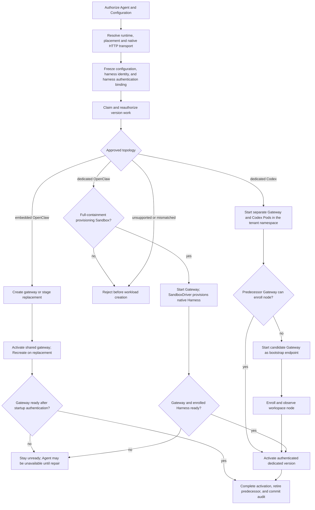

# Harness Execution Topology Flow

## Overview

Deployment freezes Harness policy, placement and authentication. Compute prepares
workloads, publishes guarded routes and retires predecessors before activation audit.

## Entry Points

- Trigger: exact-Agent `POST /namespaces/:namespaceId/agents/:agentId/deploy` and durable version
  reconciliation.
- Source: `packages/occ/src/index.ts:OpenClawController.deployAgent` and
  `apps/controller/src/worker.ts:ControllerWorker`.
- Assumptions: authorized actor; ready Namespace; same-Namespace native agent Configuration;
  explicit execution mode; and a supported `harnessAuth` binding with an authorized
  OCC Secret or account-owned credential.

## Flow

## Execution Trace

### 1. Resolve and freeze the native harness

`packages/occ/src/index.ts:OpenClawController.deployAgent`

OCC locks the authorized Agent and Configuration, resolves `agentRuntime.id`,
and validates primary/fallback routes and Harness modes. Fallbacks preserve native order,
primary provider and Harness. Only unambiguous built-in configuration defaults
to embedded OpenClaw. Missing/ambiguous policies, unsupported IDs and incompatible
modes fail closed.
Compute's `apps/controller/src/drivers/compute/native-gateway-transport.ts:validatePlaintextNativeGateway`
rejects `gateway.tls.enabled: true` before version creation and preparation:
Docker, SSH and Kubernetes require native HTTP.
The saved version keeps native configuration, approved Harness identity/version, mode,
Compute selection, and Agent ServicePrincipal unchanged. Production admits approved
`openclaw`/`embedded` and `codex`/`dedicated`, and `openclaw`/`dedicated` only when
the selected SandboxDriver provisions Harnesses with networking, filesystem, and
process containment and the Installation has native-worker support.
Pinned runtime support is automatic; custom images can declare it at startup.
An associated
`access_token` additionally requires dedicated Codex; the frozen account
contains only its OCC identity, credential kind, and opaque Secret reference.

### 2. Claim work and realize the approved topology

`apps/controller/src/worker.ts:ControllerWorker`

The worker claims version work, rechecks actor/ownership and the frozen Harness,
then calls `ComputeDriver.prepareRevision`.

`apps/controller/src/drivers/compute/docker/index.ts:DockerComputeDriver.prepareRevision`

Docker starts embedded gateways or dedicated Codex containers but rejects
harness-auth bindings before deployment; no Agent path is deployable.
`dockerGatewayConfigurationDocument` admits supported authentication fields/modes;
`reconcileGateway` generates `OPENCLAW_GATEWAY_PASSWORD` only for new containers.
The [Docker gateway authentication reference](../reference/drivers/docker-compute.md#gateway-authentication)
owns mode and password rules.

Kubernetes supports managed bindings.
SSH supports `{ "method": "runtime" }` only for embedded OpenClaw: operator
credentials remain on the host and OCC checks gateway readiness without model
validation. See the [SSH flow](pr-24-ssh-compute.md).

`apps/controller/src/drivers/compute/kubernetes/index.ts:KubernetesComputeDriver.prepareRevision`

Kubernetes calls `prepareHarnessAuth` once per resolved source, delivering selected
fields, including ChatGPT account tokens, from canonical tenant storage to versioned
Harness Secrets. Only embedded OpenClaw or dedicated Harnesses receive model keys,
never dedicated Gateways. Fixture images use the same namespace-local delivery; only
native dedicated transport tokens depend on runtime configuration. The
[harness authentication flow](native-service-account-credential-delivery.md) covers
admission, immutable source snapshots and worker reauthorization.

API composition, including development, and worker startup call
`KubernetesComputeDriver.preflight` before reconciliation. `KubernetesComputeDriver.validateConfiguration`
first rejects native Gateway or derived sandbox listener ports overlapping private
runtime status TCP/18791. Single-cluster
preflight checks every storage-namespace page and refuses split targets without
the tenant label. Resolution accepts an adopted `oce-gateways-<hash>` tenant
only beside its storage label.
The [upgrade requirements](../reference/drivers/kubernetes-compute.md#existing-split-layout-installations)
own the operator boundary.

`ensureNamespace` prepares one single-cluster tenant namespace, including adopted
targets; its storage-role label enables discovery. Two-cluster Gateways retain
their control-cluster target. Dedicated Gateway and Harness Pods, identities,
and PVCs remain separate. `deliverGatewaySecrets` validates canonical sources;
`deliverHarnessAuth` creates selected model/transport projections.
Transport and Gateway passwords use separate sources across modes. Compute
retains legacy combined sources for older Pods and copies their password before
new templates reference the separate source. Concurrent creation adopts only an
exact-owned, identical password; foreign or conflicting sources fail.
[Namespaces and isolation](../reference/drivers/kubernetes-compute/networking-and-isolation.md#namespaces-and-isolation)
owns qualified DNS and exact NetworkPolicy/Service selectors. Harness selectors
include version and network profile; Gateway selectors omit version for stability.
`deploy/helm/openclaw-execution/templates/routing.yaml` validates DNS and Envoy peer maps
before rendering NetworkPolicies. Values must be strings or native null; type
errors identify the setting.
`runtime.gatewayNodeSelector`
independently places the Gateway Pod and private-state initializer on trusted nodes.
After Harness readiness, preparation starts a candidate Gateway if its predecessor is stopped or unready. Activation waits for workspace node enrollment. Dedicated Codex keeps `agent-<agent digest>-workspace` across versions.
`KubernetesComputeDriver.gatewayNativeHookRelayConfiguration` binds its callbacks to the Agent route; `AGENT_WITH_NODE_ENTRYPOINT` prepares private capability storage and TLS trust, and OpenClaw authorizes callbacks. See [native hook routing](../reference/gateway-routing.md#native-node-endpoint).

Compute owns the Gateway; SandboxDriver owns the native Harness, with separate
ServiceAccounts. The Harness retains identity, workspace and model credentials.
OpenShell delivers version-owned setup and Gateway CA files; startup combines
trust, writes a private one-use target and reconnects with the saved device token.
Renewal and cleanup preserve exact ownership.

`internal/occdev/kubernetes.go:writeInstallation` permits Node and pinned Codex model egress. Native workers connect outbound without an app-server endpoint. Compute binds `dedicated-native` with `inference: "worker"`; a missing or disconnected Harness fails without Gateway inference. Exact callbacks and session admission scope transport to the Agent.
`apps/controller/src/drivers/compute/kubernetes/index.ts:nativeRuntimeConfiguration`
projects `models.providers.openai` and an environment SecretRef. It retains
normalized model HTTPS endpoints (port 443, paths ending in `/v1`), using the first
as provider default. Custom endpoints require `credential_source`; Secret-backed
keys stay OpenAI-only. Invalid URLs fail admission.
`apps/controller/src/drivers/credential-gateway/openshell.ts:attachForRevision`
checks every model against the immutable source endpoint before attachment.
`apps/controller/src/drivers/compute/kubernetes/runtime-entrypoints.ts:NATIVE_WORKER_ENTRYPOINT`
writes capacity/isolation settings and Driver-provided `OPENCLAW_WORKSPACE_DIR`;
Compute and Sandbox supply private temporary directories.
`apps/controller/src/drivers/sandbox/openshell.ts:configureAgent` pins default/main workspace to its data mount; file transfer uses that root absent an endpoint override. Node-local snapshots provide models/credentials and authorized workspaces, without an inference file, grant catalog or retired `nativeInferenceConfig`.

Embedded OpenClaw combines identity and model credentials. Scoped worker permissions deliver Secrets and enrollment; Gateways receive no controller or Harness Kubernetes credentials.

Sandbox receives projections and login mode through `HarnessWorkloadRequirements`; unsupported delivery fails.

Every Compute Pod template, ordinary allow policy and Gateway/Harness peer requires
the [network profile](../reference/drivers/kubernetes-compute/networking-and-isolation.md#explicit-network-profiles); readiness rejects its absence.

For provider-owned Harnesses, `providerHarnessReady` requires exactly one nonterminating `Ready=True` Pod matching the active Service's Agent, Agent revision ID, and role labels. Malformed observations enter cleanup; activation rechecks before routing changes. The [readiness contract](../reference/drivers/kubernetes-compute.md#requirements) owns candidate rules and observation limits.

### 3. Publish safely and complete activation once

`apps/controller/src/worker.ts:ControllerWorker`

`requiresStoppedPredecessors` stops all predecessors, including Gateways, and
waits for Pod termination. Redeployment interrupts service but preserves both PVCs;
retry or a new version recovers failures. Recorded stops prevent repeats; a returning
predecessor makes its successor unready. Stops retry after one, two, four, then more
claim leases. Failed preparation or preparing or activating the predecessor clears
its record. New exclusive versions supersede old reconciliation and maintenance
without rollback; see [production version stages](../reference/drivers/compute.md#production-revision-stages).
For dedicated Codex API-key auth, `pluginRuntimeSnapshot` in
`apps/controller/src/drivers/compute/kubernetes/index.ts` selects the bound model
source endpoint before `runtime.codexModelBaseUrl`.
`apps/controller/src/drivers/openai-endpoint.ts:normalizeOpenAiBaseUrl` normalizes either.
`pluginRuntimeConfigMapData` in `apps/controller/src/drivers/compute/plugin-runtime.ts`
writes the HTTPS Responses endpoint/provider pair to the manifest and `config.toml`.
`apps/controller/src/drivers/compute/kubernetes/runtime-entrypoints.ts:probeCodexAuthentication`
uses CLI overrides because the probe ignores user configuration. Account login and
other Harnesses keep their endpoints; only the Harness holds model credentials.

For admitted inference, Kubernetes Compute records launch behavior in new protected
dedicated Codex revisions. The authentication probe and app-server disable unbounded
native connection retries, avoiding indefinite reconnects. Stored revisions retain
original commands.

For custom endpoints, `gatewayConfigurationDocument` uses
`apps/controller/src/drivers/compute/codex-model-configuration.ts:codexGatewayModelConfiguration`
to clone the admitted document and qualify chat selections checked by
`configuration-rules.ts:rewriteModelSelections`, including allowlists,
primary/fallback objects and catalog IDs. It drops the `openai` source provider block. Selections
enter the projected catalog; aliases and omitted selectors retain their meaning.
Full refs preserve native ID namespaces, including `codex/`. OpenClaw separates
the explicit provider for thread start, resume and turns; the Harness probe keeps
the native ID.

Kubelet probes private `/readyz`: Gateway plugin status and native `/startupz`
and `/readyz`, Codex plugin state and authenticated app-server WebSocket, or
dedicated OpenClaw identity gate runtime-backed workload readiness.
While first-deploy [workspace setup](workspace-files.md) is pending, embedded
preparation starts the replacement Gateway before activation. If a never-served
version's Gateway is unready (its Service selects no Pod), for example after rejected
model authentication, the next version repairs it with its own template instead of
waiting for the predecessor. Repair deletes the embedded predecessor's version Secret
and ConfigMap copies.

The worker commits `activeRevisionId` by exact compare-and-set before Kubernetes
activation. `KubernetesComputeDriver.activateRevision` updates the shared Gateway's
`Recreate` Deployment and Service. Embedded preparation does not validate credentials,
so cutover can stop the serving Gateway before replacement
[startup](native-service-account-credential-delivery.md#5-authenticate-during-runtime-startup)
validates them. Each Gateway uses that check and CPU-based deadline, at most
600 seconds. Provider timeouts, rate limits and other failures hold it unready
until repair and restart or a new deployment. Readiness polling does not repeat model
requests; worker retries do not restart unchanged Pods. There is no automatic rollback.
Embedded activation deletes predecessor copies on re-render even if the replacement
never becomes ready. Dedicated predecessor copies remain while its Harness Deployment
or terminating Pod survives; retirement stops the Harness and removes the artifacts.

Activation, readiness, predecessor retirement or audit failure requeues the version
with `REVISION_FINALIZATION_INCOMPLETE` or the known wait's [pending code](../reference/agents/deployment.md#pending-deployment-progress).
Recovery retries activation and retirement for that version; lost claims and
foreign or stale workloads fail closed. Dedicated activation waits for the Gateway
to report its assigned workspace node: a 20-second budget per version and node across
activation retries, then one status read per retry. That wait and the pairing wait end
early when other Work is claimable.

On version stop, the Driver stops the Gateway within the pinned runtime's 330-second
budget and waits for Pod disappearance before stopping the Harness, which remains
available for active work. Idle or pre-OpenClaw shutdown (wrappers run under `tini`)
completes promptly. Forced termination can delay the successor until the persistent
owner lease expires.

Both Gateway modes persist SQLite, media, linked worktrees and common Git metadata
on their private claim, preserving session paths across replacement. Embedded Gateways
retain their default workspace; dedicated Harness claims retain node identity. Claims
precede Pods for `WaitForFirstConsumer`; [Gateway storage](../reference/drivers/kubernetes-compute/storage-and-credentials.md#gateway-storage)
defines initialization and mounts.

Workspace-file access uses the enrolled Harness node; Gateway and Harness share
no workspace, session, skill or image mounts. The [storage contract](../reference/drivers/kubernetes-compute/storage-and-credentials.md#harness-storage)
covers per-image assets and generated-image return. The node host stores bundles
in its state and workspaces below `/home/node/workspace`, separate from gateway state,
`CODEX_HOME` and credentials. Restart republishes image-owned assets and reconnects
with the paired identity; readiness checks node identity. Compile cache and model-probe
state remain in node state and `TMPDIR`, which a Sandbox Driver can grant.

On stop or retirement, the selected Sandbox Driver cleans up after Compute stops an
ordinary Harness, or removes a provider-owned Harness. Missing Deployments do not
skip cleanup; failures retry. Retirement retains both owned claims after Gateway
removal and checks the retiring version's ownership before deletion. Successors keep
their Gateway Deployment, identity, Service and policies.
`apps/controller/src/worker.ts:ControllerWorker.processAgentDeletion` retires every
version, then calls
`apps/controller/src/drivers/compute/kubernetes/index.ts:KubernetesComputeDriver.deleteAgentRuntimeCredentials`
to delete exact-owned private and shared claims by UID across all selected targets,
regardless of the Agent draft's mode. Cleanup retries precede database identity
removal. The [storage contract](../reference/drivers/kubernetes-compute/storage-and-credentials.md#gateway-storage)
owns claim sizes, mounts, StorageClass requirements and final teardown.

## Debugging and Verification

- Check placement, immutable policy, and conflicts:
  `node --test tests/conformance/configuration-occ.test.mjs`.
- Check guarded activation and recovery:
  `node --test tests/integration/postgres-worker-agent-revision.test.mjs` with an explicitly
  provisioned application-role PostgreSQL database.
- Check dedicated Gateway repair after an unready predecessor:
  `pnpm test:files --test-name-pattern='dedicated replacement starts a candidate Gateway' -- tests/conformance/kubernetes-compute.test.mjs`.
- Check embedded Gateway repair after a never-served unready predecessor:
  `pnpm test:files --test-name-pattern='never-served unready Gateway' -- tests/conformance/kubernetes-compute.test.mjs`.
- For real model turns, run `node --test tests/integration/docker-compute-real.test.mjs`
  (Docker Compose embedded and dedicated), or
  `node --test tests/integration/harness-topology-k3d-real.test.mjs` (Kubernetes).
  Select images, infrastructure and credentials in [test environment settings](../testing/docker.md#docker-compose-development-test-environment).
- Verify provider-backed dedicated Codex with
  `node --test tests/integration/service-account-driver-real.test.mjs`,
  `OCC_TEST_CHATGPT_SERVICE_ACCOUNT_REAL=1` and an authorized mounted
  `OCC_TEST_CHATGPT_ADMIN_KEY_PATH`; it does not use `OPENAI_API_KEY`.
- Missing credentials, images, access or either model response fail verification;
  readiness probes, handshakes, fixtures and skipped tests are not substitutes.
- HTTP 401 before worker admission indicates callback fallthrough from node-only
  worker ingress to the administrative route.

## Related docs

- [Harness execution topology implementation specification](../../specs/.archive/07-harness-execution-topology.md)
- [Platform design](../design/workloads.md#openclaw-gateways)
- [Agent placement and deployment](../reference/agents/deployment.md#execution-mode)
- [Controller worker](../reference/controller/reconciliation.md#agentrevision-lifecycle)
- [Docker Compute Driver](../reference/drivers/docker-compute.md)
- [Kubernetes Compute Driver](../reference/drivers/kubernetes-compute.md)
- [Compute Driver lifecycle hooks flow](compute-driver-lifecycle-hooks.md)
- [Service Account Driver credential delivery flow](service-account-driver-credential-delivery.md)
- [Shared-drive specification](../../specs/.archive/12-dedicated-harness-shared-workspace-drive.md)

## Manual Notes

[keep this for the user to add notes. do not change between edits]

## Changelog

- 2026-10-23 15:51: Rebase the native endpoint trace onto current lifecycle behavior; preserve older entries in linked history. (agent:roboclaw:dashboard:578a8b10-8406-4f5c-a2cc-21ab6524bf68 - 0b326680a7a388de9331c2ae9f0a7cadf2788fe7)

[Harness execution topology documentation history](harness-execution-topology/history.md) preserves the older dated entries.
