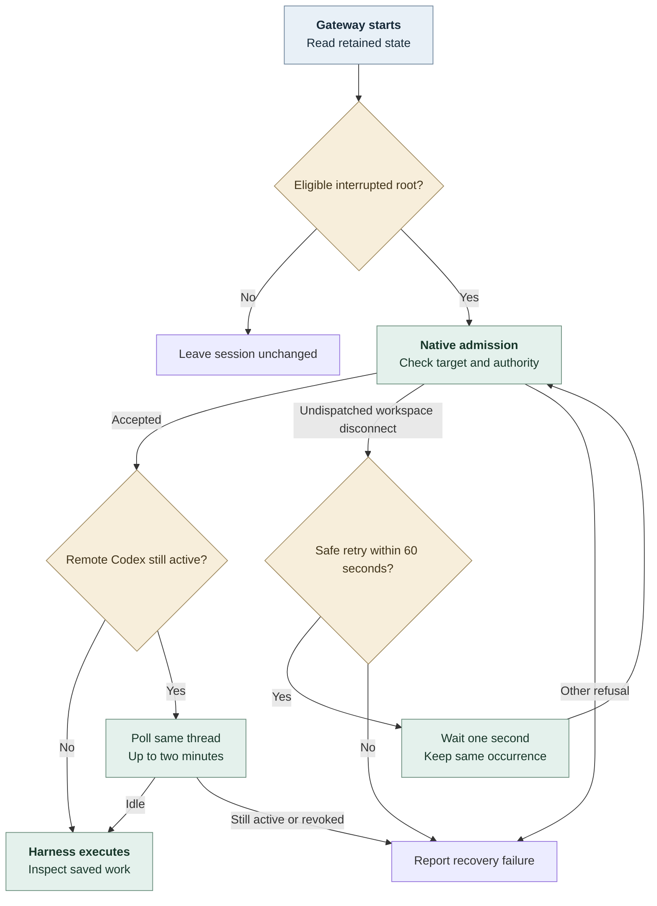

# Harness restart recovery flow

## Overview

A replacement Gateway uses retained OpenClaw session and boot records to continue
eligible interrupted work. Native recovery submits
a new input to the same session.
This flow ends when the continuation can start a fresh Harness turn or recovery
reports failure. Normal Harness execution owns the resulting model output.

## Entry Points

- Trigger: Gateway startup after graceful shutdown or recorded process loss.
- Source: `deploy/runtime/openclaw-source.json` selects native recovery in
  `src/gateway/session-restart-resume.ts:resumeMarkedSessions` in OpenClaw.
- Waits: the same source retries a restart input during workspace reconnection
  (`src/auto-reply/reply/session-event-terminal.ts`) and holds Codex preflight
  while a remote turn is still active
  (`extensions/codex/src/app-server/thread-policy.ts`).
- Prerequisites: retained Gateway state, an eligible root session, current source
  authority, and a Harness that can reconnect with its existing identity.

## Flow

The diagram describes the pinned runtime source. Deployment qualification is
tracked in the [recovery test guide](../testing/harness-restart-recovery.md).

## Execution Trace

### 1. Recover an eligible interrupted root

`deploy/runtime/openclaw-source.json` pins OpenClaw's
`src/gateway/session-restart-resume.ts:resumeMarkedSessions`. Graceful shutdown
records restart markers before stopping live work. Crash recovery also checks
persisted run ownership against recorded Gateway lifetimes. Completed, cancelled,
archived, incognito, child, and externally owned work does not become a fresh root
merely because a Gateway restarted.

The recovery owner captures the exact session target, retains current source
authority, and admits its native continuation through session-event handoff.
It keeps the restart marker until acceptance or a terminal admission failure.

Deployment admission in `packages/occ/src/agent-deployment-admission.ts:admitAgentDeployment` saves
ordinary runtime inputs and enqueues the revision. It stores no recovery metadata.
`apps/controller/src/worker.ts` retains desired-running-state, selected-revision,
lease, and predecessor checks during replacement. Compute runtime selection and
planned-replacement compatibility remain independent of native continuation.

Pinned native `src/config/sessions/session-restart-resume-scope.ts` retains its
optional scope policy. OCE supplies no scope. Native discovery compares retained
marker or lifecycle scope with the startup scope: an older nonempty value does
not match the unset value. This can refuse old unfinished work, cancel affected
queued input, or withhold child-completion custody. New unscoped work uses normal
native recovery. Session identity, authority, and explicit cancellation remain
enforced; no OCE translator or policy patch changes these decisions.

The [interrupted-turn reference](../reference/agents/interrupted-turns.md) owns the
transition limit and Stop→Deploy behavior.

### 2. Wait for a disconnected workspace before execution

Native `src/auto-reply/reply/session-event-terminal.ts:prepareSessionEventReadmission`,
called from `session-event-handoff.ts:enqueueSessionEventForHost`, decides retry.
A workspace error qualifies only when a cause has
`details.nodeError.code = NOT_CONNECTED` and `nodeCommandDispatched = false`.

Only restart inputs qualify. Admission must not have accepted or adopted the
input, started execution, committed a conversation result, or attempted delivery.
Cancellation, abandonment, and failed cleanup of staged input stop retry.
The existing occurrence owner releases and reacquires the same occurrence after
an abortable one-second delay, within one 60-second deadline. The retry retains
the original target and source assertions; native preparation checks them again.
Cancelled staged input can be reclaimed only by the same occurrence.

### 3. Transfer to the regular turn owner

Native `src/gateway/session-restart-resume-failure.ts:acceptRestartResumeReceipt`
transfers an accepted continuation to the normal reply lifecycle; the admission
owner no longer retries it. Codex
preflight can still wait as described below.
The prompt asks the Agent to inspect saved files, processes, subagents, and
external actions before continuing. It does not restore the previous process.

A permanent refusal or exhausted reconnect window follows the existing recovery
failure path, including the visible instruction to resolve the error and send a
new message. A failure after continuation admission uses the regular turn error
path instead. Shutdown cancellation retains the existing marker write guards.

### 4. Wait for a surviving remote Codex turn

Native `extensions/codex/src/app-server/thread-policy.ts:assertAdoptedCodexThreadResumeAllowed`
handles this case. After Gateway process loss, an external Codex app-server can
still execute the original turn. A host-authored restart input polls that same
thread every second with a two-minute budget before continuing through normal
adoption. An in-flight read retains the native RPC timeout. Each read checks current
authority, cancellation, thread identity, and direct-input permission.

The wait does not interrupt the remote turn or change its subscription. Other
inputs still receive the existing active-thread refusal. Deadline expiry also
refuses adoption; recovery never starts a competing turn. This path continues
after the old turn finishes. It does not reattach to its execution or recover a
hung executor.

## Debugging and Verification

Use the [real-runtime recovery case](../testing/harness-restart-recovery.md).
Without the reconnect retry, graceful Gateway Pod replacement reproduced
`WorkspaceAccessUnavailableError` / `node not connected`, followed by a terminal
restart notice while the dedicated node was reconnecting.

Image provenance records the source commit. The image's source checks exercise
session-event readmission, restart admission and the Codex wait. The Kubernetes
case must also show one continuation and a final result without another user message.

## Related docs

- [Harness execution topology](harness-execution-topology.md)
- [Harness limits](../reference/harness-execution.md#limits)
- [Recovery qualification](../testing/harness-restart-recovery.md)
- [Runtime recipe](../../deploy/runtime/README.md)

## Manual Notes

## Changelog

- 2026-11-20 16:58: Point to deployment admission and its request module. (authoring-run/c0b1d670-9c9d-4163-a9e1-c480b2170bfc - 48e378422c0f6527682d305cac5ca3992a00c5ad)

- 2026-11-18 22:29: Leave upstream restart-scope policy unchanged and document accepted transition refusal (authoring-run/348cb0b0-dd7c-4486-a0b4-415cb90f72d1 - 3f273a16a)

- 2026-11-18 20:10: Remove OCE recovery bookkeeping and document native startup ownership with accompanying changes (authoring-run/348cb0b0-dd7c-4486-a0b4-415cb90f72d1 - 11cef2cb9)

- 2026-11-17 17:58: Add surviving Codex turn wait and real-model qualification boundaries with accompanying uncommitted changes (authoring-run/f7f6f818-89bc-4764-bccc-441fe67e2a3b - 114d1a8e3d)
- 2026-11-17 17:20: Document native workspace reconnect admission bridge with accompanying uncommitted changes (authoring-run/f7f6f818-89bc-4764-bccc-441fe67e2a3b - 114d1a8e3d)
