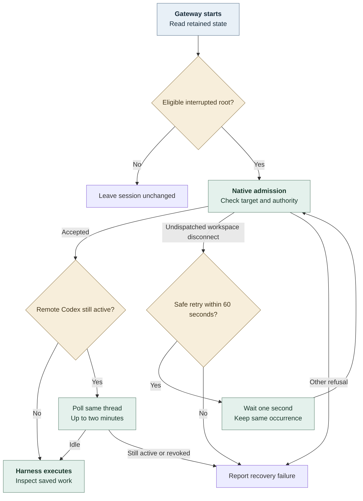

# Harness restart recovery flow

## Overview

A replacement Gateway uses retained OpenClaw session and boot records to continue
eligible interrupted work within the admitted recovery generation. Native recovery submits
a new input to the same session.
This flow ends when the continuation can start a fresh Harness turn or recovery
reports failure. Normal Harness execution owns the resulting model output.

## Entry Points

- Trigger: Gateway startup after graceful shutdown or recorded process loss.
- Source: `deploy/runtime/openclaw-source.json` selects native recovery in
  `src/gateway/session-restart-resume.ts:resumeMarkedSessions` in OpenClaw.
- Bridge: `deploy/runtime/openclaw-restart-harness-readiness.patch` extends
  native `enqueueSessionEventAttempt` during workspace reconnection and Codex
  preflight while a remote turn is still active.
- Prerequisites: retained Gateway state, an eligible root session, current source
  authority, and a Harness that can reconnect with its existing identity.

## Flow

The diagram describes the runtime source and bridge. Deployment qualification is
tracked in the [recovery test guide](../testing/harness-restart-recovery.md).

## Execution Trace

### 1. Recover an eligible interrupted root

`deploy/runtime/openclaw-source.json` pins OpenClaw's
`src/gateway/session-restart-resume.ts:resumeMarkedSessions`. Graceful shutdown
records restart markers before stopping live work. Crash recovery also checks
persisted run ownership against recorded Gateway lifetimes. Completed, cancelled,
archived, incognito, child, and externally owned work does not become a fresh root
merely because a Gateway restarted.

The recovery owner captures the exact session target, retains current source
authority, and admits its native continuation through session-event handoff.
It keeps the restart marker until acceptance or a terminal admission failure.

Deployment admission in `packages/occ/src/index.ts:admitAgentDeployment` asks
`ComputeDriver.restartContinuationDomain` for compatible retained execution.
Under the Agent lock it retains a matching generation or allocates a new one,
snapshots it into the revision, and saves it with the running lifecycle.
`transitionAgentDesiredRuntimeState` clears it on explicit stop in PostgreSQL.
The worker checks the current generation before preparation, pointer commit,
and activation, including retries after stop followed by another deployment.

Kubernetes Compute projects the immutable generation into
`OPENCLAW_GATEWAY_RESTART_RESUME_SCOPE`. Unsupported topologies use the revision ID.
Native OpenClaw (#201060, #201186) records the scope at `chat.send` admission and
lifecycle start, and checks both graceful markers and crash evidence before
continuation. It also refuses child completion custody from an ended scope. Public
session projections omit the private scope and preserve it only within the same
session incarnation.
The [interrupted-turn reference](../reference/agents/interrupted-turns.md) owns the
compatibility and stop contract.

### 2. Wait for a disconnected workspace before execution

`deploy/runtime/openclaw-restart-harness-readiness.patch` changes native
`src/auto-reply/reply/session-event-handoff.ts:enqueueSessionEventAttempt`.
A workspace error qualifies only when its cause is `UNAVAILABLE` with
`details.code = NOT_CONNECTED` and `nodeCommandDispatched = false`.

Only restart inputs qualify. Admission must not have accepted or adopted the
input, started execution, committed a conversation result, or attempted delivery.
Cancellation, abandonment, and failed cleanup of staged input stop retry.
The existing occurrence owner releases and reacquires the same occurrence after
an abortable one-second delay, within one 60-second deadline. The retry retains
the original target and source assertions; native preparation checks them again.
Cancelled staged input can be reclaimed only by the same occurrence.

### 3. Transfer to the regular turn owner

`deploy/runtime/Dockerfile:262` applies the bridge and leaves native
`acceptRestartResumeReceipt` ownership unchanged. Acceptance transfers the
continuation to the normal reply lifecycle; the admission owner no longer retries it. Codex
preflight can still wait as described below.
The prompt asks the Agent to inspect saved files, processes, subagents, and
external actions before continuing. It does not restore the previous process.

A permanent refusal or exhausted reconnect window follows the existing recovery
failure path, including the visible instruction to resolve the error and send a
new message. A failure after continuation admission uses the regular turn error
path instead. Shutdown cancellation retains the existing marker write guards.

### 4. Wait for a surviving remote Codex turn

`deploy/runtime/openclaw-restart-harness-readiness.patch` also changes native
`extensions/codex/src/app-server/thread-policy.ts:assertAdoptedCodexThreadResumeAllowed`.
After Gateway process loss, an external Codex app-server can still execute the
original turn. A host-authored restart input polls that same thread with a
two-minute budget before continuing through normal adoption. An in-flight read
retains the native RPC timeout. Each read checks current
authority, cancellation, thread identity, and direct-input permission.

The wait does not interrupt the remote turn or change its subscription. Other
inputs still receive the existing active-thread refusal. Deadline expiry also
refuses adoption; recovery never starts a competing turn. This path continues
after the old turn finishes. It does not reattach to its execution or recover a
hung executor.

## Debugging and Verification

Use the [real-runtime recovery case](../testing/harness-restart-recovery.md).
Before this bridge, graceful Gateway Pod replacement reproduced
`WorkspaceAccessUnavailableError` / `node not connected`, followed by a terminal
restart notice while the dedicated node was reconnecting.

Image provenance records the bridge digest through
`scripts/build-runtime-assets.ts:appliedPatches`. Native bridge checks exercise
session-event readmission and restart admission. The Kubernetes case must also
show one continuation and a final result without another user message.

## Related docs

- [Harness execution topology](harness-execution-topology.md)
- [Harness limits](../reference/harness-execution.md#limits)
- [Recovery qualification](../testing/harness-restart-recovery.md)
- [Runtime recipe](../../deploy/runtime/README.md)

## Manual Notes

## Changelog

- 2026-11-17 17:58: Add surviving Codex turn wait and real-model qualification boundaries with accompanying uncommitted changes (authoring-run/f7f6f818-89bc-4764-bccc-441fe67e2a3b - 114d1a8e3d)
- 2026-11-17 17:20: Document native workspace reconnect admission bridge with accompanying uncommitted changes (authoring-run/f7f6f818-89bc-4764-bccc-441fe67e2a3b - 114d1a8e3d)
