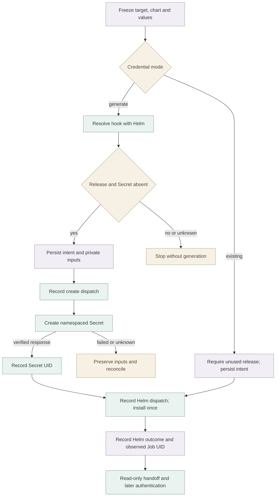

# Local credential preparation for installation

## Overview

`occ installation install` prepares bootstrap credentials on the operator host,
creates their Kubernetes Secret, then starts Helm once. This flow ends at the
Helm/initialization handoff, not authenticated API access or Agent readiness.
[CLI reference](../reference/cli.md#installation-handoff) owns flags and limits;
[production installation](../guides/deploy/production-installation.md) owns the
operator procedure.

## Entry Points

- `internal/occcli/installation_receipt.go:installationInstallCommand`:
  requires explicit kubeconfig, context, namespace, release, chart, values and a
  new receipt directory. The operator needs namespace-scoped Secret get/create
  permission and Helm installation permissions; no controller RBAC is added.
- `internal/bootstrapcredentials/credentials.go:Prepare`: generates private
  source files, shared with development setup.
- `internal/occcli/installation_doctor.go:installationHandoffCommand`: reads
  original attempt evidence without modifying Secrets or reading source files.

## Flow

Solid arrows describe implemented source paths, not deployment evidence.

## Execution Trace

### 1. Freeze and check the selected target

`internal/occcli/installation_receipt.go:installationInstallCommand` snapshots
the trusted kubeconfig, local chart and values. Helm Kubernetes environment
overrides are rejected. Generated mode calls
`internal/occcli/installation_credentials.go:resolveInstallationBootstrap`:
offline Helm rendering resolves defaults and overrides, including Secret name
and both key names. The rendered Job must include empty-database migration and
fresh-only bootstrap. Older or unsupported charts refuse automatic generation.

The installer checks all Helm release states. In generated mode,
`requireAbsentBootstrapSecret` also checks the named Secret. An existing or
unreadable Secret stops before credential generation. These point-in-time reads
are not locks: the eventual Secret POST and Helm install still arbitrate races.
Existing mode skips local generation and Secret creation; the operator owns its
configured inputs.

### 2. Prepare protected inputs and evidence

`internal/occcli/installation_credentials.go:prepareInstallationBootstrap`
runs after the original intent and receipt notice are persisted. It creates a
new attempt directory under the user's local state directory, separate from the
receipt. `bootstrap-secret.json` records its path and Secret selection, not values.

`internal/bootstrapcredentials/credentials.go:Prepare` creates a random password,
a separate `occ_` key from 32 random bytes, and a minimal `data.key` client file.
It refuses existing files, retains partial results, uses mode `0600`, and syncs
files and directory entries before any cluster write. The directory is `0700`.
Development setup uses the same writer while retaining its explicit Compose
password default and private reader-owned mount copies.

### 3. Create once before Helm

`internal/occcli/installation_credentials.go:prepareInstallationBootstrap`
syncs `bootstrap-secret-dispatch.json` with an unknown outcome, then sends the
Secret JSON through kubectl stdin to the fixed core/v1 namespaced create route.
The selected API server performs validation and admission. No credential value
appears in argv, Helm values, receipt records or a manifest file; raw subprocess
diagnostics are not forwarded.

Only a successful response with matching kind, namespace, name and credential
data plus a nonempty UID permits `bootstrap-secret-result.json`. A conflict,
denial, changed response or lost acknowledgement leaves the attempt unconfirmed;
Helm is not dispatched. Inputs are neither overwritten nor deleted automatically.

### 4. Dispatch Helm and hand off

`internal/occcli/installation_receipt.go:installationInstallCommand` syncs
`dispatch.json` before Helm starts. It retains the original Job UID when observed
and records Helm's separate outcome. Interruption does not authorize replay.

`deploy/helm/openclaw-enterprise/templates/jobs.yaml` projects credentials only
into fresh bootstrap. Migration requires an empty database; bootstrap uses
`--require-fresh`, refusing an existing Installation before account or key import.
Upgrade keeps ordinary verification without credential projection. See
[platform startup](platform-startup.md) and
[bootstrap authentication](local-password-authentication.md).

`installationBootstrapProgress` adds Secret preparation status to read-only
`doctor`/`plan` output. It never opens the recovery directory or treats prepared
keys as authenticated. The later operator-session Installation read establishes
that identity; normal Namespace and Agent operations remain API/IAM-owned.

## Debugging and Verification

- An existing Secret refuses generation before creating an installation receipt.
  Do not select existing mode to bypass an uncertain earlier attempt.
- A `bootstrap-secret-dispatch.json` without confirmed result requires target
  reconciliation. Do not delete evidence, create another receipt to replay the
  attempt, or regenerate inputs.
- `go test ./internal/occcli -run TestInstallationGeneratedCredentials` exercises
  real Helm/kubectl against a loopback Secret API fixture: selection overrides,
  private files, conflicts, denial, lost/mutated responses and receipt handoff.
  It does not prove Kubernetes deployment or authentication.
- The existing cluster receipt suite includes a lost create response after the
  real API persists the Secret. Current-source production TUI workflows install
  through this CLI and use its generated inputs for API and Agent operations.
  Historical rehearsal fixtures retain their original supplied-input path.
- PostgreSQL bootstrap coverage checks fresh-only creation and refusal without
  changing an existing Installation. Infrastructure-dependent checks require
  the [Kubernetes](../testing/kubernetes.md) and
  [PostgreSQL](../testing/postgresql.md) prerequisites; source alone is not proof.

## Related docs

- [Production handoff and recovery](../guides/deploy/production-handoff.md)
- [Bootstrap input contract](../reference/authentication.md#installation-and-account-ownership)
- [Development startup](docker-compose-development/startup.md)

## Manual Notes

## Changelog

- 2026-11-17 17:39: Trace automatic local inputs and pre-hook Secret creation in the accompanying change. (authoring-run/1fb1a0ad-cb02-4500-9594-80a9f5879665 - 270c7be633c4c6bcdc262c7d298d37dcaaab9b29)
