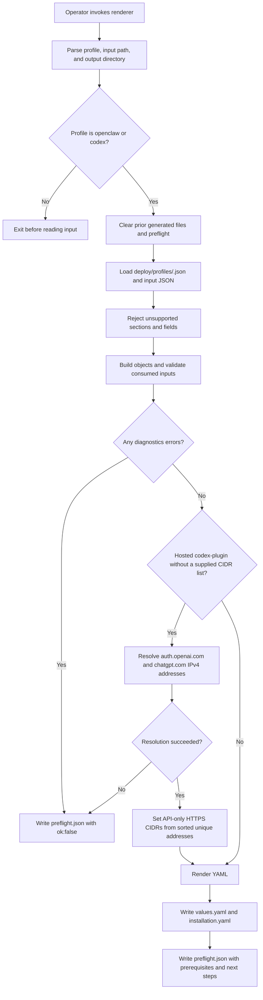

# Installation Profile Rendering Flow

## Overview

An operator passes a profile, JSON inputs, and output directory to
`scripts/render-installation-profile.mjs`. It validates inputs, resolves omitted
hosted Codex destinations, and writes paired Helm values, Installation YAML, and
preflight. This flow ends at those files. Operators still prepare the cluster
and Secrets, apply Helm, and configure hosted/runtime tokens, optional ChatGPT
service accounts, the repository registry, and Slack consumers.

## Entry Points

- Trigger: `node scripts/render-installation-profile.mjs --profile openclaw|codex --input <json> --out-dir <dir>`.
- Source: `scripts/render-installation-profile.mjs:parseArgs`,
  `scripts/render-installation-profile.mjs:buildRendered`, and
  `scripts/render-installation-profile.mjs:resolveHostedDiscoveryCidrs`.
- Assumptions: The caller runs from the repository root with installed
  dependencies, a trusted profile under `deploy/profiles/`, and site inputs that
  contain no plaintext credentials.

## Flow

## Execution Trace

### 1. Parse arguments and select the profile

`scripts/render-installation-profile.mjs:parseArgs`

`parseArgs` accepts `--profile`, `--input`, and `--out-dir`; other flags fail
before output. Profiles are `openclaw` or `codex`, with no `default`. JSON supplies
the release name and namespace for Helm and Installation settings.

After valid arguments, the renderer removes prior `values.yaml`,
`installation.yaml`, and `preflight.json` before loading input. Unreadable or
malformed JSON cannot leave stale deployment files or success reports; other
files remain untouched.

### 2. Load profile and site input

`scripts/render-installation-profile.mjs:readProfile`

`deploy/profiles/` supplies profile identity and PluginDriver selection. JSON
supplies site images, domains, CIDRs, Secrets, and repository registry names.
Explicit discovery CIDRs keep rendering offline and stable; omitted hosted
Codex CIDRs make Helm values depend on DNS.

### 3. Validate every supplied input

`scripts/render-installation-profile.mjs:buildInput`

Closed sections reject unknown fields, including unused readiness flags;
OpenClaw rejects Codex-only inputs.

Startup consumes no discovery or runtime token values. Preflight directs
operators to add `codex_pat` later through a same-Namespace Secret or the
Console. Only `codex.managedServiceAccounts` enables optional managed issuance.

Preflight enforces Helm's lowercase release-name syntax and 53-character limit
for `controlPlane.releaseName`. `controlPlane.namespace`, optional
`controlPlane.envoyNamespace`, `controlPlane.apiClients[].namespace`, and
`controlPlane.dns.namespace` are DNS labels of at most 63 characters: no dots,
slashes, or uppercase. Compute applies the same rule to `gatewayNamespace` and
`envoyNamespace`; the chart to `gatewayRouting.envoyNamespace`, `api.clients`,
and `dns`. NetworkPolicies select peers by Namespace-only
`kubernetes.io/metadata.name`; invalid names fail preflight.

`buildRendered` requires the literal `sha256` algorithm and 64 lowercase
hexadecimal characters for `controlPlane.controllerImage`, `runtime.image`, and
enabled `repository.image`. All three must also pass `imageReferenceProblem`
(`packages/occ/src/image-reference.ts`), a port of the Kubernetes reference
parser that Compute, the chart and the image tools share: a reference Kubernetes
refuses to pull, such as an uppercase repository path, fails, and an IPv6
registry host passes.

Noncanonical digest casing adds a field-specific diagnostic; the final error
branch writes only `preflight.json`, leaving no deployable artifacts.

`controlPlane.clusterName` uses the chart/bootstrap `installation.name` rule:
1–200 characters, without edge whitespace, control characters, or line/paragraph
separators.

Preflight applies downstream contracts for IPv4 CIDRs, native-admin hostnames
and shared cookie parent (not a public suffix under `tldts`), Google hosted
domains, GatewayClass, gateway API key, database CA, ChatGPT admin and sign-in
Secrets, gateway StorageClass, repository ConfigMap, Secret and Service names,
and paired metrics selectors. Invalid values fail preflight.

`signInProvider` checks GitHub, Google and OIDC Secret names and keys; client-ID
and client-secret keys must differ after chart defaults. `dedicatedSecrets`
preserves chart ordering: ChatGPT admin, database CA, gateway API key, sign-in
and repository Secrets cannot match `occ-installation-startup`, `occ-database`,
`occ-auth`, generated Gateway Secrets (`chartGatewaySecretNames`), enabled log
collector Secrets, or earlier listed Secrets. Only the two public CA Secrets
may share one; collisions fail preflight.

`scripts/render-installation-profile.mjs:nodeSelector` checks
`controlPlane.nodeSelector`, `runtime.nodeSelector` and
`runtime.gatewayNodeSelector` against the chart and bootstrap-volume helper's
Kubernetes label-key and label-value rules (values may be empty). Compute copies
the runtime selectors into Pod specs, where Kubernetes applies the same rule.
Invalid placement labels fail preflight without deployment files; legal YAML
lookalike values remain strings. `peerSelector` applies Compute's `validatePeer`
rule to DNS, API client and metrics scraper selectors. Both selector kinds use
Kubernetes label keys and values, including empty values. Their qualified
prefixes and bootstrap password claim names are DNS subdomains of at most 253
characters total, without a per-segment cap. Namespace names and unqualified
label names/values retain their 63 limit. The chart and
`scripts/prepare-bootstrap-volume:is_dns_subdomain` share this prefix/claim
rule; the chart checks peers only for nonempty maps. Repository Backend IDs
follow their rule within 200 UTF-16 code units, as in the chart.

### 4. Build Helm values

`scripts/render-installation-profile.mjs:buildRendered`

`controlPlane.databaseCa.key` allows letters, digits, `.`, `_`, or `-`, at most
253 characters; neither `.` nor a `..` prefix. Thus `..ca.pem` and 254-character
keys fail preflight before Helm. Omission uses `ca.pem`.

`validateDatabaseCaMount` checks the generated values against the chart's active
database-client mounts. With a database CA Secret, `mountPath` cannot equal the
Installation, worker runtime, bootstrap, gateway key, or private gateway CA mount.
Repository mounts are reserved only when repository credentials are enabled;
the ChatGPT mount is reserved only when managed service accounts are configured.
Profiles do not enable execution-cluster mounts. No CA configuration adds no
restriction; an omitted path keeps `/etc/openclaw/database-ca`. A collision adds
a field-specific preflight error and prevents both deployable files.

The Helm values select the control-plane image, Better Auth base URL,
bootstrap administrator, database and cluster egress CIDRs, API client
selectors, DNS peer, metrics, native admin, private gateway routing, optional
ChatGPT Backend mounting, optional logging collector, and optional repository
credential sidecar. Gateway routing is always enabled. Native admin is enabled
unless `controlPlane.github`, `controlPlane.google` or `controlPlane.oidc` renders external sign-in
with `auth.recoveryUserId`, which Helm requires with native admin off. An
optional `controlPlane.trustedProxy` renders `api.trustedProxy`. Its CIDRs were
already checked in step 3 with the API's `parseCidr` rules
(`apps/controller/src/auth/client-address.ts`): a prefix of 1 through 32 for an
IPv4-mapped address, and no range that covers every IPv4 peer. Like the chart,
preflight also refuses a zone ID, which the API accepts.

When `channels.managedSlackProxy` is true, the values also enable the
chart-managed Slack proxy Service. The chart allows that proxy public IPv4 HTTPS
egress, excluding private and reserved ranges, and the proxy authorizes Slack
hostnames. Repository values render only when the input explicitly sets
`repository.enabled: true`. Repository provider CIDRs pass through unchanged,
so operators can keep their existing GitHub ranges without DNS snapshots. The
renderer copies `repository.serviceName` only when the input sets it, and only
when that name is a DNS-1035 Service label of at most 63 characters. The
chart's upgrade guard still requires an explicit current broker Service name,
and the same DNS-1035 check cannot fail after a successful preflight.

### 5. Build Installation startup YAML

`scripts/render-installation-profile.mjs:buildRendered`

The Installation output selects Kubernetes Configuration, native IAM,
Kubernetes Compute, Kubernetes Secrets, default Preset seeding, and the profile
PluginDriver. Compute settings consume the runtime image, DNS peer, trusted
proxy CIDRs, plugin-status proxy CIDRs, gateway routing identity, runtime
storage class, node selectors, and transport Secret prefix. The Codex profile
also consumes the reviewed `runtime.codexSeccompProfile` path. Preflight applies
the Compute driver's localhost-profile rule and refuses an absolute path, a
backslash, an empty, `.`, or `..` segment, or a segment named `unconfined`,
before writing `installation.yaml`. Optional `runtime.codexModelBaseUrl` gets
Compute's endpoint rule. When optional
managed ServiceAccount inputs are supplied, it emits the ChatGPT Backend and a
matching ServiceAccount Driver; otherwise Codex Agents use the existing
`codex_pat` token path configured at Agent creation. If the chart-managed Slack
proxy is enabled, Compute receives the generated Service DNS URL and selector
for gateway-to-proxy egress; the chart grants API-to-proxy egress. Repository
opt-in adds the GitHub Backend, Repo Driver,
and worker peer expected by the broker sidecar.

The renderer derives the Compute Gateway name the same way Helm does: it
truncates `<releaseName>-agent-gateways` to 63 characters and removes a trailing
hyphen. HTTPRoute parent references therefore match the Gateway the chart
renders.

Optional `presets.files` adds operator-selected JSON paths and retains both standard
Presets. Preflight rejects non-lists and empty/non-string entries without reading
files; controller startup resolves paths and validates contents. Changes alter
the Installation checksum.

`runtime.transportSecretPrefix` must produce the same DNS-safe name that
Kubernetes Compute startup requires: `<prefix>-<12 hex characters>`, at most
253 characters in total. Preflight checks that composed name before writing
Installation YAML. A trailing hyphen in the prefix remains valid; a trailing
dot does not, because the suffix would start a new label with a hyphen.

### 6. Resolve hosted discovery egress

`scripts/render-installation-profile.mjs:resolveHostedDiscoveryCidrs`

After validation, hosted `codex-plugin` with omitted `codex.modelDiscoveryCidrs`
triggers bounded A queries for `auth.openai.com` and `chatgpt.com`. Sorted unique
IPv4 `/32` answers populate the existing API-only TCP 443 Helm policy; the driver
mutates no Kubernetes resources.

Supplied lists bypass DNS unchanged; `[]` requires external HTTPS policy for
both hosts. Other driver selections bypass resolution. DNS failure records a
preflight error and revokes both YAML files, including after successful renders.
This snapshot needs operator verification of API Pod DNS/NAT, authenticated
Console discovery, and rerender/upgrade after address changes; it never
refreshes live policy.

### 7. Write outputs and preflight

`scripts/render-installation-profile.mjs:writeYaml`

On success, the renderer serializes a deterministic `installation.yaml`, hashes
those exact bytes with SHA-256, and sets `controlPlane.installationChecksum` in
`values.yaml` to that digest. It then writes `values.yaml`, `installation.yaml`,
and `preflight.json`. Helm reads values with YAML 1.1 rules, so the writer
quotes any string key or value that could resolve to a boolean, null, number, or
timestamp (for example a `no`, `on`, `1e3`, or `0x1f` label value) or that starts
with a YAML indicator such as `@`. Quoted strings escape DEL, C1 controls (Helm folds
U+0085 into a space and refuses the others), U+2028, U+2029, U+FEFF, U+FFFE and
U+FFFF; preflight refuses lone UTF-16 surrogates, which YAML cannot spell.
On validation failure, it writes only `preflight.json`
with `ok:false`, lists only that report in `outputs`, and exits nonzero.
Input-loading failures exit without a preflight report.

The preflight report lists warnings, external prerequisites, and the next
operator steps. It tells the operator to update the Installation startup Secret
before the Helm upgrade, so API and worker pod-template annotations roll when
startup-only configuration changes. The report does not claim live readiness:
Helm rendering, Secret creation, runtime proof, hosted discovery, Slack consumer
activation, and repository registry creation need separate evidence.

## Debugging and Verification

- Run `node --test tests/integration/profile-renderer.test.mjs` to exercise the
  CLI and inspect generated profile output.
- `tests/integration/profile-preflight-chart-parity.test.mjs` runs trusted proxy
  CIDRs and client address headers, namespaces, node selectors, sign-in Secret
  names and keys, controller images, claim names, Backend IDs and free-text
  values through the renderer and `helm template`, plus the API parser or
  Compute where they apply.
- Inspect `<out-dir>/preflight.json` first. `ok:false` means required input is
  missing, supplied input is invalid, or hosted discovery DNS failed; `values.yaml` and
  `installation.yaml` are intentionally absent.
- Run `helm template oce deploy/helm/openclaw-enterprise --namespace <namespace> --values <out-dir>/values.yaml`
  to check chart-level validation before applying the chart.
- Startup-only input changes should change `controlPlane.installationChecksum`
  in `values.yaml` and the API/worker deployment pod-template annotations in
  Helm output.
- Check the release API selector and TCP 443 `/32` grants in
  `openclaw-enterprise-api-model-discovery-egress`, then verify **Load plugins**;
  rendering alone proves no catalog access.
- For runtime proof, continue through the production installation and Agent
  deployment guides. Rendered files alone do not prove native admin access,
  Codex sandboxing, hosted discovery, Slack connectivity, or repository
  credential recovery.

## Related docs

- [Render installation profiles](../guides/deploy/installation-profiles.md)
- [Production startup flow](production-startup.md)
- [Kubernetes Compute Driver](../reference/drivers/kubernetes-compute.md)
- [Bundled PluginDriver implementations](../reference/drivers/plugin-bundled.md)

## Manual Notes

[keep this for the user to add notes. do not change between edits]

## Changelog

- 2026-10-13 16:26: Merge current profile validation while retaining hosted discovery DNS snapshots and explicit network policy inputs. (authoring-run/1e1d633d-329d-462f-b077-6cb27c43a6e4 - da72ecf45a0989b857fd7f05d8238a38a979eb64)

- 2026-10-11 18:12: Validate sign-in and ChatGPT admin Secret references before rendering deployment files. (authoring-run/a792f860-0966-4b83-8955-7d864ba96f61 - ec6d41d1ac7f4cbe889ff7cdf45b60ebef99ffb7)

- 2026-10-10: Public CA Secrets may share one Secret, as in the chart.

- 2026-10-10: One `dedicatedSecrets` rule replaces the sign-in, gateway API key and credential Secret checks and adds the database CA Secret.

- 2026-10-10: Refuse gateway API key Secret names that Kubernetes refuses.
- 2026-10-11: Refuse Gateway StorageClass, repository ConfigMap and Secret, database CA Secret, and ChatGPT admin Secret names that Kubernetes refuses.

- 2026-10-10 02:33: Merge current main while retaining selector owners and Kubernetes DNS-subdomain parity. (authoring-run/c4350829-13f6-40e0-902f-9d96e622a27c - db4ccbdea96a752cd99a66cf4cf02c195f5fe3ba)

- 2026-10-10 01:15: Retain the CA mount and incoming peer-selector changelog entries when merging the latest main at maintainer request. (authoring-run/2a354440-5009-424f-8f64-47a48128bd1c - 0ebf6ef99f547dab45923cf459bf96242723e845)

- 2026-10-10 00:58: Merge current profile preflight rules while retaining database CA mount validation and its independent parity coverage. (authoring-run/3bc71672-b18b-4cc7-9189-6d0d77957cc4 - ba439186dbd131073c038eba4645d255cc8c128b)

- 2026-10-10 00:30: Match Kubernetes DNS-subdomain limits in the accompanying setup validation change. (authoring-run/4a617af9-0745-4870-a679-848dba61de53 - 3e34cc0f4b469d29fc79d2c10a33f87a0921ee47)

- 2026-10-09 23:58: Reject database CA mount collisions with the active mounts selected by installation profiles. (authoring-run/19832129-1f67-41f2-8961-d10c648012fd - e6d0571907da6bc6d40eed3e1f8125f7dd332e99)

- 2026-10-09: Check DNS, API client and metrics scraper selectors with Compute's peer label rule, allowing empty values.

- 2026-10-09: Apply the chart's sign-in Secret, runtime node selector, claim name and Backend ID rules, and escape characters Helm's YAML parser changes.

- 2026-10-09 21:03: Validate controller image references before emitting profile files. (authoring-run/9a3fd823-79af-431c-b422-44c0ba255013 - b62cf404ed354079e1c51b64a1e664b3c66c0262)

- 2026-10-09 20:06: Validate transport Secret prefixes before rendering Installation configuration. (authoring-run/8b675a82-44c5-4fc1-a404-dad5edd03858 - cd468c23101b201b3969fa1a4077a18042d3396b)

- 2026-10-09 19:54: Reject external sign-in credential-key collisions during profile preflight. (authoring-run/d628d0ae-29d8-405c-b812-0534f00d5821 - 60a837dfd798e8fac90b53c47436c4bc7a36e8e4)

- 2026-10-09 19:42: Validate control-plane placement labels before writing profile output. (authoring-run/2e2ce65b-ab3e-4466-8f24-602241488e52 - 3a1e29fb461d2ad61a9276ae4af432bcf2d04c88)

- 2026-10-09: Check API client and DNS peer namespaces as DNS labels of at most 63 characters.

- 2026-10-09: Check gateway and Envoy namespaces as DNS labels of at most 63 characters.

- 2026-10-09: Accept empty control-plane placement label values, as Kubernetes does.

- 2026-10-09: Refuse Google hosted domains the chart and API refuse.

- 2026-10-09: Refuse a repository broker Service name the chart's DNS-1035 check refuses.

- 2026-10-09: Refuse gateway and Envoy namespaces the Compute driver refuses.

- 2026-10-09: Refuse Codex seccomp paths the Compute driver refuses.

- 2026-10-08: Refuse database CA keys the chart refuses.

- 2026-10-08: Refuse installation names the chart and the bootstrap Job refuse.

- 2026-10-08 18:17: Resolve hosted Codex discovery destinations when the existing CIDR input is omitted, preserving explicit lists and external policy management. (authoring-run/80c1ae0f-fe2f-4d78-bc5c-ebfacffd1194 - 946e3a5dee61c34ac8d87b715eda1e2cc059d26a)

- 2026-10-07 12:07: Unify imported and managed PAT authentication while preserving source ownership and existing OAuth behavior. (01a0e5ec-d802-7800-9eb6-8022c1ac0d06 - be5006e62)

- 2026-10-07: Refuse a public-suffix shared cookie domain in preflight.

- 2026-10-06 15:26: Reject invalid Helm release names before emitting deployment files. (authoring-run/2ae5d308-21b1-4e0c-b693-55c25dd9f879 - 4a314f5b5ac48937acf976fc3e69c385d1883c35)

- 2026-10-06 13:20: Reject noncanonical SHA-256 image digests before emitting deployment files. (authoring-run/feaed473-dcbe-4c10-93fc-39e937f1e798 - f2fb8cbe952d7c27b2690f86134c89e6912cb883)

- 2026-09-29 20:30: Stop defaulting the repository broker Service name so the chart upgrade guard applies.

- 2026-09-29 18:00: Carry external sign-in, the recovery user ID, and trusted proxies through profile rerenders.

- 2026-09-28 22:45: Preserve original Slack public HTTPS egress and repository provider ranges in both profiles. (authoring-run/9c2c8f31-7cb0-4359-a7d7-a6f5c3be882a - 1365d9b33eec2de2452bd3142f57a1729cccd559)

- 2026-09-28 21:04: Added optional Preset file inputs to the renderer and paired startup output. (authoring-run/9c2c8f31-7cb0-4359-a7d7-a6f5c3be882a - 1365d9b33eec2de2452bd3142f57a1729cccd559)

- 2026-09-28 19:57: Match Helm Gateway names and invalidate prior generated files before rerendering. (authoring-run/c35ba3ae-a801-46fc-af68-f8f7a27d56ed - 15bab9571fa12a2192a4d5dbff70f3e263468ee7)

- 2026-09-28 15:36: Documented installation profile rendering flow. (authoring-run/6f2a325a-cf1c-4277-9ce3-7623626f68c6 - 6c56149f1f2b7290d8526d87c3624c9b7db09fbf)

- 2026-09-28 16:43: Updated the output step after removing the runtime YAML-loader dependency. (authoring-run/6f2a325a-cf1c-4277-9ce3-7623626f68c6 - 6c56149f1f2b7290d8526d87c3624c9b7db09fbf)

- 2026-09-28 17:04: Clarified that Codex defaults to existing `codex_pat` token credentials and renders managed ServiceAccount wiring only when explicitly supplied. (authoring-run/6f2a325a-cf1c-4277-9ce3-7623626f68c6 - 6c56149f1f2b7290d8526d87c3624c9b7db09fbf)

- 2026-09-28 17:31: Documented stricter profile preflight checks for IPv4 CIDRs, native-admin DNS domains, and paired metrics selectors. (authoring-run/6f2a325a-cf1c-4277-9ce3-7623626f68c6 - 6c56149f1f2b7290d8526d87c3624c9b7db09fbf)

- 2026-09-28 18:02: Documented rendered Installation checksum injection into Helm values and the Secret-before-Helm apply order. (authoring-run/6f2a325a-cf1c-4277-9ce3-7623626f68c6 - 6c56149f1f2b7290d8526d87c3624c9b7db09fbf)
