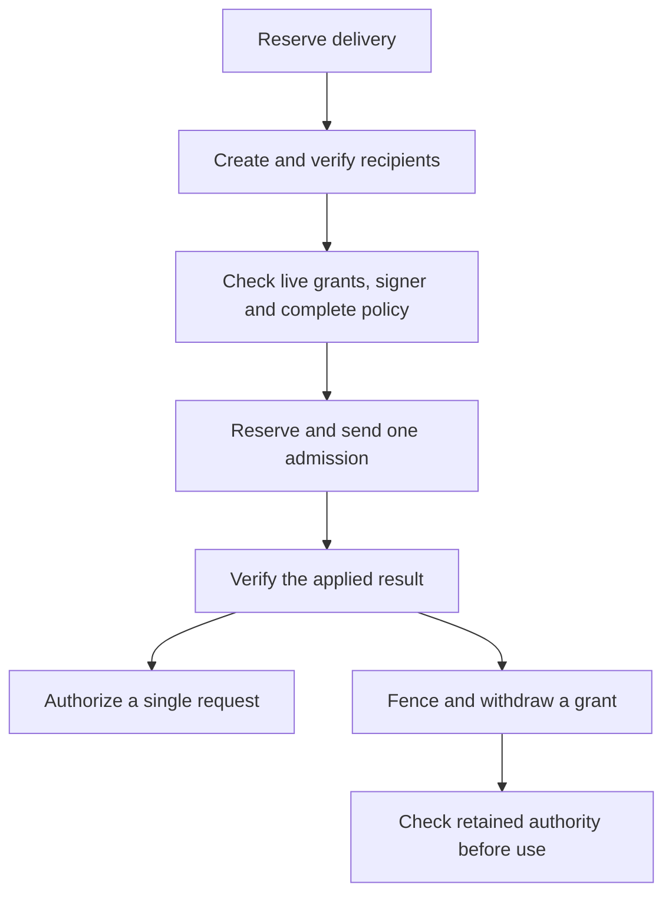

# Joint model and Git admission flow

## Overview

An Agent can use one protected Sandbox for workspace model requests and GitHub installation access. The Repo owner supplies the current installation grant. The paired Sandbox provisions its recipients; the Credential Proxy admits one authenticated supervisor. A provider name, running Pod or earlier receipt cannot authorize a replacement.

## Entry Points

- Trigger: the worker provisions a revision with a model grant and a GitHub installation grant.
- Source: `apps/controller/src/drivers/egress-proxy/openshell-joint-git-provision.ts:provisionJointGit`.
- Assumptions: the selected installation has the joint middleware, a private token endpoint and a supported supervisor assertion source.

## Flow

## Execution Trace

### 1. Provision the Git recipients

`apps/controller/src/drivers/egress-proxy/openshell-joint-git-provision.ts:observeJointGit`

The Sandbox reserves delivery before creating the providers. One dynamic provider serves Basic authentication on `github.com`; another serves required Bearer authentication on `api.github.com`. Neither stores an installation token. A separate provider carries the runtime files. The Sandbox looks up each recipient by name and verifies the full fingerprint in its label and profile annotation. It checks the provider IDs, versions, profiles, attachment epoch and ready supervisor Pod UID.

### 2. Admit the observed execution

`apps/controller/src/drivers/egress-proxy/openshell.ts:wiringStatus`

The worker compares current grants and the source policy with the supervisor's complete effective policy, including the provider rules. Each Git rule permits its one host on port 443. The worker reserves the admission in `credential_policy_effects` before sending it. A later observation must match the original session, signer, process and applied command. An uncertain response does not permit another admission.

### 3. Redeem a single authorized request

`apps/controller/src/drivers/credential-gateway/openshell-joint-git-issuer.ts:OpenShellJointGitIssuer`

The signed Git request records a possible-use receipt without reading token material. The private HTTPS issuer checks the request, destination and supervisor against a SPIFFE JWT-SVID or a Kubernetes bound token. Only then can the owner open the prepared credential. Before disclosure, the worker checks the current signer, grant, execution and receipt again. A missing or replaced supervisor Pod cancels outstanding permits. An interrupted response leaves its permit spent. The Sandbox process receives no token.

### 4. Withdraw one grant

`apps/controller/src/drivers/egress-proxy/openshell-joint-policy.ts:jointSuccessor`

OCC records the operation, predecessor key, retained grant and remaining policy. After the original fence, the Driver reserves each effect before dispatch. For Git withdrawal it detaches both Git providers conditionally and requires their original receipts; model withdrawal retains those providers. Both paths retain the runtime-files provider and write the complete remaining source policy. An unknown write stays pending. Before settlement and each use, the Driver checks the loaded policy and the Sandbox provider list and attachment epoch. When Git remains, both recipients must keep their admitted epoch, the provider environment revision must stay unchanged, and the session must report the original public key with model signing disabled. When the model remains, the Sandbox epoch must match the result of the final detach receipt and the current key must match the signed successor. OCC checks retained authority under the Namespace lock before settling.

## Debugging and Verification

Check the committed admission effect, current source policy, effective policy and provider identities independently. A prepared provider or possible-use receipt alone cannot prove release. If a conditional write has no matching receipt, observe the original operation before attempting recovery.

## Related docs

- [Agent repository credentials](agent-repository-credentials.md)
- [Protected credential requests](credential-source-egress.md)
- [OpenShell Sandbox provisioning](openshell-sandbox-provisioning.md)

## Manual Notes

[keep this for the user to add notes. do not change between edits]

## Changelog

- 2026-10-25 01:44: Verify retained session identity and the Sandbox attachment epoch at settlement and use. (authoring-run/da4d124b-c438-4a32-95f3-4a1ab3d6b047 - 87770ae401b31f17f74ab2b94b31ccbdcf80e8fe)
- 2026-10-25 01:12: Trace conditional admission, current provider attachments and withdrawal settlement. (authoring-run/dc2d71d4-a1eb-49f1-bc25-d30f68141aa8 - 3726e252f3cdfe9d8188ef1772faed9f9c9bcae9)
