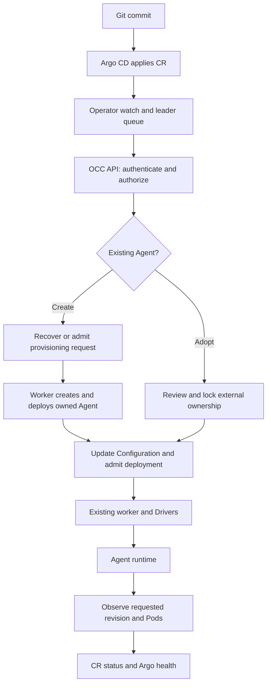

# Kubernetes Agent reconciliation flow

## Overview

Argo CD applies a new or reviewed existing Agent's desired state as Kubernetes custom resources.
The namespace-scoped Operator uses authorized OCC HTTP operations; it never
creates runtime Pods directly. This flow covers dedicated creation in an existing
Namespace, adoption and updates, not the full proposed RFC lifecycle.

## Entry Points

- `apps/operator/src/main.ts`: in-cluster startup and required namespace/cluster identity.
- `apps/operator/src/operator.ts:KubernetesAgentOperator.start`: watches, leader Lease, queue and health server.
- `apps/operator/src/reconciler.ts:AgentReconciler.reconcile`: finalizers and kind dispatch.
- `apps/controller/src/http/agents.ts:createAgentHandlers`: public management routes and native browser preparation.
- Preconditions: ready existing OCC Namespace, authorized credentials and supported immutable runtime images; either delegated creation permissions or reviewed exact-ID adoption.

## Flow

## Execution Trace

### 1. Observe and connect

`operator.ts:observe` ignores status-only changes. `renew` acquires a Kubernetes
Lease using MicroTime and starts one processing epoch. Loss of renewal aborts
that epoch. The queue coalesces work; periodic resync also observes dependencies.
`cluster.ts` performs namespace-scoped SDK requests and exact Secret-key reads.

`reconciler.ts:connect` loads the Connection service key and optional CA, then
checks the selected Namespace's Installation identity. `enterprise-client.ts`
keeps TLS verification and Host/SNI even with an explicit socket address. It
refuses redirects and returns bounded, sanitized errors.

### 2. Create or adopt, then settle desired input

Without `spec.adopt`, `AgentReconciler.provisioningRequestId` derives a stable
UUID from the registered source. `OpenClawController.getAgentProvisioningByRequest`
authorizes Namespace creation scope and resolves only the caller's original
request. If absent, `agent` submits ordinary provisioning with the source, initial
generation, Configuration and existing Harness credentials. Status is progress,
not an identity store. A pending or failed job cannot become a new POST plan.

`OpenClawController.provisionAgent` requires Namespace Agent create/administer
for managed requests; ordinary requests keep Installation administer. The worker
reauthorizes the stored scope. `processAgentProvisioningConfiguration` saves the
new Agent and external owner in one transaction. Fenced handoff uses that exact
source and actor in the management context; suspended ownership still refuses
it. The initial revision is saved in the receipt, so the first unchanged apply
needs no second deployment. See [Agent provisioning](agent-provisioning.md).

An administrator bootstraps these permissions with
`OpenClawController.delegateNamespaceRole`, through the IAM HTTP handler. It checks
a configured Role and same-Namespace non-Agent ServicePrincipal under the
existing IAM policy locks, recovers an identical binding, and uses the selected
IAM Driver's configured binding capability. The normal AccessBinding API revokes it.

`reconciler.ts:agent` reads the exact Agent and verifies dedicated execution.
`OpenClawController.adoptAgentManagement` authorizes under the Namespace lock,
locks the Agent and Configuration, verifies the reviewed snapshot and writes
ownership. It performs no deployment. `setExternalManagement` stores this in
PostgreSQL; migration 0077 constrains its shape and unique principal/source pair.

The Operator resolves Secret metadata references and Harness auth, then submits
an apply key derived from CR generation and dependency identities. The HTTP
handler prepares requested native browser settings using the Installation's
trusted origin. `OpenClawController.applyAgentManagement` validates current
authority and receipt, prepares channel checks outside the transaction, then
rechecks version and snapshot under locks. It calls the existing Configuration,
Agent and deployment methods in its private management context. Receipt and audit
commit with work admission. A repeated key recovers the existing result; stale
versions/generations conflict. See [deployment worker flow](controller-worker.md).

### 3. Observe readiness or release

`reconciler.ts:agent` compares the receipt's requested revision with the active
revision, deployment status, fresh runtime Pods and current diagnostics. Held startup
failures block readiness. The Gateway's configuration, authentication and connectivity
checks currently probe Slack, so they gate only Agents that configure Slack. Other
native channels and model turns need separate verification. `report` writes status with
a resource-version precondition. `argocd-health.lua` rejects stale generations
and timestamps; failed deployment or ownership conflict is Degraded. Stopped-state
verification waits for the active pointer to clear and checks every Agent
revision for remaining Pods. It spaces reads by 600 milliseconds to respect
the runtime API limit and aborts the wait on leader loss.

`guardExternalManagement` rejects ordinary competing mutations. A normal manual
stop suspends management. Retain finalization calls the authorized release API,
keeps its version tombstone and removes the finalizer. Referenced resources wait
for dependent CRs. Unsupported Namespace creation/import/Delete paths stop before their
unimplemented effects.

## Debugging and Verification

Inspect CR Ready reasons before workload logs. `InstallationMismatch` indicates
wrong identity; `AuthorizationDenied` indicates missing exact IAM grants;
`OwnershipConflict` requires a fresh ownership review. Never expose a service key
or remove a finalizer as a repair shortcut. Operator logs contain sanitized lease
and status failures. Test scope and commands are in the [test guide](../testing/kubernetes-agent-operator.md).

## Related docs

- [Current contract](../reference/kubernetes-agent-operator.md)
- [Setup guide](../guides/kubernetes-agent-gitops.md)
- [Agent provisioning](agent-provisioning.md)
- [RFC-0037](../../specs/rfcs/0037-kubernetes-agent-operator.md)

## Manual Notes

## Changelog

- 2026-11-12 12:25: Trace delegated creation and durable provisioning recovery (authoring-run/65cb4899-2d56-4014-aa48-d1d20f550b78 - d278426)

- 2026-11-12 10:24: Apply Slack diagnostics only to Agents that configure Slack (codex/kubernetes-agent-operator - 95e3b2b)

- 2026-11-12 08:08: Pace stopped-state history checks within the runtime API limit (codex/kubernetes-agent-operator - cdff3a4)

- 2026-11-11 21:05: Trace alpha adoption, versioned apply, observation and Retain release (codex/kubernetes-agent-operator - 6790396)
