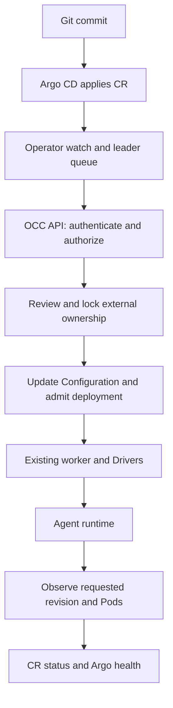

# Kubernetes Agent reconciliation flow

## Overview

Argo CD applies an existing Agent's desired state as Kubernetes custom resources.
The namespace-scoped Operator uses authorized OCC HTTP operations; it never
creates runtime Pods directly. This flow describes the alpha adoption/update
path, not the complete proposed RFC lifecycle.

## Entry Points

- `apps/operator/src/main.ts`: in-cluster startup and required namespace/cluster identity.
- `apps/operator/src/operator.ts:KubernetesAgentOperator.start`: watches, leader Lease, queue and health server.
- `apps/operator/src/reconciler.ts:AgentReconciler.reconcile`: finalizers and kind dispatch.
- `apps/controller/src/http/agents.ts:createAgentHandlers`: public management routes and native browser preparation.
- Preconditions: ready existing OCC Namespace, existing Agent/private Configuration, authorized credentials, reviewed exact-ID adoption and supported immutable runtime images.

## Flow

## Execution Trace

### 1. Observe and connect

`operator.ts:observe` ignores status-only changes. `renew` acquires a Kubernetes
Lease using MicroTime and starts one processing epoch. Loss of renewal aborts
that epoch. The queue coalesces work; periodic resync also observes dependencies.
`cluster.ts` performs namespace-scoped SDK requests and exact Secret-key reads.

`reconciler.ts:connect` loads the Connection service key and optional CA, then
checks the selected Namespace's Installation identity. `enterprise-client.ts`
keeps TLS verification and Host/SNI even with an explicit socket address. It
refuses redirects and returns bounded, sanitized errors.

### 2. Adopt and settle one desired input

`reconciler.ts:agent` reads the exact Agent and verifies dedicated execution.
`OpenClawController.adoptAgentManagement` authorizes under the Namespace lock,
locks the Agent and Configuration, verifies the reviewed snapshot and writes
ownership. It performs no deployment. `setExternalManagement` stores this in
PostgreSQL; migration 0077 constrains its shape and unique principal/source pair.

The Operator resolves Secret metadata references and Harness auth, then submits
an apply key derived from CR generation and dependency identities. The HTTP
handler prepares requested native browser settings using the Installation's
trusted origin. `OpenClawController.applyAgentManagement` validates current
authority and receipt, prepares channel checks outside the transaction, then
rechecks version and snapshot under locks. It calls the existing Configuration,
Agent and deployment methods in its private management context. Receipt and audit
commit with work admission. A repeated key recovers the existing result; stale
versions/generations conflict. See [deployment worker flow](controller-worker.md).

### 3. Observe readiness or release

`reconciler.ts:agent` compares the receipt's requested revision with the active
revision, deployment status, fresh runtime Pods and current Gateway diagnostics. `report` writes status with
a resource-version precondition. `argocd-health.lua` rejects stale generations
and timestamps; failed deployment or ownership conflict is Degraded.

`guardExternalManagement` rejects ordinary competing mutations. A normal manual
stop suspends management. Retain finalization calls the authorized release API,
keeps its version tombstone and removes the finalizer. Referenced resources wait
for dependent CRs. Unsupported create/import/Delete paths stop before their
unimplemented effects.

## Debugging and Verification

Inspect CR Ready reasons before workload logs. `InstallationMismatch` indicates
wrong identity; `AuthorizationDenied` indicates missing exact IAM grants;
`OwnershipConflict` requires a fresh ownership review. Never expose a service key
or remove a finalizer as a repair shortcut. Operator logs contain sanitized lease
and status failures. Test scope and commands are in the [test guide](../testing/kubernetes-agent-operator.md).

## Related docs

- [Current contract](../reference/kubernetes-agent-operator.md)
- [Setup guide](../guides/kubernetes-agent-gitops.md)
- [Agent provisioning](agent-provisioning.md)
- [RFC-0037](../../specs/rfcs/0037-kubernetes-agent-operator.md)

## Manual Notes

## Changelog

- 2026-11-11 21:05: Trace alpha adoption, versioned apply, observation and Retain release (codex/kubernetes-agent-operator - 6790396)
