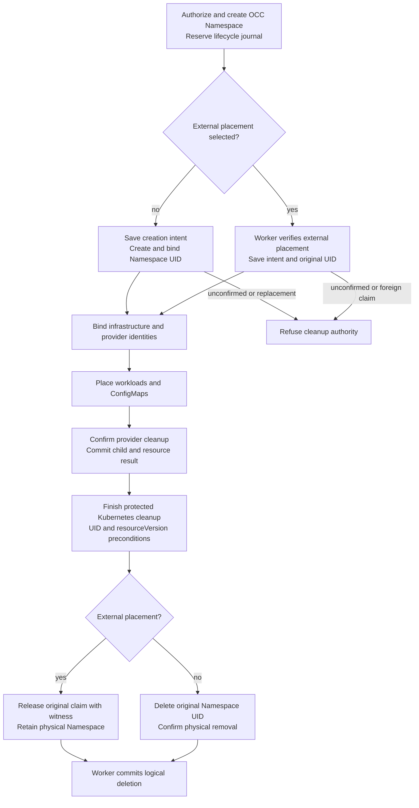

# Existing Kubernetes Namespace Placement Flow

## Overview

An Installation administrator explicitly selects an operator-owned Kubernetes
namespace while creating its platform Namespace. The running worker verifies
authorization and isolation, binds exact tenant identity, and preserves the
namespace after deletion. Other tenants retain deterministic managed placement;
the lifecycle journal saves original placement and immutable resource identities
across preparation, deletion, and worker restart. Unbound existing development
state fails explicitly.

## Entry Points

- Trigger: `POST /namespaces` with optional `existingNamespace`, subsequent
  worker provisioning or deletion, and Configuration CRUD.
- `packages/occ/src/index.ts:OpenClawController.createNamespace`
- `apps/controller/src/worker.ts:ControllerWorker.authorize`
- `apps/controller/src/drivers/compute/kubernetes/index.ts:KubernetesComputeDriver.ensureNamespace`
- Assumptions: the operator exclusively dedicates an existing, `Active`
  namespace to its tenant and prepares its external-lifecycle annotation,
  restricted Pod Security labels, and tenant-local RoleBindings before the API
  request. The worker cannot verify foreign-Pod absence. The caller holds both
  Namespace-create and Installation-`administer` authorization.

## Flow

## Execution Trace

### 1. Authorize and persist explicit external selection

`packages/occ/src/index.ts:OpenClawController.createNamespace`

`internal/occcli/cli.go:namespaceCommand` checks whether the caller supplied
`--existing-namespace` before creating its HTTP client. An explicitly supplied
value, including an empty string, must be a DNS-1123 label of 1 through 63
characters. Invalid values return a local error without a request. Omitting
the flag retains managed placement; an empty adoption flag cannot select it.
`internal/occclient/client.go:Client.CreateNamespace` sends an admitted nonempty
selection to the same API operation below.

`POST /namespaces` accepts `{ "name": "support", "existingNamespace":
"customer-support-prod" }`. Omitting `existingNamespace` keeps ordinary managed
placement and creates the current `oce-<hash15>` namespace name when no tenant
namespace already exists. Existing-namespace selection requires ordinary
Namespace-create permission plus Installation-level `administer` and the
selected bundled Kubernetes Compute Driver; Docker or external
Compute selections reject it with `409`. OCC persists the exact physical name
with its generated platform Namespace ID before queuing worker provisioning.
Partial database uniqueness prevents simultaneous active claims for the same name.

`packages/occ/src/state/postgres-schema.ts:namespaceLifecycle` and
`migrations/0065_namespace_lifecycle.sql:reserve_namespace_lifecycle` reserve a
stable lifecycle UUID with the Namespace insertion, before any dispatch. The
initial revision-zero record proves no effect was attempted. The worker's
`ControllerWorker.namespaceLifecycle` locks work before Namespace, rechecks its
PostgreSQL-clock lease after acquiring both, and validates the target and selected
Compute identity. Journal CAS and sanitized checkpoint audit commit together.
An expired claim cannot read or save confirmation. Unknown COMMIT acknowledgment
stops effects; the next authorized read uses the committed record.

### 2. Reauthorize and bind the exact external namespace

`apps/controller/src/drivers/compute/kubernetes/index.ts:KubernetesComputeDriver.ensureNamespace`

The running worker rechecks Installation `administer` immediately before
adoption. Compute reads the exact selected Kubernetes namespace and requires
`Active` status, `openclaw.dev/namespace-lifecycle: external`, all three
restricted Pod Security labels, and no foreign tenant markers or NetworkPolicies.
It binds its full Namespace-ID label and matching Namespace-ID annotation
together through a UID/`resourceVersion`-guarded, non-forced patch; concurrent
ownership changes fail safely while preserving the manager and unrelated
metadata. Missing targets, termination, foreign ownership or additive policies,
ambiguous identity, and revoked authorization fail closed without managed
fallback. A missing worker RoleBinding keeps provisioning pending; a missing
API RoleBinding instead makes subsequent Configuration operations return `503`.
Compute reconciles its owned quota, limit range, and isolation policies; no
worker pause, restart, or Installation setting is needed.

`apps/controller/src/drivers/compute/kubernetes/index.ts:KubernetesComputeDriver.networkPolicies`
renders `allow-dns` with UDP and TCP ports `53` and `5353`, scoped to the
[configured DNS peer](../reference/drivers/kubernetes-compute/networking-and-isolation.md#networking).

`apps/controller/src/drivers/compute/kubernetes/namespace-lifecycle.ts:KubernetesNamespaceJournal`
saves creation intent before effects and binds readback to its lifecycle nonce
and original UID. Compute saves each infrastructure attempt separately, so
cancellation before a later stage needs no nonexistent identity. A first,
authoritatively rejected create can record no effect; a later refusal cannot
settle an earlier unknown attempt. An unknown create with an absent read never
issues another create; matching creation metadata can recover late original
readback. Bound infrastructure updates carry the saved UID and observed resourceVersion.
The selected Sandbox receives only its child
journal and the saved physical Namespace UID, before it can mutate placement.

### 3. Colocate Configuration and workload resources

`apps/controller/src/drivers/compute/kubernetes/index.ts:KubernetesComputeDriver.reconcileDnsPorts`

When preparing an Agent in a ready Namespace, Compute extends the installed
tenant and dedicated Gateway DNS policies with missing ports. It verifies exact
ownership and the configured DNS peer, then patches with the observed UID and
resource version. The patch preserves the installed Pod selector, existing
ports, peers, and other rules; policies from before network profiles continue
to admit other Agents' unprofiled Pods. Conflicts fail the preparation pass
without overwriting concurrent changes. A complete DNS grant causes no write.

`apps/controller/src/drivers/configuration/kubernetes/index.ts:KubernetesConfigurationDriver`

Configuration discovers the bound backing namespace by tenant label for each
ConfigMap operation. Managed discovery fails closed when multiple Kubernetes
Namespaces claim the tenant, when the claiming object lacks the full
`openclaw.dev/namespace` label and `openclaw.dev/namespace-id` annotation, or
when a managed namespace name is neither the current `oce-<hash15>` form nor the
previous `oce-<slug>-<hash12>` form. The previous form is accepted only for an
already discovered namespace with `app.kubernetes.io/managed-by=openclaw-enterprise`;
new managed namespaces still use the current name. Explicitly external Namespace
provisioning rejects Configuration creation with `409` until the worker marks
the Namespace `ready`. Compute uses the same resolved namespace for workloads,
dedicated Agent-owned shared PersistentVolumeClaims, private gateway state
claims, credentials, and deletion cleanup. Existing exact Namespace, Agent,
version, service-account, and child-resource ownership checks remain unchanged.
Version retirement preserves the current gateway and its owned claims; final
gateway teardown removes the exact-owned private and shared claims by UID.

### 4. Preserve externally owned namespaces during deletion

`apps/controller/src/drivers/compute/kubernetes/index.ts:KubernetesComputeDriver.deleteNamespace`

OCC rejects deletion while Agents, Configurations, Secrets, service accounts,
or other Namespace contents remain. Compute first checks the journal's selected
targets and any observable physical Namespace UID and owner. A same-name
replacement or foreign claim refuses before provider or Kubernetes teardown.
Cancellation before the first ensure dispatch can complete without provider
cleanup because the initial journal proves no effects were started. External
selection saves its original UID separately from claim progress. Rejected
validation before any claim attempt can cancel without changing operator resources;
unknown claim attempts still require confirmation. Only the first authoritative
PATCH refusal can record no claim effect; post-PATCH read errors do not.
Current UID and foreign-claim
checks remain required.

Compute calls Sandbox cleanup with its saved child context, including after the
tenant Namespace disappears. The Sandbox confirms its original provider resource
and commits provider completion before deleting configured Kubernetes resources
or gateway access. Unknown provider outcomes remain blocked; tenant absence and
bare missing claim labels do not establish cleanup.

For retained external Namespaces, Compute also captures the later Agent-created
`allow-node-gateway` policy's original UID or confirmed absence before provider
effects. It fences that read against the original Namespace UID, deletes with
UID/resourceVersion preconditions, and refuses replacement through finalizer retries.
An attempted infrastructure binding can recover only from matching lifecycle
creation metadata in the original Namespace, then checkpoint before cleanup.

Compute checks saved infrastructure UIDs before
provider effects and again in each deletion snapshot. Deletion uses UID and
current resourceVersion preconditions, then reads back removal. A finalizer or
failed API call keeps the logical Namespace deleting. Existing orphan cleanup
removes exactly labelled ConfigMaps and ServiceAccounts; Secrets are included
only where repository-credential permissions allow listing. Operator resources
and RoleBindings remain. Sandbox returns generic confirmed-absent references or
retained original UIDs, which Compute commits before parent teardown. Each actual
sweep list checks these protected references and rechecks the saved Namespace UID
before deleting unprotected snapshots with UID/resourceVersion preconditions.
A reappearing or replaced protected object refuses instead of becoming an orphan.
Namespace-scoped repository-material cleanup likewise checks placement after its
Secret list before consuming UID/resourceVersion snapshots; missing placement
discards effects, and a replacement refuses.

After owned-resource removal, Compute checkpoints claim-release intent. An atomic
UID/resourceVersion-conditional patch removes only this claim and writes
`openclaw.dev/released-lifecycle`. If its reply is lost, the same UID, that witness,
and no current claim confirm release on retry. Bare missing markers or a later
foreign claim refuse. A committed release still requires a current ownership
read; it grants no authority to mutate later resources. Managed Namespace cleanup
instead deletes the saved physical UID and waits for actual removal. The worker
then commits logical deletion, policy removal, audit, and queue completion.

The [Namespace lifecycle contract](../reference/drivers/compute-namespace-lifecycle.md)
defines authority and recovery. No force-completion or name-only reconstruction
path exists for missing original identity or permanently lost provider evidence.

## Debugging and Verification

- Before creating the platform Namespace, inspect external lifecycle,
  restricted Pod Security labels, tenant-local RoleBindings, NetworkPolicies,
  and Installation `administer` authorization. After provisioning, verify exact
  `openclaw.dev/namespace` identity and the `namespace-id` annotation.
- A refused selection reports only `status: "failed"` in the API. The worker's
  `worker.completed` line for `namespace.ensure` carries
  `code: NAMESPACE_INCOMPLETE` and a `reason` naming the failed check, for
  example the tenant marker key (`openclaw.dev/namespace` label,
  `openclaw.dev/namespace-id` annotation or `openclaw.dev/gateway-namespace`
  label) that names a different Namespace. It never logs that marker's value, the
  other Kubernetes namespace that already claims the tenant, or the name of a
  NetworkPolicy the Namespace does not own; list those with `kubectl`. Old
  tenant markers are usually left by an earlier OCC Namespace on the same
  Kubernetes namespace.
- In single-cluster Compute without repository credentials, an orphaned
  Secret outlives deletion. List Secrets labelled `openclaw.dev/namespace=<id>`
  and `app.kubernetes.io/managed-by=openclaw-enterprise` with `kubectl`, and
  delete those whose `openclaw.dev/namespace-id` annotation is also `<id>`.
- Run `node --test tests/conformance/kubernetes-namespace-lifecycle.test.ts` for
  cancellation, resource replacement, unknown creation, and claim-release retries.
  Its controlled Kubernetes responses establish Driver protocol, not live cluster proof.
- Run `node --test tests/integration/postgres-namespace-lifecycle.test.ts` with the
  prepared disposable PostgreSQL fixture for claim takeover, concurrent finalization,
  audit rollback, and loss of a real COMMIT reply.
- Run `node --test tests/conformance/kubernetes-compute.test.mjs` for driver
  contract coverage, including current managed placement, previous managed-name
  discovery, duplicate-claim rejection, foreign ownership rejection, and cleanup
  through the resolved namespace.
- Run `node --test tests/integration/kubernetes-compute-provisioning-real.test.mjs` against
  the explicitly selected disposable cluster documented in `AGENTS.md`.
  Missing cluster infrastructure is an explicit verification gap.

## Related docs

- [Existing namespace specification](../../specs/.archive/12-kubernetes-existing-namespaces.md)
- [Platform design](../design.md)
- [Kubernetes Compute Driver](../reference/drivers/kubernetes-compute.md)
- [Production Kubernetes deployment](../guides/deploy.md)
- [Configuration Driver flow](configuration-driver.md)

## Manual Notes

[keep this for the user to add notes. do not change between edits]

## Changelog

- 2026-10-30 11:13: Correct the managed/external diagram and trace claim progress, partial binding recovery, late policy custody, and material-list placement checks in the accompanying repair. (authoring-run/80ea08bc-5b26-4327-bd7b-128cc7aaf0fd - 922a031ef91f6dc14329034f50964752757ec29b)

- 2026-10-30 10:09: Trace the generic Sandbox cleanup result, parent sweep protection, and post-list Namespace identity fence in the accompanying implementation. (authoring-run/80ea08bc-5b26-4327-bd7b-128cc7aaf0fd - ef2cf007043819118c83fd8339496a92bcab9fb3)

- 2026-10-30 09:21: Trace durable Namespace intent, claim-fenced checkpoints, original resource identity, and confirmed cleanup in the accompanying implementation. (authoring-run/8ec39c68-b73b-4524-b870-6aac72004d04 - 536e71d95bf39797f2b60048cb3677e879ed046b)

- 2026-10-23 17:00: Deletion sweeps orphaned OCE-owned ConfigMaps, ServiceAccounts and, with repository credentials, Secrets. (fix-1400)
- 2026-10-09 20:19: Refuse an explicitly empty CLI adoption flag before creating a client. (authoring-run/ee7a6b77-c247-4a57-8aa7-cfc15eb650a5 - c4cc1d9f23f9bebac8fd82881561cce48fb4fc6a)

- 2026-10-06 18:55: A refused selection logs its reason in `worker.completed`, naming foreign markers by key only. (fix-d521)
- 2026-10-06 18:40: Name all three tenant markers that block readoption, the stuck deletion of a failed selection over foreign markers, and the reasonless `failed` status. (dogfood-r38)
- 2026-10-01 16:45: Trace additive DNS port updates during Agent preparation in already-ready Namespaces. (authoring-run/0cfc470c-ba88-4a95-86e0-35123f0de703 - d419e4e49513233c39f8975328902141a52d0a96)
- 2026-10-01 15:40: Documented the accompanying allow-dns change to permit UDP and TCP port 5353 alongside port 53. (authoring-run/a4c4fa72-fa88-4660-a8ef-25b347c15dcc - 4cab4887b863904bb7190599fc27cd93ecdef246)
- 2026-09-25 01:58: Documented managed namespace-name upgrade compatibility and resolved-namespace cleanup. (authoring-run/e9e7299c-b7ba-46de-9e24-fd8bb4b76388 - 8d256c22f13a0c79f1b7b9db617e895a503f1305)
- 2026-09-01 19:09: Corrected existing-namespace storage cleanup to final gateway teardown and removed the PR-number prefix from the title. (01a05f95-dd80-7011-990f-d1c46b5bb3cc - aa366c49c44834d59f74994c5fd37fb8096f169f)
- 2026-08-28 21:20: Removed the retired local-test Compute Driver from current selection boundaries. (01a036f4-cf1d-7cc1-bbc1-000879038ac8 - 3ec166eb5fae39ed0f51ffb5ebd93338c4a2db94)
- 2026-08-28 17:58: Updated moved feature-reference links for the documentation organization. (01a036f4-cf1d-7cc1-bbc1-000879038ac8 - 4270aa29b7015562049f46c6027962fd85b584a9)
- 2026-08-26 00:44: Traced explicit administrator-selected placement, persisted ownership, running-worker adoption, and fail-closed tenant cleanup. (01a03a24-5bf5-73f0-bc5c-21830985a7c2 - bcf21fb1bc6b)
- 2026-08-25 20:46: Simplified placement to tenant-label discovery and externally owned infrastructure cleanup. (01a03a24-5bf5-73f0-bc5c-21830985a7c2 - 05f06c051bf4)
