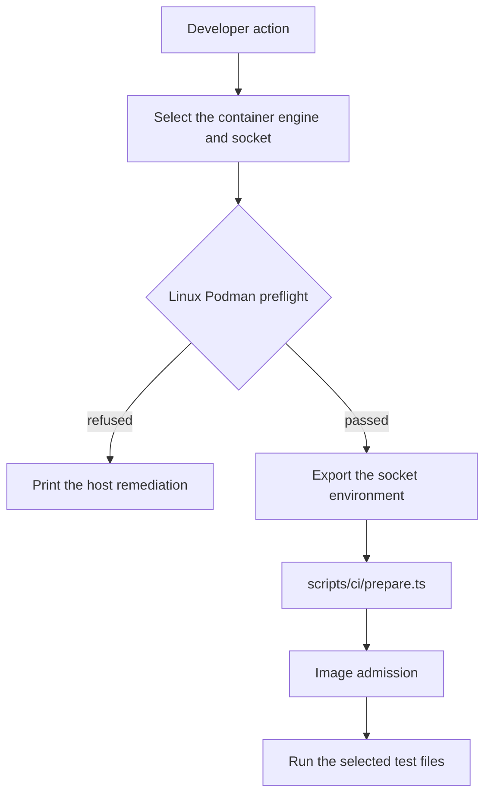

# Local k3d launcher

## Overview

The local launcher runs the repository's integration lanes on a developer
host through the same preparation CI uses.

## Entry Points

- `scripts/k3d` (action dispatch)
- `scripts/ci/prepare.ts:prepareFile` (preparation handoff)

## Flow

## Execution Trace

### 1. Select the engine

`scripts/k3d:select_engine` discovers a running Docker daemon or Podman API socket.
`OCC_K3D_CONTAINER_ENGINE` selects `docker`, `podman` or `podman-rootful`
explicitly; `OCC_K3D_PODMAN_SOCKET` names one exact socket, and an exported
`DOCKER_HOST=unix://…` socket is honored instead of being reset to the
discovered rootless socket. The state directory is
`k3d-<engine>-<harness>` under `OCC_K3D_STATE_DIR`.

On Linux the selection exports `DOCKER_SOCK` (the socket k3d mounts into
its tools node) and `CONTAINER_HOST` (the variable the Podman CLI honors;
it ignores `DOCKER_HOST`) beside `DOCKER_HOST`, so k3d and the Podman CLI
use one socket and one image store. macOS exports stay unchanged.

### 2. Run the Linux Podman preflight

`scripts/k3d:preflight_podman_engine` runs for Podman selections on Linux, before any
cluster, database or image work. It checks, in order: the socket directory
(a missing directory is the first-run state and receives the
service-start remediation), socket access (an ACL grant remediation),
socket presence, and the Podman API answer. The `cpuset` cgroup chain and
the session `oom_score_adj` apply only to the `demo` and `test` actions,
which build the k3d node containers; `down`, `info`, `get`, `copy` and
`reset` keep the socket checks only, so cleanup still runs after a reboot
removes temporary rootless delegation. macOS skips the preflight because
podman-machine runs a rootful virtual machine.

### 3. Hand off to preparation and image admission

The launcher invokes `scripts/ci/prepare.ts` with `OCC_DOCKER_BIN` bound
to the selected engine. `scripts/ci/k3d-image-admission.ts:selectNativeSourceImage` treats a local
image-inspect failure as a cache miss only for the exact Docker and
Podman diagnostics, including Podman 6's
`Error: unable to inspect "<reference>": …: image not known` with exit
code 125; every other failure stays loud.

## Debugging and Verification

Each preflight refusal prints the host command that fixes it. Host setup
and teardown for both routes are documented in
[Podman-only Linux hosts](../guides/deploy/local-kubernetes-podman.md).

## Related docs

- [CI resource preparation](github-actions-testing/preparation.md) owns the preparation the launcher enters.
- [GitHub Actions testing](github-actions-testing.md) is the parent flow.

## Manual Notes

## Changelog

- 2026-11-27 10:41: Trace the local launcher's engine selection, preflight and socket exports. (authoring-run/b502b841-6891-4eca-b62b-853a9d1f4b9c - 8b893b445)
