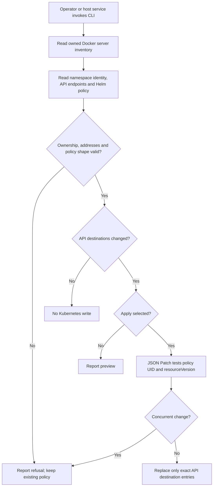

# Local Kubernetes API egress recovery

## Overview

An installation operator runs a host service that follows the owned k3d API
addresses after restart. It updates only the existing Helm control-plane rule.
This deployment supplement stops at network convergence; it does not replay
OCC requests or operate Agent revisions.

## Entry Points

- `internal/occcli/dev_api_egress.go:developmentAPIEgressCommand` exposes preview,
  apply and continuous reconciliation through the normal CLI.
- `deploy/local/occ-k3d-api-egress@.service` starts the command with Docker.
- `internal/occdev/k3d_api_egress.go:ReconcileK3dAPIEgress` requires an explicit
  local Docker context, cluster, namespace UID, Helm release and API port.

## Flow



## Execution Trace

### 1. Establish the infrastructure boundary

`internal/occdev/k3d_api_egress.go:reconcileK3dAPIEgressOnce` accepts only a Unix-socket Docker context. It finds
1–16 running servers belonging to the selected k3d cluster and collects their
IPv4 addresses on that cluster's Docker network. No Pod receives Docker access.

### 2. Validate live authority and destinations

The same function runs existing `kubectl` inside an owned server. The namespace
UID must match the installed value. `internal/occdev/k3d_api_egress.go:planAPIEgress` requires the Kubernetes
service's ready HTTPS addresses to belong to the owned servers and its port to
match the configured API port. It checks Helm annotations and the chart's exact
API/worker/initialization selector. It refuses combined ports and non-`/32` peers.

### 3. Publish the smallest policy change

`internal/occdev/k3d_api_egress.go:planAPIEgress` replaces the API rule's destination list, removing stale hosts.
`reconcileK3dAPIEgressOnce` submits JSON Patch with UID and resource-version tests.
The DNS, database, selector and port fields remain unchanged. Preview and an
unchanged endpoint set cause no write. A conflict requires a fresh read in the
next service cycle; it never triggers an unguarded write.

### 4. Continue installation maintenance

`internal/occdev/k3d_api_egress.go:ReconcileK3dAPIEgress` logs metadata-only results. In watch mode it checks again
after the configured interval, including after an unavailable Docker/API server.
Errors keep the current policy and report refusal. The OCC API and worker then
use their existing authenticated Kubernetes connections. They receive no new
identity or authority from this service.

## Debugging and Verification

Run `go test ./internal/occdev -run '^TestAPIEgress'` for destination and authority
guards. The real test requires an explicitly selected disposable local cluster:

```sh
OCC_TEST_K3D_API_EGRESS_CLUSTER=occ-dev-local \
OCC_TEST_K3D_API_EGRESS_DOCKER_CONTEXT=default \
go test ./internal/occdev -run '^TestK3dAPIEgressReal$' -v
```

The real test creates and deletes one empty namespace. It proves preview,
namespace-identity refusal, guarded endpoint replacement and no-op behavior.
Full recovery additionally requires normal OCC writes and real Agent turns after
a host reboot; a healthy service process is insufficient.

## Related docs

- [Install and verify the service](../guides/deploy/local-api-egress-recovery.md)
- [Architecture ownership](../design.md#system-model)
- [Harness execution](harness-execution-topology.md)

## Manual Notes

## Changelog

- 2026-10-26 12:20: Add local infrastructure endpoint reconciliation. (authoring-run/01a16571-f230-73d0-b786-f83300124449 - 28e75abf85bb0460fbf3b2b289ea7e31d12c1efc)
