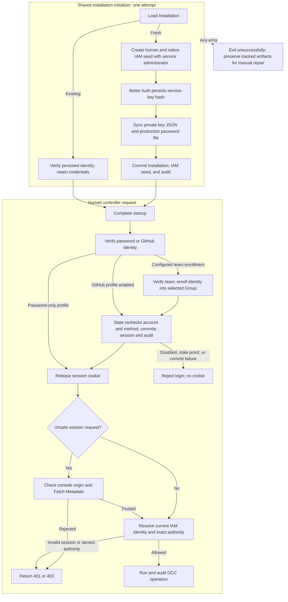

# Bootstrap and human authentication flow

## Overview

Native-IAM bootstrap commits administrators with the Installation and protects
their credentials. Human sign-in reaches exact IAM authorization;
the [service API key flow](service-api-keys.md) covers key verification,
rotation and revocation.

## Entry Points

- Trigger: `node scripts/bootstrap-installation.mjs` with `NODE_ENV=development`
  or `production`, `POST /api/auth/sign-in/email`, `POST /api/auth/providers/github/start`,
  `GET /api/auth/providers/github/callback`, the matching `google` routes, or a protected
  controller request.
- Source: [`scripts/bootstrap-installation.mjs`](../../scripts/bootstrap-installation.mjs),
  [`apps/controller/src/auth/index.ts:createControllerAuth`](../../apps/controller/src/auth/index.ts),
  and [`apps/controller/src/index.ts:createFastifyApp`](../../apps/controller/src/index.ts).
- Assumptions: Migrated PostgreSQL, configured Better Auth, native IAM bootstrap,
  protected output storage, disabled public signup, and exact IAM authorization.
  Production receives a private password path and sibling service-key path;
  development receives only the service-key output path.

## Flow

## Execution Trace

### 1. Load state and create the fresh administrator identities

[`scripts/bootstrap-installation.mjs`](../../scripts/bootstrap-installation.mjs)
loads the singleton Installation. Existing Installations verify the administrator's
immutable account/IAM identity without issuing keys, changing output, or repairing
grants, including Installations predating service-administrator bootstrap.
`verifiedWithoutAuth` checks the administrator's `occ."user"` row and IAM Principal
before loading Better Auth. Success logs `installation.already-bootstrapped` with
`step: "fast-path"`; a miss or error runs the full Better Auth check. Both paths
check the base URL first.

For fresh setup, production creates a Better Auth account with a random password;
development creates the configured `OPENCLAW_DEV_EMAIL`/`OPENCLAW_DEV_PASSWORD`
account. `packages/iam/src/index.ts:createBootstrapAdministratorSeed` adds a
non-Agent `spn_<uuid>` without a Namespace and a separate unrestricted binding to
the human's administrator Role. The [authorization reference](../reference/authorization.md#supported-policy-surface)
defines exact actions. Additional-account provisioning creates no service administrator.

### 2. Issue private output, then commit the Installation

[`apps/controller/src/auth/index.ts:createServiceKey`](../../apps/controller/src/auth/index.ts) persists a Better
Auth key named `bootstrap-admin` with the default 30-day expiry, scoped to this
Installation and service principal. This auth write is independent of the OCC
transaction. An uncommitted IAM seed cannot authorize normal OCC operations;
startup does not expose the application until bootstrap succeeds.

[`bootstrap-output.ts:writeProtectedBootstrapFile`](../../apps/controller/src/composition/bootstrap-output.ts)
creates owner-only output exclusively and syncs it before OCC commit. The JSON
contains the key response and attempt Installation ID; production also writes its
password file on the same protected PVC, and development writes to its
bootstrap-only volume or explicit direct-initialization path. No plaintext reaches logs, audit, bootstrap HTTP responses or the worker.

Both modes commit Installation/IAM/audit together after one attempt at account
creation, key issuance and output. The API loads committed state without calling the human-session-only
`POST /installation/bootstrap`. Singleton constraints permit one committed seed;
a losing initializer fails.

Any error ends the attempt with `installation.bootstrap-failed`,
available non-secret IDs and paths, and a nonzero exit; the Helm initialization
Job uses `backoffLimit: 0`. Completed tracked accounts, keys, and files,
including partial output, remain for inspection. If password `linkAccount` fails before `createAccount` returns, the helper
attempts to delete the new user before rethrowing. That is not a general artifact-recovery path; the initializer never
automatically revokes, retries, repairs, or resets committed or uncertain state.

The [recovery procedure](../guides/deploy/service-keys.md#recover-an-incomplete-bootstrap)
requires confirmed transaction completion and exact attempt IDs: an uncertain
commit can persist the seed; file existence is insufficient. Reset requires identifying the disposable
Installation and its storage. After success, import output, retaining its IDs.
Lost output is never regenerated; [service-key management](service-api-keys.md)
covers replacement and revocation.

### 3. Construct session authentication

`apps/controller/src/auth/index.ts:createPostgresControllerAuth` uses OCC's
[public binding](../reference/postgres-auth-binding.md#composition), which owns
the caller-owned pool, full schema, construction failures, and adapter settings.

`apps/controller/src/auth/index.ts:createControllerAuth` configures Better Auth
password authentication, protected cookies, and PostgreSQL storage. Sign-in returns
`{ authenticated: true }`; the token stays in its HttpOnly cookie.
`safeSessionResponse` returns public identity and `sessionKey`, an auth-secret HMAC
of the session ID (`apps/controller/src/auth/session-binding.ts`). A changed key makes
the [Console](platform-console.md#2-resolve-the-session-before-private-reads) clear
retained views and drafts. Password-only sign-out uses
`apps/controller/src/auth/password-sign-out.ts:passwordSignOut` to delete the session
through the selected database adapter before clearing its cookie. Storage failure
returns `503` without cookie changes; the caller can retry after recovery.
`auth/admission.ts:passwordFailureAdmission` counts failures; fast success clears
the selected identity, not the address. `onLimited` reports
`authentication.sign-in-limited` once per lane/window. `auth/known-device.ts`
checks the email-bound MAC before password-state reads with rate and concurrency limits (see
[known devices](../reference/authentication.md#known-devices)). Verified bindings
select the device lane; rejected bindings use the shared lane. Failed or refused
reads retain signed keys as email/address constraints, never exemptions. Password-only admission captures
issuance state before credentials, preserving reset-race invalidation; success
may reissue it. In the password-only profile with PostgreSQL State,
`passwordSignInAudit` attempts `authentication.login`. A failed success audit returns `503` without a cookie after attempted session
deletion. A failed denial audit (`DenialAuditUnavailable`) counts as a credential
failure. With an external provider, `/oce/password` marks it
`PASSWORD_DENIAL_AUDIT_UNAVAILABLE` for the same accounting. The
[session lifecycle](../reference/authentication.md#session-lifecycle) owns audit
fields, status codes, and unconfirmed outcomes. Better Auth logs only errors, so
a wrong password writes no unstructured console warning.

`requireSessionKey` checks optional `x-occ-session-key` after cookie resolution in
`ControllerAdmissionVerifier.verify`, `session`, `resolveSession`, and `signOut`.
Malformed, duplicated or foreign keys return `401` without revoking or clearing
sessions. This optional header narrows but never selects a session; the native
admin proxy strips it upstream.

When GitHub is configured, `apps/controller/src/auth/github.ts:createHumanLogin`
provides password, GitHub, and logout endpoints through a guarded Better Auth adapter.
`packages/occ/src/state/human-authentication.ts:PostgresHumanAuthentication` owns
account and method checks and the State transaction. Password verification captures
credential and account versions for the session transaction to recheck. Both methods
pass a private proof to guarded session creation; session and audit commit before
Better Auth releases the cookie. Session reads check the current account, method,
version, and Principal; sessions expire after eight hours without refresh. HTTPS uses
a `__Host-` cookie that sibling hosts cannot plant; session reads and logout reject
duplicate active-session cookies.

For GitHub, the Console reads `GET /api/auth/providers` and sends a same-origin
`POST /api/auth/providers/github/start`. The server stores a five-minute attempt with state and browser
secret digests, provider instance, callback, and PKCE verifier. A host-only
HttpOnly cookie binds the browser; this profile rejects shared-domain sessions.
Callback consumption commits before exchange; a losing, expired, or invalid
attempt does not exchange a code.
`apps/controller/src/auth/github.ts:exchangeGithubSubject` exchanges the code
with the GitHub App client ID and secret and verifies the numeric subject through
`/user`. Configured membership and first-time enrollment use that same token for
GitHub's membership and email endpoints. The subject selects the external identity;
a valid provider-returned login accompanies it into the audit but never selects an
account or grants authority. Only a new enrollment retains the verified email;
tokens are not persisted. The
[GitHub reference](../reference/authentication/external-sign-in.md#github-sign-in-for-existing-accounts)
owns OAuth scopes, token disposal, App private-key custody, and fixed
redirects.

`attemptId` authenticates the attempt-state digest with HMAC. Success sets a signed,
two-minute `SameSite=Strict` v2 receipt binding provider, session and attempt. The
same-origin result handler verifies signature, expiry and provider before State
lookup. Legacy attempts must restart; wrong-provider requests leave receipts
unchanged. Matching attempt and session permit one exchange per process-local
ledger, retained until expiry: clear the receipt and return the session key without
extending sessions. Password sign-in returns that key directly.
`refuseUnmatched` rejects malformed, unbound, replayed or expired callbacks without
audit, incrementing
[`occ_sign_in_unmatched_callbacks_total`](../reference/metrics.md#application-families).
The callback audit records the HMAC-derived attempt ID. A verified
GitHub profile also adds its subject and valid login to refusal or successful session
audits; provider failures before profile verification have no identity.
Denials after `consumeAttempt` matches are audited as
[`PROVIDER_UNAVAILABLE`](../reference/authentication/external-sign-in.md#github-sign-in-for-existing-accounts),
`EXTERNAL_IDENTITY_REJECTED` or `ACCOUNT_DISABLED`; with GitHub's
[allowlist](../reference/authentication/external-sign-in.md#organization-and-team-allowlist),
`apps/controller/src/auth/github.ts:githubMembership` runs between `GET /user` and the account
lookup and adds `MEMBERSHIP_REQUIRED` and `MEMBERSHIP_UNAVAILABLE`. The callback route turns
the response code of those, `ACCOUNT_DISABLED` and `PROVIDER_UNAVAILABLE` into the Console's
`authReason`, and a callback that fails inside OCE (5xx) into `authReason=unavailable`;
State dependency failures and uncertain session completion are not denials; neither retries.

Google (and generic OIDC) reuses `apps/controller/src/auth/github.ts:externalProviderEndpoints` for
start, callback, and result, with provider instance `google:<sha256(client ID)>`.
Authorization adds scope `openid email` and an auth-secret HMAC of attempt state
as nonce, without storage.
`apps/controller/src/auth/google.ts:exchangeGoogleSubject` exchanges the code, fetches
Google's signing keys with the shared HTTP deadline and byte limit, verifies the RS256 ID token's
signature, issuer, audience, expiry, and nonce (plus `hd` and `email_verified` when
allowed domains are set), and returns only `sub`. Tokens and email are discarded.

`apps/controller/src/auth/client-address.ts:clientAddressConfiguration` canonicalizes
IPv4-mapped addresses before prefix validation, refusing entries covering every
IPv4 or IPv6 address. `resolveClientAddress` uses dotted IPv4 for mapped peers and
header hops.

Password sign-in rejects unstorable email inside controller admission before
known-device verification or account State reads, preserving budget accounting. Password-only uses `passwordSignInAudit`;
guarded and recovery-only use `github.ts:recordPasswordDenial`, the same owner as
credential refusals. Both return `400 INVALID_REQUEST` after the denial audit;
a failed audit is a counted `503`. An exhausted shared lane rejects the invalid
email without a reserved-account lookup. Password text is not checked.
Valid email enters controller admission before `/oce/password`, with the
recovery email reserved like an administrator's. GitHub, Google and OIDC share process-local rate and concurrency limits
for start, callback and result admission (`keyedAdmission`), keyed on
client addresses behind trusted proxies and browser cookies otherwise. Provider
HTTP shares a deadline and response-byte cap; State bounds pending attempts and expired cleanup.
State persists attempt and session deadlines; cookie Max-Age subtracts monotonic
elapsed work. Expired completion releases no cookie.

`scripts/auth-maintain.mjs` parses arguments with
`scripts/lib/auth-maintain-arguments.mjs:parseAuthMaintainArguments` before
configuration or database access. Undeclared commands, including inherited object
properties, exit `64` with usage. The
[maintenance procedure](../guides/deploy/auth-maintenance.md) lists supported operations
and exit codes.

Activation requires stopped admission, drained or terminated requests, and stopped
old controllers; startup does not fence live readers. Both PostgreSQL compositions
reject GitHub with native administration, including without its cookie domain.
`apps/controller/src/auth/index.ts:createPostgresControllerAuth` checks the secret,
canonical origin and profile before activation. Invalid configuration leaves
sessions, enrollment and recovery designation unchanged.
`PostgresHumanAuthentication.activateRecovery` then validates and enrolls the complete existing password-user/Principal population,
fixes the usable recovery administrator, and removes unbound historical sessions
in one State transaction before serving resumes. Unsupported or incomplete
populations fail activation. See the
[deployment procedure](../guides/deploy/production-installation.md#enable-github-browser-sign-in).

Account routes enforce the
[session and recovery controls](../reference/authentication/external-sign-in.md#session-and-recovery-controls):
State locks actor and target and checks `expectedVersion`. After method/recovery locks,
`human-authentication.ts:guardAuthority` holds all six IAM tables through commit
using `0073_account_administration_policy.sql`, awaits the selected IAM Driver through
the route's actor callback, then rechecks the session. `READ COMMITTED` sees grants changed
during lock waits; `NOWAIT` contention returns retryable `503`. Denials roll back
before HTTP audit.
Attachment, disablement and account-wide revocation advance the version and invalidate
target sessions and proofs without changing IAM.
Guarded reads return current account and method state, not operation receipts.
Unknown completion returns a dependency failure without replay or compensation; operators must
resolve uncertainty before another action.
Without an external sign-in provider, composition omits account operations; routes
still authorize the caller, then return `409 RESOURCE_CONFLICT`.
Logout commits deletion and audit before clearing the cookie. The [authentication reference](../reference/authentication/external-sign-in.md#github-sign-in-for-existing-accounts)
owns configuration, recovery limits, and operator-visible behavior.

### 4. Admit and authorize protected API calls

`ControllerAdmissionVerifier.verifyControllerRequest` applies the
[browser origin rules](../reference/authentication.md#browser-request-origin) to
unsafe session requests before admission, including sign-out before revocation
and the GitHub result exchange, which shares the GitHub admission lane, before
reading. Explicit service API keys skip this check and never fall back to a cookie.

`apps/controller/src/index.ts:createFastifyApp` validates the session and uses the
selected IAM Driver to resolve its Installation-owned issuer/user ID and authorize
the exact resource. Separate current-policy reads for lookup and authorization
expose account and permission changes across controller instances. Missing or invalid
sessions return `401`; denied permissions return `403`; dependency failures fail
closed. Bearer credentials and caller-supplied identity headers are rejected.

### 5. Provision additional accounts

`apps/controller/src/index.ts:createFastifyApp` lets an authorized human Installation
administrator create accounts with or without GitHub. `prepareAccount` validates
and hashes the password without writes. `provisionPasswordAccount` writes the user,
password method, Principal, explicit existing-role binding, enrollment and audit
atomically, without subsequent compensation. A lost COMMIT reply returns `503`
with unknown outcome: retrying the same email creates an account only if the first
attempt did not commit; otherwise it returns `409`. Creation issues no session
and infers no grants.

### 6. Enroll a verified team member

With `autoEnrollGroupId`, `auth/github.ts:exchangeGithubSubject` verifies the
team-only allowlist and rechecks the same token's numeric ID and login. For a
missing identity, `githubEnrollmentProfile` reads a
verified primary email within the remaining provider deadline; the callback
hashes a random password and obtains a no-grant Principal from native IAM.
Attached identities skip email retrieval. No provider credential enters State.

`PostgresHumanAuthentication.enrollExternal` serializes the provider/subject,
checks the existing Installation Group and resolves the identity again inside
one State transaction. Existing identities retain their attempt-currentness and
disabled-account checks. New identities reuse `insertPasswordAccount`; only the
transaction that inserted them can snapshot those new methods without an older
attempt timestamp. Account, external method, membership and their audits commit
together. The normal session transaction rechecks the resulting proof before
issuing its cookie. Group bindings supply permission; this path creates none.

## Debugging and Verification

Run `tests/integration/` files with `node --test`.

- `node --test tests/integration/postgres-github-team-enrollment.test.ts` uses
  production authentication, PostgreSQL and IAM through the ordinary Agent API.
  Upstream GitHub responses and Compute are fixtures; it does not verify live
  GitHub registration or deployment.
- `node --test tests/integration/native-admin-access.test.mjs` covers trusted and
  untrusted origins on session mutations and sign-out, plus service-key admission.
- `postgres-production-wireup.test.mjs` with `OCC_PRODUCTION_WIREUP_DATABASE_URL`
  proves bootstrap, protected password/key delivery, human/service access and no reissue.
- `postgres-auth-accounts.test.mjs` with `OCC_TEST_DATABASE_URL` covers provisioning,
  rollback, lost COMMIT replies and password-only logout under contention. Its
  fresh-bootstrap case verifies service identity, output and access, skipping
  existing Installations.
- `node --test tests/integration/bootstrap-output.test.mjs` covers exclusive
  output and rejected unsafe paths. Failed writes retain any created file.
  Database cases require the [disposable PostgreSQL setup](../testing/postgresql.md#postgresql-test-environment);
  an unconfigured/skipped suite is not runtime proof.
- `postgres-bootstrap-failures.test.mjs` with `OCC_BOOTSTRAP_FAILURE_DATABASE_URL`
  uses a dedicated loopback database to verify concurrent production bootstrap,
  credential preservation after lost COMMIT acknowledgement in both modes, and
  fast/full-path selection.
- Verify copied output is `0600` without printing it; use a key-authenticated
  `GET /installation` and Namespace create/read to check current authority.
  A `401` indicates credential rejection; `403` indicates identity/scope/policy
  denial. For a failed bootstrap, follow
  [operator recovery](../guides/deploy/service-keys.md#recover-an-incomplete-bootstrap).
- `pnpm typecheck`, `pnpm format:check`, and `pnpm check:workspace` validate source
  and workspace structure. Compose/PVC permission checks require real runtime
  execution; chart rendering alone does not prove storage access.

## Related docs

- [Authentication](../reference/authentication.md)
- [Configuration reference](../reference/settings.md)
- [IAM](../reference/authorization.md)
- [Platform startup flow](platform-startup.md)
- [Docker Compose development](docker-compose-development.md) and [production startup](production-startup.md)
- [Service API keys](service-api-keys.md)
- [Bootstrap specification](../../specs/plans/16-bootstrap-admin-service-account/index.md)
- [Feature spec](../../specs/.archive/10-local-password-authentication.md)

## Manual Notes

[keep this for the user to add notes. do not change between edits]

## Changelog

- 2026-11-06 02:07: Trace opt-in GitHub team enrollment and transactional identity creation. (authoring-run/8d231212-5a96-46b9-8dee-2eac79700e32 - 201eed939abe18e2d522f2b2ead5047626ade755)

- 2026-11-04 11:22: Record durable password-only session revocation and storage failure handling. (authoring-run/d3b76aba-07fb-422b-b0fd-f5957926b7b8 - 0c7126dc16df1a01e2242e9bd35f9e742d6cee56)

- 2026-10-15 18:55: Record verified GitHub identity and correlate matched sign-in attempts in audit. (authoring-run/b841a0a4-490b-486f-ab3c-2074d75f0ee6 - aad21c63837ef24f9f9bae152877812abe9b1abd)

- 2026-10-10 20:56: Reject unstorable email before State reads while preserving denial audits and admission. (authoring-run/6a102658-a68a-460f-bb67-be99a2490d8d - f6526eed518b689cc99e70f2c8ad349c500e936d)

[Bootstrap and human authentication documentation history](local-password-authentication/history.md) preserves the older dated entries.
