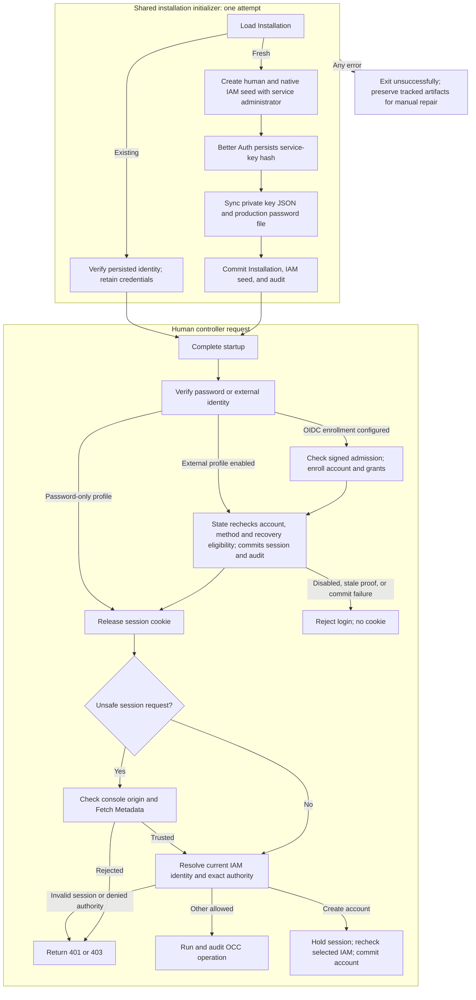

# Bootstrap and human authentication flow

## Overview

Native IAM bootstrap commits administrators with the Installation and protects
their credentials. Human sign-in leads to exact IAM authorization. See
[service API key verification, rotation and revocation](service-api-keys.md).

## Entry Points

- Trigger: `node scripts/bootstrap-installation.mjs` with `NODE_ENV=development`
  or `production`, `POST /api/auth/sign-in/email`, `POST /api/auth/providers/oidc/start`,
  `GET /api/auth/providers/oidc/callback`, the matching `google` routes, or a protected
  controller request.
- Source: [`scripts/bootstrap-installation.mjs`](../../scripts/bootstrap-installation.mjs),
  [`apps/controller/src/auth/index.ts:createControllerAuth`](../../apps/controller/src/auth/index.ts),
  and [`apps/controller/src/index.ts:createFastifyApp`](../../apps/controller/src/index.ts).
- Assumptions: Migrated PostgreSQL, configured Better Auth, native IAM bootstrap,
  protected output storage, disabled public signup, and exact IAM authorization.
  Production requires sibling private password and service-key paths.
  Development requires only the service-key path.

## Flow

## Execution Trace

### 1. Load state and create the fresh administrator identities

[`scripts/bootstrap-installation.mjs`](../../scripts/bootstrap-installation.mjs)
loads the singleton Installation. For existing Installations, including those
predating service-administrator bootstrap, it verifies the administrator's
immutable account/IAM identity without issuing keys, changing output, or repairing
grants. Both verification paths first check the base URL. `verifiedWithoutAuth`
checks the administrator's `occ."user"` row and IAM Principal before loading
Better Auth. Success logs `installation.already-bootstrapped` with `step: "fast-path"`.
A miss or error runs the full Better Auth check.

`apps/controller/src/composition/bootstrap-output.ts:bootstrapOutputPath` rejects
output basenames over 255 UTF-8 bytes before credential creation. Better Auth
creates the production account with a random password or the development account
with `OPENCLAW_DEV_EMAIL`/`OPENCLAW_DEV_PASSWORD`.
`packages/iam/src/index.ts:createBootstrapAdministratorSeed` adds a non-Agent
`spn_<uuid>` with no Namespace and its own unrestricted binding to the human's
administrator Role. See [exact IAM actions](../reference/authorization.md#supported-policy-surface).
Additional-account provisioning creates no service administrator.

### 2. Issue private output, then commit the Installation

[`apps/controller/src/auth/index.ts:createServiceKey`](../../apps/controller/src/auth/index.ts)
persists the Better Auth key `bootstrap-admin` outside the OCC transaction. The key
defaults to 30 days and is scoped to this Installation and service principal.
Normal OCC operations require committed IAM. The controller serves after bootstrap succeeds.

[`bootstrap-output.ts:writeProtectedBootstrapFile`](../../apps/controller/src/composition/bootstrap-output.ts)
exclusively creates and syncs owner-only output before OCC commit. Key JSON contains
the key response and attempt Installation ID. Production writes both files to the
same protected PVC. Development writes key JSON to its bootstrap-only volume or
explicit direct-initialization path. No plaintext reaches logs, audit, bootstrap
HTTP responses or the worker.

The initializer commits Installation, IAM and audit once. Singleton constraints
reject competing initializers. API startup verifies committed state without
calling `POST /installation/bootstrap`.

On error the initializer logs `installation.bootstrap-failed` with available
non-secret IDs and paths, exits nonzero, and retains tracked accounts, keys and
partial files for inspection. Helm sets `backoffLimit: 0`. If password `linkAccount`
fails before `createAccount` returns, the helper attempts to delete the new user and rethrows.
The initializer never automatically revokes, retries, repairs or resets uncertain
or committed state.

[Recovery](../guides/deploy/service-keys.md#recover-an-incomplete-bootstrap)
requires confirming the transaction outcome and exact attempt IDs. Files alone
cannot prove seed commit. Identify the disposable Installation and storage before
reset. Import successful output and retain its IDs. Lost output is never
regenerated. See [service-key replacement and revocation](service-api-keys.md).

### 3. Construct session authentication

`apps/controller/src/auth/index.ts:createPostgresControllerAuth` uses OCC's
[public binding](../reference/postgres-auth-binding.md#composition) for the
caller-owned pool, full schema, construction failures, and adapter settings.

`apps/controller/src/auth/index.ts:createControllerAuth` configures Better Auth
password authentication, protected cookies, and PostgreSQL storage. Sign-in
returns `{ authenticated: true }` and keeps the token in an HttpOnly cookie.
`safeSessionResponse` returns public identity and `sessionKey`, an auth-secret HMAC
of the session ID (`apps/controller/src/auth/session-binding.ts`). The
[Console](platform-console.md#2-resolve-the-session-before-private-reads) clears
retained views and drafts when the key changes.
`apps/controller/src/auth/password-sign-out.ts:passwordSignOut` deletes the
password-only session through the selected database adapter before clearing its
cookie. Storage failure returns `503` and leaves the cookie intact for retry after recovery.
`auth/admission.ts:passwordFailureAdmission` counts failures. Fast success clears
only the selected identity's count. `onLimited` reports
`authentication.sign-in-limited` once per lane/window. `auth/known-device.ts`
checks the email-bound MAC before rate- and concurrency-limited password-state
reads (see [known devices](../reference/authentication.md#known-devices)).
Verified bindings select the device lane. Rejected bindings use the shared lane.
After failed or refused reads, signed keys still constrain email and address.
Password-only admission captures issuance state before credentials so resets
invalidate stale state. Success may reissue it. With password-only PostgreSQL State,
`passwordSignInAudit` attempts `authentication.login`. If that audit fails, it
attempts session deletion and returns `503` without a cookie.
`DenialAuditUnavailable` counts as a credential failure, as does
`PASSWORD_DENIAL_AUDIT_UNAVAILABLE` from guarded `/oce/password`. See
[audit fields, statuses, and unconfirmed outcomes](../reference/authentication.md#session-lifecycle).
Better Auth logs only errors, so wrong passwords produce no unstructured console warning.

`requireSessionKey` checks optional `x-occ-session-key` after cookie resolution in
`ControllerAdmissionVerifier.verify`, `session`, `resolveSession`, and `signOut`.
Malformed, duplicated or foreign keys return `401` without revoking the session
or clearing its cookie. The header only narrows the cookie-selected session.
The native admin proxy strips it upstream.

For `GET /api/auth/session`, `apps/controller/src/auth/index.ts:session` omits
Better Auth's cookie headers. A late invalid-session response preserves a newer
sign-in cookie.

When external sign-in is configured, `apps/controller/src/auth/human-login.ts:createHumanLogin`
provides password, provider, and logout endpoints through a guarded Better Auth adapter.
`packages/occ/src/state/human-authentication.ts:PostgresHumanAuthentication` owns
account and method checks and the State transaction. With `recovery-only`,
`snapshotPassword` reads a credential only for the durable recovery holder.
Password verification finishes before `issueSession` starts its `READ COMMITTED`
transaction. That transaction takes the Installation recovery advisory lock before
user locks, compares the proof's user, Principal and method with the current
designation, then rechecks account and credential versions. It holds the lock
through session, binding and success-audit commit. If replacement commits first,
the former holder receives an audited `401` for bad credentials. If session
creation commits first, that session survives the move. Lock failure or uncertain
`COMMIT` returns `503` without a cookie or session key. Admission reads the durable
holder for the reserved password lane. Session reads still
check account, method, version and Principal; sessions expire after eight hours
without refresh. HTTPS uses the [shared session cookie](../reference/authentication.md#native-admin-shared-sessions);
session reads and logout reject duplicates.

The Console discovers OIDC and posts to
`/api/auth/providers/oidc/start`. `auth/human-login.ts:oidcProvider` binds the
five-minute attempt to the provider instance, client-secret digest, and effective
enrollment-policy digest. `createPostgresControllerAuth` fills omitted Group IDs
from Installation defaults before computing that digest. The attempt stores
state and browser-secret digests, callback and PKCE verifier. A host-only HttpOnly
cookie binds the browser. Callback consumption commits before code exchange.
Invalid or consumed attempts cannot exchange codes.

`apps/controller/src/auth/oidc.ts:exchangeOidcSubject` verifies the ID token and,
when configured, its admission claim. One string is one group. Arrays require
strings only. Matching is exact and case-sensitive, with no trimming or comma
splitting. Missing, malformed or unmatched claims fail before account lookup.
Signed `sub` selects the identity. Only eligible unknown identities reach
[enrollment profile checks](#6-enroll-an-oidc-identity). No provider token enters State.

The signed login receipt binds provider, session and attempt. The Console
[consumes it once](../reference/authentication/external-sign-in.md) with the
matching origin and session cookie.

Google reuses `auth/human-login.ts:externalProviderEndpoints`.
`apps/controller/src/auth/google.ts:exchangeGoogleSubject` verifies its ID token,
including `hd` and `email_verified` when allowed domains are set, and returns
`sub`. It does not use the OIDC enrollment policy.

`apps/controller/src/auth/client-address.ts:clientAddressConfiguration` canonicalizes
IPv4-mapped addresses before prefix validation, refusing entries covering every
IPv4 or IPv6 address. `resolveClientAddress` uses dotted IPv4 for mapped peers and
header hops.

Password admission validates email before known-device or State reads.
Each profile owns its refusal audit. See [errors and failure accounting](../reference/authentication.md#session-lifecycle).
Google and OIDC share process-local rate and concurrency limits for start,
callback and result admission (`keyedAdmission`). The key is the client address
behind trusted proxies or the browser cookie otherwise. Provider HTTP shares a
deadline and response-byte cap. State limits pending attempts and expired cleanup,
and stores attempt and session deadlines. Cookie Max-Age subtracts monotonic
elapsed time. Expired completion releases no cookie.

`scripts/auth-maintain.ts` calls
`scripts/lib/auth-maintain-arguments.ts:parseAuthMaintainArguments` before
configuration or database access. Undeclared commands, including inherited object
properties, exit `64` with usage. See [maintenance commands and exit codes](../guides/deploy/auth-maintenance.md).

Stop admission, drain or terminate requests, and stop old controllers before
activation. Startup leaves live readers unfenced. Both PostgreSQL compositions
reject Google with native administration. OIDC permits shared-cookie or host-only exchange.
`apps/controller/src/auth/index.ts:createPostgresControllerAuth` checks the secret,
canonical origin and profile before activation. Invalid configuration leaves
sessions, enrollment and recovery designation unchanged.
On first activation, `PostgresHumanAuthentication.activateRecovery` enrolls
qualifying password users with their Principals and reports skipped users, who
cannot sign in until repaired. It requires a usable selected recovery
administrator, then designates that account and removes unbound historical
sessions in one State transaction before serving. See the
[deployment procedure](../guides/deploy/production-installation.md#enable-external-browser-sign-in).

For [account and recovery routes](../reference/authentication/external-sign-in.md#session-and-recovery-controls),
State locks actor and target and checks `expectedVersion`. After method/recovery locks,
`human-authentication.ts:guardAuthority` uses `0073_account_administration_policy.sql`
to hold all six IAM tables through commit. It awaits the selected IAM Driver through
the route's actor callback, then rechecks the session. `READ COMMITTED` sees grant
changes during lock waits. `NOWAIT` contention returns retryable `503`. Denials
roll back before HTTP audit.
Attachment, disablement and account-wide revocation advance the version and
invalidate target sessions and proofs without changing IAM. Guarded reads return
current account and method state without a receipt for a prior operation.
Unknown completion returns a dependency failure. Resolve it before proceeding,
without replay or compensation. Without an external provider, composition omits
account operations. Routes still authorize the caller before `409 RESOURCE_CONFLICT`.
Logout commits deletion and audit before clearing the cookie. See
[external sign-in configuration and recovery limits](../reference/authentication/external-sign-in.md#external-sign-in-profile).

### 4. Admit and authorize protected API calls

`ControllerAdmissionVerifier.verifyControllerRequest` checks
[browser origin](../reference/authentication.md#browser-request-origin) before
admitting unsafe session requests, including before sign-out revokes the session
and before the external admission lane reads a result for exchange. Explicit service
API keys skip the check and never fall back to a cookie.

`apps/controller/src/index.ts:createFastifyApp` validates the session. The selected
IAM Driver resolves its Installation-owned issuer/user ID and authorizes the exact
resource. Lookup and authorization read current policy separately, exposing
account and permission changes across controllers. Missing or invalid sessions
return `401`. Permission denials return `403`. Dependency failures fail closed.
The controller rejects bearer credentials and caller-supplied identity headers.

### 5. Provision additional accounts

After [admission and throttling](../reference/authentication.md#account-provisioning)
and password hashing, `apps/controller/src/auth/index.ts:createPostgresAuthAccountProvisioner`
holds the original session, shared IAM configuration, and Native IAM
account-administration policy in that order through the original State
`READ COMMITTED` transaction's commit. The originally selected IAM Driver rechecks
`administer` on the same Installation. State revalidates the requested Role and atomically writes the
account, password method, Principal, grants, enrollment, and final success audit.
Earlier session revocation, expiry by `COMMIT`, or a denied final IAM decision
rolls back creation. With Native IAM, a policy withdrawal that commits first is
visible to that decision.
Sign-out waits for the session lock. Lost `COMMIT` replies return `503` with
unknown outcome. Never compensate or replay.

### 6. Enroll an OIDC identity

`auth/oidc-enrollment.ts:oidcEnrollmentPolicy` validates and canonicalizes policy.
During composition, `resolveOidcEnrollmentPolicy` fills default Groups and
fingerprints the policy once, including resolved `createAccount.requireVerifiedEmail`.
Composition applies configured IAM before checking Role, Namespace and Group references.
`auth/oidc.ts:oidcEnrollmentProfile` validates email and enforces the verification
policy. It refuses non-boolean verification claims. With `requireVerifiedEmail: false`,
absent or false verification yields `emailVerified: false`. The callback uses
the profile only for creation. Existing identities keep their saved profile.

`snapshotExternal` distinguishes missing identities from refused existing ones.
Creation requires a missing identity and valid profile. The callback hashes a random
password and asks native IAM for the configured initial binding or no direct grant.

`packages/occ/src/state/human-authentication.ts:PostgresHumanAuthentication.enrollExternal`
serializes by provider and subject, holds the shared IAM configuration lock,
validates references and resolves the identity again. For existing identities,
State checks attempt currentness and disabled status. New identities reuse
`insertPasswordAccount`. Only the inserting transaction can snapshot new methods
without an older attempt timestamp. State writes the actual verification boolean
to `email_verified`. Account, Principal, external method, initial Role binding,
Group memberships and audits commit together. Existing accounts receive only
missing Group memberships. The session transaction rechecks the proof before
issuing its cookie.

## Debugging and Verification

- `tests/integration/postgres-auth-account-session.test.ts` covers provisioning
  races and uncertain commits in the `postgres-auth` lane.
- `node --test tests/integration/postgres-oidc-enrollment.test.ts` exercises
  production authentication, PostgreSQL and IAM through the ordinary Agent API.
  OIDC responses and Compute are fixtures, leaving live provider registration
  and model execution unverified. `oidc-agent-chat` uses real Keycloak, a deployed
  Agent and a model reply.
- `node --test tests/integration/native-admin-access.test.mjs` covers trusted and
  untrusted origins on session mutations and sign-out, plus service-key admission.
- `postgres-production-wireup.test.ts` with `OCC_PRODUCTION_WIREUP_DATABASE_URL`
  proves bootstrap, protected password/key delivery, human/service access and no reissue.
- `postgres-auth-accounts.test.ts` with `OCC_TEST_DATABASE_URL` covers provisioning,
  rollback, lost COMMIT replies and password-only logout under contention. Its
  fresh-bootstrap case verifies service identity, output and access, skipping
  existing Installations.
- `node --test tests/integration/bootstrap-output.test.ts` covers exclusive
  output, unsafe-path refusal, and file retention on write failure.
  Runtime proof requires running the database cases with
  [disposable PostgreSQL](../testing/postgresql.md#postgresql-test-environment).
- `postgres-bootstrap-failures.test.ts` with `OCC_BOOTSTRAP_FAILURE_DATABASE_URL`
  uses a dedicated loopback database to verify concurrent production bootstrap,
  credential preservation after lost COMMIT acknowledgement in both modes, and
  fast/full-path selection.
- Check copied output mode is `0600` without printing the contents. Check current
  authority with a key-authenticated `GET /installation` and Namespace create/read.
  `401` means credential rejection. `403` means identity, scope or policy denial.
  After bootstrap failure, follow
  [operator recovery](../guides/deploy/service-keys.md#recover-an-incomplete-bootstrap).
- `postgres-oidc-recovery-replacement.test.ts` uses real routes to exercise
  recovery-only sign-in, both session/replacement lock orders, retained sessions
  and lost COMMIT replies. The two-controller fixture checks the State invariant
  only. Production multi-controller qualification is separate.
- `pnpm typecheck`, `pnpm format:check`, and `pnpm check:workspace` check source
  and workspace structure. Compose/PVC permissions require runtime evidence
  of storage access beyond chart rendering.

## Related docs

- [Authentication](../reference/authentication.md)
- [Configuration reference](../reference/settings.md)
- [IAM](../reference/authorization.md)
- [Platform startup flow](platform-startup.md)
- [Docker Compose development](docker-compose-development.md) and [production startup](production-startup.md)
- [Service API keys](service-api-keys.md)
- [Bootstrap specification](../../specs/plans/16-bootstrap-admin-service-account/index.md)
- [Feature spec](../../specs/.archive/10-local-password-authentication.md)

## Manual Notes

[keep this for the user to add notes. do not change between edits]

## Changelog

- 2026-11-18 07:50: Condense the bootstrap and authentication trace. (authoring-run/ecdff9cc-850a-496d-a883-2485233e72ab - 4657570be473fd721dc059021d0f6dda1f9451eb)
- 2026-11-18 03:10: Order recovery-only password-session creation with online replacement. (authoring-run/99c6c84d-1684-4d25-9675-3414cb6273cf - 4657570be473fd721dc059021d0f6dda1f9451eb)
- 2026-11-12 09:36: Clarify the Native IAM account-creation guarantee. (authoring-run/a948a3cb-f16f-4bfd-bcb8-6dcebafc7e37 - affc6f39cf54a1da65b7f1121c83fb74f55c433e)
- 2026-11-12 09:25: Retain account authority through commit. (authoring-run/276118f6-2838-4088-8f68-2deba06ca89d - affc6f39cf54a1da65b7f1121c83fb74f55c433e)

- 2026-11-11 10:23: Document exact scalar group admission and creation-only email verification policy. (authoring-run/4ed1deac-0365-4912-90fb-946108b6abaa - 1fefb0644)

- 2026-11-11 09:25: Document how a session check preserves a newer browser cookie. (authoring-run/020599f2-46fb-4eca-94b0-53f51af3deca - f0b9c002c0577bcc8854913b0eafa5449bd5fbe3)

- 2026-11-09 16:10: Trace startup policy resolution and the single external identity lookup. (authoring-run/17c43ed1-f4cd-439d-adb5-d2532f4e7755 - 65aa5bd78)

- 2026-11-09 15:02: Trace OIDC admission, initial grants and native GitHub retirement in the accompanying changes. (authoring-run/fa345547-f102-4631-804e-25fc90a46621 - daecab29c452af39945f5526257288771a77bdfc)

- 2026-11-06 19:16: Preserve team enrollment and host-only browser access; trace configured account memberships. (authoring-run/58e06c73-4f86-4a03-b654-b9af9a6429d1 - 491908448534fbcee539aac386180fbf9268d59b)

- 2026-11-06 08:56: Document host-only GitHub native administration. (authoring-run/2205da1f-3410-4bcb-9697-f2bbb5ebc49a - 4d7abb4a7f48c9dddf19afe87bbedfa1807a5749)

- 2026-11-06 02:07: Trace opt-in GitHub team enrollment and transactional identity creation. (authoring-run/8d231212-5a96-46b9-8dee-2eac79700e32 - 201eed939abe18e2d522f2b2ead5047626ade755)

- 2026-11-04 11:22: Record durable password-only session revocation and storage failure handling. (authoring-run/d3b76aba-07fb-422b-b0fd-f5957926b7b8 - 0c7126dc16df1a01e2242e9bd35f9e742d6cee56)

- 2026-10-15 18:55: Record verified GitHub identity and correlate matched sign-in attempts in audit. (authoring-run/b841a0a4-490b-486f-ab3c-2074d75f0ee6 - aad21c63837ef24f9f9bae152877812abe9b1abd)

- 2026-10-10 20:56: Reject unstorable email before State reads while preserving denial audits and admission. (authoring-run/6a102658-a68a-460f-bb67-be99a2490d8d - f6526eed518b689cc99e70f2c8ad349c500e936d)

[Bootstrap and human authentication documentation history](local-password-authentication/history.md) preserves older entries.
