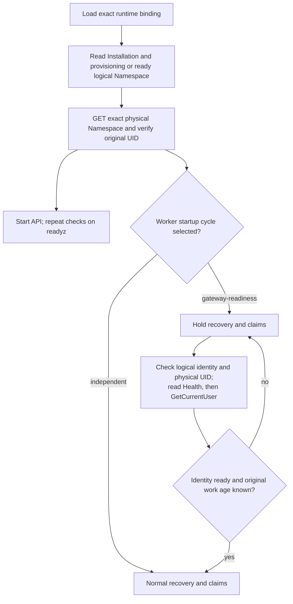

# Named workspace runtime flow

## Overview

An operator starts the API against an already bootstrapped Installation and an
independently prepared physical Kubernetes Namespace. This runtime-only path
asserts their identities; it does not initialize the database or adopt resources.
The [named workspace settings](../reference/settings/named-workspace.md) own the
supported inputs and deployment restrictions.

## Entry Points

- `apps/controller/src/composition/installation-config.ts:loadInstallationConfiguration`
  consumes `OCC_NAMED_WORKSPACE` from the runtime Helm Deployment.
- `apps/controller/src/composition/production.ts:composeProduction` binds the API.
- `apps/controller/src/worker.ts:ControllerWorker.start` starts an optional worker.

The database contains the original Installation and an owned `provisioning` or `ready` logical
Namespace. The operator supplies its exact IDs and original physical UID. The
initial runtime profile has one Recreate API and zero workers. Effective Kubernetes
permissions and isolation require separate operator verification.

## Flow

## Execution Trace

### 1. Select the runtime binding

`apps/controller/src/composition/named-workspace.ts:readNamedWorkspace` requires
exactly five fields and rejects bootstrap stage. Composition rejects coexistence
with the closed diagnostic binding and rejects repository or credential-provider
authority. The bundled OpenShell Backend can select only its Sandbox member;
there is no need to select a Credential Gateway merely to attach.

### 2. Verify existing identities

`apps/controller/src/composition/named-workspace.ts:verifyNamedWorkspace` compares
the persisted Installation ID and checks an owned `provisioning` or `ready` logical
Namespace in one read-only database transaction. Bootstrap leaves a new Namespace
`provisioning`; this check does not transition it or alter queued work.
`apps/controller/src/drivers/compute/kubernetes/index.ts:PreprovisionedKubernetesNamespace`
performs exact-name authenticated GET and verifies the original UID, ownership,
private gateway membership, restricted Pod Security and active physical lifecycle.
Configuration and Secret Drivers receive the same immutable binding. No failed
check creates, relabels or adopts a replacement Namespace.

`apps/controller/src/composition/production.ts:composeProduction` performs these
checks before serving; `/readyz` repeats them. The API therefore withdraws
readiness if the Namespace identity changes. Its read-only attachment needs no
Git credential issuer or Credential Proxy. Authentication and IAM retain their ordinary owners.

Each API replica limits `/readyz` to a burst of ten requests per direct peer IP,
refilling one request per second. Excess requests return HTTP 429 with `Retry-After`
before database, identity or Kubernetes checks. Forwarded addresses do not change
the budget. Admitted probes repeat the checks without caching readiness, and
`/healthz` remains independent of this limit. The budget permits normal kubelet
readiness probes; callers behind one proxy share a budget.

### 3. Gate only the selected startup cycle

`apps/controller/src/worker/startup-gate.ts:waitForStartupDependency` runs before
recovery or claims only when composition selects `gateway-readiness`.
`apps/controller/src/drivers/sandbox/openshell.ts:checkStartupDependency` first
reads public Health on the configured TLS gateway, then calls
`apps/controller/src/drivers/sandbox/openshell-gateway-client.ts:checkIdentity`.
This method reads `GetCurrentUser` with the same configured credentials, rereading
the bearer token file for that call. It accepts only a nonempty subject and an authenticated
provider matching the transport, as defined in the
[named workspace settings](../reference/settings/named-workspace.md).
It returns no identity or roles and creates no Workspace or provider resources.

The gate distinguishes unavailable identity, forbidden access and pending
readiness. Missing identity-read capability and permissive `local_dev` responses
keep it closed. RPCs retain deadlines and abort cancellation. The worker repeats
logical and physical identity checks before and after both gateway reads succeed.

`packages/occ/src/state/postgres-work-queue.ts:startupWorkAge` reads original
queued and claimed timestamps on the database clock. Unknown age keeps the gate
closed. Positive old age emits `work-too-old` and proceeds to the ordinary
[worker recovery and deadline rules](controller-worker.md), without resetting
attempts, age or leases. Every process restart closes the gate. Independent
profiles bypass it; this Git-disabled contract serves no broker while gated.

## Debugging and Verification

Run `node --test tests/integration/named-workspace-runtime.test.ts` with disposable
application and migration database URLs. The test exercises production API
composition, real PostgreSQL persistence, the Kubernetes SDK against a local TLS
fixture, public gRPC Health and authenticated `GetCurrentUser`.
The runtime test covers changed UID, unavailable identity, forbidden reads, bearer-file refresh,
refused permissive identities, missing RPC support, malformed identities, cancellation,
provisioning API readiness, deleting logical and terminating physical refusals,
initial work, recovery, restart, old/unknown age and an independent startup cycle.
A healthy gateway with a revoked bearer leaves both expired claimed work and fresh
queued work unchanged. Rotation of the same bearer file permits normal recovery.

Run `node --test tests/integration/named-workspace-chart.test.ts` for real Helm
install and upgrade rendering. Helm checks retain the gateway resources, narrow tenant selectors, and retain
worker Namespace GET at zero replicas without worker tenant bindings.
These fixtures do not prove a live cluster, effective RBAC, OpenShell deployment,
GitHub sign-in, browser behavior, supplier compatibility or model execution.

## Related docs

- [Named workspace settings](../reference/settings/named-workspace.md)
- [Default production startup](production-startup.md)
- [Controller worker](controller-worker.md)
- [OpenShell Backend](../reference/backends.md#openshell-gateway)

## Manual Notes

[keep this for the user to add notes. do not change between edits]

## Changelog

- 2026-10-23 15:12: Require an authenticated identity read after public Health. (named-workspace-gateway-identity-20261023 - 5c7ffab23c3a7ebbc96e81b37722ad8e634ee1da)
- 2026-10-23 01:13: Bound readiness requests before dependency checks. (named-workspace-readiness-rate-limit-20261023 - 70a74c6bb1eaba6acb7536101889cbf79b26c7ef)
- 2026-10-23 00:48: Document runtime attachment and optional worker dependency checks. (named-workspace-runtime-publication-20261023 - 9c10e6d571333c89e9206df6505fd0fbebd14247)
