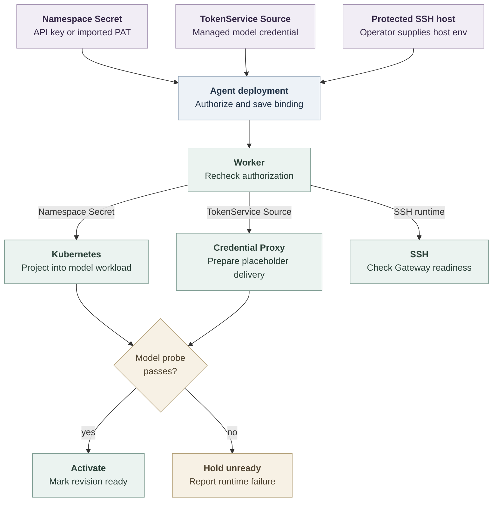

# Harness Authentication Binding Flow

## Overview

Select an OCC Secret or TokenService Credential Source through Agent `harnessAuth`.
Deployment freezes the authorized binding and the Worker rechecks it. Kubernetes
projects a direct Secret into the model-executing workload. For a managed Source,
Credential Proxy serves the admitted model requests and the Sandbox receives a
placeholder. The workload authenticates before activation. SSH `runtime` uses
operator credentials and checks Gateway readiness without model authentication.

TokenService owns Codex OAuth grants. See the [launch limits](../reference/drivers/kubernetes-compute/codex-oauth-storage.md#oauth-launch-limits).

## Entry Points

- Trigger: Agent create/PATCH with `harnessAuth`, followed by the bodyless
  exact-Agent deployment action.
- Sources: `packages/occ/src/agent-drafts.ts:createAgent`, `updateAgent`,
  and `packages/occ/src/agent-deployment-admission.ts:admitAgentDeployment`.
- Assumptions: ready Namespace at deployment, same-Namespace Secret or ready
  Source, exact actor permissions, a compatible
  configured Harness/model, and selected Compute support.

## Flow

## Execution Trace

### 1. Acquire or select one credential source

`packages/occ/src/device-authorization-flow.ts:createDeviceAuthorizationFlow` handles start, poll, and cancel.

After [device authorization](credential-source-lifecycle.md#device-authorization-and-configuration),
TokenService creates a ready Source. Console saves its `credential_source`
reference. Hosted Apps discovery resolves that Source through TokenService
after checking exact Source access. Closing the completed login session
leaves the Source available for subsequent discovery.

Console calls
`apps/controller/src/drivers/compute/model-discovery.ts:discoverHarnessModels`
without storing credentials. OpenAI API-key discovery excludes models with a
valid `shutdown_date` today or earlier in UTC; other dates and the Anthropic and
service-account catalogs remain unfiltered. Discovery does not prove a model call.

`packages/occ/src/agent-drafts.ts:createAgent`, `updateAgent`,
`packages/occ/src/harness-auth.ts:authorizeHarnessAuthSource`

Create and PATCH follow the [`harnessAuth` field semantics](../reference/agents.md#harness-authentication).
On compatible deployments, API keys and imported `codex_pat` tokens use stable
OCC Secret references and require exact Secret `operate`. Issuing a PAT for an
OCC-managed ChatGPT ServiceAccount creates a static `codex-pat` Source. Select
the issued Source by ID. OCC rejects a direct ServiceAccount binding.

The caller needs exact Source `operate`. The Source must belong to the Agent's
Namespace and the selected TokenService instance. The model Source appears in
both `harnessAuth` and `credentialSources` on direct Agent writes. Namespace
locks serialize reference changes against Source deletion.

When PATCH changes Harness authentication but keeps the source list, OCC checks
the previous Harness source without taking a source row lock. If that source
belongs to a TokenService, the caller must remove it from the list in the same
update.

The [Secret storage flow](secret-storage-and-delivery.md) owns value storage;
[account issuance](service-account-driver-credential-delivery.md) owns upstream
credentials and their private Backend binding.

### 2. Freeze the admitted source and compatibility

`packages/occ/src/agent-deployment-admission.ts:admitAgentDeployment`, `packages/occ/src/harness-auth.ts:admitHarnessAuth` and
`credentialSourceHarnessAuthSnapshot`

Deployment requires a nonnull binding, exact Agent `deploy`, and Configuration
`read`. For a Secret-backed key or PAT, OCC checks the actor's and Agent
principal's exact Secret `operate`, resolves the backend through the selected
Secret Driver, and freezes the reference and Driver identity. `runtime` needs
no source grant, lookup, or delivery metadata. SSH accepts only embedded
OpenClaw with `runtime`. Kubernetes requires dedicated Codex for a Secret-backed
PAT. Managed Codex PAT and OAuth Sources require dedicated Codex, a compatible
Sandbox, and Credential Proxy.
Unsupported combinations fail before OCC queues deployment.

For a managed TokenService Source, deployment checks the caller's and Agent principal's source `operate` grants, the approved model route, and the applicable saved or preset network grant. Supported admission saves the Source reference and separate network and injection policies in the Agent revision; see the [credential lifecycle](credential-source-lifecycle.md#2-bind-and-admit-an-agent-revision). Unsupported routes are refused before revision or work creation. If admission fails after Native IAM creates the Agent's source grant, the transaction rolls back that grant, any new Role, and its success audit. Agent save records Source references only.

Host credential changes can affect a runtime version after restart without
redeployment; see the
[SSH lifecycle](pr-24-ssh-compute.md).

The Agent revision contains references and safe internal metadata, never credential
bytes. Public serialization exposes the binding and omits backend locators and
private account ownership. Changing the draft binding affects the next explicit
deployment.

### 3. Recheck authorization before provisioning the Agent revision

`apps/controller/src/worker.ts:ControllerWorker.resolveRevisionBackend`,
`resolveRevisionSecretContext`

The Worker rechecks the original deploying actor's authorization, the Agent's
exact Secret grants, and Secret ownership against the saved revision. Revocation
or a changed owner rejects work before projection. For a managed Source, see
[Worker checks before delivery](credential-source-lifecycle.md#3-prepare-credential-delivery).
For `runtime`, only Agent/Configuration authorization runs; the dispatch context
carries only the method, and SSH neither reads the operator credential file nor
issues a model probe.

For a Secret-backed API key or PAT, the Worker resolves
backend ownership from OCC state and passes an ephemeral `ComputeRevisionContext`
without reading credential bytes or rewriting the Agent revision. Compute then reads
the canonical CP source, verifies the admitted Secret UID, and delivers the
selected fields into the DP Secret for that Agent revision.
Missing or replaced Secrets fail preparation.
Previous versions keep references without retaining their sources
indefinitely; drafts, selected versions, and pending deployments block source deletion.

### 4. Prepare and place the one credential projection

`apps/controller/src/drivers/compute/kubernetes/index.ts:prepareHarnessAuth`,
`KubernetesComputeDriver.prepareRevision`

For a TokenService Source, Compute matches the revision's model binding
against the Source, configured provider, credential environment, and Bearer
presentation. The Worker rechecks Source access and asks Credential Proxy to
prepare the placeholder. Compute never projects the Source's material into a
runtime Secret.

Compute projects the admitted Secret into the combined embedded workload as
`OPENAI_API_KEY`, `ANTHROPIC_API_KEY`, or, for explicit custom providers,
`OCE_MODEL_API_KEY`. `harnessModelAuthentication` and `requireProviderApiKeys`
require a matching provider key reference. Configuration environment and generic
Secret bindings cannot override it. All selections retain the same provider.
`harnessProbeConfiguration` preserves custom transport/model IDs and supplies a
default env SecretRef; native probe results must name `models.json` for this path,
`env` for built-ins. Dedicated Codex receives only its key or `CODEX_ACCESS_TOKEN`;
its Gateway receives neither. Initial runtime credentials supply transport/channel
groups, not model authentication.

The selected Sandbox consumes these already-rendered
`HarnessWorkloadRequirements` and selects or looks up no other credential. An
upstream runtime unable to honor genuine Secret projection fails explicitly. Network policies keep the
provider-login egress the admitted auth method requires. Gateway transport
and Kubernetes workload identity credentials stay separate.

### 5. Authenticate during runtime startup

`apps/controller/src/drivers/compute/kubernetes/runtime-entrypoints.ts:AGENT_RUNTIME_ENTRYPOINT`,
`GATEWAY_RUNTIME_ENTRYPOINT`

Codex consumes an explicit `CODEX_LOGIN_MODE`. API-key login receives the key
through stdin. A Secret-backed PAT uses `codex_pat` and `--with-access-token`.
For a managed `codex-pat` Source, the launcher writes the placeholder to the PAT
auth file and runs `codex login status`. Credential Proxy supplies the real PAT
for the [admitted native requests](../reference/credential-sources/managed-static.md#codex-pat).
Native whoami validates and hydrates identity from the token without a runtime
workspace override. The launcher removes credential environment variables before
the model probe and app-server start. Missing or conflicting
inputs, failed login, or a failed primary-model probe
(under the restricted [probe policy](../reference/harness-execution.md#harness-authentication))
prevent app-server startup and readiness. API-key and service-account login
state remains in the temporary home. Its volume has a `1Gi` size limit.
Managed Codex OAuth startup writes
placeholder-only auth state (step 6).

The dedicated wrapper retains `APP_SERVER_TOKEN` for local plugin
authentication (with plugin status enabled, deriving it from the Agent revision
and startup identity) but omits it from the `codex login` and `codex app-server`
environments; the listener receives the current token's SHA-256
digest. The token remains in the Pod; filtering child environments does not
isolate same-UID processes.

`startAuthenticatedCodex` gives `probeCodexAuthentication` at most two
attempts within one monotonic 61-second budget. Only a subprocess `ETIMEDOUT`
schedules the second, after a one-second timer, timed out at the smaller of
30 seconds and the remaining budget; an unexplained `SIGKILL` is nonretryable.

Embedded OpenClaw consumes the selected provider's native API key and runs one native
primary-model probe during actual gateway startup, with tools and fallback
disabled; its 256-token output cap lets reasoning models answer within the
15-second timeout. Initial and replacement deployments use the same path; their `Recreate`
activation can stop the serving gateway before the new
process validates credentials, so a failure leaves the Agent unavailable until
repair and restart or a new deployment, with no automatic rollback.

Both runtimes capture native output and hold final failures unready with a fixed
message. Codex publishes the existing runtime failure only after retry exhaustion or a
nonretryable result. Readiness polling does not repeat
provider calls. A restart or deployment starts a new check with the same timeout. Probes may
incur usage charges.

After readiness, the [activation and recovery flow](harness-execution-topology.md#3-publish-safely-and-complete-activation-once)
completes activation.
Updating a Secret leaves existing process environments and DP runtime copies
unchanged until preparation: deploy each consumer, verify a real turn, then
revoke the previous key upstream. Version history cannot restore historical
Secret values.

### 6. Start Codex with a managed OAuth Source

`apps/controller/src/drivers/compute/kubernetes/index.ts`,
`apps/controller/src/drivers/compute/kubernetes/runtime-entrypoints.ts`

Compute matches the admitted model projection to `harnessAuth.sourceId`.
The launcher receives a placeholder and trusted account metadata. It writes
temporary `chatgptAuthTokens` state without a refresh token and runs the
native model probe before app-server startup. TokenService retains and renews
the grant, and Credential Proxy substitutes the access token only for the
admitted requests. Recovery requires an authorized model binding. See
[credential withdrawal](../reference/credential-sources/withdrawal.md).

## Debugging and Verification

- The [Agent credential-binding PostgreSQL test](../../tests/integration/postgres-staged-agent-credential-binding.test.ts)
  exercises Fastify, PostgreSQL, Native IAM, and the concrete TokenService and
  Secret Drivers. It checks exact draft authorization, partial PATCH behavior,
  deployment refusal without revision or work, and detach after owner loss. The
  Kubernetes API transport is simulated; this does not prove runtime delivery.
- `node --test tests/conformance/plugin-compute.test.ts` checks the filtered
  Codex child environments, startup-derived listener hash, and retained wrapper
  token. The runtime-image startup test checks the native Codex shell without a
  provider turn.
- [Container launcher tests](../testing/docker.md#verify-codex-startup-probe-recovery)
  run the generated launcher against a fixture CLI, proving recovery control
  flow, not provider acceptance. Inspect allowlisted `codex.model_probe` logs
  (no raw output) for attempt and final-code evidence.

- `node --test tests/integration/harness-topology-k3d-real.test.mjs` with
  `OCC_TEST_HARNESS_K3D_REAL=1` exercises the API binding/deploy path with
  disposable Kubernetes/PostgreSQL, genuine images, and an authorized API key,
  requiring a provider-backed turn from both dedicated Codex and embedded OpenClaw.
- [Service-account coverage](../testing/slack.md#service-account-coverage) checks
  lifecycle, API, and persistence behavior. It does not prove live provider
  credential revocation or model turns.
- Verify Secret projections only on intended consumers, source-deletion guards,
  Agent revision metadata, dispatch denial after revoked grants, and failed
  auth preventing readiness. Use synthetic sentinels for serialized resources,
  logs, and audit disclosure checks; never print live credentials.
- [OpenShell testing](../testing/openshell.md) distinguishes explicit unsupported
  projection failure from genuine Secret delivery and model execution. A test-only
  bridge cannot establish production Sandbox support.

## Related docs

- [Agent harness authentication](../reference/agents.md#harness-authentication)
- [Credential renewal and revocation](../guides/deploy/credential-lifecycle.md)
- [Service Account Driver credential delivery flow](service-account-driver-credential-delivery.md)
- [Secret storage and gateway delivery flow](secret-storage-and-delivery.md)
- [Harness execution topology flow](harness-execution-topology.md)

## Manual Notes

[keep this for the user to add notes. do not change between edits]

## Changelog

- 2026-11-22 10:23: Describe managed Source deployment through credential admission. (authoring-run/65ea33a1-3a10-4bd1-b35f-421997b57a4e - 6747afc21)

- 2026-11-21 11:45: Preserve the extracted Agent flow and public Source enrollment link. (authoring-run/16cfa409-7c14-4f52-9167-3e897f919125 - 7533013d1061c433e27883818cf69f955239c43f)

- 2026-11-20 19:04: Refresh sources. (authoring-run/8a8bde8b-71de-4de5-80bf-e32f0e335c34 - 220f62d86ceb3dfc6f66dbee7c6f86cda50e5d05)
- 2026-11-20 16:54: Point to Agent draft operations. (authoring-run/1d1eaa12-f12f-4086-bf6e-c99b882c7f39 - 193c5644e642321ea5c5f626cdf1d49729637cab)

- 2026-11-20 16:33: Point Harness binding and snapshot checks to their source module. (authoring-run/5406c3c6-28fa-42a9-a7a7-4afa642738f1 - 56b116735a3a38a48eff35bf36152d3032b1d7d3)

- 2026-11-20 16:18: Update source pointers for the device login workflow. (authoring-run/6b146686-4bcb-4c54-9b42-4c9f0f8e7a15 - c77f4a6376b5412d0544e7dc69194877d755e2f7)

- 2026-11-20 16:18: Link public TokenService Source enrollment and preserve the staged delivery limit. (authoring-run/9bb61048-2680-4355-9169-bd7a6dd316af - 27b47ccbf7223c303b844af151c9712082380919)

- 2026-11-20 06:28: Trace retained Harness source checks and failed deploy grant rollback. (authoring-run/a5334b64-f17c-4030-bf48-74ef016aa7cd - 0d220dfad528032b978eaa8e9cb55885686add44)

- 2026-11-20 04:36: Document internal TokenService draft admission and deployment refusal. (authoring-run/bee5b125-46e3-42d4-b88e-01e64e7960c1 - 16c120736)

- 2026-11-17 19:24: Correct device-login state ownership and polling. (authoring-run/a1a47d55-3248-4349-81a2-ca786027b634 - c5ddcd80cb4cfcd0b969a52ef5c4cafff552a8e8)

- 2026-10-30 07:41: Check the recorded Credential Gateway before catalog lookup in the accompanying Compute fix. (authoring-run/ea326acd-648d-4ca4-a2c6-afdd4cb4771e - 429951edfc002c1c6ef98970696e655e03ba3ec7)

- 2026-10-26 06:25: Document embedded custom-provider Secret projection and isolated probe binding in the accompanying implementation. (authoring-run/dc3e84d5-d5f9-44fa-870c-a8497b2c5379 - 835094105cb0feba10ab0f82243bd6fe7e146931)

- 2026-10-16 01:36: Keep external OAuth custody while integrating current Sandbox policy. (authoring-run/3cfe533a-7ff7-4f25-ba91-7a0fc8bc35b6 - 5af46154157b7da222e2dd9839fd1bcb741c3056)

- 2026-10-14 21:28: Hold missing externally managed Codex authentication after a Sandbox restart in the accompanying fix. (authoring-run/62007ef0-44a1-467c-b24d-a61d42878897 - d4f744719e6e0b3bcb25f33bc13acf4aa81088ad)

- 2026-10-13 09:37: Reconcile current admission and lifecycle behavior with external OAuth custody in the accompanying merge. (authoring-run/fd902939-ed58-4508-8d33-95a863d966af - e8d39978d801e7a5a8ac7242f32035f426da94e1)

- 2026-10-12 11:55: Retire owned Deployment writers before Jobs and persist bounded failure evidence before resumable cleanup. (authoring-run/adccd418-cf61-4fbb-b3ba-0fcad194d907 - 040e7498ecd89e0e565af71f234776ecfaad2186)

[Harness Authentication Binding documentation history](native-service-account-credential-delivery/history.md) preserves the older dated entries.
