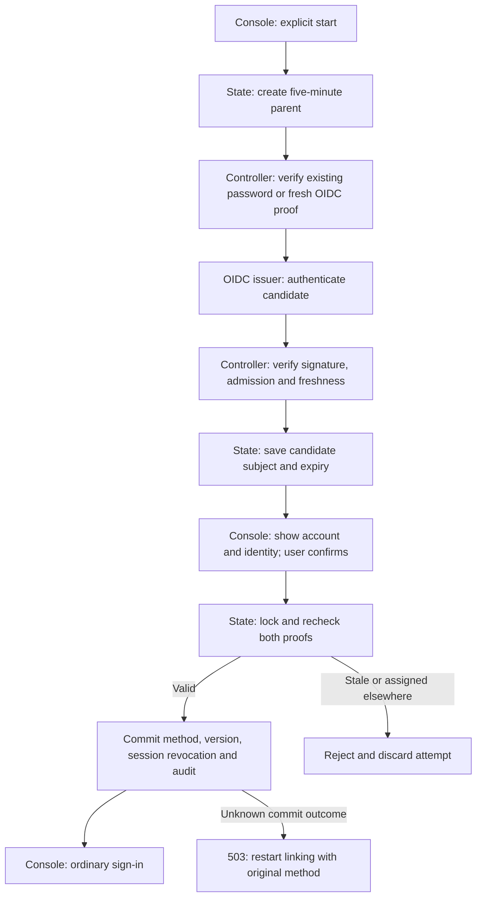

# OIDC account linking flow

## Overview

A user starts account linking from the Console sign-in page. The controller
collects fresh proof of an existing account and a candidate OIDC identity.
PostgreSQL commits attachment only after explicit confirmation. This flow ends
at the ordinary sign-in page; [human authentication](local-password-authentication.md)
owns subsequent session issuance.

## Entry Points

- `apps/controller/src/console/console.mts:showAccountLink` renders the public flow.
- `apps/controller/src/auth/index.ts:oidcLink` enforces the exact browser origin
  and sends each action to the private authentication endpoint.
- `apps/controller/src/auth/human-login.ts:createHumanLogin` binds the browser
  cookie, configured provider and policy to the State-owned parent attempt.

## Flow

## Execution Trace

### 1. Start a browser-bound attempt

`apps/controller/src/auth/human-login.ts:createHumanLogin` creates a random
host-only HttpOnly cookie. `packages/occ/src/state/human-authentication.ts:startLink`
stores its digest, a policy digest, the provider and a database-clock expiry.
It cancels the browser's previous parent. `reserveAttempt` serializes capacity
and expiry cleanup across controllers for both parent and provider attempts.

### 2. Prove the existing account

`apps/controller/src/auth/index.ts:signInEmail` reuses password admission for the
linking password route. The private `/oce/link/password` endpoint uses the same `verifyPassword` function
as password sign-in, then calls `proveLinkOwner` without session creation.
`linkOwner` accepts typed proof fields and rechecks the account and method
versions after password verification.

For external proof, `externalProviderEndpoints` starts a one-use OIDC child
with purpose `owner`. It adds `max_age=0`. The callback consumes the child,
checks the same parent cookie and policy, then calls
`apps/controller/src/auth/oidc.ts:exchangeOidcSubject` with the challenge time.
`apps/controller/src/auth/id-token.ts:verifyIdToken` requires signed, fresh
`auth_time` and `iat` in addition to normal token validation. Only an already
attached, enabled identity can become the owner proof.

### 3. Prove and confirm the candidate

A child with purpose `candidate` uses the same validation and saves the exact
provider subject through `proveLinkCandidate`. This branch never calls account
or Group enrollment. `readLink` supplies the account and candidate for review.

`packages/occ/src/state/human-authentication.ts:confirmLink` locks the parent,
account and original proof method. It checks expiry, versions, provider policy
and any recovery-only restriction. `insertExternal` uses the existing unique
provider/subject constraint to prevent identity transfer. The same transaction
increments the account version, removes sessions and appends the attachment
audit, then consumes the parent. A fresh same-account attachment is a no-op.
The controller clears cookies only after confirmed commit; it issues no session.

### 4. Handle refusal or uncertain completion

`apps/controller/src/auth/human-login.ts:linkOperation` discards a parent after a
known proof or state refusal. Parent deletion cascades to its children.
Cancellation and sign-out also delete the parent. Expiry and policy mismatch
prevent later use. Unknown database errors remain dependency failures; the
controller does not retry or compensate. The Console directs the user to start
again with the original method.

## Debugging and Verification

Run `node --test tests/integration/postgres-oidc-account-linking.test.ts` with
the [PostgreSQL prerequisites](../testing/postgresql.md). It uses production
HTTP, State and IAM with fixture issuer responses. It covers concurrent
confirmation, freshness rejection, revocation, audit rollback and actual loss
of a COMMIT response. It does not qualify an upstream provider.

The `oidc-agent-chat` QA scenario uses real Keycloak and Console linking before
Agent creation and model chat. Requested GitHub proof also needs a qualified
GitHub-backed broker and a recorded browser interaction.

## Related docs

- [Account-linking contract](../reference/authentication/account-linking.md)
- [OIDC setup](../guides/deploy/oidc-sign-in.md)
- [Human authentication](local-password-authentication.md)
- [RFC-0033](../../specs/rfcs/0033-oidc-account-linking.md)

## Manual Notes

## Changelog

- 2026-11-10 07:58: Trace separate password-proof handlers and typed ownership validation. (authoring-run/f3659272-3f8b-41a1-9379-658381bb9679 - 3363c1577c8ef6aabbe8a0725f73477406ac455e)

- 2026-11-10 00:18: Trace the accompanying account-linking implementation. (authoring-run/44b77125-b2cd-40e8-b132-d912d3933ed7 - a0730c3bed16459143ade3c97d706cdf65602ae8)
