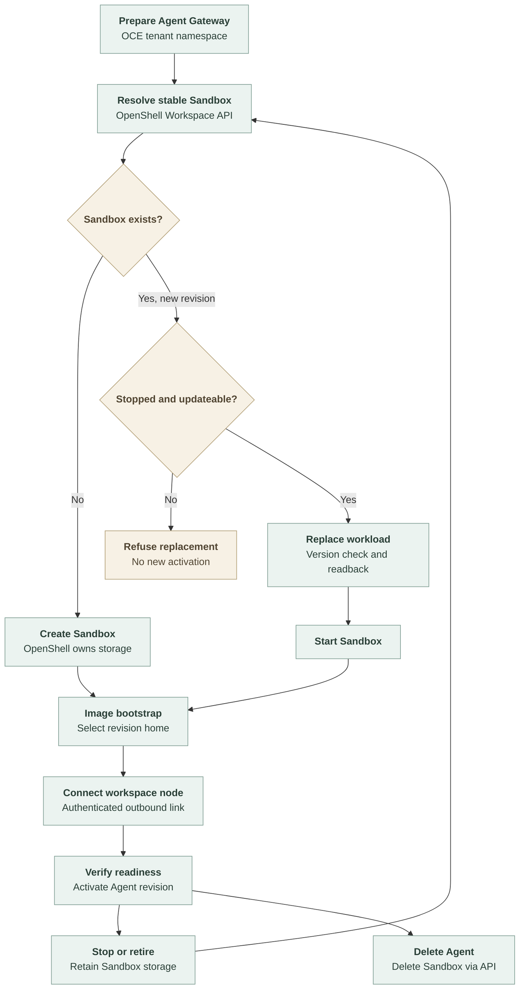

# Managed OpenShell workload flow

## Overview

The Kubernetes Compute Driver selects an internal managed OpenShell runtime
that keeps one Sandbox per Agent across revisions. An Agent deployment triggers shared Kubernetes Gateway
preparation and OpenShell workload reconciliation. OpenShell owns Harness storage
in a managed namespace; OCE manages Gateway resources in its tenant namespace.
This trace covers implemented prototype code, not verified cluster behavior.

## Entry Points

- `apps/controller/src/composition/installation-config.ts:loadInstallationConfiguration`
  constructs one Kubernetes Compute Driver and the selected Sandbox collaborator.
  Native, operator and managed execution all retain `occ/kubernetes` and the
  configured Compute ID. Managed mode requires `managedOpenShell` settings;
  native and operator selections reject that block.
- `apps/controller/src/drivers/compute/kubernetes/index.ts:prepareRevision`
  receives the authorized Agent revision and prepares the Gateway.
- `apps/controller/src/drivers/sandbox/openshell/managed.ts:reconcileHarness`
  creates or updates the Agent's Sandbox through its Backend.

Assumptions: one worker, dedicated Harness, managed OpenShell Workspaces and the
upstream `SandboxUpdates.UpdateSandbox` RPC, enabled in the OpenShell gateway.
See [configuration and limits](../reference/drivers/kubernetes-openshell-compute.md).

## Flow

The same revision can be adopted after a lost response. The diagram omits that
retry edge. A failed update readback does not reach `StartSandbox`.

## Execution Trace

### 1. Prepare the Workspace and Gateway

`OpenShellSandboxDriver` declares Dedicated OpenClaw available in managed mode
without requiring `kubernetes.userNamespaces: false`. Managed reconciliation
bypasses `prepareNativeWorkspace`; the image bootstrap prepares retained
directories inside the Sandbox. The operator-mode availability checks still apply
to its temporary Kubernetes preparation Deployment.

`apps/controller/src/drivers/sandbox/openshell/managed.ts:ensureNamespace`
creates or verifies the owned logical
Workspace through OpenShell. It applies no Kubernetes resources there.
`KubernetesComputeDriver.prepareRevision` retains Gateway and credential
orchestration. `apps/controller/src/drivers/compute/kubernetes/harness/runtime.ts:createHarnessRuntime`
constructs `KubernetesHarnessRuntime` for native workloads,
`SandboxHarnessRuntime` for operator OpenShell or external provisioning Sandboxes,
and `ManagedOpenShellHarnessRuntime` for managed OpenShell. Non-provisioning
Sandboxes retain their cleanup hooks with Kubernetes-owned workloads.
`KubernetesComputeDriver.admitRevision` records managed storage in the existing
private `compute.admission` value while preserving any protected-execution launch
fact. `validateHarnessStorage` compares that saved mode with the current
Installation before preparation, activation, stop or retirement can touch resources.
A mismatch fails the operation. The worker therefore cannot finish stopping an
old revision under a new storage mode and then prepare its replacement. This also
applies when both modes use the same Compute and Sandbox IDs. Restoring the original
Installation allows operations on the stored revisions again.
`harnessForRevision` validates the saved Sandbox ID before selecting a runtime.
The runtime's workspace owner omits Harness PVC operations for provider storage.

`KubernetesComputeDriver.harnessLaunch` builds command, environment, identity and
retained-directory requirements from prepared Agent inputs. `harnessLaunchWithNode`
adds node startup and retained identity when enrollment is selected. Kubernetes
uses this description for its container and mounts. `sandboxRequirements` passes
logical directories and an empty `workspaceMounts` list to managed OpenShell;
provider preparation and activation do not render a Harness Deployment.
For dedicated OpenClaw with Google Workspace enabled, the launch environment
includes the pinned Google release digest. Both Kubernetes Pods and OpenShell
Sandboxes receive it through this shared description.

`ManagedOpenShellSandbox.harnessSpec` maps named directories to image-bootstrap
inputs. Explicit directory environment bindings select workspace and node-state
paths; an unrelated variable with the same value does not select retained state.
The shared `OpenShellSandboxDriver.harnessSpecForLayout` adds process, network and
Provider settings without constructing operator PVCs. The managed implementation
supplies its own filesystem and runtime-class/resource configuration.

### 2. Reconcile a stopped workload

`ManagedOpenShellSandbox.ensureRuntimeProvider` uses an Agent-derived Provider
name. A new revision replaces its material only while the Sandbox is stopped.
Same-revision retries permit the existing restricted setup-envelope renewal.
Credential updates precede a fresh Provider read and version-checked config write.
The config write patches only changed fields. Unchanged empty values, including
`node_ca_pem` without a CA, remain stored: sending an empty update would request
deletion and the Gateway client refuses it.

`reconcileHarness` verifies Namespace and Agent ownership, then requires stopped
state before changing the revision. It rejects unsupported immutable differences,
sends `SandboxUpdates.UpdateSandbox` with the observed resource version and reads
back the complete specification. Only a matching result can start. The client
uses the separate service path in `openshell-gateway-client.ts:updateSandbox`.

Before restarting a native OpenClaw Sandbox whose new revision has not enrolled,
`reconcileHarness` restores a missing startup exposure through `ExposeService`.
It reads back the exact port and bearer-passthrough authorization before start.
An incorrect or missing endpoint leaves the Sandbox stopped. After a lost
exposure response, a retry adopts the stored endpoint. Once the new revision
enrolls, the existing withdrawal path deletes the exposure again. Codex retains
its service for the app-server transport.

### 3. Select storage paths and connect the node

`ManagedOpenShellSandbox.harnessSpec` places OpenClaw's `NODE_COMPILE_CACHE` at
`/sandbox/oce/node-compile-cache`. Node initializes this cache before the
bootstrap runs, so its path must not pass through the runtime selector symlink.
Bootstrap includes the cache among its process-owned private directories.

`deploy/runtime/openshell-bootstrap.cjs:prepareManaged` creates process-owned
retained directories and a revision home before the Harness loader runs. It
validates existing paths, creates home-relative links and atomically replaces
the runtime selector symlink. Old homes remain until Agent deletion.

`KubernetesComputeDriver.workspaceNodePeers` pairs the managed namespace labels
with the gateway-issued Sandbox supervisor ID. `providerHarnessReady` reads
OpenShell lifecycle state. Existing transport and node-enrollment checks still
gate activation.

After reconciliation, `OpenShellSandboxDriver.provisionHarness` verifies any
selected plugin request guard before workspace initialization.
`OpenShellSandboxDriver.initializeWorkspace` waits for supervisor readiness,
then verifies the setup Secret's Namespace, Agent and setup identifiers in OCE's
tenant namespace. `ManagedOpenShellSandbox.workspaceInitializationPath` selects
`/sandbox/oce/workspace` without requiring a PVC mount. The initializer uses the
bootstrap's selected revision home through `/sandbox/.openclaw-runtime/home`.
Operator mode still requires an approved PVC mount. Both paths deliver the
payload through authenticated `ExecSandbox` stdin, including completed setup
records on retries and later revisions. See
[workspace initialization](workspace-files.md#2-deployment-initializes-storage-before-execution).

### 4. Retain or delete

`apps/controller/src/drivers/sandbox/openshell/managed.ts:cleanup`
ignores retirement for an older revision after
replacement. For the current revision it calls `StopSandbox` and confirms stopped
state. It does not delete storage.

`KubernetesComputeDriver.deleteAgentRuntimeCredentials` resolves the tenant's
Kubernetes namespace name and calls `ManagedOpenShellHarnessRuntime.deleteAgent`.
It deletes the owned Sandbox and runtime Provider through OpenShell before shared
Gateway cleanup. Failure leaves final Agent deletion incomplete. Runtime stop
calls Sandbox cleanup and retains storage; final deletion alone releases it. Namespace cleanup removes
unused runtime profiles and the Workspace. No Harness PVC call is made by OCE.

#### Stop and replacement ordering

If `StopSandbox` fails, or OCE cannot confirm the stopped state, OCE ends the
replacement attempt before preparing the new workload. On retry, OCE reads the
Sandbox again: if it is stopped, replacement can proceed; otherwise OCE repeats
the stop and checks its result. Retryable failures are rescheduled within the
worker's retry and convergence limits; exhausting those limits fails deployment.

A failed call can leave the original stop running in OpenShell. The ordering
argument relies on two behaviors:

- Before OpenShell accepts the stop, cancellation removes the pending request.
- After OpenShell accepts it, the stop continues even if the caller disconnects.
  Later stops, updates and starts for that Sandbox wait until it finishes.

With one OCE worker, recovery therefore cannot start the replacement ahead of
the original stop in the tested cancellation and client-process-loss cases.
These cases do not require an OCE revision field on the stop RPC.
Provider credential updates and exposure withdrawal are outside this argument.

## Debugging and Verification

Run the [local checks and deferred cluster checklist](../testing/openshell.md#managed-compute-prototype).
A missing image bootstrap fails launch. Incorrect namespace labels block the
workspace-node connection. Unsupported or incomplete workload updates leave the
Sandbox stopped and the revision inactive. Local protocol and filesystem checks
do not establish cluster isolation or durable replacement after failures.

## Related docs

- [Prototype configuration](../reference/drivers/kubernetes-openshell-compute.md)
- [Ordinary OpenShell provisioning](openshell-sandbox-provisioning.md)

## Manual Notes

## Changelog

- 2026-11-03 19:03: Keep Node's startup compile cache outside the managed runtime selector in the accompanying fix. (authoring-run/6b5d1338-b410-4347-b988-154d7c2d9bce - 095680880b1cce7ee9cd45747561e4e569285826)

- 2026-11-03 17:21: Scope native workspace preparation restrictions to operator mode in the accompanying fix. (authoring-run/312403ae-d08f-40d0-a198-9c959ae9f4d1 - 095680880b1cce7ee9cd45747561e4e569285826)

- 2026-11-03 12:46: Record and enforce revision storage ownership before lifecycle changes. (authoring-run/873512f2-7b07-44e5-961f-063c914fb9f8 - a230df02217e438df6844c77a51dee306a045453)

- 2026-11-03 11:56: Replace the stale-stop assertion with the stop failure and replacement ordering argument. (authoring-run/873512f2-7b07-44e5-961f-063c914fb9f8 - d4caa6375d72294c401c7b2fc6dc2018f2b420f0)

- 2026-10-31 08:58: Document provider config patches and native startup exposure restoration in the accompanying fixes. (authoring-run/68462537-8da5-4e40-b1de-c17e6362abfa - 25ba1beeb75fe5d18728ec1bf6806b13bc3f5b9c)

- 2026-10-30 16:02: Document the single Kubernetes Driver and internal Harness runtimes in the accompanying refactor. (authoring-run/c24cb39c-9494-4d3c-89b4-90565284e060 - 25ba1beeb75fe5d18728ec1bf6806b13bc3f5b9c)

- 2026-10-29 19:25: Preserve the selected Google release digest in shared Harness launch inputs. (authoring-run/fb4ccb42-b336-495f-8e10-34c206f1670d - 7290420f88e1ff02de857da37f1c4c100401b5f7)

- 2026-10-23 20:15: Fix managed workspace initialization path selection. (authoring-run/4e502b3d-c986-4244-9d04-1665d6f223ac - c95d57168)

- 2026-10-23 13:17: Describe direct Harness inputs. (authoring-run/2c3f5532-2023-4496-954f-df02d9be44c1 - bd4948208)

- 2026-10-22 12:52: Trace the uncommitted managed Compute prototype. (authoring-run/614bce75-0da5-4656-b1c3-6e8fc1740729 - 0505bb60ea905e4fe011616b41e5d1dcfc369bb4)
