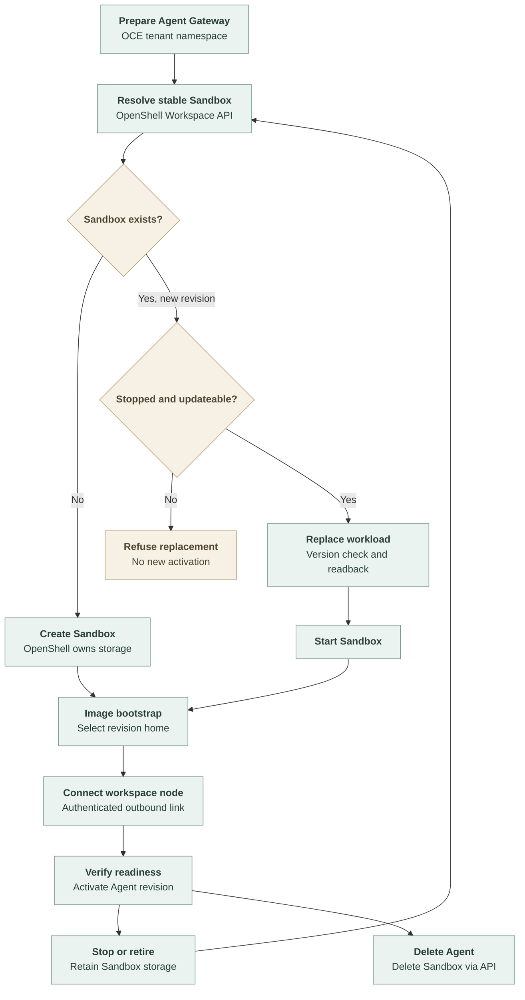

# Managed OpenShell workload flow

## Overview

Kubernetes Compute keeps one OpenShell Sandbox per Agent across revisions.
Deployment prepares the Gateway and reconciles the Sandbox workload. OpenShell
owns Harness storage; OCE manages Gateway resources in its tenant namespace.
This trace describes implementation, not cluster qualification.

## Entry Points

- `apps/controller/src/composition/installation-config.ts:loadInstallationConfiguration`
  selects managed execution from the bundled Sandbox's `integrationMode: service`.
  All Kubernetes modes retain `occ/kubernetes` and the configured Compute ID.
- `apps/controller/src/drivers/compute/kubernetes/index.ts:prepareRevision`
  receives the authorized Agent revision and prepares the Gateway.
- `apps/controller/src/drivers/sandbox/openshell/managed.ts:reconcileHarness`
  creates or updates the Agent's Sandbox through its Backend.

Assumptions: one worker, dedicated Harness, managed OpenShell Workspaces and the
upstream `SandboxUpdates.UpdateSandbox` RPC, enabled in the OpenShell gateway.
See [configuration and limits](../reference/drivers/kubernetes-openshell-compute.md).

## Flow

Retries can adopt the same revision after a lost response. Failed readback prevents start.

## Execution Trace

### 1. Prepare the Workspace and Gateway

`OpenShellSandboxDriver` declares Dedicated OpenClaw available in managed mode
without requiring `kubernetes.userNamespaces: false`. Managed reconciliation
bypasses `prepareNativeWorkspace`; the image bootstrap prepares retained
directories inside the Sandbox. The operator-mode availability checks still apply
to its temporary Kubernetes preparation Deployment.

`apps/controller/src/drivers/sandbox/openshell/managed.ts:ensureNamespace`
creates or verifies the owned logical
Workspace through OpenShell. It applies no Kubernetes resources there.
`KubernetesComputeDriver.prepareRevision` retains Gateway and credential
orchestration. `apps/controller/src/drivers/compute/kubernetes/harness/runtime.ts:createHarnessRuntime`
constructs `KubernetesHarnessRuntime` for native workloads,
`SandboxHarnessRuntime` for operator OpenShell or external provisioning Sandboxes,
and `ManagedOpenShellHarnessRuntime` for managed OpenShell. Non-provisioning
Sandboxes retain their cleanup hooks with Kubernetes-owned workloads.
The Compute constructor rejects managed execution with an execution cluster,
ServicePrincipal projection or no runtime.
`KubernetesComputeDriver.admitRevision` records managed storage in `compute.admission`
alongside protected-execution launch facts. `validateHarnessStorage` refuses
preparation, activation, stop and retirement when the Installation storage mode
differs, even with unchanged Driver IDs. Restore the original settings to resume.
`harnessForRevision` validates the saved Sandbox ID before selecting a runtime.
The runtime's workspace owner omits Harness PVC operations for provider storage.

`KubernetesComputeDriver.harnessLaunch` builds command, environment, identity and
retained-directory requirements from prepared Agent inputs. `harnessLaunchWithNode`
adds node startup and retained identity when enrollment is selected. Kubernetes
uses this description for its container and mounts. `sandboxRequirements` passes
logical directories and an empty `workspaceMounts` list to managed OpenShell;
provider preparation and activation do not render a Harness Deployment.
For dedicated OpenClaw with Google Workspace enabled, the launch environment
includes the pinned Google release digest. Both Kubernetes Pods and OpenShell
Sandboxes receive it through this shared description.

`ManagedOpenShellSandbox.harnessSpec` maps named directories to image-bootstrap
inputs. Explicit directory environment bindings select workspace and node-state
paths; an unrelated variable with the same value does not select retained state.
The shared `OpenShellSandboxDriver.harnessSpecForLayout` adds process, network and
Provider settings without constructing operator PVCs. The managed implementation
supplies its own filesystem and resource configuration.

### 2. Reconcile a stopped workload

`ManagedOpenShellSandbox.ensureRuntimeProvider` names Providers by Agent ID.
Replacement requires a stopped Sandbox; same-revision retries permit restricted
setup-envelope renewal. Credential updates precede config read and version-checked write.
The patch updates changed fields and deletes obsolete keys with empty-string
markers. It omits unchanged empty fields, including `node_ca_pem` without a CA.
Setting a desired field to empty is refused because OpenShell would delete it.
Readback must match config, profile and ownership before reconciliation continues.
Rejected or incomplete writes prevent start; retries recognize committed config
after a lost response.

`reconcileHarness` verifies Namespace and Agent ownership, then requires stopped
state before changing the revision. It rejects resource changes.
`reconcilePolicy` reads the latest stored policy separately from the creation
specification. Static policy and non-Git middleware bindings must remain unchanged.
When Provider membership differs, `reconcileHarness` clears base network rules
through `reconcilePolicy` while stopped to avoid credential-scope conflicts.
OpenShell controls Provider-contributed policy. Each policy write checks the
resource version; readback verifies policy, stopped Sandbox identity, workload
and ownership. OCE does not wait for activation while stopped.

`reconcileProviders` ignores attachment order. It verifies the intermediate policy,
then detaches obsolete Providers before attaching replacements to avoid credential
key conflicts. Each mutation checks the observed resource version; readback verifies
membership, unchanged workload/ownership and stopped Sandbox identity. Shared
Credential Source Providers survive detachment. Failed or uncertain mutations
prevent start. Retries reconcile stored membership and policy; after the last
attachment, they install the final policy. A failed final policy leaves attachments
in place without rollback or start. Unchanged membership needs only policy reconciliation.

`ManagedOpenShellSandbox.gitScopeAnnotations` fingerprints the repository Driver
and resolved bindings, excluding the session deadline. Revisions can change scope
or enable/disable Git. Before Git preparation, `retainedGitSandbox` calls
`verifyRetiredGit`: the predecessor must belong to the same Agent and Workspace,
be stopped, and have no Git middleware or revision-owned Provider. Git-free
predecessors are permitted. Preparation creates a fresh revision-owned bootstrap
Provider and middleware binding; workload readback verifies the scope annotation.

For Git-free successors, `reconcileHarness` checks retirement directly. Replacement
removes Git environment, annotations and enrollment configuration and restores the
ordinary policy. Retries verify stored workload before start. Re-enablement creates
fresh authority; late predecessor cleanup preserves the successor and fetched files.
Static policy, restart policy and non-Git middleware must remain unchanged.
`verifyGitSandbox` checks current policy separately from creation policy, plus workload
and ownership. Failed reads remain retryable; confirmed mismatches close the route.
See the [repository flow](agent-repository-credentials.md) for credential installation
and supervisor identity checks.

`OpenShellSandboxDriver.gitContinuity` checks ownership, readiness and process
identity across two reads. Git verifies Provider receipts, network and supervisor
identities against [OpenShell execution reports](../reference/repository-credentials/protected-openshell-git.md#execution-identity).
The launch fingerprint excludes OpenShell-internal annotations.

After a restart, `observeHeldPreview` requires a fresh authenticated denial before
`releasePreview` acknowledges the launcher. The original worker records release
intent before sending. Uncertain release or worker replacement requires a new
revision. Git lookup checks the same startup acknowledgment after observation.
PostgreSQL checks durable acknowledgment before credential use. Stop withdraws
the binding.

`openshell-gateway-client.ts:updateSandbox` sends the latest resource version.
The Driver verifies the workload and live policy separately before start because
the specification retains the creation policy.

`ManagedOpenShellSandbox.observeHarness` reports running only when OpenShell reports
the latest policy loaded and its active version matches. Kubernetes Compute's
`SandboxHarnessRuntime.ready` uses this observation before activation. A failed
policy load raises an error. The managed Driver records a fingerprint of the
admitted policy in the Sandbox's revision annotations. `networkPolicyBaseline`
checks the live policy against that fingerprint before a live edit or Git
continuity check. The fingerprint excludes Agent grants so OCE can replace them
independently. A Git retirement clears the stopped Sandbox's rules through a
separate path. Replacement records the successor's fingerprint before startup.

`apps/controller/src/drivers/egress-proxy/openshell.ts:loadedPolicyVersion`
requires the returned policy revision to be loaded and its version to match
OpenShell's active version. This Sandbox counter is independent of OCE's egress-plan
generation, which starts again for a new Agent revision. `wiringStatus` still
compares the complete source policy with the admitted configuration. Non-Git
enforcement evidence must report that same OpenShell version, which remains part
of the installation fingerprint. Git retains its separate Provider and execution
checks. A mismatched or unloaded version cannot enroll or revalidate an installation.

`apps/controller/src/worker.ts:retireEgressInstallation` retires the predecessor's
enrollment after Compute confirms its stop. Failed stops leave enrollment unchanged.
`recordEgressInstallation` then accepts the successor's verified receipt under the
Agent lock, provided its deployment is still eligible. PostgreSQL retains one
immutable receipt per revision and permits only one non-retired receipt per sender
and Sandbox. Retired receipts remain available for revision cleanup, but request
lookup excludes them. A delayed predecessor callback cannot reactivate its receipt;
repeated cleanup names the predecessor revision and cannot retire the successor.
Separate Sandboxes retain independent enrollments until their own retirement.

Before restarting a native OpenClaw Sandbox whose new revision has not enrolled,
`reconcileHarness` restores a missing startup exposure through `ExposeService`.
It reads back the exact port and bearer-passthrough authorization before start.
An incorrect or missing endpoint leaves the Sandbox stopped. After a lost
exposure response, a retry adopts the stored endpoint. Once the new revision
enrolls, the existing withdrawal path deletes the exposure again. Codex retains
its service for the app-server transport.

### 3. Select storage paths and connect the node

`ManagedOpenShellSandbox.harnessSpec` sets the Harness home to
`/opt/oce/managed/home` on the workload filesystem. Node initializes its compile
cache in a sibling directory before the bootstrap runs. The home and cache are
recreated when OpenShell replaces the workload.

`deploy/runtime/openshell-bootstrap.cjs:prepareManaged` creates process-owned
retained directories under `/sandbox/oce` and links the workspace, generated
images, and Codex sessions from the private home. The node state environment
variable points to its real retained directory. The bootstrap refuses existing
symlink ancestors, conflicting links, and private runtime homes left on the PVC
by earlier builds. OpenClaw checks the actual ancestry of the retained node
state directory, so the PVC permissions still gate native worker startup.

`KubernetesComputeDriver.workspaceNodeRelay` omits direct Sandbox ingress in managed
mode. `prepareWorkspaceNode` supplies the [Envoy node URL](../reference/gateway-routing.md#native-node-endpoint);
`networkPolicies` admits OCE's Envoy Pods. No OpenShell namespace or Pod labels
are resolved. Activation removes obsolete Agent policies through
`deleteUnwrittenAgentPolicies`. OpenShell lifecycle, transport and node enrollment
still gate activation.

After reconciliation, `OpenShellSandboxDriver.provisionHarness` verifies any
selected plugin request guard before workspace initialization.
`OpenShellSandboxDriver.initializeWorkspace` waits for supervisor readiness,
then verifies the setup Secret's Namespace, Agent and setup identifiers in OCE's
tenant namespace. `ManagedOpenShellSandbox.workspaceInitializationPath` selects
`/sandbox/oce/workspace` without requiring a PVC mount. The initializer uses the
bootstrap's workload home at `/opt/oce/managed/home`.
Operator mode still requires an approved PVC mount. Both paths deliver the
payload through authenticated `ExecSandbox` stdin, including completed setup
records on retries and later revisions. See
[workspace initialization](workspace-files.md#2-deployment-initializes-storage-before-execution).

### 4. Retain or delete

`apps/controller/src/drivers/sandbox/openshell/managed.ts:cleanup`
preserves a successor workload when retiring an older revision. For the current
revision it calls `StopSandbox` and confirms stopped state. It does not delete storage.

For a Git revision, `OpenShellGitRuntime.withdrawConfirmed` first blocks local use
and waits for the route store to record withdrawal. Failure prevents replacement.
After stop, `ManagedOpenShellSandbox.retireGit` removes Git middleware and clears
base network rules, then detaches the old Git Provider with readback. It deletes
only Providers and profiles marked for that revision, including artifacts left by
an interrupted attempt. Cleanup does not resolve current repository policy.
`releaseWithdrawn` releases the in-memory route while retaining its tombstone.
Late predecessor cleanup can remove its detached artifacts but cannot stop or
change the successor. The successor restores its complete policy before start.

`KubernetesComputeDriver.deleteAgentRuntimeCredentials` resolves the tenant's
Kubernetes namespace name and calls `ManagedOpenShellHarnessRuntime.deleteAgent`.
It deletes the owned Sandbox and runtime Provider through OpenShell before shared
Gateway cleanup. Failure leaves final Agent deletion incomplete. Namespace cleanup removes unused runtime profiles and the Workspace. OCE makes no Harness PVC calls.

#### Stop and replacement ordering

OCE requires a confirmed stop before replacement. A retry reads the Sandbox
and repeats the stop if needed within the worker's convergence limits.
Cancellation removes a pending stop before admission. After admission OpenShell
finishes the stop despite disconnection, serializing subsequent lifecycle calls.
This ordering covers one worker. Provider writes and exposure withdrawal need
separate verification.

## Debugging and Verification

Run the [local checks and deferred cluster checklist](../testing/openshell-managed.md).
A missing image bootstrap fails launch. An unreachable Envoy endpoint blocks the
workspace-node connection. Unsupported or incomplete workload updates leave the
Sandbox stopped and the revision inactive. Local protocol and filesystem checks
do not establish cluster isolation or durable replacement after failures.

## Related docs

- [Prototype configuration](../reference/drivers/kubernetes-openshell-compute.md)
- [Ordinary OpenShell provisioning](openshell-sandbox-provisioning.md)

## Manual Notes

## Changelog

- 2026-11-19 22:11: Isolate private homes, verify policy and fence Git recovery. (authoring-run/f0ca6751-75e0-4de4-bcdd-df016d2b4a50 - caad39a5e6b5f143628f326e5c3959b164a7caab)

- 2026-11-19 11:07: Rename selection to integrationMode, defaulting to legacy. (authoring-run/b99f4c77-4d5d-4682-8f6f-f1e82c55323d - 597acc05cdfe4be5874f3f362a77e927a0855ea6)

- 2026-11-18 22:11: Select managed execution from the Sandbox workspace mode in the accompanying change. (authoring-run/8310b556-472e-4f48-8d7d-b15a34c1b562 - 597acc05cdfe4be5874f3f362a77e927a0855ea6)

- 2026-11-18 19:26: Use Envoy ingress without OpenShell Sandbox selectors in the accompanying change. (authoring-run/f5b43850-4eb1-4d35-960f-4f4a641f5178 - 597acc05cdfe4be5874f3f362a77e927a0855ea6)

- 2026-11-18 16:51: Remove obsolete Provider config keys with readback in the accompanying fix. (authoring-run/671a44ed-6929-4d1b-b949-8fc89154ce75 - 434ca70f7e7d60769865b780096886acbfc0219c)

- 2026-11-16 19:23: Support Git enablement and disablement after verified predecessor retirement in the accompanying implementation. (authoring-run/6162dd23-33b7-482f-be88-9b54cc477da0 - 7b9261020c74d0beb64df5cf227127cb8c9b32c7)

- 2026-11-09 20:15: Retain Harness recovery and require a new revision after worker replacement in the accompanying rebase. (authoring-run/7bc6f6a8-db0f-4304-9729-3dabe2800ffd - f8a7f049153b93196473fd86b53f0f3593dde82f)

- 2026-11-09 14:46: Synchronize launcher acknowledgment across equivalent readiness observations. (authoring-run/bf495f0e-2473-4a6c-a712-b7fd8e42c0ac - 8e64932163a4fb6a78cf24bcf0bf538c9e9f9039)

- 2026-11-09 13:51: Exclude internal runtime metadata from the retained launch hash in the accompanying recovery fix. (authoring-run/32967952-c0bb-49f9-9a39-d1ee631ec86c - 8e64932163a4fb6a78cf24bcf0bf538c9e9f9039)

- 2026-11-06 23:38: Separate automatic Harness recovery from execution authorization in the accompanying change. (authoring-run/dc561fff-7187-4fb0-86c0-83cb8dbcf6ab - 8e64932163a4fb6a78cf24bcf0bf538c9e9f9039)

- 2026-11-06 21:31: Permit changed Git scope after predecessor retirement in the accompanying implementation. (authoring-run/2bf18ba3-d9f8-4c8d-81ec-6c428bc3103b - 1c0ef14084e7bbf5f316e6612e65c87202acfc13)

- 2026-11-06 20:09: Retain revision enrollment receipts and retire current Sandbox authority after confirmed runtime stop. (authoring-run/39489360-1173-4089-a7cf-81713b17e4b9 - 86a7ef632ac8b3e8e28bfd67306bf7b49ba83302)

- 2026-11-06 19:37: Separate retained Sandbox policy versions from OCE plan generations in enrollment and verification. (authoring-run/f9c72fbe-948e-4733-88e2-645e041ff678 - 86a7ef632ac8b3e8e28bfd67306bf7b49ba83302)

- 2026-11-06 16:40: Verify Git execution continuity through OpenShell APIs without Kubernetes Pod access in the accompanying implementation. (authoring-run/98f243c1-3b2b-4701-b08c-41c70e5cb06e - 86a7ef632ac8b3e8e28bfd67306bf7b49ba83302)

- 2026-11-06 16:19: Verify managed Git Provider, policy and workload identities in the accompanying fix. (authoring-run/020a2dfb-3881-495b-b205-d747747ec6fd - 86a7ef632ac8b3e8e28bfd67306bf7b49ba83302)

- 2026-11-05 16:14: Add unchanged Git revision replacement and retained-Sandbox cleanup in the accompanying implementation. (authoring-run/75184c4a-c570-4917-ad17-019697ab6fc5 - 86a7ef632ac8b3e8e28bfd67306bf7b49ba83302)

- 2026-11-05 11:08: Coordinate Provider and network policy replacement while stopped, with recovery from partially committed changes. (authoring-run/21b26bb3-10b6-4ed0-a49e-c83cf5c09bfc - e49e7078393d7685094d44a14122e8444c7ccc46)

- 2026-11-04 21:18: Reconcile network rules separately from workload updates and gate readiness on policy activation in the accompanying implementation. (authoring-run/58e6dc9e-a980-4300-94d2-c14a0300073b - 38fc75b4d6cba2096d6435c0294f213267362df1)

- 2026-11-04 19:01: Reconcile Provider attachments while stopped and verify membership before restart in the accompanying implementation. (authoring-run/fd07e061-6581-4e80-9946-e13b37bfb63b - c1a56da513af5bbd098cb06499796f365f6b3d28)

- 2026-11-03 19:03: Keep Node's startup compile cache outside the managed runtime selector in the accompanying fix. (authoring-run/6b5d1338-b410-4347-b988-154d7c2d9bce - 095680880b1cce7ee9cd45747561e4e569285826)

- 2026-11-03 17:21: Scope native workspace preparation restrictions to operator mode in the accompanying fix. (authoring-run/312403ae-d08f-40d0-a198-9c959ae9f4d1 - 095680880b1cce7ee9cd45747561e4e569285826)

- 2026-11-03 12:46: Record and enforce revision storage ownership before lifecycle changes. (authoring-run/873512f2-7b07-44e5-961f-063c914fb9f8 - a230df02217e438df6844c77a51dee306a045453)

- 2026-11-03 11:56: Replace the stale-stop assertion with the stop failure and replacement ordering argument. (authoring-run/873512f2-7b07-44e5-961f-063c914fb9f8 - d4caa6375d72294c401c7b2fc6dc2018f2b420f0)

- 2026-10-31 08:58: Document provider config patches and native startup exposure restoration in the accompanying fixes. (authoring-run/68462537-8da5-4e40-b1de-c17e6362abfa - 25ba1beeb75fe5d18728ec1bf6806b13bc3f5b9c)

- 2026-10-30 16:02: Document the single Kubernetes Driver and internal Harness runtimes in the accompanying refactor. (authoring-run/c24cb39c-9494-4d3c-89b4-90565284e060 - 25ba1beeb75fe5d18728ec1bf6806b13bc3f5b9c)

- 2026-10-29 19:25: Preserve the selected Google release digest in shared Harness launch inputs. (authoring-run/fb4ccb42-b336-495f-8e10-34c206f1670d - 7290420f88e1ff02de857da37f1c4c100401b5f7)

- 2026-10-23 20:15: Fix managed workspace initialization path selection. (authoring-run/4e502b3d-c986-4244-9d04-1665d6f223ac - c95d57168)

- 2026-10-23 13:17: Describe direct Harness inputs. (authoring-run/2c3f5532-2023-4496-954f-df02d9be44c1 - bd4948208)

- 2026-10-22 12:52: Trace the uncommitted managed Compute prototype. (authoring-run/614bce75-0da5-4656-b1c3-6e8fc1740729 - 0505bb60ea905e4fe011616b41e5d1dcfc369bb4)
