# OpenShell Sandbox provisioning flow

## Overview

Kubernetes Compute delegates dedicated Codex and native OpenClaw Harnesses to
OpenShell. Operator mode reconciles each tenant namespace and workspace chart,
then creates or adopts its same-named Workspace. Managed mode fails before mutation.

Model credentials use a [credential source](credential-source-lifecycle.md),
without Agent Secret permission. Codex receives its verifier and runtime files;
Compute uses the advertised bearer-passthrough exposure instead of the direct
Agent Service. Drivers without endpoint support retain Kubernetes transport.

Development delivery projects expiring node setup through a revision-owned
provider file. The Harness signs its token; network policy limits enrollment
to the node executable and Agent Gateway. The Sandbox can read this token;
this is not a production credential-delivery contract.

## Entry Points

- Trigger: a worker reconciles an Agent revision that selects the OpenShell
  Sandbox Driver and Kubernetes Compute Driver.
- Source: `apps/controller/src/drivers/sandbox/openshell.ts:ensureNamespace`
- Source: `apps/controller/src/drivers/sandbox/openshell.ts:provisionHarness`
- Source: `apps/controller/src/drivers/compute/kubernetes/index.ts:prepareRevision`
- Assumptions: the Installation selected Kubernetes Compute, the OpenShell
  Sandbox, and the OpenShell Credential Gateway through one `openshell` Backend;
  the tenant Namespace and baseline isolation exist; and the Gateway is ready in
  operator workspace mode.

## Flow

```mermaid
graph TD
  A["<b>Reconcile revision</b><br/>Worker selects Drivers"] --> B["<b>Prepare Namespace</b><br/>Kubernetes isolation"]
  B --> C{"<b>Workspace mode</b><br/>Installation setting"}
  C -- "managed" --> X["<b>Reject configuration</b><br/>Before mutation"]
  C -- "operator" --> D["<b>Reconcile resources</b><br/>Labels and workspace chart"]
  D --> E["<b>Own Workspace</b><br/>Create or adopt"]
  E --> F["<b>Derive Harness</b><br/>Compute requirements"]
  F --> K0["<b>Start Agent Gateway</b><br/>Fail-closed transport"]
  K0 --> Y0{"<b>Node setup</b><br/>Material exists?"}
  Y0 -- "no" --> R0["<b>Retry preparation</b><br/>No provider or Sandbox"]
  Y0 -- "yes" --> Q["<b>Attach model source</b><br/>Credential provider"]
  Q --> G{"<b>Harness inputs valid?</b><br/>Kind and delivery"}
  G -- "no" --> R["<b>Reject provisioning</b><br/>Candidate stays inactive"]
  G -- "yes" --> W["<b>Reconcile runtime provider</b><br/>Files and literal setup"]
  W --> P{"<b>Native Harness?</b>"}
  P -- "yes" --> P0["<b>Temporary PVC preparation</b><br/>Non-root Deployment; wait for deletion"]
  P0 --> H["<b>Create Sandbox</b><br/>Providers and exposure"]
  P -- "no" --> H
  H --> V{"<b>Harness</b>"}
  V -- "Codex" --> J["<b>Resolve exposure</b><br/>Advertised WebSocket origin"]
  J --> K["<b>Replace Gateway</b><br/>Provider route and bearer token"]
  K --> M["<b>Wait for Harness</b><br/>Compute readiness"]
  V -- "OpenClaw" --> T["<b>Sandbox ready</b><br/>No inbound exposure"]
  T --> M
  M --> Y{"<b>Workspace node</b><br/>Connected?"}
  Y -- "no" --> R1["<b>Retry node</b><br/>Relaunch after process exit"]
  R1 --> Y
  Y -- "yes" --> S{"<b>Attachment status</b><br/>All ready?"}
  S -- "failed, withheld, revoked" --> R
  S -- "ready" --> Z{"<b>Active Harness</b>"}
  Z -- "Codex" --> L["<b>Run model turn</b><br/>Gateway to Codex"]
  Z -- "OpenClaw" --> U["<b>Run worker turn</b>"]
  L --> NC{"<b>Native revision?</b><br/>Revision cleanup"}
  U --> NC
  P0 -- "interrupted; retire" --> NC
  NC -- "yes" --> PC["<b>Delete owned preparer</b><br/>Wait for Deployment and Pods"]
  PC --> N["<b>Delete Sandbox</b>"]
  NC -- "no" --> N
  N --> RP["<b>Delete runtime provider</b>"]
  RP --> O["<b>Delete Workspace</b><br/>Namespace cleanup"]
  O --> P["<b>Delete Namespace</b><br/>Compute cleanup"]

  classDef state fill:#EDF2F7,stroke:#879AB0,color:#25364A,stroke-width:1px
  classDef operation fill:#EBF3F0,stroke:#7F9D93,color:#2B4038,stroke-width:1px
  classDef gate fill:#F7F1E5,stroke:#B3A078,color:#514532,stroke-width:1px
  classDef blocked fill:#F3F4F6,stroke:#98A2AE,color:#44505F,stroke-width:1px
  class A,B,F state
  class D,E,Q,W,H,J,K,L,M,N,O,P,PC,R1,T,U operation
  class C,G,NC,NH,S,V,Y,Y0,Z gate
  class X,R,R0 blocked
  linkStyle default stroke:#8B949E,stroke-width:1px
```

## Execution Trace

### 0. Create the development control plane

`scripts/dev-up`, `internal/occdev/openshell_k3d.go:upK3d`,
`internal/occdev/openshell.go:prepareOpenShell`,
`internal/occdev/kubernetes.go:writeInstallation`

The written Installation declares the `openshell` Backend, Gateway endpoint,
Sandbox and a Credential Gateway whose `binaries` list holds native Codex for
x64 and ARM64 runtimes, whatever the launcher host. Credential-source profiles,
not Sandbox policy, govern egress.

`scripts/dev-up` validates Kubernetes/OpenShell and invokes `occ dev up`.
Compose is default; `OCC_DEVELOPMENT_CONTROL_PLANE=kubernetes` selects
Kubernetes-only. Before state creation, Kubernetes-only rejects API-port
collisions and records engine, cluster, namespace, port and key destination.
Both verify the pinned archive, package charts and import digest-pinned
Gateway/Sandbox/supervisor images. Kubernetes-only builds or selects controller/runtime images, imports them
with PostgreSQL and resolves in-cluster digests.

After Agent Sandbox rollout failure, `prepareOpenShell` calls
`internal/occdev/agent_sandbox_rollout_diagnostics.go:captureAgentSandboxRollout`
once before returning the original error for rollback. Synchronous capture
selects the fixed Deployment, controller-UID-linked ReplicaSets/Pods and associated Warning
reasons. It excludes messages, environment, full labels and logs, and marks
unavailable, malformed or oversized results.

Capture gets a fresh 15-second context, three-second request/command timeouts,
256 KiB/command and a 32 KiB record cap. Direct commands are awaited; 200 ms pipe
draining does not terminate arbitrary descendants. Error-output writes ignore
failures; writer latency/durability are outside the subprocess budget. Capture
neither retries nor diagnoses the failure.

After Helm, `network.providerHarness` records Gateway
ClusterIP, Pod selector and TCP/8080. The Agent Gateway aliases only the advertised hostname to that IP, preserving
HTTP Host for routing. NetworkPolicy lets it reach only those Pods/port.

Compose runs PostgreSQL, OCC and its k3d-targeting worker; Kubernetes-only uses
`oce-system` and in-cluster authentication. Both install private Envoy routing
and operator Workspaces, limiting Gateway access to API, worker, supervisor
callbacks and dedicated Agent Gateways. See
[local deployment guides](../guides/deploy/local-kubernetes-development.md).

Cleanup validates recorded engine/state before deleting the named cluster and
Compose project/volumes; partial cleanup retains recovery state.

### 1. Prepare the Namespace and OpenShell Workspace

`apps/controller/src/drivers/compute/kubernetes/index.ts:ensureNamespace`

Compute establishes quota, limits and baseline NetworkPolicies before
`SandboxDriver.ensureNamespace`. Managed mode rejects before Kubernetes or
Gateway use. Operator mode applies namespace labels, workspace-chart resources
and provider NetworkPolicies, then checks health; optional namespace-local
readiness comes first. Development uses the central Gateway endpoint.

`apps/controller/src/backends/openshell.ts:clientForNamespace` passes raw
endpoints, including bracketed IPv6, unchanged to the gRPC client. HTTP
origins keep port 80 explicit; HTTPS and nondefault ports retain their behavior.

The Driver uses Compute's physical namespace name for the Workspace. It reads
it, creates it if missing, or rereads after concurrent `ALREADY_EXISTS`.
Adoption requires its expected name, OCC Namespace ID label, managed-by label
and active phase; conflicts fail Namespace preparation. Compute's `oce-` plus
15-character digest fits OpenShell's 19-character limit.

### 2. Derive the provider-owned Harness request

`apps/controller/src/drivers/compute/kubernetes/index.ts:prepareRevision`

Compute derives `provisionHarness` inputs from the regular Kubernetes Deployment:
image, command, labels, environment, mounts, optional identity, and resources.
It starts the first Agent Gateway with fail-closed transport and the direct
Service inactive. Until that Gateway is ready and its Agent-owned setup Secret
exists, readiness remains incomplete: no credential attachment, runtime provider,
or Sandbox is created. Compute then passes the setup Secret reference to the Driver.
The local OpenShell profile disables projected workload identity. If it is
enabled, OpenShell rejects the revision before Gateway mutation because the
pinned API cannot preserve the exact Agent ServiceAccount and token.
For a `credential_source` revision it renders only `CODEX_LOGIN_MODE=api_key`,
no model Secret, and calls `CredentialGatewayDriver.attachForRevision`. The
attachments, one provider name per source, go into
`requirements.credentialAttachments`. Compute passes those requirements and the
immutable revision to OpenShell instead of creating the Deployment itself.
For Codex, it reads the exact Agent transport Secret in the control plane and
adds only its SHA-256 verifier as `APP_TOKEN_SHA`. It turns the admitted
plugin-runtime snapshot into `runtime.json` and `config.toml` workload-file
requirements and removes their ConfigMap paths from the remaining environment.

### 3. Validate and serialize the Sandbox

`apps/controller/src/drivers/sandbox/openshell.ts:provisionHarness`

OpenShell accepts only dedicated Codex or OpenClaw revisions pinned to the
selected Driver. It serializes Kubernetes, filesystem, process, and
binary-scoped network policy against the exact `v0.1.3-pre.2` wire contract.
Landlock is a hard requirement; unsupported enum spellings, inherited object
keys, the old `passthrough` TLS spelling, or policies without executable paths
fail before launch. Gateway readiness requires positive `timeoutMs`. Startup
logs `startup-error` code `STARTUP_FAILED`, does not name that field, and stops
before Kubernetes calls. The Installation loader reports that the timeout must
be a positive safe integer. Duplicate names and reserved
`workspace-node-enrollment` fail before the Driver is built. Rename; keep
binaries and endpoints.

Kubernetes Compute invokes `provisionHarness` only after the workspace-node
setup Secret exists. The Driver creates or adopts the runtime provider with the
final node envelope, never an empty placeholder. A later renewal version-fences
`UpdateProvider` to `node_setup_json` only. A configured post-create delay waits
until the canonical process listens. Compute then rolls the Gateway and waits
for that Deployment before observing workspace-node enrollment.
Codex requires one lowercase `APP_TOKEN_SHA`, no raw `APP_SERVER_TOKEN`, and two
bounded plugin-free runtime files. Native OpenClaw rejects plugin-runtime files
and retains its admitted literal inference config. Other Secret-backed
environment and projected workload identity fail closed.

The Driver creates or adopts a revision-owned provider from
`oce-codex-runtime` or `oce-openclaw-runtime`. Codex projects its runtime files;
both project node setup and the public CA read-only. The Driver checks the setup
Secret's Agent ownership and bounded, live envelope. Model credentials remain
in the Credential Gateway;
attachments must use unique OCC `oce-cs-` provider names.

A renewed setup changes only `node_setup_json` through a version-fenced update.
The expired prior envelope requires a later live expiry and unchanged endpoint,
TLS fingerprint, static config, and ownership. Drift fails before Sandbox creation. Binary-scoped policy admits enrollment only to the
Gateway endpoint from `/usr/local/bin/node`; model injection allows the native
Codex executable or Node for native OpenClaw.

Revision-private runtime storage mounts at `/sandbox/.openclaw-runtime`, with
persistent subpaths below `/sandbox/.openclaw-mounts`. Admitted `/home/node`
paths move beneath the runtime home, declared as `harnessHome` for native hook
credentials. Codex hooks trust the provider-file Gateway CA and require an
in-cluster routing hostname or two clusters. Chmod-sensitive paths such as
`OPENCLAW_NODE_STATE_DIR` address process-created `state` children, avoiding
symlink ancestors and root-owned mount roots.
`apps/controller/src/drivers/compute/kubernetes/runtime-entrypoints.ts:NATIVE_WORKER_ENTRYPOINT`
reads setup and CA into its private connect target. It starts a private readiness
listener only when Compute supplies its status port; provider-owned Harnesses
omit that port and use outbound node enrollment readiness. `sandboxCommand` gives the
native process writable temporary storage, preserving the supervisor's `/tmp`.
Restarts reread setup and reuse device identity.

Codex's optional delay lets its listener start before Compute rolls the Gateway
to that endpoint and waits for the exact Deployment. Native OpenClaw has no inbound service or Harness endpoint. Compute skips
transport observation and provider routing, retaining supervisor-to-Gateway enrollment policies.

`openshell.ts:prepareNativeWorkspace` temporarily prepares native PVC subpaths
through a non-root Deployment. It rejects symlink ancestors and incomplete
recovery, verifies UID ownership and `0700`, then waits for Deployment and Pod deletion.
Remove it if OpenShell adds private subpath preparation and OCE adopts it.

### 4. Call the versioned gateway contract

`apps/controller/src/drivers/sandbox/openshell-gateway-client.ts:createSandbox`

The client sends the Sandbox identity, spec, Namespace Workspace scope, and a
`request_id`: the revision UUID first. OpenShell keeps a `request_id` whose create
errored server-side unresolved forever, so when the Gateway refuses one
(`REQUEST_OUTCOME_UNCERTAIN`, `REQUEST_ID_PAYLOAD_MISMATCH`, or
`REQUEST_REPLAY_UNAVAILABLE`) and `getSandbox` finds no Sandbox, the Driver tries
the next of 16 IDs: the revision UUID, then 15 derived from it. Each failing pass
spends one ID; the Workspace-unique Sandbox name prevents duplicates. Unresolved
IDs never expire. Once the controller
identity holds 1000 unresolved or unexpired admission records, OpenShell rejects
every new `request_id` with `RESOURCE_EXHAUSTED`, so repeated server-side create
failures count against that quota. Completed records expire after 24 hours.
`unary` maps that exact refusal to `OpenShellAdmissionLimitError`, a
`TransientDependencyError` (`SANDBOX_ADMISSION_LIMIT_REACHED`): revision
provisioning waits for it until the convergence deadline without spending
attempts; Namespace work retries it as usual. Codex requests one unnamed
bearer-passthrough exposure for `APP_SERVER_PORT` and requires its `service_urls`
entry. Native
OpenClaw connects outbound, so it requests no exposure and rejects any returned
URL. The Driver
calls `getSandbox` first and creates only an absent Sandbox; it adopts an
existing or `ALREADY_EXISTS` Sandbox only when its Workspace, labels,
annotations, and full spec match the request and it is not deleting or stopped.
For Codex, `GetService` must also return the unnamed bearer-passthrough endpoint
on the admitted port. Workspace `sandbox:write` is the trust boundary because a
holder can replace the Sandbox.

The Backend shares one client per endpoint but does not cache failed setup.
Cancellation is checked after setup and before dispatch; after dispatch it
cancels the local gRPC call without proving the remote mutation stopped. The
lifecycle therefore recovers uncertain effects through adoption and cleanup.

`GetService` retains two forms of the URL. The normalized form preserves the
existing control-endpoint behavior used by local clients. The advertised form
preserves OpenShell's hostname and port for workload transport. The Sandbox
Driver accepts only the unnamed exposure on the admitted app-server port with
bearer passthrough and returns its WebSocket origin plus the provider-local
`/sandbox/enterprise` workspace root through `harnessEndpoint`. Missing,
malformed, or changed exposure state fails closed.

The runtime opens provider files through their reported absolute paths. Any
Gateway failure prevents readiness.

OpenShell's supervisor opens the node connection. Kubernetes-only uses the
in-cluster WSS route; Compose uses the Agent Gateway Service URL. In both cases,
policy binds the node executable and supervisor to the exact destination. The
supervisor relaunches an exited node and falls back to direct signaling when
process-group signaling returns `EPERM`.

### 5. Observe readiness or clean up

`apps/controller/src/drivers/compute/kubernetes/index.ts:prepareRevision`

After a successful create, Compute verifies that the returned reference belongs
to the revision. When the selected provisioning Sandbox Driver also implements
`harnessEndpoint`, Compute resolves the endpoint and replaces the first
Gateway's fail-closed template. The resulting Deployment receives that exact
origin as `APP_SERVER_URL`, the provider-local root as
`OPENCLAW_REMOTE_WORKSPACE_ROOT`, and, in the owned k3d profile, an exact host
alias to the provider address. Compute grants Gateway egress only to the
configured provider peer and port, leaves the direct Agent Service on its
inactive selector, and omits the Compute-owned Harness route. A serving
predecessor is not rewritten during successor preparation; activation resolves
the candidate endpoint again before cutover. A provisioning Driver without
`harnessEndpoint` keeps the Kubernetes Service or private-route path and the
canonical `/home/node/workspace` root.

Compute then waits for the provider-owned Harness Pod and exact workspace node.
Missing enrollment keeps the revision inactive. The dedicated Harness wrapper
rereads the provider setup before every node retry and retains the latest valid
value while the projection is unavailable. It relaunches the workspace-node
process one second after every exit without capping attempts, so Gateway rollout
does not strand the Sandbox. Shutdown stops the retry loop.

For bound sources
Compute calls `attachmentStatus`, which reads
`GetSandboxProviderStatus`. `pending` or a missing status retries; `failed`,
`withheld`, `revoked`, or `absent` fails the revision; only `ready` for every
attachment completes preparation.

On shutdown, `shutdownRevisionRuntime` calls the Sandbox Driver’s `cleanup`
with the immutable revision. For native OpenClaw,
`openshell.ts:cleanupNativeWorkspace` first reads the deterministic preparer
Deployment, even if no Sandbox was created. It checks the exact name, namespace,
managed-by, Namespace, Agent, revision, and workload-role labels, then requests
foreground deletion with a UID precondition. Missing objects permit replay;
foreign ownership or a replaced UID fails closed. The same cleanup runs after
successful preparation without widening adoption checks.

Cleanup waits up to 120 seconds for both the Deployment and all Pods with those
exact labels to disappear, including when the Deployment is already absent. It
never deletes Pods directly. Cancellation or API failure leaves cleanup
retryable. Only then does the Gateway client send idempotent `DeleteSandbox`
with the same `workspace_scope`, followed by verified revision-provider deletion.

Namespace deletion calls `cleanup` without a revision after revision resources
are gone. OpenShell verifies Workspace ownership, removes remaining owned
providers and the shared profile, sends idempotent `DeleteWorkspace`, and removes
configured resources in reverse order. A terminating Workspace permits replay.
Only successful Sandbox cleanup lets Compute delete the Kubernetes namespace.

## Debugging and verification

The [OpenShell testing guide](../testing/openshell.md) owns commands and
prerequisites. In the Compose profile, confirm `network.providerHarness.address`
matches the `openshell-gateway` ClusterIP, the Agent Gateway uses the advertised
`ws://*.openshell.localhost:8080/` origin, and its direct Agent Service stays
inactive. The protected k3d case must still prove provider files, verifier-only
authorization, node enrollment, model turns, cleanup, containment, and
networking. Native OpenClaw remains a separate verification-only path.

## Related docs

- [OpenShell Sandbox Driver](../reference/drivers/openshell-sandbox.md) and [OpenShell Credential Gateway](../reference/drivers/openshell-credential-gateway.md)
- [Credential source lifecycle](credential-source-lifecycle.md)
- [OpenShell tests](../testing/openshell.md)
- [Kubernetes Compute Driver](../reference/drivers/kubernetes-compute.md)
- [Harness execution topology](harness-execution-topology.md)

## Manual Notes

[keep this for the user to add notes. do not change between edits]

## Changelog

- 2026-10-12 02:24: Fence orphaned native preparer cleanup by ownership and UID, and wait for its Pods before retiring the revision. (aa4725c3-d7ca-4ae5-a77c-7eec5adf94c6 - 8f425fe9f)

- 2026-10-10 10:40: Preserve Codex CA delivery while rebasing native enrollment. (authoring-run/90c959b9-f6b9-4948-bbb2-f73c6f174258 - 279cf04fa)

- 2026-10-10 12:40: Declare the Sandbox HOME for native hook credentials; hooks trust the file-delivered Gateway CA. (fix-1017)

- 2026-10-09 23:18: Accept bracketed IPv6 endpoints. (authoring-run/6eefb93e-33fb-450a-9657-51ebe15a686e - 21f34928437fb7d6f4391ba4af5d3e15bf9ce480)

- 2026-10-09 19:45: Cover both runtime architectures in the development credential policy. (authoring-run/1e7118f7-bdb0-4564-894c-02f990f75e67 - bd540bcdef63cdc719e73192e4dbe99c365953c3)
- 2026-10-10 08:45: Temporarily prepare native PVC subpaths with existing Deployment authority before Sandbox startup. (authoring-run/90c959b9-f6b9-4948-bbb2-f73c6f174258 - cdc92cdcf)

- 2026-10-10 08:28: Keep native worker enrollment policies without requiring an inbound provider route. (authoring-run/90c959b9-f6b9-4948-bbb2-f73c6f174258 - aeb7d91ab)

- 2026-10-09 17:56: Allow outbound-only Harnesses to return no endpoint and skip transport observation. (authoring-run/046d9ca4-c1af-4515-b4d1-62c314d84484 - 4926e2425)

- 2026-10-09 17:10: Deliver native node setup through a revision-owned provider and remove the native test bridge. (authoring-run/046d9ca4-c1af-4515-b4d1-62c314d84484 - d156330a1)

- 2026-10-09 15:30: Record bounded Agent Sandbox failure metadata before the original error returns and rollback proceeds; tighten setup prose. (authoring-run/54f8d1c2-fb6e-4074-999f-5185af50a86f - 8bfec22f49b207c16afce21bd9a941ee0e9cd95d)

- 2026-10-06 22:10: Preserve HTTP port 80 when creating the OpenShell gRPC target. (authoring-run/88f2e095-3f3a-4d9b-a878-663034cdde6e - 2fc8320cf8bfbf9d7ea20757ef3fe32d7157e6aa)

- 2026-10-05 16:17: Documented version-fenced workspace-node setup renewal through the revision provider and supervisor refresh. (authoring-run/4f3e6ccd-a967-48c8-9d5d-f29a6d338d7d - fd9a082e2587432bde6282748a82e3025a64fd1a)

- 2026-10-05 12:50: Removed repeated setup and wire-contract detail while preserving the current OpenShell provisioning sequence and moved older entries to the history page. (authoring-run/fd7f6cdb-1d1d-40d5-8d4a-d6d80cd946e7 - 4b5afe0cb653f7dd99fccdb2e3432cbf60e6a03e)

- 2026-10-02 16:26: Passed OpenShell's provider-local workspace root to the dedicated Gateway while preserving the canonical Kubernetes Harness root. (authoring-run/3bf937d5-c422-419e-af2d-754abe024ca4 - 987c8c2b4ace1e152262ef6920b6d0f9ff26a086)

[OpenShell Sandbox provisioning documentation history](openshell-sandbox-provisioning/history.md) preserves the older dated entries.
