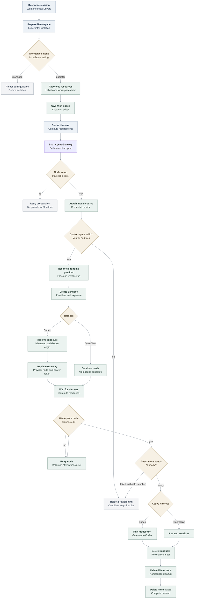

# OpenShell Sandbox provisioning flow

## Overview

Kubernetes Compute delegates dedicated Codex and native OpenClaw Harnesses to
the OpenShell Sandbox Driver. Operator mode owns a Workspace for each OCC
Namespace; managed mode fails before mutation. Model access uses a
[credential source](credential-source-lifecycle.md), without granting the Agent
Secret permission. Dedicated Codex receives revision-owned provider files and
authenticates Gateway requests through OpenShell's bearer-passthrough exposure.
Compute uses that advertised endpoint instead of the direct Harness Service.

The development Driver puts the expiring workspace-node setup envelope in a
revision-owned provider file. The Harness signs the bootstrap token that the
Gateway receives, while network policy limits its use to the node executable
and Agent Gateway endpoint. This exposes the token to the Sandbox and is not a
production credential-delivery contract.

Both Kubernetes-only and Compose development control planes install the pinned
Gateway and render the workspace chart, without compatibility projections.

## Entry Points

- Trigger: a worker reconciles an Agent revision that selects the OpenShell
  Sandbox Driver and Kubernetes Compute Driver.
- Source: `apps/controller/src/drivers/sandbox/openshell.ts:ensureNamespace`
- Source: `apps/controller/src/drivers/sandbox/openshell.ts:provisionHarness`
- Source: `apps/controller/src/drivers/compute/kubernetes/index.ts:prepareRevision`
- Assumptions: the Installation selected Kubernetes Compute, the OpenShell
  Sandbox, and the OpenShell Credential Gateway through one `openshell` Backend;
  the tenant Namespace and baseline isolation exist; and the Gateway is ready in
  operator workspace mode.

## Flow

## Execution Trace

### 0. Create the development control plane

`scripts/dev-up`, `internal/occdev/openshell_k3d.go:upK3d`,
`internal/occdev/openshell.go:prepareOpenShell`,
`internal/occdev/kubernetes.go:writeInstallation`

The written Installation declares the `openshell` Backend, Gateway endpoint,
Sandbox and a Credential Gateway whose `binaries` list holds native Codex for
x64 and ARM64 runtimes, whatever the launcher host. Credential-source profiles,
not Sandbox policy, govern egress.

`scripts/dev-up` validates Kubernetes/OpenShell and invokes `occ dev up`.
Compose is default; `OCC_DEVELOPMENT_CONTROL_PLANE=kubernetes` selects
Kubernetes-only. Before state creation, Kubernetes-only rejects API-port
collisions and records engine, cluster, namespace, port and key destination.
Both verify the pinned archive, package charts and import digest-pinned
Gateway/Sandbox/supervisor images. Kubernetes-only builds or selects controller/runtime images, imports them
with PostgreSQL and resolves in-cluster digests.

After Agent Sandbox rollout failure, `prepareOpenShell` calls
`internal/occdev/agent_sandbox_rollout_diagnostics.go:captureAgentSandboxRollout`
once before returning the original error for rollback. Synchronous capture
selects the fixed Deployment, controller-UID-linked ReplicaSets/Pods and associated Warning
reasons. It excludes messages, environment, full labels and logs, and marks
unavailable, malformed or oversized results.

Capture gets a fresh 15-second context, three-second request/command timeouts,
256 KiB/command and a 32 KiB record cap. Direct commands are awaited; 200 ms pipe
draining does not terminate arbitrary descendants. Error-output writes ignore
failures; writer latency/durability are outside the subprocess budget. Capture
neither retries nor diagnoses the failure.

After Helm, `network.providerHarness` records Gateway
ClusterIP, Pod selector and TCP/8080. The Agent Gateway aliases only the advertised hostname to that IP, preserving
HTTP Host for routing. NetworkPolicy lets it reach only those Pods/port.

Compose runs PostgreSQL, OCC and its k3d-targeting worker; Kubernetes-only uses
`oce-system` and in-cluster authentication. Both install private Envoy routing
and operator Workspaces, limiting Gateway access to API, worker, supervisor
callbacks and dedicated Agent Gateways. See
[local deployment guides](../guides/deploy/local-kubernetes-development.md).

Cleanup validates recorded engine/state before deleting the named cluster and
Compose project/volumes; partial cleanup retains recovery state.

### 1. Prepare the Namespace and OpenShell Workspace

`apps/controller/src/drivers/compute/kubernetes/index.ts:ensureNamespace`

Compute establishes quota, limits and baseline NetworkPolicies before
`SandboxDriver.ensureNamespace`. Managed mode rejects before Kubernetes or
Gateway use. Operator mode applies namespace labels, workspace-chart resources
and provider NetworkPolicies, then checks health; optional namespace-local
readiness comes first. Development uses the central Gateway endpoint.

`apps/controller/src/backends/openshell.ts:clientForNamespace` passes raw
endpoints, including bracketed IPv6, unchanged to the gRPC client. HTTP
origins keep port 80 explicit; HTTPS and nondefault ports retain their behavior.

The Driver uses Compute's physical namespace name for the Workspace. It reads
it, creates it if missing, or rereads after concurrent `ALREADY_EXISTS`.
Adoption requires its expected name, OCC Namespace ID label, managed-by label
and active phase; conflicts fail Namespace preparation. Compute's `oce-` plus
15-character digest fits OpenShell's 19-character limit.

### 2. Derive the provider-owned Harness request

`apps/controller/src/drivers/compute/kubernetes/index.ts:prepareRevision`

With `provisionHarness`, Compute derives image, command, labels, environment,
mounts, optional identity and resources from its ordinary Deployment shape.
First deployment starts the Gateway on fail-closed transport; the Agent Service
stays inactive. Preparation waits for Gateway readiness and the Agent-owned node
setup Secret before attaching credentials or creating providers/Sandboxes, then
passes that Secret reference. OpenShell rejects projected workload identity before
mutation: the pinned API cannot preserve the exact ServiceAccount/token. The
local profile disables it.

For `credential_source`, Compute attaches provider names without a model Secret.
External ChatGPT sources also supply a placeholder and account metadata for
`CODEX_LOGIN_MODE=chatgptAuthTokens`; others use `api_key`. OpenShell provisions
the frozen revision. Compute reads Codex's exact Agent transport Secret and
passes only `APP_TOKEN_SHA`. It compiles the admitted plugin snapshot into
`runtime.json`/`config.toml` workload files and removes their ConfigMap env paths.

An `openai` profile binds credentials to immutable `config.base_url` plus `/**`,
defaulting to OpenAI `/v1`. Shared [registration validation](credential-source-lifecycle.md#1-admit-the-registration-request)
rejects invalid endpoints. Native OpenClaw refuses custom endpoints; with explicit
`base_url`, Codex's
`apps/controller/src/drivers/compute/plugin-runtime.ts:codexConfigurationToml`
selects a named provider and HTTPS Responses transport.

### 3. Validate and serialize the Sandbox

`apps/controller/src/drivers/sandbox/openshell.ts:provisionHarness`

Only dedicated Codex or OpenClaw revisions pinned to this Driver are accepted.
Kubernetes, filesystem, process and binary-scoped network policy use v0.1
messages checked against the independent `v0.1.3-pre.2` fixture. `environment`
preserves opaque `OCE_CODEX_CHATGPT_ACCOUNT` JSON during path relocation. Landlock is required; unsupported enums, inherited
keys, old `passthrough` TLS spelling and missing executable paths fail before
launch. Readiness `timeoutMs` must be a positive safe integer. The Installation
loader names it; startup instead logs `startup-error` / `STARTUP_FAILED` before
Kubernetes calls. Duplicate names and reserved `workspace-node-enrollment` fail
before Driver construction. Rename them, retaining binaries and endpoints.

After the setup-Secret gate above, `provisionHarness` creates or adopts the
runtime provider with the final node envelope, never a placeholder. Renewal
version-fences `UpdateProvider` to `node_setup_json` only. A configured
post-create delay gives the process time to listen. Compute then rolls the
Gateway to the exposed route and waits for that Deployment before observing
workspace-node enrollment.

Dedicated Codex requires one lowercase `APP_TOKEN_SHA`, no `APP_SERVER_TOKEN`,
and two bounded plugin-free runtime inputs. Selected plugins, repository broker
configuration, malformed files, and other Secret-backed environment fail before
Gateway mutation.

The shared `oce-codex-runtime` profile backs a revision-owned provider with
read-only `runtime.json`, `config.toml`, and `node-setup.json`. The last file holds
the validated Agent-owned setup Secret’s complete expiring envelope, including
`bootstrapToken`. This development diagnostic avoids credential rewriting:
OpenClaw signs that token in its device proof.
Before renewal, the Driver requires the same endpoint and TLS fingerprint, an
expired stored envelope, a later live expiry, and unchanged runtime and CA
configuration. The Sandbox network policy limits the connection to the exact
Gateway endpoint and `/usr/local/bin/node`. Foreign ownership or other drift
fails before Sandbox creation.

The Driver mounts a revision-scoped Agent PVC subpath at
`/sandbox/.openclaw-runtime`; persistent subpaths mount below
`/sandbox/.openclaw-mounts`. It rewrites admitted `/home/node` paths beneath the
runtime home, declared as `harnessHome` for native hook credentials. Codex hook
commands trust the provider-file Gateway CA and reach the Gateway route only when
the node does: an in-cluster routing hostname or two clusters. Exact mount paths
such as `OPENCLAW_NODE_STATE_DIR` use a process-created `state` child, so atomic
writes cross neither a symlink nor a root-owned mount. Workspace, node identity, sessions, and generated images
remain separate. `/tmp` stays on the bounded ephemeral image layer.

Credential attachments must use the OCC `oce-cs-` name shape and cannot repeat
a static provider. The profile binds them to the exact native Codex executable;
a changed runtime dependency path fails the startup model probe.

Native OpenClaw uses a separate verification bridge, not a supported local
first-Agent path.

### 4. Call the versioned gateway contract

`apps/controller/src/drivers/sandbox/openshell-gateway-client.ts:createSandbox`

The client sends the Sandbox identity, spec, Namespace Workspace scope, and a
`request_id`: the revision UUID first. OpenShell keeps a `request_id` whose create
errored server-side unresolved forever, so when the Gateway refuses one
(`REQUEST_OUTCOME_UNCERTAIN`, `REQUEST_ID_PAYLOAD_MISMATCH`, or
`REQUEST_REPLAY_UNAVAILABLE`) and `getSandbox` finds no Sandbox, the Driver tries
the next of 16 IDs: the revision UUID, then 15 derived from it. Each failing pass
spends one ID; the Workspace-unique Sandbox name prevents duplicates. Unresolved
IDs never expire. Once the controller
identity holds 1000 unresolved or unexpired admission records, OpenShell rejects
every new `request_id` with `RESOURCE_EXHAUSTED`, so repeated server-side create
failures count against that quota. Completed records expire after 24 hours.
`unary` maps that exact refusal to `OpenShellAdmissionLimitError`, a
`TransientDependencyError` (`SANDBOX_ADMISSION_LIMIT_REACHED`): revision
provisioning waits for it until the convergence deadline without spending
attempts; Namespace work retries it. Codex requires one unnamed bearer-passthrough
exposure for `APP_SERVER_PORT` in both `service_urls` and `GetService`. Native
OpenClaw connects outbound and rejects returned exposure URLs. After `getSandbox`,
the Driver creates only an absent Sandbox. It adopts existing or `ALREADY_EXISTS`
Sandboxes only when Workspace, labels, annotations, and full spec match and the
Sandbox is neither deleting nor stopped. Workspace `sandbox:write` is the trust
boundary: its holder can replace the Sandbox.

The Backend shares one client per endpoint and retries failed setup. Unary calls
check cancellation after setup and credential preparation, before dispatch.
Setup cancellation waits for the pending step; it cannot bound stalled
initialization or file reads. After dispatch, cancellation rejects the caller and
cancels local gRPC, not necessarily the remote mutation. The lifecycle must
recover uncertain effects.

`GetService` keeps a normalized control URL and advertised workload host/port.
`harnessEndpoint` requires the unnamed bearer-passthrough app-server exposure and
returns its WebSocket origin and configured `sandboxDataMount.mountPath`
(default `/sandbox/enterprise`). Compute derives native-hook storage from
`harnessHome`; the launcher creates it with mode `0700`. Invalid/changed exposure
fails closed. Provider files use their reported absolute paths; Gateway failure
prevents readiness. Revision providers survive uncertain creates; cleanup deletes
their Sandbox first.

OpenShell's supervisor opens the node connection. Kubernetes-only uses the
in-cluster WSS route; Compose uses the Agent Gateway Service URL. In both cases,
policy binds the node executable and supervisor to the exact destination. The
supervisor relaunches an exited node and falls back to direct signaling when
process-group signaling returns `EPERM`.

### 5. Observe readiness or clean up

`apps/controller/src/drivers/compute/kubernetes/index.ts:prepareRevision`

Compute verifies revision ownership. With `harnessEndpoint`, it replaces the
initial fail-closed target with `APP_SERVER_URL`, `OPENCLAW_REMOTE_WORKSPACE_ROOT`
and the owned k3d profile's exact host alias.
`apps/controller/src/drivers/compute/kubernetes/index.ts:gatewayNativeHookRelayConfiguration`
derives private storage from Sandbox `harnessHome`; Compute owns relay URL/auth.
Egress permits only the provider peer/port; the direct Agent Service stays
inactive without a Harness route. Preparation preserves the serving predecessor;
activation resolves the candidate again. Without `harnessEndpoint`, Compute keeps
its Service/private route and `/home/node/workspace`.

Compute then waits for the provider-owned Harness Pod and exact workspace node.
Missing enrollment keeps the revision inactive. The dedicated Harness wrapper
rereads the provider setup before every node retry and retains the latest valid
value while the projection is unavailable. It relaunches the workspace-node
process one second after every exit without capping attempts, so Gateway rollout
does not strand the Sandbox. Shutdown stops the retry loop.

For bound sources
Compute calls `attachmentStatus`, which reads
`GetSandboxProviderStatus`. `pending` or a missing status retries; `failed`,
`withheld`, `revoked`, or `absent` fails the revision; only `ready` for every
attachment completes preparation. On revision
shutdown, `shutdownRevisionRuntime` calls `cleanup` with the revision. The
Gateway client sends `DeleteSandbox` with the same `workspace_scope`; a missing
Sandbox is an idempotent success. Codex cleanup then verifies and deletes the
revision provider. Namespace cleanup removes the shared profile after its
runtime providers are gone.

Namespace deletion calls `cleanup` without a revision after revision resources
are gone. OpenShell verifies Workspace ownership, deletes remaining owned runtime
providers and the shared profile, sends idempotent `DeleteWorkspace`, then removes
workspace-chart resources and NetworkPolicies in reverse order. A terminating
Workspace remains retryable after a lost response. Compute deletes the Kubernetes
namespace only after this cleanup succeeds.

## Debugging and verification

See [OpenShell tests](../testing/openshell.md) for commands and prerequisites.
In Compose, `network.providerHarness.address` must match the `openshell-gateway`
ClusterIP, the Agent Gateway must use `ws://*.openshell.localhost:8080/`, and its
direct Service stays inactive. Protected k3d must prove provider files,
verifier-only authorization, enrollment, model turns, cleanup, containment and
networking. Native OpenClaw remains verification-only.

## Related docs

- [OpenShell Sandbox Driver](../reference/drivers/openshell-sandbox.md) and [OpenShell Credential Gateway](../reference/drivers/openshell-credential-gateway.md)
- [Credential source lifecycle](credential-source-lifecycle.md)
- [OpenShell tests](../testing/openshell.md)
- [Kubernetes Compute Driver](../reference/drivers/kubernetes-compute.md)
- [Harness execution topology](harness-execution-topology.md)

## Manual Notes

[keep this for the user to add notes. do not change between edits]

## Changelog

- 2026-10-14 01:11: Reconcile endpoint validation and provider ownership with external OAuth custody in the accompanying merge. (01a11d95-ebef-76e1-b9b9-9d3d2e88e99e - c5fb4880ebf2df2aedae12f99adb1992a930ba1b)

- 2026-10-13 14:11: Reconcile setup-Secret ordering and preserve service-IPv6 history alongside credential endpoint safeguards. (agent:roboclaw:dashboard:9d0532e1-befb-4fc3-935e-7cd2a0c72110 - 90268463bbd255c3c13a0e0bdeb437728189eb1a)

- 2026-10-10 13:04: Reconcile native hook HOME/CA flow with endpoint safeguards; trim repeated narration. (agent:roboclaw:dashboard:9d0532e1-befb-4fc3-935e-7cd2a0c72110 - 90268463bbd255c3c13a0e0bdeb437728189eb1a)

- 2026-10-13 18:22: Preserve opaque account metadata during Sandbox environment relocation. (authoring-run/a67c01b5-f0f7-434b-8183-d2dcc6941836 - 7c25b823f17e93f62d7ba8abea23e65df4b36fef)

- 2026-10-13 09:37: Reconcile current admission and lifecycle behavior with external OAuth custody in the accompanying merge. (authoring-run/fd902939-ed58-4508-8d33-95a863d966af - e8d39978d801e7a5a8ac7242f32035f426da94e1)

- 2026-10-10 12:40: Declare the Sandbox HOME for native hook credentials; hooks trust the file-delivered Gateway CA. (fix-1017)

- 2026-10-09 12:22: Pass the Sandbox-owned private native hook credential directory to the Gateway launcher. (authoring-run/8e337823-5cdf-4dbb-bdac-e9c51a5051b9 - 635244e85c443a4408c92730b508601bbb20f2cd)

- 2026-10-09 23:18: Accept bracketed IPv6 endpoints. (authoring-run/6eefb93e-33fb-450a-9657-51ebe15a686e - 21f34928437fb7d6f4391ba4af5d3e15bf9ce480)

- 2026-10-09 20:27: Integrate main lifecycle, native workspace and readiness contracts without dropping endpoint safeguards. (agent:roboclaw:dashboard:9d0532e1-befb-4fc3-935e-7cd2a0c72110 - 90268463bbd255c3c13a0e0bdeb437728189eb1a)

- 2026-10-09 19:45: Cover both runtime architectures in the development credential policy. (authoring-run/1e7118f7-bdb0-4564-894c-02f990f75e67 - bd540bcdef63cdc719e73192e4dbe99c365953c3)

- 2026-10-09 15:30: Record bounded Agent Sandbox failure metadata before the original error returns and rollback proceeds; tighten setup prose. (authoring-run/54f8d1c2-fb6e-4074-999f-5185af50a86f - 8bfec22f49b207c16afce21bd9a941ee0e9cd95d)

- 2026-10-06 22:10: Preserve HTTP port 80 when creating the OpenShell gRPC target. (authoring-run/88f2e095-3f3a-4d9b-a878-663034cdde6e - 2fc8320cf8bfbf9d7ea20757ef3fe32d7157e6aa)

- 2026-10-06 11:17: Reconciled endpoint flow with current namespace and provider provisioning; condensed repeated prose. (agent:roboclaw:dashboard:9d0532e1-befb-4fc3-935e-7cd2a0c72110 - b6dc6b87a461ad33374e133d15cc739d8e074fea)

- 2026-10-05 16:17: Documented version-fenced workspace-node setup renewal through the revision provider and supervisor refresh. (authoring-run/4f3e6ccd-a967-48c8-9d5d-f29a6d338d7d - fd9a082e2587432bde6282748a82e3025a64fd1a)

- 2026-10-05 11:36: Trace pre-registration endpoint validation and condense repeated setup and runtime details. (agent:roboclaw:dashboard:9d0532e1-befb-4fc3-935e-7cd2a0c72110 - 9958ef0412565864efba7b13995536d7c2a51d22)

- 2026-10-05 00:06: Bind immutable credential-source endpoints to provider profiles and Codex runtime configuration while retaining existing default endpoint limits for other consumers. (authoring-run/4e4824a1-f107-44c2-90bf-00fe13ff650c - d269c6d03)

- 2026-10-05 12:50: Removed repeated setup and wire-contract detail while preserving the current OpenShell provisioning sequence and moved older entries to the history page. (authoring-run/fd7f6cdb-1d1d-40d5-8d4a-d6d80cd946e7 - 4b5afe0cb653f7dd99fccdb2e3432cbf60e6a03e)

- 2026-10-02 16:26: Passed OpenShell's provider-local workspace root to the dedicated Gateway while preserving the canonical Kubernetes Harness root. (authoring-run/3bf937d5-c422-419e-af2d-754abe024ca4 - 987c8c2b4ace1e152262ef6920b6d0f9ff26a086)

[OpenShell Sandbox provisioning documentation history](openshell-sandbox-provisioning/history.md) preserves the older dated entries.
