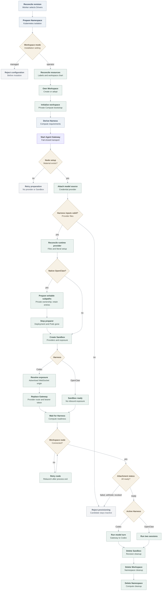

# OpenShell Sandbox provisioning flow

## Overview

Kubernetes Compute delegates dedicated Codex and native OpenClaw to OpenShell. Operator mode owns Namespace Workspaces; managed mode fails before mutation.
[Credential sources](credential-source-lifecycle.md) provide model access without
Agent Secret permission. Codex authenticates Gateway requests through revision-owned
files and OpenShell's bearer-passthrough endpoint, replacing the
Harness Service.

Development workspace-node setup exposes a scoped bootstrap token through a
revision-owned provider file. Both local control-plane profiles install the pinned
Gateway and workspace chart.

## Entry Points

- Trigger: a worker reconciles an Agent revision that selects the OpenShell
  Sandbox Driver and Kubernetes Compute Driver.
- Source: `apps/controller/src/drivers/sandbox/openshell.ts:ensureNamespace`
- Source: `apps/controller/src/drivers/sandbox/openshell.ts:provisionHarness`
- Source: `apps/controller/src/drivers/compute/kubernetes/index.ts:prepareRevision`
- Assumptions: the Installation selects Kubernetes Compute, OpenShell Sandbox
  and Credential Gateway through one `openshell` Backend; Namespace isolation
  exists; the Gateway is ready in operator mode.

## Flow

## Execution Trace

### 0. Create the development control plane

`scripts/dev-up`, `internal/occdev/openshell_k3d.go:upK3d`,
`internal/occdev/openshell.go:prepareOpenShell`,
`internal/occdev/kubernetes.go:writeInstallation`

The Installation selects the `openshell` Backend and Drivers. Model profiles allow
Node and x64/ARM64 Codex independently of launcher architecture. The pinned runtime
enables Dedicated OpenClaw development with mandatory Landlock.

`scripts/dev-up` validates Kubernetes/OpenShell before `occ dev up`. Compose is
default; `OCC_DEVELOPMENT_CONTROL_PLANE=kubernetes` selects Kubernetes-only, which
rejects API-port collisions and records engine, cluster, namespace, port and key
destination before creating state. Both verify the pinned archive, package charts
and import immutable OpenShell images. Kubernetes-only also builds/selects OCE
images, imports PostgreSQL and resolves cluster digests.

Both profiles import OCE images before OpenShell images and workloads, preventing
k3s garbage collection from removing idle OpenShell images during imports.

After Agent Sandbox rollout failure, `prepareOpenShell` calls
`internal/occdev/agent_sandbox_rollout_diagnostics.go:captureAgentSandboxRollout`
once before returning the original error for rollback. Capture selects the fixed
Deployment, UID-linked ReplicaSets/Pods and Warning reasons, excluding messages,
environment, full labels and logs. It marks unavailable/malformed/oversized results.
Limits: fresh 15-second context, three seconds and 256 KiB per command, 32 KiB per
record. Direct commands are awaited; 200 ms pipe draining cannot terminate
descendants. Output failures are ignored; writer latency/durability remain unbounded.
Capture neither retries nor diagnoses.

After Helm, `network.providerHarness` records Gateway ClusterIP, Pod selector and TCP/8080. Agent Gateways alias only the advertised hostname to that address; HTTP Host retains the routing key. NetworkPolicy permits only that peer and port. Compose runs PostgreSQL and OCC with a k3d-targeting worker; Kubernetes-only uses `oce-system` and in-cluster authentication. Both install private Envoy routing and operator Workspaces, restricting Gateway access to control-plane callers, supervisor callbacks and dedicated Agent Gateways. See [local deployment guides](../guides/deploy/local-kubernetes-development.md).

`internal/occdev/compose_routing.go:prepareComposeRoutingFiles` sets container
ownership for private routing files; Installation files remain `0644` in private state.

Cleanup validates recorded engine/state before deleting the named cluster and
Compose project/volumes; partial cleanup retains recovery state.

### 1. Prepare the Namespace and OpenShell Workspace

`apps/controller/src/drivers/compute/kubernetes/index.ts:ensureNamespace`

Compute establishes quota, limits and baseline NetworkPolicies before
`SandboxDriver.ensureNamespace`. Managed mode rejects before Kubernetes or
Gateway use. Operator mode applies namespace labels, workspace-chart resources
and provider NetworkPolicies, then checks health; optional namespace-local
readiness comes first. Development uses the central Gateway endpoint.

`apps/controller/src/backends/openshell.ts:clientForNamespace` passes raw
endpoints, including bracketed IPv6, unchanged to the gRPC client. HTTP
origins keep port 80 explicit; HTTPS and nondefault ports retain their behavior.

The Workspace uses Compute's physical namespace name: `oce-` plus a 15-character
digest fits OpenShell's 19-character limit. The Driver creates it if absent and
rereads after `ALREADY_EXISTS`. Adoption requires exact name, OCC Namespace ID and
managed-by labels, and active phase; conflicts fail preparation.

### 2. Derive the provider-owned Harness request

`apps/controller/src/drivers/compute/kubernetes/index.ts:prepareRevision`

Compute derives requirements from its ordinary Deployment. [Private workspace setup](workspace-files.md#2-deployment-initializes-storage-before-execution)
initializes the approved PVC; marker readiness, byte cleanup, fenced deletion and
writer termination precede Sandbox handoff. Only the completion guard remains.

Compute starts the Gateway on fail-closed transport with its Agent Service
inactive. Credential attachment and provider/Sandbox creation await Gateway
readiness and its Agent-owned node setup Secret; Compute passes that Secret
reference to the SandboxDriver.
The local OpenShell profile disables projected workload identity. If it is
enabled, OpenShell rejects the revision before Gateway mutation because the
pinned API cannot preserve the exact Agent ServiceAccount and token.
For `credential_source`, Compute renders the catalog login mode without a model
Secret and passes the immutable revision and `attachForRevision` provider names
through `requirements.credentialAttachments`.
For Codex, it reads the exact Agent transport Secret in the control plane and
adds only its SHA-256 verifier as `APP_TOKEN_SHA`. It converts the admitted plugin
snapshot into `runtime.json`/`config.toml` workload files and removes their ConfigMap
paths from the environment.

`OpenShellSandboxDriver.configureAgent` selects full access with user review and drops `appServer.networkProxy`.
`deploy/runtime/openclaw-codex-full-access-profile.patch` sends `:danger-full-access` on thread and turn requests only when the OpenShell
endpoint selects that profile. If native policy returns a constrained thread,
the Gateway fails the request before a turn. First Agent can read a
prior PAT revision frozen with `workspace-write`, warning that shell tools fail; `--replace-key` deploys one at the current policy.
OpenShell blocks nested bubblewrap user namespaces; model readiness does not
prove shell execution.

PAT bootstrap (`prepareHarnessAuth`;
`apps/controller/src/drivers/compute/kubernetes/runtime-entrypoints.ts:AGENT_RUNTIME_ENTRYPOINT`)
writes an opaque placeholder to private `auth.json`, clears the child override,
and validates native login status. Scoped [PAT routes](../reference/drivers/openshell-credential-gateway.md#source-type-catalog)
admit bootstrap and model traffic; failure keeps revisions inactive.
For API-key sources, the credential gateway derives the profile from immutable `config.base_url`,
defaulting to OpenAI `/v1`. Its shared validator rejects invalid endpoints before
[registration](credential-source-lifecycle.md#1-admit-the-registration-request).
The profile binds credentials to the full base path, including prefixes such as
`/api/v1`, followed by `/**`. `attachForRevision` rejects custom endpoints for
native OpenClaw. For Codex,
`apps/controller/src/drivers/compute/plugin-runtime.ts:codexConfigurationToml`
selects a named provider with the normalized endpoint and HTTPS Responses transport.

### 3. Validate and serialize the Sandbox

`apps/controller/src/drivers/sandbox/openshell.ts:provisionHarness`

Only dedicated Codex/OpenClaw revisions pinned to this Driver are accepted.
Policies use the `v0.1.4` wire contract and require Landlock. Unsupported enums,
inherited keys, old `passthrough` TLS spelling and missing executables fail before
launch. Readiness `timeoutMs` requires a positive safe integer; the loader names
it, while startup logs `startup-error` / `STARTUP_FAILED` before Kubernetes calls.
Duplicate/reserved `workspace-node-enrollment` names fail before construction; rename
them, retaining binaries and endpoints.

`provisionHarness` creates or adopts the provider with final setup. Expired setup renewal version-fences `UpdateProvider` to `node_setup_json`. For Codex, a bounded post-create delay precedes the exposed route; Compute rolls the Gateway before observing enrollment. Native OpenClaw has no inbound route.

Dedicated Codex requires one lowercase `APP_TOKEN_SHA`, no `APP_SERVER_TOKEN`,
and two bounded plugin-free runtime inputs. Selected plugins, repository broker
configuration, malformed files, and other Secret-backed environment fail before
Gateway mutation.

Revision providers use `oce-codex-runtime` or `oce-openclaw-runtime`. Both supply read-only setup and Gateway CA files; Codex requires `runtime.json` and `config.toml`, which native OpenClaw refuses. The validated setup Secret's complete expiring envelope, including `bootstrapToken`, becomes `node-setup.json`. WebSocket rewriting is unsupported: OpenClaw signs the literal token in its device proof.
Before renewal, the Driver requires the same endpoint and TLS fingerprint, an
expired stored envelope, a later live expiry, and unchanged runtime and CA
configuration. The Sandbox network policy limits the connection to the exact
Gateway endpoint and `/usr/local/bin/node`. Foreign ownership or other drift
fails before Sandbox creation.

The Driver mounts revision state at `/sandbox/.openclaw-runtime` and persistent
subpaths below `/sandbox/.openclaw-mounts`. Admitted `/home/node` paths move under
the runtime home, declared as `harnessHome` for native hook credentials. Codex
hooks trust the provider-file Gateway CA and require node-reachable routing.
`OPENCLAW_NODE_STATE_DIR` uses a process-created `state` child to avoid atomic
replacement through symlinks/root-owned mounts. Workspace, node identity, sessions
and images stay separate. The supervisor probes `/tmp`; native `TMPDIR` uses a
private runtime-home `tmp` child.

`prepareNativeWorkspace` uses a restricted revision-owned Deployment to privatize
writable PVC subpaths, preserving retained entries. Verification checks mode and
process ownership before UID-fenced foreground deletion and writer Pod termination.
Preparation requires `userNamespaces: false` and the pinned Gateway's default
identity. It adds no model credential, ServiceAccount token, capability or direct
Pod creation.

Credential attachments require OCC `oce-cs-` names without static-provider duplicates.
Model profiles bind access to the selected Codex/Node executable. Production
qualification remains outstanding.

### 4. Call the versioned gateway contract

`apps/controller/src/drivers/sandbox/openshell-gateway-client.ts:createSandbox`

The client sends the Sandbox identity, spec, Workspace scope, and one of 16
`request_id` values: the revision UUID, then 15 derived IDs. After
`REQUEST_OUTCOME_UNCERTAIN`, `REQUEST_ID_PAYLOAD_MISMATCH`, or
`REQUEST_REPLAY_UNAVAILABLE`, the Driver uses the next ID only when `getSandbox`
finds nothing. Unresolved IDs do not expire; completed records expire after 24
hours. The Workspace-unique Sandbox name prevents duplicates. At 1,000 live or
unresolved records, `RESOURCE_EXHAUSTED` maps to the transient
`SANDBOX_ADMISSION_LIMIT_REACHED`: revision provisioning waits without spending
attempts, while Namespace work retries normally. Codex requires one unnamed
bearer-passthrough exposure for `APP_SERVER_PORT`. Native OpenClaw requests no
exposure and rejects any returned URL. The Driver
calls `getSandbox` first and creates only an absent Sandbox; it adopts an
existing or `ALREADY_EXISTS` Sandbox only when its Workspace, labels,
annotations, and full spec match the request and it is not deleting or stopped.
Workspace `sandbox:write` permits Sandbox replacement and defines the trust boundary.

The Backend reuses clients and retries setup. Cancellation is
checked after setup/credential preparation, so stalled initialization/file reads
remain unbounded. After dispatch, cancellation stops local gRPC; remote mutations
may continue and require recovery.

`GetService` returns the local client URL and advertised workload hostname/port.
The unnamed bearer-passthrough exposure must match the admitted app-server port.
`harnessEndpoint` returns its WebSocket origin and `/sandbox/enterprise` workspace
root. Missing, malformed or changed exposure fails closed.

`apps/controller/src/drivers/sandbox/openshell.ts:harnessStatus` probes the authenticated WebSocket handshake before
reading a held-failure document. `apps/controller/src/drivers/sandbox/openshell-service-transport.ts:serviceWebSocketHandshake`
destroys HTTP refusal responses immediately, so unfinished bodies cannot retain
connections after the probe returns.

The revision provider survives an uncertain create; revision cleanup deletes
the Sandbox first. The runtime opens provider files at their reported absolute
paths; Gateway failures prevent readiness.

OpenShell's supervisor opens the node connection. Kubernetes-only uses the
in-cluster WSS route; Compose uses the Agent Gateway Service URL. In both cases,
policy binds the node executable and supervisor to the exact destination. The
supervisor relaunches an exited node and falls back to direct signaling when
process-group signaling returns `EPERM`.

### 5. Observe readiness or clean up

`apps/controller/src/drivers/compute/kubernetes/index.ts:prepareRevision`

Compute verifies revision ownership. Codex `harnessEndpoint` replaces fail-closed
transport with `APP_SERVER_URL`, `OPENCLAW_REMOTE_WORKSPACE_ROOT` and
`OPENCLAW_CODEX_PROVIDER_PERMISSION_PROFILE`; owned k3d also adds the exact host
alias. Gateway egress admits only the provider peer/port; the direct Service stays
inactive and Compute omits its Harness route. Preparation preserves a serving
predecessor; activation resolves the candidate again. Without `harnessEndpoint`,
Codex retains Kubernetes transport and `/home/node/workspace`. Native OpenClaw
uses outbound enrollment and its admitted workspace.

Compute waits for the provider Harness Pod and exact workspace node; missing enrollment keeps it inactive. The Codex supervisor
rereads the provider setup before every node retry and retains the latest valid
value while the projection is unavailable. It relaunches the workspace-node
process one second after every exit without capping attempts, so Gateway rollout
does not strand the Sandbox. Shutdown stops the retry loop.

For bound sources
Compute calls `attachmentStatus`, which reads
`GetSandboxProviderStatus`. `pending` or a missing status retries; `failed`,
`withheld`, `revoked`, or `absent` fails the revision; only `ready` for every
attachment completes preparation. On revision
shutdown, `shutdownRevisionRuntime` calls `cleanup` with the revision. The
Gateway client sends `DeleteSandbox` with the same `workspace_scope`; a missing
Sandbox is an idempotent success. Both Harnesses then delete their owned
revision provider. `cleanupNativeWorkspace` also retires an owned preparer left
by an interrupted attempt without a Sandbox; foreign or replaced resources fail
closed. Namespace cleanup removes unused runtime profiles.

After revision cleanup, Namespace deletion calls `cleanup` without a revision. OpenShell verifies Workspace ownership, deletes remaining owned runtime
providers and the shared profile, sends idempotent `DeleteWorkspace`, then removes
workspace-chart resources and NetworkPolicies in reverse order. A terminating
Workspace remains retryable after a lost response. Compute deletes the Kubernetes
namespace only after this cleanup succeeds.

## Debugging and verification

The [testing guide](../testing/openshell.md) owns prerequisites and proof. Compose
requires the provider ClusterIP, advertised `ws://*.openshell.localhost:8080/`
route and inactive direct Service. Native model execution requires real runtime
proof on a Landlock-capable host; Console admission and initialized files are insufficient.

## Related docs

- [OpenShell Sandbox Driver](../reference/drivers/openshell-sandbox.md) and [OpenShell Credential Gateway](../reference/drivers/openshell-credential-gateway.md)
- [Credential source lifecycle](credential-source-lifecycle.md)
- [OpenShell tests](../testing/openshell.md)
- [Kubernetes Compute Driver](../reference/drivers/kubernetes-compute.md)
- [Harness execution topology](harness-execution-topology.md)

## Manual Notes

[keep this for the user to add notes. do not change between edits]

## Changelog

- 2026-10-15 18:17: Pin OpenShell v0.1.4. (authoring-run/openshell-014-rebase-20261015 - 64a3424a9)
- 2026-10-14: Merge current contracts with native provisioning and retained-workspace preparation. (Codex/01a13654-be66-7741-b54f-f8ae80f2d496)
- 2026-10-15 08:47: Select explicit Codex permissions. (authoring-run/7eb24321-3670-4154-adde-41a0f1b36728 - 04514330688378316bd0641b8d5560da56aeff85)

- 2026-10-15 02:25: Distinguish API-key and PAT isolation. (authoring-run/c11897e0-33a6-4276-b620-aaec6d57ab00 - 07eb950b5)

- 2026-10-14 14:04: Scope PAT authentication and OpenShell prerequisites. (authoring-run/dba0a6cb-33d9-40fd-b38b-e20cddf4b75f - 96a2b79fa)

- 2026-10-14 20:27: Release refused WebSocket probes. (authoring-run/01a10a81-070c-7aa3-97d0-fbce8f285d4d - 4727e9b109a2127150e03e39e859d45e0668f82f)

- 2026-10-13 14:11: Reconcile setup-Secret ordering and preserve service-IPv6 history alongside credential endpoint safeguards. (agent:roboclaw:dashboard:9d0532e1-befb-4fc3-935e-7cd2a0c72110 - 90268463bbd255c3c13a0e0bdeb437728189eb1a)

- 2026-10-13 13:57: Reconciled development image import order with upstream rollout diagnostics. (authoring-run/503e74ea-e82a-4d1a-8081-fcf4fc4e6868 - 96272fa0a5e4f359ed354abb1918e44986c19e76)

- 2026-10-10 13:04: Reconcile native hook HOME/CA flow with endpoint safeguards; trim repeated narration. (agent:roboclaw:dashboard:9d0532e1-befb-4fc3-935e-7cd2a0c72110 - 90268463bbd255c3c13a0e0bdeb437728189eb1a)

- 2026-10-10 12:40: Declare the Sandbox HOME for native hook credentials; hooks trust the file-delivered Gateway CA. (fix-1017)

- 2026-10-09 23:18: Accept bracketed IPv6 endpoints. (authoring-run/6eefb93e-33fb-450a-9657-51ebe15a686e - 21f34928437fb7d6f4391ba4af5d3e15bf9ce480)

- 2026-10-09 20:27: Integrate main lifecycle, native workspace and readiness contracts without dropping endpoint safeguards. (agent:roboclaw:dashboard:9d0532e1-befb-4fc3-935e-7cd2a0c72110 - 90268463bbd255c3c13a0e0bdeb437728189eb1a)

- 2026-10-09 19:45: Cover both runtime architectures in the development credential policy. (authoring-run/1e7118f7-bdb0-4564-894c-02f990f75e67 - bd540bcdef63cdc719e73192e4dbe99c365953c3)

- 2026-10-09 15:30: Record bounded Agent Sandbox failure metadata before the original error returns and rollback proceeds; tighten setup prose. (authoring-run/54f8d1c2-fb6e-4074-999f-5185af50a86f - 8bfec22f49b207c16afce21bd9a941ee0e9cd95d)

- 2026-10-13 16:45: Reconcile native private temporary state and retained writable-subpath preparation. (Codex/01a13654-be66-7741-b54f-f8ae80f2d496 - ff12fc86cd1662c98a9d8db78be9c2fa4facdcdd)

- 2026-10-08: Document normal native OpenClaw provider delivery and private Compute workspace initialization; retain experimental qualification limits. (Codex/01a0e8ec-d02f-7b93-a59b-5b7fccf2ebaa)

- 2026-10-06 22:10: Preserve HTTP port 80 when creating the OpenShell gRPC target. (authoring-run/88f2e095-3f3a-4d9b-a878-663034cdde6e - 2fc8320cf8bfbf9d7ea20757ef3fe32d7157e6aa)

- 2026-10-06 15:57: Recorded the development image-import order that keeps pinned OpenShell images available until their workloads start. (authoring-run/473c1419-a5a2-4774-ac8d-33d6a265ae06 - 99641a7ab00ad8fdd987e27e9ee838814e5f535a)

- 2026-10-06 11:17: Reconciled endpoint flow with current namespace and provider provisioning; condensed repeated prose. (agent:roboclaw:dashboard:9d0532e1-befb-4fc3-935e-7cd2a0c72110 - b6dc6b87a461ad33374e133d15cc739d8e074fea)

- 2026-10-05 16:17: Documented version-fenced workspace-node setup renewal through the revision provider and supervisor refresh. (authoring-run/4f3e6ccd-a967-48c8-9d5d-f29a6d338d7d - fd9a082e2587432bde6282748a82e3025a64fd1a)

- 2026-10-05 11:36: Trace pre-registration endpoint validation and condense repeated setup and runtime details. (agent:roboclaw:dashboard:9d0532e1-befb-4fc3-935e-7cd2a0c72110 - 9958ef0412565864efba7b13995536d7c2a51d22)

- 2026-10-05 00:06: Bind immutable credential-source endpoints to provider profiles and Codex runtime configuration while retaining existing default endpoint limits for other consumers. (authoring-run/4e4824a1-f107-44c2-90bf-00fe13ff650c - d269c6d03)

- 2026-10-05 12:50: Removed repeated setup and wire-contract detail while preserving the current OpenShell provisioning sequence and moved older entries to the history page. (authoring-run/fd7f6cdb-1d1d-40d5-8d4a-d6d80cd946e7 - 4b5afe0cb653f7dd99fccdb2e3432cbf60e6a03e)

- 2026-10-02 16:26: Passed OpenShell's provider-local workspace root to the dedicated Gateway while preserving the canonical Kubernetes Harness root. (authoring-run/3bf937d5-c422-419e-af2d-754abe024ca4 - 987c8c2b4ace1e152262ef6920b6d0f9ff26a086)

[OpenShell Sandbox provisioning documentation history](openshell-sandbox-provisioning/history.md) preserves the older dated entries.
