# OpenShell Sandbox provisioning flow

## Overview

Kubernetes Compute provisions OpenShell Harnesses.

## Entry Points

- Trigger: worker reconciles an OpenShell/Kubernetes Agent revision.
- Source: `apps/controller/src/drivers/sandbox/openshell.ts:ensureNamespace`
- Source: `apps/controller/src/drivers/sandbox/openshell.ts:provisionHarness`
- Source: `apps/controller/src/drivers/compute/kubernetes/index.ts:prepareRevision`
- Assumptions: `openshell` Backend; ready operator-mode Gateway; Namespace isolation
  [excludes Gateway authority](../reference/drivers/openshell-sandbox.md#gateway-kubernetes-authority).

## Flow

```mermaid
graph TD
  %%{init: {"flowchart": {"htmlLabels": true}}}%%
  A["<b>Reconcile Namespace</b><br/>Worker selects Drivers"] --> B["<b>Prepare Namespace</b><br/>Kubernetes isolation"]
  B --> C{"<b>Workspace mode</b><br/>Installation setting"}
  C -- "managed" --> X["<b>Reject configuration</b><br/>Before mutation"]
  C -- "operator" --> D["<b>Reconcile resources</b><br/>Labels and workspace chart"]
  D --> G0["<b>Ensure configured gateway</b><br/>Owned resources and health"]
  G0 --> E["<b>Own Workspace</b><br/>Create or adopt"]
  E --> A0["<b>Namespace ready</b><br/>Deployment permitted"]
  A0 --> F["<b>Derive Harness</b><br/>Compute requirements"]
  F --> K0["<b>Start Agent Gateway</b><br/>Fail-closed transport"]
  K0 --> Y0{"<b>Node setup</b><br/>Material exists?"}
  Y0 -- "no" --> R0["<b>Retry preparation</b><br/>No provider or Sandbox"]
  Y0 -- "yes" --> Q["<b>Attach model source</b><br/>Credential provider"]
  Q --> G{"<b>Harness inputs valid?</b><br/>Provider files"}
  G -- "no" --> R["<b>Reject provisioning</b><br/>Candidate stays inactive"]
  G -- "yes" --> W["<b>Reconcile runtime provider</b><br/>Files and literal setup"]
  W --> W0{"<b>Native OpenClaw?</b>"}
  W0 -- "yes" --> W1["<b>Prepare writable subpaths</b><br/>Private ownership; retain entries"]
  W1 --> W2["<b>Stop preparer</b><br/>Deployment and Pods gone"]
  W2 --> H["<b>Create Sandbox</b><br/>Providers and exposure"]
  W0 -- "no" --> H
  H --> I["<b>Initialize workspace</b><br/>Private ExecSandbox stdin"]
  I --> V{"<b>Harness</b>"}
  V -- "Codex" --> J["<b>Resolve exposure</b><br/>Advertised WebSocket origin"]
  J --> K["<b>Prepare Gateway route</b><br/>When no predecessor owns it"]
  K --> C1{"<b>Read Codex requirements</b><br/>Harness readiness"}
  C1 -- "refused" --> R
  C1 -- "compatible" --> M["<b>Wait for Harness</b><br/>Compute readiness"]
  V -- "OpenClaw" --> T["<b>Sandbox ready</b><br/>No inbound exposure"]
  T --> M
  M --> Y{"<b>Workspace node</b><br/>Connected?"}
  Y -- "no" --> R1["<b>Retry node</b><br/>Relaunch after process exit"]
  R1 --> Y
  Y -- "yes" --> S{"<b>Attachment status</b><br/>All ready?"}
  S -- "failed, withheld, revoked" --> R
  S -- "ready" --> NG{"<b>Native OpenClaw?</b>"}
  NG -- "yes" --> NR["<b>Confirm Gateway</b><br/>Node binding and rollout"]
  NG -- "no" --> P1["<b>Publish revision</b><br/>Commit active selection"]
  NR --> P1
  P1 --> Z{"<b>Activate Harness</b>"}
  Z -- "Codex" --> C2{"<b>Recheck Codex readiness</b><br/>Before replacing Gateway"}
  C2 -- "refused" --> R2["<b>Fail deployment</b><br/>Published selection retained"]
  C2 -- "serving" --> L["<b>Run model turn</b><br/>Gateway to Codex"]
  Z -- "OpenClaw" --> U["<b>Run native turn</b>"]
  L -- "Git withdrawn" --> D1["<b>Fence delivery</b><br/>OCC commits intent"]
  D1 --> D2{"<b>Verify reduction</b><br/>Exact execution"}
  D2 -- "pending" --> D2
  D2 -- "withdrawn" --> L
  D2 -- "cannot prove" --> D3["<b>Request retirement</b><br/>Caller decides"]
  L --> N["<b>Delete Sandbox</b><br/>Version cleanup"]
  U --> N
  N --> O["<b>Delete Workspace</b><br/>Namespace cleanup"]
  O --> P0["<b>Delete owned gateway</b><br/>Operator resources retained"]
  P0 --> P["<b>Delete Namespace</b><br/>Compute cleanup"]

  classDef state fill:#EDF2F7,stroke:#879AB0,color:#25364A,stroke-width:1px
  classDef operation fill:#EBF3F0,stroke:#7F9D93,color:#2B4038,stroke-width:1px
  classDef gate fill:#F7F1E5,stroke:#B3A078,color:#514532,stroke-width:1px
  classDef blocked fill:#F3F4F6,stroke:#98A2AE,color:#44505F,stroke-width:1px
  class A,B,F,D1 state
  class D,E,I,Q,W,W1,W2,H,J,K,L,M,N,O,P,P1,R1,T,U,NR operation
  class C,C1,C2,G,S,V,Y,Y0,Z,W0,D2,NG gate
  class X,R,R0,R2,D3 blocked
  linkStyle default stroke:#8B949E,stroke-width:1px
```

## Execution Trace

### 0. Create the development control plane

`scripts/dev-up`, `internal/occdev/openshell_k3d.go:upK3d`,
`internal/occdev/openshell.go:prepareOpenShell`,
`internal/occdev/kubernetes.go:writeInstallation`

[downloadVerified](../../internal/occdev/openshell_assets.go) streams archives.
[Go](../../internal/occdev/routing_manifest.go) and [CI](../../scripts/ci/routing.mjs) cap manifests at 32 MiB.
Only network errors or HTTP 408/429/5xx retry: up to eight cancelable 60-second attempts starting
within 120 seconds. Retries remove incomplete `0600` archives, preserving existing files.

Kubernetes-only uses PostgreSQL in `oce-system`, in-cluster authentication and
[per-Agent HTTPS](../guides/deploy/local-setup.md). Compose uses PostgreSQL/OCC with k3d.

`prepareOpenShell`/[installAgentSandbox](../../scripts/ci/openshell.mjs) verify native/descriptor identity
from cached children/indexes or exact-child pulls. Manifest/config/CRI checks precede apply
(`Never`); CRI misses retry. Overrides remain intact.
The [importer](../../internal/occdev/openshell_image.go) journals tag/engine-ID intent before creation.
Return/rollback/`dev down` reconcile without clusters/Compose providers. Incomplete inspection
or uncertain/replaced tags retain state.

[first-agent](../../scripts/first-agent.ts) and the operator hook [check](../../internal/occdev/check.go)
controller availability before provisioning and share refusal diagnostics.

[captureAgentSandboxRollout](../../internal/occdev/agent_sandbox_rollout_diagnostics.go) reports Deployment,
UID-linked ReplicaSets/Pods and Warning reasons once, preserving rollback errors. It excludes
messages, environment, full labels and logs, marking unavailable/malformed/oversized results.
Limits: 15 seconds total, three seconds/256 KiB per command, 32 KiB per record, no retries.
The 200 ms pipe drain cannot terminate descendants.

`network.providerHarness` records Gateway ClusterIP, Pod selector and TCP/8080.
Agent Gateways alias its hostname, preserving HTTP Host; policy permits only those
Pods/port. Launchers install private Envoy routing and operator Workspaces.
`docs/snippets/openshell-quickstart/kubernetes/service-policies.py` uses live
selectors to admit API, worker, supervisors and Agent Gateways on TCP/8080.
Supervisor grants accumulate per Namespace; callers must match ownership labels.
Protected Git preserves Gateway DNS/API egress through Service addresses, DNS
selectors/ports and ready API endpoints. Empty discovery warns and removes stale
grants; failed reads abort. Policies are recorded before application and
deleted on uninstall. See [local deployment](../guides/deploy/local-kubernetes-development.md)
and the [retired local protected profile](../guides/deploy/local-openshell-images.md#select-the-protected-profile).

`internal/occdev/sandbox_network_policy.go:loadSandboxNetworkPolicies` validates
policies (maximum 1 MiB) before provisioning; persisted rules augment generated
rules. See [startup network policy](../guides/deploy/local-sandbox-network-policy.md).
Cleanup validates ownership before deleting the cluster, project and volumes.

### 0.1. Check Harness mode support

Before Agent writes transform Configuration, `packages/occ/src/index.ts:admitsOpenClawExecutionMode`
checks `supportsHarnessExecutionMode` from `apps/controller/src/drivers/sandbox/openshell.ts:constructor`,
native-worker support and provisioning requirements. Status reads the deployed revision's stored result.

### 1. Prepare the Namespace and OpenShell Workspace

`packages/occ/src/namespace-lifecycle.ts:reconcileNamespaceLifecycle`,
`apps/controller/src/composition/namespace-lifecycle.ts:sandboxNamespaceLifecycleBinding`

After Compute isolation, OCC invokes Sandbox with placement and cancellation.
`openshell-namespace-gateway.ts:reconcileNamespaceGateway` prepares configured gateways;
operator mode checks health and owns the Workspace.

`apps/controller/src/backends/openshell.ts:clientForNamespace` passes raw endpoints (including
bracketed IPv6) unchanged to gRPC. HTTP retains explicit port 80; HTTPS and nondefault ports are unchanged.

Compute names Workspaces `oce-` plus a 15-character digest (19 characters total).
The Driver creates missing Workspaces and rereads after `ALREADY_EXISTS`. Adoption requires
matching name, OCC Namespace ID, managed-by labels and active phase. Conflicts fail preparation.

### 2. Derive the provider-owned Harness request

`apps/controller/src/drivers/compute/kubernetes/index.ts:prepareRevision`

`provisionHarness` derives the Harness from Compute's Deployment. The Agent Service stays inactive
and Gateway transport fails closed. Attachments and provider/Sandbox creation await Gateway
readiness and its Agent-owned setup Secret reference. `validateHarnessAuth` rejects dedicated
OpenShell projected identity at `servicePrincipalCredentials.mode` because OpenShell cannot preserve
the Agent ServiceAccount/token.

For `credential_source`, Compute renders catalog login without a model Secret and puts version
and `attachForRevision` provider names in `requirements.credentialAttachments`.
`chatgptAuthTokens` retains account metadata and omits static `CODEX_ACCESS_TOKEN`.
Codex receives only `APP_TOKEN_SHA` from its exact transport Secret. Compute converts the admitted
plugin snapshot to `runtime.json`/`config.toml` workload files, removing ConfigMap environment paths.

`OpenShellSandboxDriver.configureAgent` sets full access/user review for every login
mode and removes `appServer.networkProxy`.
`deploy/runtime/openclaw-codex-full-access-profile.patch` sends `:danger-full-access`
for threads/turns; constrained threads fail before a turn. First Agent warns that
prior PAT `workspace-write` versions break shell tools; `--replace-key` deploys
current policy. OpenShell blocks nested bubblewrap; model readiness does not prove shell execution.

`KubernetesComputeDriver.admitRevision` persists the launch selection.
`codexLaunchEntrypoint` selects by revision, authentication, protection and workspace node.
Existing revisions retain encoding. New PAT/workspace setup children are packed once on first use.

For a [PAT source](../reference/drivers/openshell-credential-gateway.md#source-type-catalog),
`prepareHarnessAuth` selects native login. Startup verifies login using a placeholder in private `auth.json`.
`openShellPatRecovery` requires exact upgrade refusals, a later same-thread HTTPS fallback,
then a nonempty answer and tool-free completion. Terminal HTTPS 401/403 leaves the Harness
unready with `AUTHENTICATION_FAILED`.
`requireModelSourceDestination` checks immutable `config.authorized_base_url` before binding
the [shared provider](../reference/drivers/kubernetes-compute/model-provider.md)
URL plus `/**`, preserving `/api/v1` prefixes. `attachForRevision` translates native
OpenClaw configuration and matches endpoints. For explicit Codex endpoints,
`apps/controller/src/drivers/compute/plugin-runtime.ts:codexConfigurationToml`
selects the named HTTPS Responses provider.

### 3. Validate and serialize the Sandbox

`apps/controller/src/drivers/sandbox/openshell.ts:provisionHarness`

`apps/controller/src/drivers/compute/kubernetes/index.ts:admitRevision` freezes scratch.
After shutdown, `verifyScratchVolume` checks the claim. `workspaceVolumeMounts`
preserves writable `/sandbox/scratch`. [Scratch PVCs](../reference/drivers/kubernetes-compute/configuration.md#scratch-volumes)
survive Agent cleanup.

`sandboxDataMount` rejects scratch selection or overlapping data paths. `OpenShellGitRuntime.prepare` supplies
process-scoped, mount-specific `safe.directory` and `push.negotiate=true`.

Dedicated Codex and OpenClaw require Landlock. The Driver validates filesystem,
process and [binary-scoped network policy](agent-sandbox-policy.md) before Kubernetes
calls. Labels outside `allowed_pod_labels` fail with `SANDBOX_POD_LABELS_NOT_PERMITTED`.

`provisionHarness` creates or adopts providers. Renewal updates only `node_setup_json` after checking
the version. `sandboxCommand` adds applicable workspace links, setup wait and account bootstrap.
Tests target 64 KiB serialized; OpenShell permits 256 KiB across arguments, 32 KiB each.
Adoption compares the full spec including the command. Changed immutable commands require
[revision recovery](../guides/topics/agent-troubleshoot.md#an-openshell-agent-stops-answering).
`internal/occdev/kubernetes.go:openShellInstallationConfiguration` omits the
development startup delay. Compute rolls the Gateway before checking enrollment;
`harnessStatus` below gates readiness.

Dedicated Codex requires one lowercase `APP_TOKEN_SHA` and two runtime files,
each at most 65,536 bytes. `APP_SERVER_TOKEN` is forbidden. A second model proxy,
malformed files and other Secret-backed environment fail before Gateway mutation.

After login, `agentRuntimeEntrypoint` calls
`apps/controller/src/drivers/compute/kubernetes/codex-plugin-stdio.ts:withCodexPluginStdio`.
Clean exit permits verifier WebSocket startup; failure triggers group TERM/KILL.
Readiness does not attest HMAC plugin status.

`oce-codex-runtime`/`oce-openclaw-runtime` provide read-only setup and Gateway CA.
Only Codex accepts `runtime.json`/`config.toml`. `harnessRuntimeCredentials` reads
the projected Secret; `packages/utils/src/workspace-node-setup.ts:validateWorkspaceNodeSetupSecret`
checks ownership and setup material without further reads. OpenShell keeps provider output private; failures become `OpenShellSandboxConfigurationFailure`.
Validated setup, including `bootstrapToken`, becomes `node-setup.json`. TLS-pinned setup requires `wss://`
at admission and supervisor replacement. WebSocket rewriting is unsupported:
device proofs sign the literal token.
Renewal requires expired stored setup, later live expiry and unchanged endpoint,
TLS fingerprint, runtime and CA. Policy permits that Gateway and `/usr/local/bin/node` only;
foreign ownership/drift prevents creation.

State uses `/sandbox/.openclaw-runtime`; subpaths use `/sandbox/.openclaw-mounts`.
Admitted `/home/node` paths relocate to `harnessHome` for hooks. Codex hooks
use provider-file Gateway CA and node-reachable routing.
`apps/controller/src/drivers/compute/kubernetes/runtime-entrypoints.ts:agentWithNodeEntrypoint`
and `NATIVE_WORKER_ENTRYPOINT` set `0700` and clear setgid before setup/migration;
permission failures stop startup. [Writable runtime state](../reference/drivers/openshell-sandbox.md#writable-runtime-state)
owns state-child isolation, retained permissions and temporary paths.

`prepareNativeWorkspace` creates missing scratch directories; existing ones must
be process-owned `0700`. Sibling content stays untouched. Other subpaths use
managed preparation in a restricted revision Deployment. Ownership/mode checks precede UID-fenced foreground deletion;
completed preparation exits successfully on SIGTERM with normal grace. Sandbox
creation waits for every writer Pod. Admission requires `userNamespaces: false`,
one optional operator-mode ServiceAccount and the pinned Gateway's default identity.
Preparation has no model credentials, ServiceAccount tokens, capabilities or direct
Pod creation.

After Sandbox readiness, `initializeWorkspace` validates the setup Secret's
Namespace, Agent and setup identity, then sends initializer/JSON stdin through
authenticated `ExecSandbox`. Workspace `flock` serializes attempts; the Harness
awaits completion. See [document initialization](workspace-files.md#2-deployment-initializes-storage-before-execution),
separate from native subpath preparation.

Credential attachments require OCC `oce-cs-` names without static-provider duplicates.
Model profiles bind access to the selected Codex/Node executable. Production
qualification is incomplete.

### 4. Call the versioned gateway contract

`apps/controller/src/drivers/sandbox/openshell-gateway-client.ts:createSandbox`

Send Workspace-scoped identity/spec, a unique name and `request_id` (revision UUID, then 15 derived IDs).
After `REQUEST_OUTCOME_UNCERTAIN`, `REQUEST_ID_PAYLOAD_MISMATCH` or `REQUEST_REPLAY_UNAVAILABLE`,
advance only if `getSandbox` confirms absence. At 1,000 live/unresolved records, `RESOURCE_EXHAUSTED`
([`SANDBOX_ADMISSION_LIMIT_REACHED`](../reference/drivers/openshell-sandbox.md#troubleshooting)) defers preparation until its deadline without spending attempts. Namespace work retries.
After replay, [Worker diagnostics](../reference/drivers/openshell-sandbox.md#createsandbox-admission-failures) only explain refusals.

Provisioning reads [Agent sizing and RuntimeClass](../reference/drivers/openshell-sandbox.md#configuration)
from the current Installation. Adoption, including `ALREADY_EXISTS`, requires matching Workspace, labels,
annotations/spec and a Sandbox that is neither stopped nor deleting. Workspace `sandbox:write`
permits replacement. Each Harness has one unnamed bearer-passthrough
`APP_SERVER_PORT` exposure; only Codex returns a URL. Native held-failure exposure
ends after confirmed deletion through `withdrawHarnessExposure`, adoption or
recreation with `workspaceNodeEnrolled`.

After HTTP `400` or `404`, `observeHeldRepositoryGitPreview` and `enrollHarness`
require the recorded release acknowledgment and authenticated WebSocket. Other
non-`200` responses stay pending or refuse enrollment without an upgrade.

The Backend reuses clients and retries setup. Cancellation follows
setup/credential preparation; stalled initialization/file reads have no cancellation deadline.
After dispatch it stops local gRPC, but remote mutations may require recovery.

`GetService` separates control/workload addresses. `harnessEndpoint` returns the WebSocket
origin and `sandboxDataMount.mountPath` (default `/sandbox/enterprise`). Native hooks
use `harnessHome` (`0700`). Invalid or changed exposure fails closed.

`apps/controller/src/drivers/sandbox/openshell.ts:harnessStatus` calls
`apps/controller/src/drivers/sandbox/openshell-service-transport.ts:serviceCodexReadinessStatus`
on the exact Harness exposure. After bearer-authenticated initialization, `configRequirements/read`
denials fail preparation or activation with `RUNTIME_CODEX_PERMISSION_POLICY_INCOMPATIBLE`.
`worker.completed.failure` records fixed categories even when candidate stop defers.
Missing/malformed replies stay `starting`; null means no managed policy.
Requirements allow 1 MiB; other replies and notifications share 16 KiB. Each message and
exchange caps at 1 MiB + 16 KiB. Within that cap, complete correlated usable requirements over
1 MiB yield `RUNTIME_CODEX_REQUIREMENTS_TOO_LARGE`.

For `credential_source`/`codex_pat`, the same connection sends `getAuthStatus` with
`includeToken:false` and `refreshToken:false`. Only `personalAccessToken`, null `authToken`
and `requiresOpenaiAuth:true` permit serving; other replies stay `starting`. The Gateway checks
real thread grants. Native OpenClaw uses the authenticated WebSocket handshake. Unavailable WebSockets
permit held-failure reads. Timeouts yield transient `SANDBOX_GATEWAY_UNAVAILABLE`.

Provider files use reported absolute paths. Gateway failure blocks readiness.
Providers survive uncertain creates; cleanup deletes their Sandbox first.

Both control planes use the Gateway's scoped WSS node route. Envoy rewrites
worker-transfer paths and attributes clients. Policy binds executable/host/port.
On process-group `EPERM`, the supervisor signals the process directly.

### 5. Observe readiness or clean up

`apps/controller/src/drivers/compute/kubernetes/index.ts:prepareRevision`

Compute verifies Namespace, Agent, ServicePrincipal and revision IDs.
Codex `harnessEndpoint` sets `APP_SERVER_URL`, `OPENCLAW_REMOTE_WORKSPACE_ROOT`
and `OPENCLAW_CODEX_PROVIDER_PERMISSION_PROFILE`; owned k3d pins the provider host.
`gatewayConfigurationDocument` maps `/home/node/workspace` to the Sandbox root
without Harness storage mounts. `gatewayNativeHookRelayConfiguration` uses
`harnessHome` and Compute-owned relay URL/auth. Egress permits only the provider
peer/port; the direct Agent Service stays inactive without a Harness route.
For dedicated replacements the worker stops earlier runtimes before preparing the candidate.
`apps/controller/src/worker.ts:finalizeRevision` publishes the active selection before
activation rechecks the Harness. Permanent activation refusal fails deployment without
reverting that selection, replacing the Gateway or retiring the predecessor.
Without `harnessEndpoint`, Codex uses Kubernetes transport and `/home/node/workspace`.
Native OpenClaw enrolls outbound into its admitted workspace.

Activation requires the Harness Pod and enrolled Secret node. Each retry rereads
provider setup, retaining valid values during projection outages. The Codex
supervisor restarts workspace-node one second after every exit until shutdown.

`apps/controller/src/drivers/egress-proxy/openshell-request-hook-preview.ts:previewPolicyAndRecipient`
checks policy, recipient and launcher proof. Strict grants require `PRE_CREDENTIALS`;
legacy preview accepts absent binding fields.

`apps/controller/src/drivers/egress-proxy/openshell-git-runtime.ts:observeHeldPreview`
arms one-use denial: `git-write` probes
`/<owner>/<repo>.git/oce-observe-request/<nonce>.git/info/refs`;
installation-shaped providers, including `github-repository`, probe
`/oce-observe-request/<nonce>.git/info/refs`. Both use `service=git-upload-pack`.
The HTTPS launcher sends no credentials. The authority sends every request under either
probe prefix to the denial handler before binding lookup. Only the exact challenge qualifies.
Observation alone cannot release the Harness.

`attachmentStatus`/`GetSandboxProviderStatus` retries pending/missing status;
`failed`, `withheld`, `revoked` or `absent` fails preparation. Version `cleanup`
calls `GetSandbox`, `DeleteSandbox`, then deletes runtime and Git providers/profile.
Absence requires `GetWorkspace` and another `GetSandbox`. `cleanupNativeWorkspace`
retires interrupted preparers without a Sandbox, refusing foreign/replaced resources.

Namespace `cleanup` verifies Workspace ownership, removes owned runtime/Git
providers and profiles, sends idempotent `DeleteWorkspace`, then removes chart
resources/NetworkPolicies in reverse order. Lost responses retry terminating
Workspaces. Managed gateways with no ready Pod or an unavailable transport proceed
to owned-resource cleanup; provider and authorization refusals still block it.
Compute deletes the Kubernetes namespace only after cleanup succeeds.

### 6. Withdraw Git without retiring the execution

`apps/controller/src/drivers/egress-proxy/openshell-registration.ts:createOpenShellCapabilities`
keeps the transport inside the installed Driver. The Token Service supplies material;
`packages/occ/src/state/credential-deliveries.ts:CredentialDeliveries` stores target, binding,
fence, desired and observed policy, installed and pending material versions. Unknown
writes survive restart. A forward migration preserves receipts and fences former writers.

On withdrawal, `apps/controller/src/drivers/egress-proxy/openshell-git-route-store.ts:expire`
fences delivery and commits reduction intent through
`packages/occ/src/state/credential-delivery-reductions.ts:CredentialDeliveryReductions`.
`apps/controller/src/drivers/egress-proxy/openshell-expired-git.ts:subtractExpiredOpenShellGit`
conditionally detaches Git, independently verifying reduced generation, original process/network,
retained providers and model attachment. Applied detaches require observation; only unapplied
intent repeats. Replacement cannot settle it.

With one Git binding and separate model authorization, removing the last Git route preserves the
conversation. Multiple independent Git bindings remain unsupported. Generic `withdrawBinding`
returns `retire-runtime`. Compute reports `CREDENTIAL_WITHDRAWAL_REQUIRES_RUNTIME_RETIREMENT`
without Sandbox deletion or a detachment claim. The worker keeps that source pending and
attempts other authorized withdrawals. Retirement remains separate.

## Debugging and verification

See [test prerequisites and proof](../testing/openshell.md). Compose needs the
provider ClusterIP, advertised `ws://*.openshell.localhost:8080/` route, and inactive
direct Service. Native model proof requires Landlock; Console admission and
initialized files are insufficient.

`tests/integration/runtime-image-node-state-permissions.test.ts` checks packaged
setup, retry and restart under setgid parents. It does not prove Kubernetes or
model execution.

## Related docs

- [Agent Sandbox policy admission and live application](agent-sandbox-policy.md)

- [OpenShell Sandbox Driver](../reference/drivers/openshell-sandbox.md) and [OpenShell Credential Gateway](../reference/drivers/openshell-credential-gateway.md)
- [Credential source lifecycle](credential-source-lifecycle.md)
- [OpenShell tests](../testing/openshell.md)
- [Kubernetes Compute Driver](../reference/drivers/kubernetes-compute.md)
- [Harness execution topology](harness-execution-topology.md)

## Manual Notes

[keep this for the user to add notes. do not change between edits]

## Changelog

- 2026-11-11 21:41: Bind controller preload to node identity. (authoring-run/6d4239da-0b3c-4a1d-baaf-cd0d1b4646a6 - 7a2f352a44c42459a3a33c784199a47d11d98e1e)

- 2026-11-11 21:12: Preload Agent Sandbox locally. (authoring-run/6d4239da-0b3c-4a1d-baaf-cd0d1b4646a6 - dfbdd7bfa6ccfba7d3d2e6b28f2770988c0cfc0d)

- 2026-11-11 16:37: Check the managed controller before local Agent deployment. (authoring-run/8dc2b49c-caf2-4594-9d69-06d1826b336e - 98da01c910)

- 2026-11-11 06:13: Trace attachment refusals. (authoring-run/04448580-0c4a-4965-8c27-7f586386c885 - fef779767c622b30bab45c7a0a94f16fc04f70ab)

- 2026-11-11 05:33: Record lazy packing and PAT evidence. (authoring-run/1354aaee-dc47-423c-864d-41dfc9608912 - f633bf27c890)

- 2026-11-11 05:03: Explain revision-bound command selection and PAT startup refusal. (authoring-run/d486197b-c9d9-437a-8a99-f54368ab9e69 - a7d8e6a5d2b0)

- 2026-11-10 21:21: Guard scratch storage. (authoring-run/77c6dd8e-42d7-4688-9561-cf468610374c - 011cd43b9c88d4123b19f12bd5d7bd0938e905d2)

- 2026-11-10 21:04: Trace scratch PVC admission and mounts. (authoring-run/0029d37a-209b-4105-8242-a8c48c959c81 - 8b0d0518cb8786253d9632ae4beb8a75758a2e61)

- 2026-11-10 20:33: Wait for the native Gateway node binding and rollout before readiness. (authoring-run/01a1b316-df53-7fc0-b967-6e23527300dc - 5b7ee9438050)

- 2026-11-10 16:32: Preserve safe partial Namespace teardown. (authoring-run/cc94d782-dafd-44ca-bc46-6d902f4ae4d1 - dde53dee8)

- 2026-11-10 12:45: Record fixed Codex permission denial categories in worker diagnostics. (authoring-run/bc23cb27-0cf1-40d2-9361-93726c5de660 - 3c5686897dcb09293562aa30d1a2cecaacc71353)

- 2026-11-10 12:22: Clarify Gateway authority. (authoring-run/64da6dd5-9c32-4858-b176-ff11e8c8ae92 - 3c5686897dcb09293562aa30d1a2cecaacc71353)

- 2026-11-10 05:13: Bound complete Codex requirements separately and distinguish post-publication refusal. (authoring-run/7e421486-330f-4f04-b3b8-2b00f30f5647 - 1b3382ad62844cc821c9b004870d86f4814d0b39)

- 2026-11-10 00:45: Check Codex permission requirements before reporting Harness readiness. (authoring-run/2e07121e-8d92-484b-921e-c6c9f179bc00 - c4094c2f34c912b581b9c26d2edea91d3a0ebfd4)

[OpenShell Sandbox provisioning documentation history](openshell-sandbox-provisioning/history.md) preserves the older dated entries.
