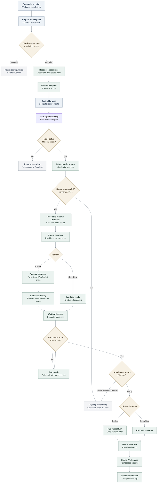

# OpenShell Sandbox provisioning flow

## Overview

Kubernetes Compute delegates dedicated Harnesses to OpenShell. Operator mode owns Namespace Workspaces; managed mode fails before mutation.
[Credential sources](credential-source-lifecycle.md) provide model access without
Agent Secret permission. Codex authenticates Gateway requests through revision-owned
provider files and OpenShell's bearer-passthrough endpoint, replacing the direct
Harness Service.

Workspace-node setup exposes a scoped bootstrap token through a revision-owned
provider file; it remains development-only.

## Entry Points

- Trigger: a worker reconciles an Agent revision that selects the OpenShell
  Sandbox Driver and Kubernetes Compute Driver.
- Source: `apps/controller/src/drivers/sandbox/openshell.ts:ensureNamespace`
- Source: `apps/controller/src/drivers/sandbox/openshell.ts:provisionHarness`
- Source: `apps/controller/src/drivers/compute/kubernetes/index.ts:prepareRevision`
- Assumptions: the Installation selected Kubernetes Compute, the OpenShell
  Sandbox, and the OpenShell Credential Gateway through one `openshell` Backend;
  the tenant Namespace and baseline isolation exist; and the Gateway is ready in
  operator workspace mode.

## Flow

## Execution Trace

### 0. Create the development control plane

`scripts/dev-up`, `internal/occdev/openshell_k3d.go:upK3d`,
`internal/occdev/openshell.go:prepareOpenShell`,
`internal/occdev/kubernetes.go:writeInstallation`

The written Installation declares the `openshell` Backend, Gateway endpoint,
Sandbox and a Credential Gateway whose `binaries` list holds native Codex for
x64 and ARM64 runtimes, whatever the launcher host. Credential-source profiles,
not Sandbox policy, govern egress.

`scripts/dev-up` validates Kubernetes/OpenShell and invokes `occ dev up`.
Compose is default; `OCC_DEVELOPMENT_CONTROL_PLANE=kubernetes` selects
Kubernetes-only. Before state creation, Kubernetes-only rejects API-port
collisions and records engine, cluster, namespace, port and key destination.
Both verify the pinned archive, package charts and import digest-pinned
Gateway/Sandbox/supervisor images. Kubernetes-only builds or selects controller/runtime images, imports them
with PostgreSQL and resolves in-cluster digests.

Both profiles import OCE images before OpenShell images and workloads, preventing
k3s garbage collection from removing idle OpenShell images during imports.

After Agent Sandbox rollout failure, `prepareOpenShell` calls
`internal/occdev/agent_sandbox_rollout_diagnostics.go:captureAgentSandboxRollout`
once before returning the original error for rollback. Synchronous capture
selects the fixed Deployment, controller-UID-linked ReplicaSets/Pods and associated Warning
reasons. It excludes messages, environment, full labels and logs, and marks
unavailable, malformed or oversized results.

Capture gets a fresh 15-second context, three-second request/command timeouts,
256 KiB/command and a 32 KiB record cap. Direct commands are awaited; 200 ms pipe
draining does not terminate arbitrary descendants. Error-output writes ignore
failures; writer latency/durability are outside the subprocess budget. Capture
neither retries nor diagnoses the failure.

After Helm, `network.providerHarness` records Gateway
ClusterIP, Pod selector and TCP/8080. The Agent Gateway aliases only the advertised hostname to that IP, preserving
HTTP Host for routing. NetworkPolicy lets it reach only those Pods/port.

Compose runs PostgreSQL, OCC and its k3d-targeting worker; Kubernetes-only uses
`oce-system` and in-cluster authentication. Both install private Envoy routing
and operator Workspaces, limiting Gateway access to API, worker, supervisor
callbacks and dedicated Agent Gateways. See
[local deployment guides](../guides/deploy/local-kubernetes-development.md).

`internal/occdev/compose_routing.go:prepareComposeRoutingFiles` sets container
ownership for private routing files; Installation files remain `0644` in private state.

Cleanup validates recorded engine/state before deleting the named cluster and
Compose project/volumes; partial cleanup retains recovery state.

### 1. Prepare the Namespace and OpenShell Workspace

`apps/controller/src/drivers/compute/kubernetes/index.ts:ensureNamespace`

Compute establishes quota, limits and baseline NetworkPolicies before
`SandboxDriver.ensureNamespace`. Managed mode rejects before Kubernetes or
Gateway use. Operator mode applies namespace labels, workspace-chart resources
and provider NetworkPolicies, then checks health; optional namespace-local
readiness comes first. Development uses the central Gateway endpoint.

`apps/controller/src/backends/openshell.ts:clientForNamespace` passes raw
endpoints, including bracketed IPv6, unchanged to the gRPC client. HTTP
origins keep port 80 explicit; HTTPS and nondefault ports retain their behavior.

The Workspace uses Compute's physical namespace name (`oce-` plus a 15-character
digest, within OpenShell's 19-character limit). The Driver reads it, creates it
if missing, or rereads after concurrent `ALREADY_EXISTS`. Adoption requires the
expected name, OCC Namespace ID label, managed-by label and active phase;
conflicts fail Namespace preparation.

### 2. Derive the provider-owned Harness request

`apps/controller/src/drivers/compute/kubernetes/index.ts:prepareRevision`

Compute derives `provisionHarness` image, command, labels, environment, mounts,
optional identity, and resources from its ordinary Deployment shape.
First deployment keeps the Agent Service inactive. Compute starts the Gateway on
fail-closed transport, waits for readiness and its Agent-owned node setup Secret,
then passes the Secret reference to the SandboxDriver. Credential attachment and
provider/Sandbox creation wait for both prerequisites.
The local OpenShell profile disables projected workload identity. If it is
enabled, OpenShell rejects the revision before Gateway mutation because the
pinned API cannot preserve the exact Agent ServiceAccount and token.
For `credential_source`, Compute renders the catalog login mode without a model
Secret and passes revision and `attachForRevision` provider names through
`requirements.credentialAttachments`.
For Codex, it reads the exact Agent transport Secret in the control plane and
adds only its SHA-256 verifier as `APP_TOKEN_SHA`. It converts the admitted plugin
snapshot into `runtime.json`/`config.toml` workload files and removes their ConfigMap
paths from the environment.

`OpenShellSandboxDriver.configureAgent` selects full access with user review and drops `appServer.networkProxy`.
`deploy/runtime/openclaw-codex-full-access-profile.patch` sends `:danger-full-access` on thread and turn requests only when the OpenShell
endpoint selects that profile. If native policy returns a constrained thread,
the Gateway fails the request before a turn. First Agent can read a
prior PAT revision frozen with `workspace-write`, warning that shell tools fail; `--replace-key` deploys one at the current policy.
OpenShell blocks nested bubblewrap user namespaces; model readiness does not
prove shell execution.

PAT bootstrap (`prepareHarnessAuth`;
`apps/controller/src/drivers/compute/kubernetes/runtime-entrypoints.ts:AGENT_RUNTIME_ENTRYPOINT`)
writes an opaque placeholder to private `auth.json`, clears the child override,
and validates native login status. Scoped [PAT routes](../reference/drivers/openshell-credential-gateway.md#source-type-catalog)
admit bootstrap and model traffic; failure keeps revisions inactive.
For API-key sources, the credential gateway derives the profile from immutable `config.base_url`,
defaulting to OpenAI `/v1`. Its shared validator rejects invalid endpoints before
[registration](credential-source-lifecycle.md#1-admit-the-registration-request).
The profile binds credentials to the full base path, including prefixes such as
`/api/v1`, followed by `/**`. `attachForRevision` rejects custom endpoints for
native OpenClaw. For Codex,
`apps/controller/src/drivers/compute/plugin-runtime.ts:codexConfigurationToml`
selects a named provider with the normalized endpoint and HTTPS Responses transport.

### 3. Validate and serialize the Sandbox

`apps/controller/src/drivers/sandbox/openshell.ts:provisionHarness`

Only dedicated Codex or OpenClaw revisions pinned to this Driver are accepted.
Kubernetes, filesystem, process and binary-scoped network policy use the
`v0.1.3-pre.2` wire contract. Landlock is required; unsupported enums, inherited
keys, old `passthrough` TLS spelling and missing executable paths fail before
launch. Readiness `timeoutMs` must be a positive safe integer. The Installation
loader names it; startup instead logs `startup-error` / `STARTUP_FAILED` before
Kubernetes calls. Duplicate names and reserved `workspace-node-enrollment` fail
before Driver construction. Rename them, retaining binaries and endpoints.

After the setup-Secret gate above, `provisionHarness` creates or adopts the
runtime provider with the final node envelope, never a placeholder. Renewal
version-fences `UpdateProvider` to `node_setup_json` only. A configured
post-create delay gives the process time to listen. Compute then rolls the
Gateway to the exposed route and waits for that Deployment before observing
workspace-node enrollment.

Dedicated Codex requires one lowercase `APP_TOKEN_SHA`, no `APP_SERVER_TOKEN`,
and two bounded plugin-free runtime inputs. Selected plugins, repository broker
configuration, malformed files, and other Secret-backed environment fail before
Gateway mutation.

The shared `oce-codex-runtime` profile backs a revision-owned provider with
read-only `runtime.json`, `config.toml`, and `node-setup.json`. The last file holds
the validated Agent-owned setup Secret’s complete expiring envelope, including
`bootstrapToken`. This development diagnostic avoids credential rewriting:
OpenClaw signs that token in its device proof.
Before renewal, the Driver requires the same endpoint and TLS fingerprint, an
expired stored envelope, a later live expiry, and unchanged runtime and CA
configuration. The Sandbox network policy limits the connection to the exact
Gateway endpoint and `/usr/local/bin/node`. Foreign ownership or other drift
fails before Sandbox creation.

The Driver mounts a revision-scoped Agent PVC subpath at
`/sandbox/.openclaw-runtime`; persistent subpaths mount below
`/sandbox/.openclaw-mounts`. It rewrites admitted `/home/node` paths beneath the
runtime home, declared as `harnessHome` for native hook credentials. Codex hook
commands trust the provider-file Gateway CA and reach the Gateway route only when
the node does: an in-cluster routing hostname or two clusters. Exact mount paths
such as `OPENCLAW_NODE_STATE_DIR` use a process-created `state` child, so atomic
writes cross neither a symlink nor a root-owned mount. Workspace, node identity, sessions, and generated images
remain separate. `/tmp` stays on the bounded ephemeral image layer.

Credential attachments must use the OCC `oce-cs-` name shape and cannot repeat
a static provider. The profile binds them to the exact native Codex executable;
a changed runtime dependency path fails the startup model probe.

Native OpenClaw uses a separate verification bridge, not a supported local
first-Agent path.

### 4. Call the versioned gateway contract

`apps/controller/src/drivers/sandbox/openshell-gateway-client.ts:createSandbox`

The client sends the Sandbox identity, spec, Workspace scope, and one of 16
`request_id` values: the revision UUID, then 15 derived IDs. After
`REQUEST_OUTCOME_UNCERTAIN`, `REQUEST_ID_PAYLOAD_MISMATCH`, or
`REQUEST_REPLAY_UNAVAILABLE`, the Driver uses the next ID only when `getSandbox`
finds nothing. Unresolved IDs do not expire; completed records expire after 24
hours. The Workspace-unique Sandbox name prevents duplicates. At 1,000 live or
unresolved records, `RESOURCE_EXHAUSTED` maps to the transient
`SANDBOX_ADMISSION_LIMIT_REACHED`: revision provisioning waits without spending
attempts, while Namespace work retries normally. Codex requires one unnamed
bearer-passthrough exposure for `APP_SERVER_PORT`. Native OpenClaw requests no
exposure and rejects any returned URL. The Driver
calls `getSandbox` first and creates only an absent Sandbox; it adopts an
existing or `ALREADY_EXISTS` Sandbox only when its Workspace, labels,
annotations, and full spec match the request and it is not deleting or stopped.
For Codex, `GetService` must also return the unnamed bearer-passthrough endpoint
on the admitted port. Workspace `sandbox:write` is the trust boundary because a
holder can replace the Sandbox.

The Backend reuses clients and retries setup. Cancellation is
checked after setup/credential preparation, so stalled initialization/file reads
remain unbounded. After dispatch, cancellation stops local gRPC; remote mutations
may continue and require recovery.

`GetService` returns the local client URL and advertised workload hostname/port.
The unnamed bearer-passthrough exposure must match the admitted app-server port.
`harnessEndpoint` returns its WebSocket origin and `/sandbox/enterprise` workspace
root. Missing, malformed or changed exposure fails closed.

`apps/controller/src/drivers/sandbox/openshell.ts:harnessStatus` probes the authenticated WebSocket handshake before
reading a held-failure document. `apps/controller/src/drivers/sandbox/openshell-service-transport.ts:serviceWebSocketHandshake`
destroys HTTP refusal responses immediately, so unfinished bodies cannot retain
connections after the probe returns.

The revision provider survives an uncertain create; revision cleanup deletes
the Sandbox first.

The runtime opens provider files at their reported absolute paths.

OpenShell's supervisor opens the node connection. Kubernetes-only uses the
in-cluster WSS route; Compose uses the Agent Gateway Service URL. In both cases,
policy binds the node executable and supervisor to the exact destination. The
supervisor relaunches an exited node and falls back to direct signaling when
process-group signaling returns `EPERM`.

### 5. Observe readiness or clean up

`apps/controller/src/drivers/compute/kubernetes/index.ts:prepareRevision`

Compute verifies revision ownership, resolves `harnessEndpoint`, and replaces
the Gateway’s fail-closed template. It projects the endpoint as `APP_SERVER_URL`,
the root as `OPENCLAW_REMOTE_WORKSPACE_ROOT`, and `codexPermissionProfile` as
`OPENCLAW_CODEX_PROVIDER_PERMISSION_PROFILE`. The owned k3d profile also gets an
exact host alias to the provider address. Compute grants Gateway egress only to the
configured provider peer and port, leaves the direct Agent Service on its
inactive selector, and omits the Compute-owned Harness route. A serving
predecessor is not rewritten during successor preparation; activation resolves
the candidate endpoint again before cutover. A provisioning Driver without
`harnessEndpoint` keeps the Kubernetes Service or private-route path and the
canonical `/home/node/workspace` root.

Compute then waits for the provider-owned Harness Pod and exact workspace node.
Missing enrollment keeps the revision inactive. The dedicated Harness wrapper
rereads the provider setup before every node retry and retains the latest valid
value while the projection is unavailable. It relaunches the workspace-node
process one second after every exit without capping attempts, so Gateway rollout
does not strand the Sandbox. Shutdown stops the retry loop.

For bound sources
Compute calls `attachmentStatus`, which reads
`GetSandboxProviderStatus`. `pending` or a missing status retries; `failed`,
`withheld`, `revoked`, or `absent` fails the revision; only `ready` for every
attachment completes preparation. On revision
shutdown, `shutdownRevisionRuntime` calls `cleanup` with the revision. The
Gateway client sends `DeleteSandbox` with the same `workspace_scope`; a missing
Sandbox is an idempotent success. Codex cleanup then verifies and deletes the
revision provider. Namespace cleanup removes the shared profile after its
runtime providers are gone.

Namespace deletion calls `cleanup` without a revision after revision resources
are gone. OpenShell verifies Workspace ownership, deletes remaining owned runtime
providers and the shared profile, sends idempotent `DeleteWorkspace`, then removes
workspace-chart resources and NetworkPolicies in reverse order. A terminating
Workspace remains retryable after a lost response. Compute deletes the Kubernetes
namespace only after this cleanup succeeds.

## Debugging and verification

See [OpenShell tests](../testing/openshell.md) for prerequisites and proof coverage.
In Compose, `network.providerHarness.address` must match the `openshell-gateway`
ClusterIP and the Agent Gateway must use `ws://*.openshell.localhost:8080/`.

## Related docs

- [OpenShell Sandbox Driver](../reference/drivers/openshell-sandbox.md) and [OpenShell Credential Gateway](../reference/drivers/openshell-credential-gateway.md)
- [Credential source lifecycle](credential-source-lifecycle.md)
- [OpenShell tests](../testing/openshell.md)
- [Kubernetes Compute Driver](../reference/drivers/kubernetes-compute.md)
- [Harness execution topology](harness-execution-topology.md)

## Manual Notes

[keep this for the user to add notes. do not change between edits]

## Changelog

- 2026-10-15 08:47: Select explicit Codex permissions. (authoring-run/7eb24321-3670-4154-adde-41a0f1b36728 - 04514330688378316bd0641b8d5560da56aeff85)

- 2026-10-15 02:25: Distinguish API-key and PAT isolation. (authoring-run/c11897e0-33a6-4276-b620-aaec6d57ab00 - 07eb950b5)

- 2026-10-14 14:04: Scope PAT authentication and OpenShell prerequisites. (authoring-run/dba0a6cb-33d9-40fd-b38b-e20cddf4b75f - 96a2b79fa)

- 2026-10-14 20:27: Release refused WebSocket probes. (authoring-run/01a10a81-070c-7aa3-97d0-fbce8f285d4d - 4727e9b109a2127150e03e39e859d45e0668f82f)

- 2026-10-13 14:11: Reconcile setup-Secret ordering and preserve service-IPv6 history alongside credential endpoint safeguards. (agent:roboclaw:dashboard:9d0532e1-befb-4fc3-935e-7cd2a0c72110 - 90268463bbd255c3c13a0e0bdeb437728189eb1a)

- 2026-10-13 13:57: Reconciled development image import order with upstream rollout diagnostics. (authoring-run/503e74ea-e82a-4d1a-8081-fcf4fc4e6868 - 96272fa0a5e4f359ed354abb1918e44986c19e76)

- 2026-10-10 13:04: Reconcile native hook HOME/CA flow with endpoint safeguards; trim repeated narration. (agent:roboclaw:dashboard:9d0532e1-befb-4fc3-935e-7cd2a0c72110 - 90268463bbd255c3c13a0e0bdeb437728189eb1a)

- 2026-10-10 12:40: Declare the Sandbox HOME for native hook credentials; hooks trust the file-delivered Gateway CA. (fix-1017)

- 2026-10-09 23:18: Accept bracketed IPv6 endpoints. (authoring-run/6eefb93e-33fb-450a-9657-51ebe15a686e - 21f34928437fb7d6f4391ba4af5d3e15bf9ce480)

- 2026-10-09 20:27: Integrate main lifecycle, native workspace and readiness contracts without dropping endpoint safeguards. (agent:roboclaw:dashboard:9d0532e1-befb-4fc3-935e-7cd2a0c72110 - 90268463bbd255c3c13a0e0bdeb437728189eb1a)

- 2026-10-09 19:45: Cover both runtime architectures in the development credential policy. (authoring-run/1e7118f7-bdb0-4564-894c-02f990f75e67 - bd540bcdef63cdc719e73192e4dbe99c365953c3)

- 2026-10-09 15:30: Record bounded Agent Sandbox failure metadata before the original error returns and rollback proceeds; tighten setup prose. (authoring-run/54f8d1c2-fb6e-4074-999f-5185af50a86f - 8bfec22f49b207c16afce21bd9a941ee0e9cd95d)

- 2026-10-06 22:10: Preserve HTTP port 80 when creating the OpenShell gRPC target. (authoring-run/88f2e095-3f3a-4d9b-a878-663034cdde6e - 2fc8320cf8bfbf9d7ea20757ef3fe32d7157e6aa)

- 2026-10-06 15:57: Recorded the development image-import order that keeps pinned OpenShell images available until their workloads start. (authoring-run/473c1419-a5a2-4774-ac8d-33d6a265ae06 - 99641a7ab00ad8fdd987e27e9ee838814e5f535a)

- 2026-10-06 11:17: Reconciled endpoint flow with current namespace and provider provisioning; condensed repeated prose. (agent:roboclaw:dashboard:9d0532e1-befb-4fc3-935e-7cd2a0c72110 - b6dc6b87a461ad33374e133d15cc739d8e074fea)

- 2026-10-05 16:17: Documented version-fenced workspace-node setup renewal through the revision provider and supervisor refresh. (authoring-run/4f3e6ccd-a967-48c8-9d5d-f29a6d338d7d - fd9a082e2587432bde6282748a82e3025a64fd1a)

- 2026-10-05 11:36: Trace pre-registration endpoint validation and condense repeated setup and runtime details. (agent:roboclaw:dashboard:9d0532e1-befb-4fc3-935e-7cd2a0c72110 - 9958ef0412565864efba7b13995536d7c2a51d22)

- 2026-10-05 00:06: Bind immutable credential-source endpoints to provider profiles and Codex runtime configuration while retaining existing default endpoint limits for other consumers. (authoring-run/4e4824a1-f107-44c2-90bf-00fe13ff650c - d269c6d03)

- 2026-10-05 12:50: Removed repeated setup and wire-contract detail while preserving the current OpenShell provisioning sequence and moved older entries to the history page. (authoring-run/fd7f6cdb-1d1d-40d5-8d4a-d6d80cd946e7 - 4b5afe0cb653f7dd99fccdb2e3432cbf60e6a03e)

- 2026-10-02 16:26: Passed OpenShell's provider-local workspace root to the dedicated Gateway while preserving the canonical Kubernetes Harness root. (authoring-run/3bf937d5-c422-419e-af2d-754abe024ca4 - 987c8c2b4ace1e152262ef6920b6d0f9ff26a086)

[OpenShell Sandbox provisioning documentation history](openshell-sandbox-provisioning/history.md) preserves the older dated entries.
