# OpenShell Sandbox provisioning flow

## Overview

Kubernetes Compute delegates dedicated Codex/OpenClaw to OpenShell. Operator mode
owns Namespace Workspaces; managed mode fails before mutation.
[Credential sources](credential-source-lifecycle.md) provide model access without
Agent Secret permission. Agent revision files and bearer passthrough authenticate Codex Gateway requests
without a Harness Service.

Development workspace-node setup uses a scoped token in its provider file.

## Entry Points

- Trigger: a worker reconciles an Agent revision that selects the OpenShell
  Sandbox Driver and Kubernetes Compute Driver.
- Source: `apps/controller/src/drivers/sandbox/openshell.ts:ensureNamespace`
- Source: `apps/controller/src/drivers/sandbox/openshell.ts:provisionHarness`
- Source: `apps/controller/src/drivers/compute/kubernetes/index.ts:prepareRevision`
- Assumptions: the Installation selects Kubernetes Compute, OpenShell Sandbox
  and Credential Gateway through one `openshell` Backend; Namespace isolation
  exists; the Gateway is ready in operator mode.

## Flow

```mermaid
graph TD
  A["<b>Reconcile Agent revision</b><br/>Worker selects Drivers"] --> B["<b>Prepare Namespace</b><br/>Kubernetes isolation"]
  B --> C{"<b>Workspace mode</b><br/>Installation setting"}
  C -- "managed" --> X["<b>Reject configuration</b><br/>Before mutation"]
  C -- "operator" --> D["<b>Reconcile resources</b><br/>Labels and workspace chart"]
  D --> E["<b>Own Workspace</b><br/>Create or adopt"]
  E --> F["<b>Derive Harness</b><br/>Compute requirements"]
  F --> K0["<b>Start Agent Gateway</b><br/>Fail-closed transport"]
  K0 --> Y0{"<b>Node setup</b><br/>Material exists?"}
  Y0 -- "no" --> R0["<b>Retry preparation</b><br/>No provider or Sandbox"]
  Y0 -- "yes" --> Q["<b>Attach model source</b><br/>Credential provider"]
  Q --> G{"<b>Harness inputs valid?</b><br/>Provider files"}
  G -- "no" --> R["<b>Reject provisioning</b><br/>Candidate stays inactive"]
  G -- "yes" --> W["<b>Reconcile runtime provider</b><br/>Files and literal setup"]
  W --> W0{"<b>Native OpenClaw?</b>"}
  W0 -- "yes" --> W1["<b>Prepare writable subpaths</b><br/>Private ownership; retain entries"]
  W1 --> W2["<b>Stop preparer</b><br/>Deployment and Pods gone"]
  W2 --> H["<b>Create Sandbox</b><br/>Providers and exposure"]
  W0 -- "no" --> H
  H --> I["<b>Initialize workspace</b><br/>Private ExecSandbox stdin"]
  I --> V{"<b>Harness</b>"}
  V -- "Codex" --> J["<b>Resolve exposure</b><br/>Advertised WebSocket origin"]
  J --> K["<b>Replace Gateway</b><br/>Provider route and bearer token"]
  K --> M["<b>Wait for Harness</b><br/>Compute readiness"]
  V -- "OpenClaw" --> T["<b>Sandbox ready</b><br/>No inbound exposure"]
  T --> M
  M --> Y{"<b>Workspace node</b><br/>Connected?"}
  Y -- "no" --> R1["<b>Retry node</b><br/>Relaunch after process exit"]
  R1 --> Y
  Y -- "yes" --> S{"<b>Attachment status</b><br/>All ready?"}
  S -- "failed, withheld, revoked" --> R
  S -- "ready" --> Z{"<b>Active Harness</b>"}
  Z -- "Codex" --> L["<b>Run model turn</b><br/>Gateway to Codex"]
  Z -- "OpenClaw" --> U["<b>Run native turn</b>"]
  L --> N["<b>Delete Sandbox</b><br/>Version cleanup"]
  U --> N
  N --> O["<b>Delete Workspace</b><br/>Namespace cleanup"]
  O --> P["<b>Delete Namespace</b><br/>Compute cleanup"]

  classDef state fill:#EDF2F7,stroke:#879AB0,color:#25364A,stroke-width:1px
  classDef operation fill:#EBF3F0,stroke:#7F9D93,color:#2B4038,stroke-width:1px
  classDef gate fill:#F7F1E5,stroke:#B3A078,color:#514532,stroke-width:1px
  classDef blocked fill:#F3F4F6,stroke:#98A2AE,color:#44505F,stroke-width:1px
  class A,B,F state
  class D,E,I,Q,W,W1,W2,H,J,K,L,M,N,O,P,R1,T,U operation
  class C,G,S,V,Y,Y0,Z,W0 gate
  class X,R,R0 blocked
  linkStyle default stroke:#8B949E,stroke-width:1px
```

## Execution Trace

### 0. Create the development control plane

`scripts/dev-up`, `internal/occdev/openshell_k3d.go:upK3d`,
`internal/occdev/openshell.go:prepareOpenShell`,
`internal/occdev/kubernetes.go:writeInstallation`

`openshell` profiles support Node and x64/ARM64 Codex on any launcher architecture
and require Landlock.

`scripts/dev-up` validates Kubernetes/OpenShell and invokes `occ dev up`.
Compose is default; `OCC_DEVELOPMENT_CONTROL_PLANE=kubernetes` selects Kubernetes-only.
Before state creation, Kubernetes-only rejects API-port collisions and records
engine, cluster, namespace, port and key destination. Both verify archives,
package charts and import digest-pinned OpenShell images. Kubernetes-only
builds/selects OCE images, imports PostgreSQL and resolves cluster digests.

Both import OCE images first, preventing k3s garbage collection of idle OpenShell images.

After Agent Sandbox rollout failure, `prepareOpenShell` invokes
`internal/occdev/agent_sandbox_rollout_diagnostics.go:captureAgentSandboxRollout`
once, preserving the original error for rollback. It records Deployment,
UID-linked ReplicaSets/Pods and Warning reasons without messages, environment,
full labels or logs; unavailable, malformed or oversized results are marked.
Limits: fresh 15-second context, three seconds and 256 KiB/command, 32 KiB/record.
Commands are awaited; 200 ms pipe draining cannot terminate descendants.
Output failures are ignored. The writer has no timeout or persistence guarantee. Capture never retries.

`network.providerHarness` records Gateway ClusterIP, Pod selector and TCP/8080.
Agent Gateways alias only the advertised hostname, preserving HTTP Host;
NetworkPolicy permits only those Pods/port.
Compose runs PostgreSQL and OCC with a k3d-targeting worker; Kubernetes-only uses
`oce-system` and in-cluster authentication. Both install private Envoy routing
and operator Workspaces, restricting Gateway access to API, worker, supervisor
callbacks and dedicated Agent Gateways. See [local deployment guides](../guides/deploy/local-kubernetes-development.md).

`internal/occdev/sandbox_network_policy.go:loadSandboxNetworkPolicies` runs
Driver validation before provisioning (policy file maximum 1 MiB). Persisted rules
augment generated Installation rules; see [startup network policy](../guides/deploy/local-sandbox-network-policy.md).

`internal/occdev/compose_routing.go:prepareComposeRoutingFiles` sets container
ownership for private routing files; Installation files remain `0644` in private state.

Cleanup validates ownership, deletes cluster/project/volumes, and retains partial-failure recovery state.

### 1. Prepare the Namespace and OpenShell Workspace

`apps/controller/src/drivers/compute/kubernetes/index.ts:ensureNamespace`

Compute establishes quota, limits and baseline NetworkPolicies before
`SandboxDriver.ensureNamespace`. Managed mode rejects before Kubernetes/Gateway
use. Operator mode checks optional local readiness, applies namespace labels,
workspace resources and provider NetworkPolicies, then checks health.
Development uses the central Gateway.

`apps/controller/src/backends/openshell.ts:clientForNamespace` passes raw
endpoints, including bracketed IPv6, unchanged to the gRPC client. HTTP
origins keep port 80 explicit; HTTPS and nondefault ports retain their behavior.

The Workspace uses Compute's physical namespace name: `oce-` plus a 15-character
digest fits OpenShell's 19-character limit. The Driver creates it if absent and
rereads after `ALREADY_EXISTS`. Adoption requires exact name, OCC Namespace ID and
managed-by labels, and active phase; conflicts fail preparation.

### 2. Derive the provider-owned Harness request

`apps/controller/src/drivers/compute/kubernetes/index.ts:prepareRevision`

Compute derives `provisionHarness` requirements from its ordinary Deployment.
First deployment keeps the Agent Service inactive and Gateway transport fail-closed.
Attachment and provider/Sandbox creation await Gateway readiness and its Agent-owned
setup Secret, passed by reference. The local profile disables projected identity;
when enabled, OpenShell rejects before Gateway mutation because its pinned API
cannot preserve the exact Agent ServiceAccount/token.

For `credential_source`, Compute renders the catalog login mode without a model
Secret and passes version and `attachForRevision` provider names through
`requirements.credentialAttachments`. For `chatgptAuthTokens`, OpenShell omits
static `CODEX_ACCESS_TOKEN`, retaining account metadata. Codex receives only `APP_TOKEN_SHA` from its exact Agent transport
Secret. Compute converts the admitted plugin snapshot into `runtime.json` and
`config.toml` workload files, removing their ConfigMap environment paths.

`OpenShellSandboxDriver.configureAgent` sets full access/user review for all
login modes and removes `appServer.networkProxy`.
`deploy/runtime/openclaw-codex-full-access-profile.patch` sends the endpoint's
`:danger-full-access` profile for threads/turns; constrained threads fail
before a turn. First Agent warns: prior PAT `workspace-write` versions break
shell tools; `--replace-key` deploys current policy.
OpenShell blocks nested bubblewrap; model readiness does not prove shell execution.

PAT bootstrap (`prepareHarnessAuth`;
`apps/controller/src/drivers/compute/kubernetes/runtime-entrypoints.ts:AGENT_RUNTIME_ENTRYPOINT`)
writes an opaque placeholder to private `auth.json`, clears the child override,
and validates native login status. Scoped [PAT routes](../reference/drivers/openshell-credential-gateway.md#source-type-catalog)
admit bootstrap/model traffic; failure keeps versions inactive.
API-key profiles bind immutable `config.base_url` plus `/**` (default OpenAI `/v1`),
preserving prefixes including `/api/v1`. [Registration validation](credential-source-lifecycle.md#1-admit-the-registration-request)
rejects invalid endpoints.
`attachForRevision` rejects custom endpoints for native OpenClaw. For Codex,
`apps/controller/src/drivers/compute/plugin-runtime.ts:codexConfigurationToml`
selects a named provider and HTTPS Responses transport.

### 3. Validate and serialize the Sandbox

`apps/controller/src/drivers/sandbox/openshell.ts:provisionHarness`

Only dedicated Codex or OpenClaw versions pinned to this Driver qualify.
Kubernetes, filesystem, process and binary-scoped network policy use the
`v0.1.5` wire contract. `environment` preserves opaque
`OCE_CODEX_CHATGPT_ACCOUNT` JSON during path relocation. Landlock is required; unsupported enums, inherited
keys, old `passthrough` TLS spelling and missing executable paths fail before
launch. Readiness `timeoutMs` requires a positive safe integer. Configuration errors
prevent Kubernetes calls. Duplicate names and
`workspace-node-enrollment` prevent Driver construction.
The template includes the Harness Pod labels. The Gateway rejects the request if
any label key is missing from `allowed_pod_labels`.

`provisionHarness` creates or adopts the provider with final setup. Renewal checks the provider version and updates only `node_setup_json` through `UpdateProvider`. For Codex, a configured post-create delay of at most 120 seconds precedes route exposure. Compute rolls the Gateway before checking enrollment.

Dedicated Codex requires one lowercase `APP_TOKEN_SHA` and two runtime files
without plugins, each at most 65,536 bytes. `APP_SERVER_TOKEN` is forbidden. Selected plugins, repository broker
configuration, malformed files, and other Secret-backed environment fail before
Gateway mutation.

Providers use `oce-codex-runtime` or `oce-openclaw-runtime`. Both supply read-only setup and Gateway CA files; Codex requires `runtime.json` and `config.toml`, which native OpenClaw refuses. The validated setup Secret's complete expiring envelope, including `bootstrapToken`, becomes `node-setup.json`. WebSocket rewriting is unsupported: OpenClaw signs the literal token in its device proof.
Renewal requires the same endpoint, TLS fingerprint, runtime, and CA configuration.
Renewal requires an expired stored envelope and a later live expiry. The Sandbox network policy limits the connection to the exact
Gateway endpoint and `/usr/local/bin/node`. Foreign ownership or drift prevents Sandbox creation.

The Driver mounts version state at `/sandbox/.openclaw-runtime` and persistent
subpaths below `/sandbox/.openclaw-mounts`. Admitted `/home/node` paths move under
runtime `harnessHome` for native hook credentials. Codex
hooks trust the provider-file Gateway CA and require node-reachable routing.
`OPENCLAW_NODE_STATE_DIR` uses a process-created `state` child to avoid atomic
replacement through symlinks/root-owned mounts. Workspace, node identity, sessions
and images stay separate. The supervisor probes `/tmp`; native `TMPDIR` is a
private `tmp` child under the runtime home.

`prepareNativeWorkspace` uses a restricted Deployment for the Agent revision to privatize
writable PVC subpaths, preserving retained entries. Mode and process ownership checks precede
UID-fenced foreground deletion and writer Pod termination.
Preparation requires `userNamespaces: false` and the pinned Gateway's default
identity, without model credentials, ServiceAccount tokens, capabilities, or direct
Pod creation.

Document delivery is separate from native subpath preparation.
After Sandbox readiness, `initializeWorkspace` checks the private setup Secret's
Namespace, Agent and setup identity, then sends the shared initializer and JSON
stdin through authenticated `ExecSandbox`. A workspace `flock` serializes attempts;
the Harness waits for its completion marker. See [workspace initialization](workspace-files.md#2-deployment-initializes-storage-before-execution).

Credential attachments require OCC `oce-cs-` names without static-provider duplicates.
Model profiles bind access to the selected Codex/Node executable. Production
qualification is incomplete.

### 4. Call the versioned gateway contract

`apps/controller/src/drivers/sandbox/openshell-gateway-client.ts:createSandbox`

The client sends Sandbox identity/spec, Workspace scope, and one of 16
`request_id` values: Agent revision UUID, then 15 derived IDs. After `REQUEST_OUTCOME_UNCERTAIN`,
`REQUEST_ID_PAYLOAD_MISMATCH` or `REQUEST_REPLAY_UNAVAILABLE` it advances once
`getSandbox` finds nothing. Unresolved IDs never expire; completed records do
after 24 hours. Names are Workspace-unique. At 1,000 live/unresolved
records, `RESOURCE_EXHAUSTED` becomes transient `SANDBOX_ADMISSION_LIMIT_REACHED`:
Preparation waits without spending attempts until its convergence
deadline; Namespace work retries. Each Harness takes one unnamed
bearer-passthrough `APP_SERVER_PORT` exposure (Codex transport, native held
failure); only Codex returns a URL. The Driver reads first. It adopts an existing or `ALREADY_EXISTS` Sandbox only
when Workspace, labels, annotations, and spec match exactly and it is neither stopped nor deleting. Workspace `sandbox:write` permits replacement and
bounds trust. Native exposure ends once a post-enrollment pass confirms its
delete, by `withdrawHarnessExposure`, adoption or recreation with
`workspaceNodeEnrolled`.

The Backend reuses clients, retrying setup. Cancellation is checked after
setup/credential preparation; stalled initialization/file reads have no cancellation deadline. After dispatch, cancellation stops local gRPC; remote mutations
may continue, requiring recovery.

`GetService` separates control URL and advertised workload host/port.
`harnessEndpoint` returns WebSocket origin and configured
`sandboxDataMount.mountPath` (default `/sandbox/enterprise`). Native hooks
use `harnessHome`, mode `0700`. Invalid or changed exposure fails closed.

`apps/controller/src/drivers/sandbox/openshell.ts:harnessStatus` probes the
authenticated WebSocket handshake before reading a held-failure document;
unanswered reads are transient `SANDBOX_GATEWAY_UNAVAILABLE`.
`apps/controller/src/drivers/sandbox/openshell-service-transport.ts:serviceWebSocketHandshake`
destroys HTTP refusals at once, releasing their connections.

Provider files use reported absolute paths. Gateway failure blocks readiness.
Providers survive uncertain creates; cleanup deletes their Sandbox first.

The OpenShell supervisor connects through in-cluster WSS on Kubernetes or the
Agent Gateway Service URL on Compose. Policy binds the executable/supervisor to
that destination. On process-group `EPERM`, the supervisor signals the process directly.

### 5. Observe readiness or clean up

`apps/controller/src/drivers/compute/kubernetes/index.ts:prepareRevision`

Compute checks the deployment's Namespace, Agent, ServicePrincipal, and Agent revision IDs. For Codex, `harnessEndpoint` replaces
fail-closed transport with `APP_SERVER_URL`, `OPENCLAW_REMOTE_WORKSPACE_ROOT` and
`OPENCLAW_CODEX_PROVIDER_PERMISSION_PROFILE`; owned k3d pins the provider host
alias. `gatewayConfigurationDocument` keeps Gateway workspace `/home/node/workspace`;
the bridge maps it to the Sandbox root without mounting Harness storage.
`gatewayNativeHookRelayConfiguration` derives private storage from `harnessHome`;
Compute owns relay URL/auth. Egress admits only the provider peer/port; the direct
Agent Service stays inactive and Compute omits its Harness route. Preparation
preserves a serving predecessor; activation resolves the candidate again. Without
`harnessEndpoint`, Codex retains Kubernetes transport and `/home/node/workspace`.
Native OpenClaw enrolls outbound into its admitted workspace.

Compute awaits the Harness Pod and the Secret's enrolled node.
Missing enrollment prevents activation. The Codex supervisor
rereads the provider setup before every node retry, keeping the latest valid
value while the projection is unavailable. It relaunches the workspace-node
process one second after every exit, uncapped, so Gateway rollout does not
strand the Sandbox. Shutdown stops retries.

Compute checks sources through `attachmentStatus`/`GetSandboxProviderStatus`:
`pending` or missing status retries; `failed`, `withheld`, `revoked` or `absent`
fails preparation. Shutdown calls `cleanup` for the version: `GetSandbox`, then
`DeleteSandbox` (absence needs `GetWorkspace` and a second `GetSandbox`), then
deletes the runtime provider. `cleanupNativeWorkspace` retires
interrupted preparers without a Sandbox, refusing foreign/replaced resources. Namespace cleanup
removes unused runtime profiles.

After retirement, Namespace `cleanup` verifies Workspace ownership, removes
owned providers/profile, sends idempotent `DeleteWorkspace`, then removes chart
resources/NetworkPolicies in reverse order. Terminating Workspaces retry after
lost responses. Compute deletes the Kubernetes namespace only after cleanup succeeds.

## Debugging and verification

The [testing guide](../testing/openshell.md) defines prerequisites and proof. Compose
needs the provider ClusterIP, advertised `ws://*.openshell.localhost:8080/`
route, and inactive direct Service. Native model execution requires real runtime
proof on a Landlock-capable host; Console admission and initialized files are insufficient.

## Related docs

- [Agent Sandbox policy admission and live application](agent-sandbox-policy.md)

- [OpenShell Sandbox Driver](../reference/drivers/openshell-sandbox.md) and [OpenShell Credential Gateway](../reference/drivers/openshell-credential-gateway.md)
- [Credential source lifecycle](credential-source-lifecycle.md)
- [OpenShell tests](../testing/openshell.md)
- [Kubernetes Compute Driver](../reference/drivers/kubernetes-compute.md)
- [Harness execution topology](harness-execution-topology.md)

## Manual Notes

[keep this for the user to add notes. do not change between edits]

## Changelog

- 2026-10-20 21:45: Pin OpenShell v0.1.5 and admit Harness template labels at the Gateway. (authoring-run/016ma8eD5SYoBTV5kswEV3Dn - bca5b199b)

- 2026-10-19 09:48: Preserve main and policy traces; condense prose. (authoring-run/545665b0-3aef-44dc-beb8-492b753b1a13 - bc3ba215dd9927692bc2882ffaf06a35c27fed4a)

- 2026-10-16 01:36: Integrate credential-independent Codex permissions while preserving external OAuth and private relay delivery. (authoring-run/3cfe533a-7ff7-4f25-ba91-7a0fc8bc35b6 - 5af46154157b7da222e2dd9839fd1bcb741c3056)

- 2026-10-15 23:19: Normalize Helm `appVersion` labels. (01a11d95-ebef-76e1-b9b9-9d3d2e88e99e - 5e5473f0631a4eb17c4497795a4dd850d244de4c)

- 2026-10-15 22:26: Reconcile current main behavior with OpenShell OAuth contracts in the accompanying merge. (authoring-run/41e4bb7a-c8eb-4332-b1f9-07fb8e234f63 - b747cf5b6402ad36ce9f1ae6dbed08928ddcf3dc)

- 2026-10-15 18:17: Pin OpenShell v0.1.4. (authoring-run/openshell-014-rebase-20261015 - 64a3424a9)
- 2026-10-14: Merge current contracts with native provisioning and retained-workspace preparation. (Codex/01a13654-be66-7741-b54f-f8ae80f2d496)
- 2026-10-15 08:47: Select explicit Codex permissions. (authoring-run/7eb24321-3670-4154-adde-41a0f1b36728 - 04514330688378316bd0641b8d5560da56aeff85)

- 2026-10-15 02:25: Distinguish API-key and PAT isolation. (authoring-run/c11897e0-33a6-4276-b620-aaec6d57ab00 - 07eb950b5)

- 2026-10-14 14:04: Scope PAT authentication and OpenShell prerequisites. (authoring-run/dba0a6cb-33d9-40fd-b38b-e20cddf4b75f - 96a2b79fa)

- 2026-10-14 22:33: Exclude static Codex aliases. (authoring-run/32c91236-108c-48b8-9a06-9747c1d2d90c - f3a4d896bb51cd0d8e62bcdb29a69645b1c850dc)
- 2026-10-15 16:14: Link frozen Agent policy admission and later live application. (authoring-run/43cb74b9-e1fe-4fc2-adde-9d932b061d7c - a28596ab8)

- 2026-10-14 14:52: Validate and snapshot startup Sandbox network policy overrides through the Driver. (authoring-run/5e9763cf-c7fd-4990-94ac-6bc267d0287a - a28596ab8cf5e028a5eb91c276feb19a3775554c)

- 2026-10-14 20:27: Release refused WebSocket probes. (authoring-run/01a10a81-070c-7aa3-97d0-fbce8f285d4d - 4727e9b109a2127150e03e39e859d45e0668f82f)

- 2026-10-14 01:11: Reconcile endpoint validation and provider ownership with external OAuth custody in the accompanying merge. (01a11d95-ebef-76e1-b9b9-9d3d2e88e99e - c5fb4880ebf2df2aedae12f99adb1992a930ba1b)

- 2026-10-13 14:11: Reconcile setup-Secret ordering and preserve service-IPv6 history alongside credential endpoint safeguards. (agent:roboclaw:dashboard:9d0532e1-befb-4fc3-935e-7cd2a0c72110 - 90268463bbd255c3c13a0e0bdeb437728189eb1a)

- 2026-10-13 13:57: Reconciled development image import order with upstream rollout diagnostics. (authoring-run/503e74ea-e82a-4d1a-8081-fcf4fc4e6868 - 96272fa0a5e4f359ed354abb1918e44986c19e76)

- 2026-10-10 13:04: Reconcile native hook HOME/CA flow with endpoint safeguards; trim repeated narration. (agent:roboclaw:dashboard:9d0532e1-befb-4fc3-935e-7cd2a0c72110 - 90268463bbd255c3c13a0e0bdeb437728189eb1a)

- 2026-10-13 18:22: Preserve opaque account metadata during Sandbox environment relocation. (authoring-run/a67c01b5-f0f7-434b-8183-d2dcc6941836 - 7c25b823f17e93f62d7ba8abea23e65df4b36fef)

- 2026-10-13 09:37: Reconcile current admission and lifecycle behavior with external OAuth custody in the accompanying merge. (authoring-run/fd902939-ed58-4508-8d33-95a863d966af - e8d39978d801e7a5a8ac7242f32035f426da94e1)

- 2026-10-10 12:40: Declare the Sandbox HOME for native hook credentials; hooks trust the file-delivered Gateway CA. (fix-1017)

- 2026-10-09 12:22: Pass the Sandbox-owned private native hook credential directory to the Gateway launcher. (authoring-run/8e337823-5cdf-4dbb-bdac-e9c51a5051b9 - 635244e85c443a4408c92730b508601bbb20f2cd)

- 2026-10-09 23:18: Accept bracketed IPv6 endpoints. (authoring-run/6eefb93e-33fb-450a-9657-51ebe15a686e - 21f34928437fb7d6f4391ba4af5d3e15bf9ce480)

- 2026-10-09 20:27: Integrate main lifecycle, native workspace and readiness contracts without dropping endpoint safeguards. (agent:roboclaw:dashboard:9d0532e1-befb-4fc3-935e-7cd2a0c72110 - 90268463bbd255c3c13a0e0bdeb437728189eb1a)

- 2026-10-09 19:45: Cover both runtime architectures in the development credential policy. (authoring-run/1e7118f7-bdb0-4564-894c-02f990f75e67 - bd540bcdef63cdc719e73192e4dbe99c365953c3)

- 2026-10-09 15:30: Record bounded Agent Sandbox failure metadata before the original error returns and rollback proceeds; tighten setup prose. (authoring-run/54f8d1c2-fb6e-4074-999f-5185af50a86f - 8bfec22f49b207c16afce21bd9a941ee0e9cd95d)

- 2026-10-13 16:45: Reconcile native private temporary state and retained writable-subpath preparation. (Codex/01a13654-be66-7741-b54f-f8ae80f2d496 - ff12fc86cd1662c98a9d8db78be9c2fa4facdcdd)

- 2026-10-08: Document normal native OpenClaw provider delivery and private Compute workspace initialization; retain experimental qualification limits. (Codex/01a0e8ec-d02f-7b93-a59b-5b7fccf2ebaa)

- 2026-10-06 22:10: Preserve HTTP port 80 when creating the OpenShell gRPC target. (authoring-run/88f2e095-3f3a-4d9b-a878-663034cdde6e - 2fc8320cf8bfbf9d7ea20757ef3fe32d7157e6aa)

- 2026-10-06 15:57: Recorded the development image-import order that keeps pinned OpenShell images available until their workloads start. (authoring-run/473c1419-a5a2-4774-ac8d-33d6a265ae06 - 99641a7ab00ad8fdd987e27e9ee838814e5f535a)

- 2026-10-06 11:17: Reconciled endpoint flow with current namespace and provider provisioning; condensed repeated prose. (agent:roboclaw:dashboard:9d0532e1-befb-4fc3-935e-7cd2a0c72110 - b6dc6b87a461ad33374e133d15cc739d8e074fea)

- 2026-10-05 16:17: Documented version-fenced workspace-node setup renewal through the revision provider and supervisor refresh. (authoring-run/4f3e6ccd-a967-48c8-9d5d-f29a6d338d7d - fd9a082e2587432bde6282748a82e3025a64fd1a)

- 2026-10-02 16:26: Passed OpenShell's provider-local workspace root to the dedicated Gateway while preserving the canonical Kubernetes Harness root. (authoring-run/3bf937d5-c422-419e-af2d-754abe024ca4 - 987c8c2b4ace1e152262ef6920b6d0f9ff26a086)

[OpenShell Sandbox provisioning documentation history](openshell-sandbox-provisioning/history.md) preserves the older dated entries.
